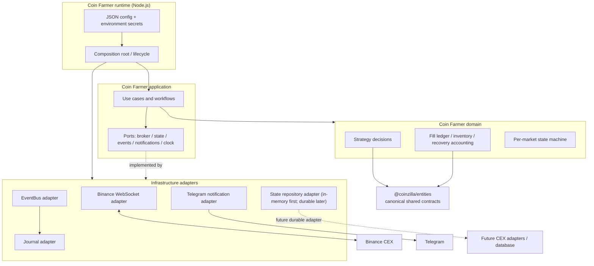
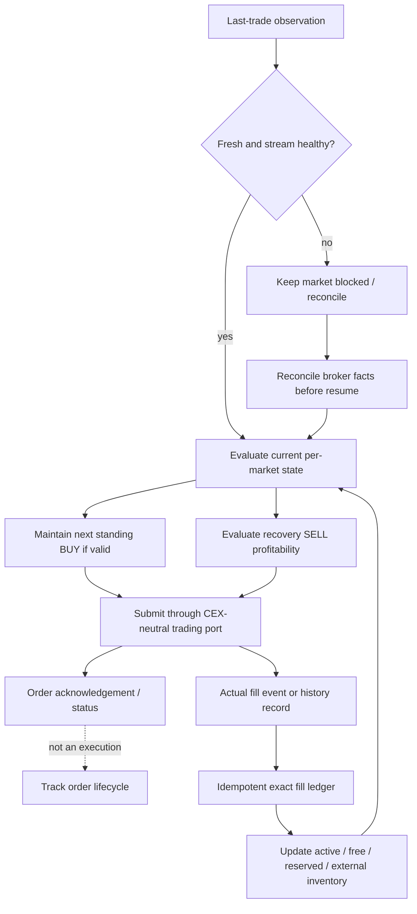

# Coinzilla — Coin Farmer

**Path:** `apps/bot-coin-farmer`  
**Runtime:** Node.js `>=22.23.4`  
**Language:** JavaScript (ES modules)  
**Configuration:** JSON + environment secrets  
**Status:** Architecture and implementation roadmap; application code has not started

Coin Farmer is a CEX-agnostic cryptocurrency spot-trading application. Its initial strategy is a **fill-driven accumulation and capital-recovery strategy** informed by the existing Free-Roll specification. **It is not a grid bot.** It does not define a ladder of independent grid levels or trade each level as an isolated grid cycle. Instead, it coordinates a market's active position, standing BUY, recovery SELL, actual fees, recovery target and permanently retained free inventory as one strategy state.

The first concrete exchange adapter will use the existing Binance WebSocket implementation in `@coinzilla/brokers`. The first notification adapter will use the existing Telegram implementation in `@coinzilla/notifiers`. Neither integration is allowed to leak into strategy policy.

## Start here

| Document | What it answers |
|---|---|
| [Architecture](./docs/architecture/COIN_FARMER_ARCHITECTURE.md) | How the application is divided and how components depend on each other |
| [Module catalog](./docs/architecture/MODULE_CATALOG.md) | Proposed folders/files, responsibility, dependencies, inputs and outputs |
| [Workflows](./docs/architecture/WORKFLOWS.md) | Startup, market tick, BUY, SELL, fill, recovery, notification and shutdown sequences |
| [Implementation roadmap](./ROADMAP.md) | Ordered delivery phases, PR-sized tasks, dependencies and acceptance gates |
| [V1 behavior map](./docs/architecture/V1_TO_V2_BEHAVIOR_PLAN.md) | Which V1 strategy behavior is the starting point and what needs explicit review |
| [Architecture diagrams](./docs/architecture/README.md#diagrams) | Editable Mermaid source and rendered diagrams |

## Application context

- **V1 reference:** [`apps/bot-free-roll`](../bot-free-roll/README.md) remains unchanged by CF work. Its [strategy specification](../bot-free-roll/README.md), [engineering roadmap](../bot-free-roll/ROADMAP.md), [current-state audit](../bot-free-roll/CURRENT_STATE.md), and [shared-entity audit](../bot-free-roll/DOMAIN_ENTITY_AUDIT.md) are the initial evidence base.
- **CF implementation:** this app owns its source, configuration, tests, runtime, state and release gates. It must not import V1 application code or use V1 runtime state.
- **Shared packages:** CF should reuse reviewed public Coinzilla contracts rather than create duplicate Money, Quantity, Market, Fill or Order models.
- **No live-trading claim:** documentation and a future skeleton do not make the app safe for real funds. Live trading requires the release gates in [ROADMAP.md](./ROADMAP.md).

## What the strategy does

At a high level, for each configured market independently:

1. Read the **last traded price** and the market's current trading rules.
2. Calculate the next BUY limit from the initial reference price or last qualifying BUY price using the configured percentage step.
3. Keep the intended BUY order resting while the market/order state permits.
4. Track actual executions and commissions per fill. An order acknowledgement is not a fill.
5. After a qualifying BUY completes, reconcile/cancel any old recovery SELL before calculating and placing its replacement.
6. Keep a SELL only when exact accounting proves that its conservative expected net result meets the configured minimum-profit rule.
7. Allocate the configured retained quantity to permanently free inventory only after the recovery SELL is fully executed and actual cumulative net profit satisfies the strategy rule.
8. Never include free or external wallet inventory in future strategy sell quantities.

The exact strategy rules and unresolved decisions must be mapped from V1 before implementation. See [V1 behavior map](./docs/architecture/V1_TO_V2_BEHAVIOR_PLAN.md).

## Architecture at a glance

The runtime composes application workflows with adapters. Workflows call ports; domain policy is pure and exchange-neutral. Adapters translate Binance, Telegram, event bus, journal and (later) persistence integrations into those contracts.



The strategy loop is event-driven and fill-driven. Market observations may cause an order *plan*, but only broker-confirmed executions change the economic ledger.



### Proposed source layout

This is the intended starting structure for implementation. It is deliberately specific enough to guide PRs, but it does not require a separate class for every file. The [module catalog](./docs/architecture/MODULE_CATALOG.md) defines each proposed module.

```text
apps/bot-coin-farmer/
├── README.md
├── ROADMAP.md
├── package.json
├── .env.example
├── trading-config.json
├── docs/
│   ├── architecture/
│   │   ├── README.md
│   │   ├── COIN_FARMER_ARCHITECTURE.md
│   │   ├── MODULE_CATALOG.md
│   │   ├── WORKFLOWS.md
│   │   ├── V1_TO_V2_BEHAVIOR_PLAN.md
│   │   └── diagrams/
│   │       ├── system-context.mmd
│   │       ├── component-architecture.mmd
│   │       ├── market-lifecycle.mmd
│   │       ├── buy-order-flow.mmd
│   │       ├── sell-recovery-flow.mmd
│   │       ├── execution-accounting-flow.mmd
│   │       ├── execution-lifecycle.mmd
│   │       ├── recovery-sequence.mmd
│   │       ├── notification-flow.mmd
│   │       └── persistence-evolution.mmd
│   └── decisions/
├── src/
│   ├── index.js
│   ├── bootstrap/
│   │   ├── container.js
│   │   └── startup.js
│   ├── config/
│   │   ├── loader.js
│   │   └── validator.js
│   ├── application/
│   │   ├── strategy-runner.js
│   │   ├── pair-manager.js
│   │   └── reconciliation.js
│   ├── domain/
│   │   ├── strategy/
│   │   │   ├── calculate-buy-price.js
│   │   │   └── plan-buy.js
│   │   ├── accounting/
│   │   │   ├── fill-ledger.js
│   │   │   ├── calculate-fill-accounting.js
│   │   │   └── recovery-cycle.js
│   │   ├── profitability/
│   │   │   └── approve-sell.js
│   │   ├── inventory/
│   │   │   └── inventory-ledger.js
│   │   └── state-machine/
│   │       ├── market-state.js
│   │       └── order-transition.js
│   ├── infrastructure/
│   │   ├── broker/binance-websocket/
│   │   │   ├── create-binance-broker.js
│   │   │   ├── market-data-adapter.js
│   │   │   ├── trading-adapter.js
│   │   │   ├── account-adapter.js
│   │   │   ├── history-adapter.js
│   │   │   └── mappers/
│   │   ├── notifications/telegram/
│   │   │   ├── telegram-adapter.js
│   │   │   └── notification-mapper.js
│   │   ├── persistence/
│   │   │   └── in-memory-state-repository.js
│   │   ├── scheduler/
│   │   │   └── market-task-queue.js
│   │   ├── logging/
│   │   │   └── logger-adapter.js
│   │   ├── journal/journal-adapter.js
│   │   └── event-bus/event-bus-adapter.js
│   └── ports/
│       ├── broker.js
│       ├── journal.js
│       ├── event-bus.js
│       ├── state-repository.js
│       ├── notification-publisher.js
│       └── clock.js
└── test/
    ├── unit/
    │   ├── domain/
    │   └── application/
    ├── contract/
    │   ├── broker/
    │   └── notifications/
    ├── integration/
    ├── simulation/
    └── acceptance/
```

**Important:** `in-memory-state-repository.js` is the initial test/development implementation, not restart-safe persistence. A database adapter is a later roadmap phase. Do not mistake the event journal for the authoritative strategy-state store.

## Initial technical decisions

| Concern | CF direction |
|---|---|
| Runtime | Node.js `>=22.23.4`, JavaScript ESM |
| Workspace | Existing pnpm workspace; package name proposed as `@coinzilla/bot-coin-farmer` |
| Config | JSON for strategy/market configuration; environment variables only for credentials and deployment secrets |
| Exchange | CEX-agnostic application ports; Binance WebSocket adapter first |
| Notifications | Optional Telegram adapter using `@coinzilla/notifiers`; notifier failures never change trading decisions |
| Eventing | Existing `@coinzilla/event-bus` for internal application events |
| Journal | Existing `@coinzilla/journal` for operational/event records; not the source of truth for balances or strategy ledger |
| Persistence | State-repository port from the start; in-memory adapter initially; durable database choice deferred |
| Financial values | Exact decimal strings and shared Coinzilla value objects; no Number arithmetic for price, quantity, fee, notional or P&L |
| Tests | Native Node.js test runner; deterministic fakes; no network or credentials in default tests |

## V1 protection

CF must not import `apps/bot-free-roll/src/**`, share V1 in-memory state, or change V1 files. Reuse means learning the rules, reusing public shared package contracts, and independently implementing approved behavior—not copying the old app wholesale.

## Current status

Only architecture and planning documents belong in this PR. No CF runtime source, package manifest, configuration, database, or live-trading capability is being created by this documentation work.
