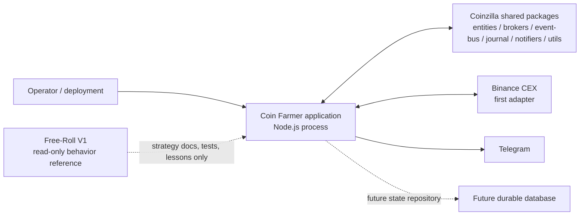
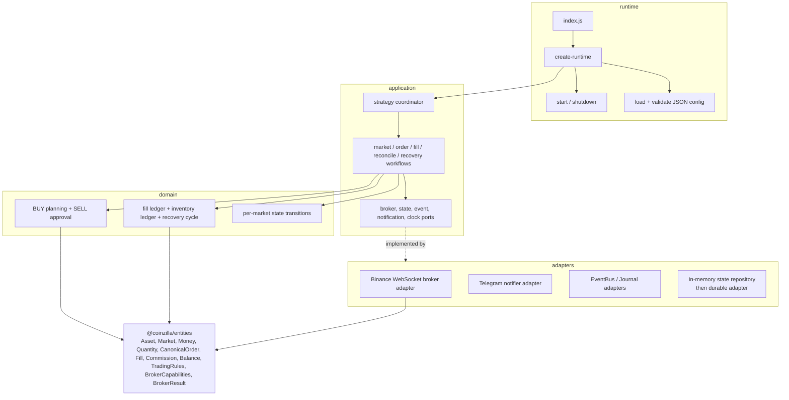

# Coin Farmer — Concrete Application Architecture

**Application:** `apps/bot-coin-farmer`  
**Runtime:** Node.js `>=22.23.4`, JavaScript ESM  
**Status:** Target design for implementation; source code not yet created

## 1. Product and strategy definition

Coin Farmer is a spot cryptocurrency trading application. The first strategy is a **fill-driven accumulation and recovery strategy**, based on the approved Free-Roll V1 behavior.

Do not label this a grid bot in code or documentation. It is not a traditional grid strategy with a ladder of fixed price levels and independent buy/sell level pairs. For each configured market, the strategy coordinates one active trading position and the relevant standing BUY and recovery SELL orders. Its next BUY price is derived from a reference/last qualifying BUY price and a configured percentage step. Its SELL is gated by exact recovery accounting and a minimum net-profit requirement.

The strategy does not guarantee fills, profit, or market movement. Its safety objective is narrower: never intentionally submit a SELL that fails the approved conservative net-profit rule, and refuse to trade when the required facts are unknown or inconsistent.

## 2. Concrete product context

- **Markets:** cryptocurrency spot markets, configured independently.
- **CEX independence:** strategy and application workflows consume Coinzilla-owned canonical contracts and app-owned capability ports. No exchange SDK type or raw payload may enter domain/application policy.
- **Initial CEX:** Binance through the existing `BinanceWebSocketBroker` and `BinanceWebSocketConfig` exported by `@coinzilla/brokers`. This is an adapter choice, not a strategy dependency.
- **Notifications:** Telegram first, using `TelegramNotifier` and `subscribeTelegramNotifications` from `@coinzilla/notifiers`. Notification delivery is optional and must not block or alter trading.
- **Eventing/journal:** existing `@coinzilla/event-bus` and `@coinzilla/journal` are integration candidates already used by V1.
- **Persistence:** a repository port is part of the design from day one. A durable DB adapter is a future phase; initial in-memory state is not restart recovery.
- **Runtime:** Node.js `>=22.23.4` (the current `@coinzilla/brokers` package declares this engine floor), ESM JavaScript, JSON config, pnpm workspace.

## 3. System context

See [system-context.mmd](./diagrams/system-context.mmd).



CF and V1 are sibling applications. CF must not import V1 source, reuse its process memory, or read/write its state directory.

## 4. Component architecture

See [component-architecture.mmd](./diagrams/component-architecture.mmd).



### 4.1 Runtime

Owns process startup, composition, configuration, resource ownership, signal handling and shutdown ordering. It constructs the concrete Binance/Telegram/EventBus/Journal/persistence adapters and injects their capabilities into application workflows. It contains no BUY/SELL formulas or inventory decisions.

### 4.2 Application

Owns use-case orchestration. It coordinates domain decisions and external effects through ports. It decides *when* to call a policy, persist state, submit/cancel an order, reconcile broker facts, or publish an event. It does not know Binance payload names or Telegram HTTP details.

### 4.3 Domain

Owns pure rules and state invariants:
- Buy-price calculation and buy eligibility.
- Sell profitability approval.
- Fill and commission interpretation.
- Active/free/reserved/external inventory ownership.
- Recovery-cycle completion.
- Per-market readiness state transitions.

Domain functions receive canonical data and return decisions, updated immutable projections, or explicit refusal reasons. They do not perform I/O.

### 4.4 Adapters

Implement ports:
- Binance maps WebSocket API/Streams events, orders, fills, balances, trading rules and history into canonical Coinzilla contracts.
- Telegram maps curated application events to human-readable messages through the existing notifier package.
- EventBus and Journal adapters isolate those package APIs from use cases.
- State repository begins in-memory for tests/development; a future durable adapter can be added without changing domain rules or workflow contracts.

## 5. Dependency and package reuse rules

The current `@coinzilla/entities` public index exports canonical candidates including `Asset`, `Market`, `Money`, `Quantity`, `CanonicalOrder`, `Commission`, `Fill`, `Balance`, `TradingRules`, `BrokerCapabilities`, and `BrokerResult`. CF should use these contracts after reviewing their constructors, invariants, exports and tests. Do not create app-local duplicates of these concepts.

The current `@coinzilla/brokers` public index exports `BinanceWebSocketBroker`, `BinanceWebSocketConfig`, and `CoreBroker`. `CoreBroker` is not itself a complete CEX-neutral application port specification. CF should define narrow application-facing broker ports and implement the first adapter using the existing Binance broker. If later multiple apps/adapters need the same ports, propose a shared package contract through the owning domain.

The current `@coinzilla/notifiers` public index exports `TelegramNotifier` and `subscribeTelegramNotifications`. Keep Telegram optional and behind the notification adapter.

Use `@coinzilla/event-bus`, `@coinzilla/journal`, and `@coinzilla/utils` only through public package exports. Do not deep-import package internals.

### Dependency rules

- Domain imports canonical entities and pure local domain modules only.
- Application imports domain modules and application port contracts.
- Adapters import application ports, shared contracts, and their concrete integration packages.
- Runtime imports all outer layers and performs composition.
- No domain/application import from `@coinzilla/brokers`, Binance SDKs, Telegram packages, process environment, network clients or filesystem APIs.
- No imports from `apps/bot-free-roll`.
- Shared package changes are owned by the relevant package domain and follow `AI_AGENT_WORKFLOW.md`.

## 6. Proposed source structure

See [MODULE_CATALOG.md](./MODULE_CATALOG.md) for file-by-file responsibilities and contracts.

```text
src/
├── index.js
├── runtime/
│   ├── create-runtime.js
│   ├── start-runtime.js
│   ├── shutdown-runtime.js
│   └── config/
│       ├── load-config.js
│       └── validate-config.js
├── domain/
│   ├── strategy/
│   │   ├── calculate-buy-price.js
│   │   ├── plan-buy.js
│   │   ├── approve-sell.js
│   │   └── market-state.js
│   ├── accounting/
│   │   ├── fill-ledger.js
│   │   ├── inventory-ledger.js
│   │   ├── recovery-cycle.js
│   │   └── calculate-fill-accounting.js
│   └── orders/
│       ├── order-intent.js
│       └── order-transition.js
├── application/
│   ├── ports/
│   │   ├── broker/
│   │   │   ├── market-data.js
│   │   │   ├── trading.js
│   │   │   ├── account.js
│   │   │   ├── execution-history.js
│   │   │   └── market-rules.js
│   │   ├── state-repository.js
│   │   ├── event-publisher.js
│   │   ├── notification-publisher.js
│   │   └── clock.js
│   ├── workflows/
│   │   ├── initialize-market.js
│   │   ├── process-market-observation.js
│   │   ├── process-order-update.js
│   │   ├── process-fill.js
│   │   ├── reconcile-market.js
│   │   ├── recover-market.js
│   │   └── stop-strategy.js
│   └── services/
│       ├── strategy-coordinator.js
│       └── market-task-queue.js
└── adapters/
    ├── broker/binance-websocket/
    │   ├── create-binance-broker.js
    │   ├── market-data-adapter.js
    │   ├── trading-adapter.js
    │   ├── account-adapter.js
    │   ├── history-adapter.js
    │   └── mappers/
    ├── notifications/telegram/
    │   ├── telegram-adapter.js
    │   └── notification-mapper.js
    ├── events/event-bus-adapter.js
    ├── journal/journal-adapter.js
    ├── persistence/in-memory-state-repository.js
    └── logging/logger-adapter.js

test/
├── unit/domain/
├── unit/application/
├── contract/broker/
├── contract/notifications/
├── integration/
├── simulation/
└── acceptance/
```

This is a deliberate target structure, not an instruction to create empty files. Each module should be introduced with the behavior and tests it owns.

## 7. Strategy behavior to implement

The V1 README remains the starting behavior reference. The following summary is intentionally concrete; the behavior-map document records details and open questions.

### Per-market BUY policy

- Use last traded price for initial entry and ongoing monitoring.
- Calculate initial/subsequent BUY limit using the approved percentage-step formula from V1: `referencePrice * (1 - priceStepPercent / 100)`.
- The subsequent reference is the last qualifying BUY price.
- Round limit prices down to the broker's exact price increment and validate all market constraints.
- The next BUY is a standing order; do not wait for a later tick to decide to place it if current state says it should already be maintained.
- Do not create duplicate BUY reservations after repeated ticks/events.
- If last-trade data is stale, invalid, missing or gap-affected, block price-based actions.

### Per-market SELL policy

- SELL only active strategy inventory; exclude permanently free, external/unmanaged and already-reserved quantity.
- Centralize SELL approval in one pure function. Inputs include exact candidate quantity/price, cost/recovery accounting, actual known fees, conservative fee reserve, trading rules and configured minimum net profit.
- Deny when any required input is unknown, unsupported, stale, inconsistent or inexact.
- After a new BUY completes, do not replace an existing recovery SELL until its cancel/final status and fills have been reconciled.
- Allocate `keepQuantity` only after the recovery SELL is fully filled and cumulative actual net profit meets `minProfit`.
- Partial/canceled/under-profitable SELLs allocate no free coins.

### Fill and commission policy

- Every execution is an immutable fill with stable identity.
- Apply a fill exactly once even if seen through WebSocket, REST history and replay.
- Preserve exact base quantity, quote quantity, price, execution time, liquidity role and all commission facts.
- Explicit zero commission differs from unknown commission.
- Quote/base fees are supported according to the strategy accounting contract.
- Third-asset fees remain unsupported in the initial strategy: reject known third-asset fee configurations before trading; if an unexpected third-asset fee appears, record the reported fact, mark accounting incomplete and pause the market. Do not convert or value it.
- Configured fee percentages are planning assumptions/reserves only; never book them as actual fees.

### Partial fills

Capture each partial fill immediately in the immutable ledger. The current V1 strategy decision says not to advance to the next strategy step or place replacement strategy orders until the relevant order is fully filled. The workflow must still reconcile partial fills and handle cancellation/fill races safely.

## 8. Market state machine

See [market-lifecycle.mmd](./diagrams/market-lifecycle.mmd).

The target per-market states are:

- `INITIALIZING`: config, broker capabilities, fee eligibility, trading rules, subscriptions and starting facts are checked.
- `READY`: safe initial state; no active strategy order/position requiring management.
- `ACTIVE`: strategy is managing a position and/or working orders.
- `RECONCILING`: order, fill, balance or stream state is uncertain; order mutations are forbidden.
- `PAUSED_UNSAFE`: required facts are unknown/inconsistent or an invariant failed; no automatic resume.
- `STOPPED`: explicit stop; no new strategy orders.

A process may be running while one market is paused and another is active. State transitions must be pure decisions, persisted through the repository port when durable persistence is implemented, and tested independently of broker I/O.

## 9. Notifications and operational events

See [notification-flow.mmd](./diagrams/notification-flow.mmd).

The strategy/application publishes stable, canonical events. A notification mapper selects user-relevant events and formats safe messages. The Telegram adapter sends them using `@coinzilla/notifiers`.

Initial notification categories:
- Order fully executed (side, market, order identity, actual executed quantity/price where known).
- Execution/fill accounted (only if distinct from order completion and useful; avoid message spam).
- Market paused/unsafe with actionable reason.
- Recovery completed or remains blocked.
- Runtime startup, shutdown and unrecoverable runtime error.

Telegram is optional: if both credentials are absent, notifications are disabled; if only one is configured, startup validation fails clearly. Telegram/network errors are logged and isolated; they must never roll back a fill, alter inventory, or trigger a trading decision. Never forward raw exchange payloads or secrets.

## 10. Persistence and restart strategy

See [persistence-evolution.mmd](./diagrams/persistence-evolution.mmd).

Define a `StateRepository` port before the first strategy workflow so application use cases do not depend on storage technology. Initially provide an in-memory implementation for unit tests and deterministic simulation. The first runnable milestones must clearly state that process restart does not restore strategy-owned accounting unless a durable adapter and reconciliation workflow have landed.

A future durable adapter (database not selected) must store versioned strategy state, immutable fill identities/facts or a replayable ledger, inventory buckets, order intents/identities, recovery-cycle state and a reconciliation cursor/checkpoint. Writes must be atomic enough to prevent partially applied state transitions. Startup must load state, query authoritative broker balances/orders/fills, reconcile, and only then allow order mutations.

The event journal is operational history, not automatically the authoritative ledger or a database substitute. Never claim restart safety from a log file alone.

## 11. Configuration direction

Use JSON for strategy settings and environment variables only for secrets/deployment-specific credentials.

Proposed logical configuration shape (illustrative; schema must be finalized in the configuration phase):

```json
{
  "application": {
    "enabled": true,
    "mode": "testnet"
  },
  "broker": {
    "adapter": "binance-websocket",
    "marketMappings": {
      "doge-usdt": "DOGEUSDT"
    }
  },
  "notifications": {
    "telegram": {
      "enabled": true
    }
  },
  "strategy": {
    "enabled": true,
    "settings": {
      "minProfit": "0.01"
    },
    "markets": {
      "doge-usdt": {
        "baseAssetCode": "DOGE",
        "quoteAssetCode": "USDT",
        "enabled": true,
        "makerPercent": "0.075",
        "takerPercent": "0.075",
        "priceStepPercent": "0.05",
        "orderQuantity": "400",
        "keepQuantity": "1"
      }
    }
  }
}
```

The logical market key and asset identities are strategy-facing. The Binance symbol mapping belongs to broker adapter configuration. Financial values are decimal strings, not JSON numbers. Do not add arbitrary precision fields when exact trading rules are provided by the broker. The final shape must be validated against actual broker/account requirements and V1 decisions.

Environment secrets expected for the first integrations:
- Binance API key and secret (names aligned with the existing broker config conventions).
- `TELEGRAM_BOT_TOKEN` and `TELEGRAM_CHAT_ID` when Telegram is enabled.

No credentials belong in JSON committed to the repository.

## 12. Testing strategy

| Suite | What it proves | Network? |
|---|---|---|
| Domain unit | Exact calculations, inventory conservation, profitability, state transitions | No |
| Application unit | Correct workflow ordering, refusal paths, retries, idempotency | No; fake ports |
| Broker contract | Binance adapter maps the same canonical facts and failure semantics required by the ports | No for fixtures |
| Notification contract | Curated event mapping, optional/invalid config, failure isolation | No; fake notifier |
| Integration | Real package wiring and controlled Binance TESTNET interactions | Explicit opt-in only |
| Simulation/replay | Partial fills, duplicate/late events, cancel races, gaps, restart, multi-market concurrency | No |
| Acceptance | End-to-end lifecycle and operator safety gates | TESTNET only before release |

Use the native Node.js test runner. Default tests must not require API credentials, Telegram credentials, network access or a database.

## 13. Explicit non-goals and open decisions

Not decided by this architecture:
- Database product/schema and exact durability guarantees.
- Whether CF eventually supports multiple strategy types or remains focused on this accumulation/recovery strategy.
- Any change to V1 strategy rules that are not yet approved.
- Whether V1 and CF can ever run simultaneously against the same live account.
- Exact final method signatures for app-owned broker ports until they are checked against the actual Binance broker methods and shared entities.
- Live-trading enablement and production cutover.

Do not resolve these by implementation convenience. Record material choices as ADRs and update the CF roadmap.
