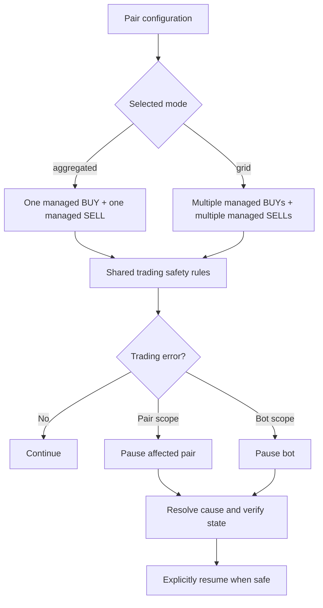

# Coinzilla Free-Roll — BUY-cycle Grid Mode

**Document version:** `v0.001`  
**Application:** `coinzilla/apps/bot-free-roll`  
**Status:** Proposed strategy variant; implementation not yet enabled.  
**Companion roadmap:** [GRID-ROADMAP.md](./GRID-ROADMAP.md)  
**Legacy strategy:** [README.md](./README.md)


## Agreed foundational decisions (2026-11-01)

These decisions were confirmed during the Grid design discussion and take precedence over any older conflicting proposal in this document.

### Strategy modes

- Pair configuration explicitly selects `aggregated` or `grid`.
- `aggregated` manages one BUY and one SELL order per pair.
- `grid` manages multiple BUY and multiple SELL orders per pair. Grid orders are managed independently; a new BUY must not silently cancel or resize unrelated SELL orders.
- Grid eligibility does not depend on `makerPercent`. Any configured pair may use Grid.
- Maker fees and commissions affect execution economics and profitability checks, not strategy selection.
- No automatic mode switching and no silent fallback between modes.

### Initial BUY behavior

- When `makerPercent = 0`, use post-only `LIMIT_MAKER` orders and place the initial BUY immediately.
- When `makerPercent > 0`, use the existing price-trigger behavior for the initial BUY.
- This is the only agreed mode-specific initial-entry distinction so far. Do not invent additional startup conditions.

### First working release: deliberately no restore

- Do not implement persisted Grid-state restoration or restart recovery in the first working Grid milestone.
- Prioritize a working in-process trading lifecycle first. Persistence and restoration are a later extension.
- Requirements elsewhere in this document for restart reconstruction describe future work, not a blocker for the first working milestone.
- Do not claim restart safety until that later work is implemented and tested.

### Global trading fail-closed rule

- A trading error must pause the affected pair or the whole bot, according to the error's scope.
- Do not silently swallow a trading error, continue with assumed state, or switch strategies.
- A pair-specific failure must not unnecessarily stop other pairs that remain demonstrably safe.
- Trading may resume only after the cause is resolved and the affected state is verified safe.
- This rule applies equally to aggregated and Grid modes.

### Mode and safety overview



---

## 1. Purpose

Grid mode is an optional Free-Roll operating mode in which every fully filled BUY order becomes an independent recovery cycle with its own SELL order and its own accounting.

The goal is to accumulate free coins one completed BUY cycle at a time, without canceling or resizing earlier recovery SELL orders when a later BUY fills.

**Core rule: one fully filled BUY creates one independent recovery cycle and one independent recovery SELL.**

This document defines the proposed Grid behavior. It does not describe current runtime capability. The current implementation remains the aggregated strategy documented in [README.md](./README.md) until the Grid roadmap is implemented and Grid mode is explicitly enabled.

## 2. First-release scope

Grid mode supports multiple managed BUY orders and multiple independent SELL orders per pair:

- Multiple BUY orders may be working at the same time.
- Each BUY belongs to its own independently tracked BUY cycle.
- Each eligible cycle may have its own live SELL order.
- Multiple cycle SELL orders may remain open simultaneously.
- A new BUY cycle must not cancel or resize unrelated cycle SELL orders.
- SELL completion order does not matter.
- The exact BUY placement/replenishment schedule beyond the agreed initial-entry rule remains a separate design decision; do not assume a one-working-BUY limit.

This is a BUY-cycle Grid: each BUY cycle has independent recovery ownership. It is not the legacy aggregated one-BUY/one-SELL model.

## 3. Example: two DOGE cycles

Assume:

- Market: `DOGEFDUSD`
- `orderQuantity = 100 DOGE`
- `keepQuantity = 1 DOGE`
- `minProfit = 0.01 FDUSD`
- `makerPercent = 0`
- Both BUYs execute with no actual commission for this simplified example.
- Broker trading rules allow the shown quantities.

The bot buys 100 DOGE in cycle A:

| Cycle | BUY quantity | Target SELL quantity | Target retained quantity |
|---|---:|---:|---:|
| A | 100 DOGE | 99 DOGE | 1 DOGE |

The bot places SELL A for 99 DOGE and places the next BUY for 100 DOGE.

The next BUY fills before SELL A. Grid mode does **not** cancel or resize SELL A. It creates cycle B and places SELL B:

| Cycle | BUY quantity | Target SELL quantity | Target retained quantity |
|---|---:|---:|---:|
| A | 100 DOGE | 99 DOGE | 1 DOGE |
| B | 100 DOGE | 99 DOGE | 1 DOGE |
| **Total** | **200 DOGE** | **198 DOGE** | **2 DOGE** |

SELL A and SELL B can fill in either order. Each one must independently recover its own cycle cost and meet the net-profit requirement. Only then does its remaining one DOGE become free inventory.

The arithmetic above is illustrative. Actual order quantity must be calculated from reconciled fills, base-asset commissions, outstanding reservations, and broker quantity rules. Never assume submitted quantity equals net acquired base quantity.

## 4. How Grid differs from current aggregated Free-Roll

| Behavior | Existing aggregated mode | Grid mode |
|---|---|---|
| First BUY fills 100 DOGE | Create aggregate recovery SELL for 99 | Create cycle A SELL for 99 |
| Second BUY fills 100 before first SELL | Cancel first SELL and replace with aggregate SELL for 199 | Keep cycle A SELL unchanged; create cycle B SELL for 99 |
| Third BUY fills | Replace aggregate SELL with 299 | Keep A/B SELLs; create cycle C SELL for 99 |
| Free quantity after two successful recoveries | 1 DOGE for the pooled recovery cycle | 2 DOGE, one from each completed cycle |
| SELL B fills before SELL A | Not applicable to one aggregate SELL | Complete B only; A remains open and unchanged |

The legacy behavior is intentional and remains the default. Grid is opt-in and must not change the existing strategy when disabled.

## 5. Configuration proposal

The proposed configuration adds an explicit mode per pair. The exact schema must be validated and approved in GRID-040 before runtime integration.

Illustrative shape:

```json
{
  "strategies": {
    "free-roll": {
      "enabled": true,
      "settings": {
        "minProfit": 0.01
      },
      "pairs": {
        "DOGEFDUSD": {
          "enabled": true,
          "mode": "grid",
          "makerPercent": 0,
          "takerPercent": 0.075,
          "priceStepPercent": 0.05,
          "orderQuantity": 100,
          "keepQuantity": 1
        }
      }
    }
  }
}
```

Compatibility rules:

- Missing `mode` means `aggregated`.
- Existing committed configuration remains aggregated until explicitly changed.
- Grid must never be enabled implicitly.
- Unknown mode values fail configuration validation before trading.
- A pair cannot switch between aggregated and Grid while it has live orders or unreconciled inventory/cycle state.
- Do not run both accounting models for the same pair at the same time.

## 6. BUY lifecycle

1. Grid may maintain multiple working BUY orders per pair; do not impose the legacy one-working-BUY limit.
2. For the initial BUY, use the agreed entry rule: `makerPercent = 0` means immediate post-only `LIMIT_MAKER`; nonzero `makerPercent` means use the existing price-trigger behavior.
3. Every execution is captured with stable identity and actual commission facts.
4. The strategy waits for each BUY order to become fully filled before advancing that BUY cycle, consistent with the currently approved partial-fill policy.
5. It reconciles the final order status and all fills using the in-process state available in the first milestone.
6. It creates exactly one cycle, idempotently associated with that BUY order/fill identity.
7. It calculates and places that cycle's SELL.
8. Further BUY placement follows the separately approved Grid order-management rules; do not invent a schedule or silently fall back to aggregated behavior.

A duplicate fill or order event must not create another cycle or duplicate SELL.

If cycle creation or SELL placement has an ambiguous outcome, the pair must reconcile before retrying. Never retry a non-idempotent order creation blindly.

## 7. Independent SELL lifecycle

Every open cycle owns at most one live SELL order. Different cycles may have live SELL orders at the same time.

When a new BUY cycle is created:

- Create the new cycle's SELL.
- Do not cancel an older cycle's SELL.
- Do not resize an older cycle's SELL.
- Do not alter another cycle's cost, proceeds, fees, remaining quantity, reservation, or status.

When a cycle SELL fills:

- Resolve the owning cycle from the stable broker order identity.
- Reconcile all actual fills and commissions.
- Update only that cycle.
- Complete only that cycle if its full SELL is reconciled and its actual net profit meets `minProfit`.
- Allocate exactly one `keepQuantity` to free inventory for that cycle.
- Leave all other cycles unchanged.

A cycle SELL can be canceled/replaced only within that same cycle. The previous order must be terminal and its final fills reconciled before releasing its reservation or placing a replacement.

## 8. Per-cycle accounting

Unlike the existing pooled recovery accounting, Grid requires independent recovery accounting for each BUY cycle.

Each cycle tracks at least:

- Stable cycle ID.
- Source BUY order ID and canonical BUY fill IDs.
- Actual net acquired base quantity.
- Current remaining base quantity.
- Actual BUY quote cost and eligible quote-asset commissions.
- Actual SELL quote proceeds, net of eligible quote-asset commissions.
- Actual commission amounts and assets by fill.
- Current SELL order ID and all historical SELL attempt IDs.
- Current reserved quantity.
- Outstanding recovery amount.
- Actual realized net profit.
- Free quantity allocated, initially zero.
- Lifecycle status and accounting-completeness status.

### 8.1 Cost and proceeds

Use actual fill facts, never submitted limit price × requested quantity as accounting truth.

- Add actual BUY quote amount and eligible quote-denominated BUY commission to that cycle's recovery cost.
- Add actual SELL quote amount less eligible quote-denominated SELL commission to that cycle's net proceeds.
- Preserve cumulative cost and proceeds when a SELL is canceled or replaced.
- Do not transfer proceeds or costs between cycles.
- Do not count unrealized market value as recovered capital.

### 8.2 Profit approval

Each SELL plan must prove that the cycle's own expected net proceeds can recover its outstanding eligible cost and meet `minProfit`, using conservative commission coverage and exact decimal arithmetic.

Final completion is based on actual fills and actual commissions, not the estimated order plan.

A cycle cannot allocate free inventory merely because:
- a SELL order was accepted;
- a SELL order is partially filled;
- a cancel request succeeded;
- the market price crossed the limit;
- the order status says FILLED before its actual fills have been reconciled.

### 8.3 Commission assets

Existing commission policy remains in force:

- Explicit zero commissions are valid facts.
- Quote-asset commissions affect quote recovery cost/proceeds.
- Base-asset BUY commissions reduce net acquired base quantity.
- Base-asset SELL commissions reduce remaining base inventory.
- Unexpected third-asset commissions are recorded unchanged, make accounting incomplete, and pause the pair. Do not convert or value them.
- Configured maker/taker percentages are planning assumptions, not actual fee records.

For `makerPercent: 0`, use the existing `LIMIT_MAKER` policy. Do not assume actual commission is zero without checking fills.

### 8.4 SELL quantity and base-fee reservation

Before placing a cycle SELL, Grid reserves the configured worst-case base-fee allowance:

\[\text{sellQuantity}=\operatorname{floorStep}\left(\frac{\text{remainingQuantity}-\text{keepQuantity}}{1+\text{feeRate}}\right)\]
\[\text{reservedQuantity}=\text{sellQuantity}\times(1+\text{feeRate})\]

The reservation must never exceed that cycle's sellable inventory. Quantity-step dust remains active cycle inventory; it is not automatically free. Actual fill debits and commissions remain authoritative. If an actual base-asset commission exceeds the reserved allowance, the fill cannot be safely applied and the pair must pause for reconciliation. The configured fee rate is a conservative planning allowance, not a substitute for actual commission facts.

## 9. Free inventory

`keepQuantity` is retained **per successfully completed Grid cycle**, not once for the aggregate pair position.

For two successful 100 DOGE cycles with one DOGE retained per cycle:

- Cycle A allocates 1 DOGE.
- Cycle B allocates 1 DOGE.
- Pair-level free inventory increases by 2 DOGE.

Allocation occurs only after that cycle's SELL is fully filled, all fills/fees are reconciled, and actual net profit is at least `minProfit`.

Free inventory is a permanent excluded bucket:

- Never use it to calculate an active cycle's sell quantity.
- Never reserve it for a SELL.
- Never include it in future recovery cost or proceeds.
- Never silently reclassify it as working capital.
- Report it separately from active and external inventory.

If a cycle has residual quantity beyond `keepQuantity` because of conservative fee handling or quantity-step rounding, that residual must remain explicitly accounted for. Do not silently allocate the entire residual as free inventory.

If actual residual quantity is insufficient to allocate the configured `keepQuantity`, do not allocate a partial amount automatically; pause or retain the cycle as incomplete according to the finalized accounting contract.

## 10. Partial fills, cancellation, and replacement

The existing wait-for-full-order-fill policy remains in effect for strategy advancement. Fill facts must still be recorded as they arrive.

For a partially filled SELL:

- Update the owning cycle's actual sold quantity and proceeds.
- Keep the cycle open.
- Allocate no free inventory.
- Do not alter other cycles.
- Do not place another SELL for the same reserved units.

If the SELL is canceled after partial execution:

1. Read the final canonical order status.
2. Retrieve and reconcile all fills for that order.
3. Deduplicate stream and history records.
4. Release only the remaining reservation proven no longer locked by the exchange.
5. Carry the same cycle's remaining quantity, recovery balance, proceeds, and fees forward.
6. Place a replacement SELL only for that cycle after profitability and inventory validation pass.

A cancellation request or response alone is never proof that no fill occurred.

## 11. Inventory ownership and reservations

Grid must reconcile inventory across all cycles and pair-level buckets.

At minimum distinguish:

1. Active strategy inventory assigned to incomplete cycles.
2. Free inventory from completed cycles.
3. Quantity reserved by each live SELL.
4. Executed quantity awaiting final accounting/reconciliation.
5. External or unmanaged wallet inventory.
6. Broker-reported available and locked balances.

Every live SELL reservation belongs to exactly one cycle and one broker order. A base unit cannot be reserved by two SELLs.

Pair-level active/reserved/free totals are derived from authoritative cycle and market-ledger state. Do not maintain duplicate mutable totals that can drift.

Unknown or unowned broker orders, unexplained balance changes, or reservation mismatches pause the pair. Do not assume that total wallet balance belongs to Free-Roll.

## 12. Later phase: persistence, recovery, and restart

**Out of scope for the first working Grid milestone.** The requirements below define a future extension; they must not delay the first in-process working implementation.

A restart must reconstruct every cycle, not just one aggregate SELL.

Recovery must prove:

- The current BUY order, if any, maps to the pair.
- Every open SELL maps to exactly one cycle.
- Each cycle's current SELL and historical replacement SELLs are known.
- All BUY and SELL fills are available and deduplicated.
- Actual commissions and assets are preserved.
- Per-cycle cost/proceeds/profit projections are reproducible.
- Free allocation is applied exactly once.
- Reservations match broker open/locked orders.
- Pair-level projections match the cycle collection and market inventory ledger.

If any order is unknown, any cycle mapping is ambiguous, or fill/commission/balance facts are incomplete, do not create new orders or automatically resume.

### Legacy-to-Grid transition

A legacy aggregated position cannot safely be split into BUY cycles merely by dividing aggregate quantity by `orderQuantity`. The original per-BUY fill ownership, fees, pooled proceeds, partial sells, and retained quantity may not be reconstructible.

Therefore the initial rollout requires a clean boundary:

- Stop creating new BUY orders for the pair.
- Reconcile all live BUY/SELL orders and fills.
- Drain or safely resolve the existing aggregate recovery position.
- Confirm no unresolved order, fill, fee, reservation, or balance discrepancy remains.
- Only then enable Grid mode and initialize a clean cycle ledger.

If a clean boundary cannot be proven, remain in aggregated mode and pause for explicit reconciliation. A future explicit conversion tool would require its own reviewed design and tests.

## 13. Risk and exposure limits

Independent cycles can accumulate inventory while their SELLs remain unfilled. The first Grid release must define a bounded exposure policy before repeated BUY replenishment is enabled.

A simple `maxOpenCycles` check after a BUY fills is not sufficient: a currently open BUY can still fill and create another cycle.

The policy must account for:
- Current open cycles and their unrecovered quote exposure.
- A live BUY order's maximum possible additional exposure.
- Available quote balance and broker-locked funds.
- Open SELL reservations and actual strategy-owned base quantity.
- Per-pair and, where relevant, shared quote-asset exposure across pairs.

When the limit is reached, block placement of another BUY. If an already-live BUY could breach the cap, define whether it must be canceled and reconciled or whether its full possible exposure was reserved in advance. Never rely on a post-fill check to prevent excess exposure.

## 14. Observability and statistics

Grid diagnostics should report both pair-level projections and per-cycle detail.

Useful fields include:
- Open, completed, paused, and reconciliation-required cycle counts.
- Cycle ID, source BUY order ID, current SELL order ID, and historical SELL IDs.
- Actual acquired, remaining, reserved, and sold base quantities.
- Per-cycle quote cost, net proceeds, outstanding recovery, and realized net profit.
- Actual commission totals grouped by asset.
- Free inventory allocated by cycle and total pair free inventory.
- Last reconciliation result and any blocking discrepancy.

Journal events should carry stable cycle and order identities. Do not log raw broker payloads, credentials, or secrets. Notification failures must never alter trading decisions.

## 15. Acceptance gates

Grid's first working in-process milestone is acceptable when all of the following are true:

- All GRID roadmap stages required for the release are complete and merged into `develop`.
- Existing aggregated behavior passes its full regression suite unchanged.
- Cycle accounting is exact, deterministic, and based on actual fills/fees.
- Multiple SELL reservations are proven non-overlapping.
- Out-of-order SELL completion and cancel/fill races are covered.
- The first in-process milestone does not claim restart recovery; persistence and restart reconstruction are a later release gate.
- Unknown orders and incomplete accounting fail closed.
- Grid exposure limits include outstanding BUY exposure.
- Fake-broker end-to-end tests pass.
- Controlled testnet validation passes with actual commission facts inspected.
- Operator drain/rollback procedure is documented.
- CI is green on a branch up to date with `develop`.
- Grid enablement for a pair receives explicit approval.

Passing unit tests alone is not production certification. Persistence/restart recovery, reconnect hardening, and production rollout remain later gates. This document does not authorize live trading.

## 16. Related documents and ownership

- [GRID-ROADMAP.md](./GRID-ROADMAP.md) — migration stages, audit, PR sequence, test matrix, and agent instructions.
- [README.md](./README.md) — existing aggregated strategy specification and current default behavior.
- [ROADMAP.md](./ROADMAP.md) — existing Free-Roll implementation roadmap.
- [CURRENT_STATE.md](./CURRENT_STATE.md) — prior implementation audit; re-audit current source before relying on historical findings.
- App `AGENTS.md` and repository-wide `AGENTS.md`, `AI_AGENT_WORKFLOW.md`, and `ENGINEERING_STANDARDS.md` — engineering and cross-domain workflow.

**Important:** Grid mode is a planned optional strategy variant. The current implementation does not yet support multiple independent recovery SELLs per pair.
