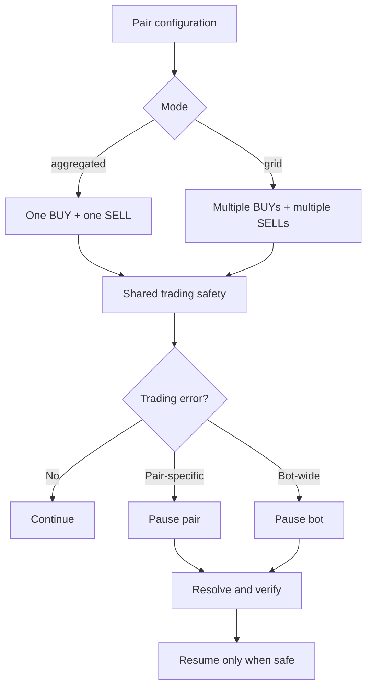

# Free-Roll Grid Migration Roadmap

**Document version:** `v0.001`  
**Application:** `apps/bot-free-roll`  
**Target branch:** `feature/bot-grid`  
**Base:** `develop`  
**Status:** Design and migration plan — no Grid runtime behavior is enabled by this document.

**Strategy specification:** [GRID-README.md](./GRID-README.md)  
**Existing strategy specification:** [README.md](./README.md)  
**Existing engineering roadmap:** [ROADMAP.md](./ROADMAP.md)


## Agreed foundational decisions (2026-11-01)

This section records the decisions confirmed during the Grid design discussion. It overrides older conflicting assumptions in this roadmap.

### Mode behavior

| Configured mode | Order management |
|---|---|
| `aggregated` | One managed BUY and one managed SELL per pair |
| `grid` | Multiple managed BUY orders and multiple independent SELL orders per pair |

- Grid is selected explicitly in pair configuration.
- Any pair may use Grid, regardless of `makerPercent`.
- Maker fees/commissions affect execution economics and profitability checks only; they do not decide Grid eligibility.
- Never automatically switch modes or silently fall back to aggregated behavior.
- Grid BUY and SELL orders are independently managed. Do not cancel or resize an unrelated cycle's SELL when another BUY fills.

### Initial BUY behavior

- `makerPercent = 0`: use post-only `LIMIT_MAKER` and place the initial BUY immediately.
- `makerPercent > 0`: use the existing price-trigger behavior for the initial BUY.
- Do not add other startup conditions unless explicitly approved.

### First working milestone

- The immediate goal is a working in-process Grid trading lifecycle.
- Persisted Grid-state restoration and restart recovery are explicitly deferred to a later phase.
- Do not block the first working milestone on restore functionality or claim restart safety before it exists.
- Multiple simultaneous BUYs are in scope. Do not reintroduce the earlier one-working-BUY restriction.
- Exact BUY placement/replenishment scheduling beyond the initial-entry rule remains to be discussed; do not invent it.

### Global trading fail-closed rule

Any trading error pauses the affected pair or the entire bot according to its scope. Never silently swallow a trading error, continue with assumed state, or switch strategy. A pair-specific failure should not stop unrelated pairs that remain safe. Resume only after the cause is resolved and the affected state is verified safe. This rule applies to both aggregated and Grid modes.



---

## 1. Mission

Introduce an optional **BUY-cycle Grid mode** to Free-Roll while preserving the existing aggregated recovery behavior as the default and as a supported mode.

The first working Grid release supports multiple managed BUY orders and multiple independent SELL orders per pair:

- Every fully filled BUY order creates one independent recovery cycle.
- Every cycle owns its own recovery SELL order and accounting.
- A later BUY fill must not cancel, resize, or replace an unrelated cycle's SELL.
- Each successfully completed cycle retains its own `keepQuantity` as free inventory.
- Different cycles may complete in any order.
- All order, fill, commission, inventory, and trading-safety rules remain mandatory.
- Persisted state restoration and restart recovery are deferred; the first milestone focuses on a working in-process lifecycle.

The exact BUY placement/replenishment schedule beyond the initial-entry rule is not yet specified. Do not impose a one-working-BUY restriction or invent additional scheduling rules.

The migration must be incremental, test-first, feature-flagged, and reversible until Grid mode is explicitly enabled for a pair.

## 2. Relationship to existing Free-Roll

The current strategy is the compatibility baseline. Its approved behavior remains documented in [README.md](./README.md), including pooled recovery accounting and replacement of one aggregate SELL when another BUY fills.

Grid mode changes the unit of recovery accounting:

| Concern | Existing aggregated mode | BUY-cycle Grid mode |
|---|---|---|
| BUY orders | One managed BUY per pair | Multiple managed BUY orders per pair |
| Recovery unit | One pooled active recovery position | One independently tracked BUY cycle |
| SELL orders | At most one aggregate SELL per pair | One independent SELL per open cycle |
| New BUY fills | Reconcile/cancel/replace aggregate SELL | Create a new cycle; leave existing cycle SELLs untouched |
| Profit accounting | Pooled recovery cost/proceeds | Cost/proceeds and net-profit approval per cycle |
| Free allocation | One `keepQuantity` per completed pooled recovery cycle | One `keepQuantity` per successfully completed BUY cycle |
| Sell cancellation | Rebuild aggregate recovery SELL | Rebuild only the affected cycle's SELL |
| Restart | Reconstruct aggregate position/order state | Reconstruct every cycle and its SELL reservation independently |

Do not reinterpret or silently change the existing mode to behave like Grid. The new behavior is opt-in and must have a separate, explicit configuration value.

## 3. Agreed Grid behavior and examples

### 3.1 Canonical example: two BUY cycles

Configuration example:

- Pair: `DOGEFDUSD`
- BUY quantity: `100 DOGE`
- `keepQuantity`: `1 DOGE`
- Maker commission configuration: `0%`
- Required minimum net profit: `0.01 FDUSD`
- Assumption for this arithmetic example only: actual fills report no commission and quantity increments allow the exact quantities shown.

Sequence:

1. BUY cycle A fills 100 DOGE.
2. Grid creates SELL A for 99 DOGE at a price that independently satisfies cycle A's net-profit requirement.
3. Grid places the next BUY for 100 DOGE.
4. BUY cycle B fills 100 DOGE while SELL A remains open.
5. Grid creates SELL B for 99 DOGE. SELL A remains unchanged and open.
6. The next BUY may be placed, subject to configured risk/exposure limits and all readiness checks.
7. SELL A and SELL B may fill in either order.
8. Each SELL must independently pass its own final fill, commission, inventory, and net-profit checks before exactly 1 DOGE is allocated to free inventory.

Expected result after both cycles complete successfully:

- Cycle A: buy 100, sell 99, retain 1 free DOGE.
- Cycle B: buy 100, sell 99, retain 1 free DOGE.
- Total free inventory earned: 2 DOGE.
- Previously earned free DOGE is never eligible for another order.

The 99 DOGE quantity is an illustrative result, not a hard-coded formula. Actual sellable quantity must account for actual base-asset commissions, broker quantity increments, already reserved inventory, and other reconciled inventory facts.

### 3.2 Different SELL completion order

SELL B may fill before SELL A. Completing B must update only cycle B and the pair-level free-inventory total. It must not reset cycle A's cost, proceeds, fees, remaining quantity, status, or order reference.

### 3.3 A third BUY fills

If cycles A and B each have an open 99 DOGE SELL and BUY C fills for 100 DOGE:

- Do not cancel or resize SELL A.
- Do not cancel or resize SELL B.
- Create cycle C and its independent SELL C.
- Multiple BUY orders are supported in Grid; exact placement scheduling remains a separate decision.

### 3.4 SELL partially fills or is canceled

The existing wait-for-full-order-fill policy remains in force for strategy advancement.

- Record every actual fill immediately and idempotently.
- A partially filled SELL does not complete its cycle and does not allocate free inventory.
- If a SELL is canceled after partial execution, reconcile its final status and all fills.
- Carry the same cycle's remaining inventory, outstanding recovery amount, actual proceeds, fees, and profit calculation into a replacement SELL for that cycle only.
- Never reset the cycle because an order was replaced.
- Never create a replacement until the prior order is conclusively terminal and its fills are reconciled.
- Never reserve the same base units for both the old and replacement SELL.

### 3.5 Fees and quantity constraints

The configured `makerPercent: 0` selects post-only `LIMIT_MAKER` and makes the initial BUY immediate; nonzero `makerPercent` uses the existing initial price-trigger behavior. This does not authorize assuming actual commissions are always zero. Maker-fee configuration never determines Grid eligibility. Actual commission amount and asset on every fill remain authoritative.

For each cycle:

- BUY cost uses actual fill quote amounts and eligible actual BUY commissions.
- Net acquired base quantity reflects base-asset BUY commissions.
- SELL proceeds use actual fill quote amounts less eligible actual SELL commissions.
- Base-asset SELL commissions reduce the cycle's remaining base inventory.
- Third-asset commission behavior remains unchanged: preserve the reported fact, mark accounting incomplete, and pause the pair; do not value or convert the third-asset fee.
- A SELL price is approved against that cycle's own unrecovered cost, actual fees, and required `minProfit`.
- The order quantity is rounded down to broker rules and cannot exceed the cycle's unreserved strategy-owned quantity.

## 4. Scope and explicit non-goals

### In scope

- Independent per-BUY-cycle lifecycle and state.
- Multiple concurrently open SELL orders for one pair.
- Per-cycle cost, proceeds, fees, remaining quantity, and profitability approval.
- Pair-level aggregation of active, reserved, and free inventory without losing cycle ownership.
- Reconciliation of multiple tracked SELL orders.
- Restart recovery of cycle identity, status, fill history, and reservations.
- Optional per-pair configuration with legacy behavior as the default.
- Cycle-aware statistics, journal events, diagnostics, and documentation.
- Deterministic tests for out-of-order fills, races, failures, and recovery.

### Explicitly out of scope for the first Grid release

- Multiple simultaneous BUY orders at different price levels.
- Martingale sizing, dynamic order quantities, or automatic averaging rules beyond the existing one-BUY flow.
- A new broker/exchange-specific implementation in strategy code.
- FIFO/LIFO redesign of the existing strategy's cost-basis policy outside the cycle accounting required by Grid.
- Automatic adoption of manual/external wallet inventory.
- Third-asset commission conversion or valuation.
- Automatic resumption after an unsafe reconciliation discrepancy.
- Live-money enablement or a claim of production readiness.

## 5. Non-negotiable invariants

1. **Execution truth:** exchange order status is not a substitute for canonical fill records.
2. **Fill idempotency:** each fill is applied once by stable broker/account/market/trade identity; conflicting duplicate facts pause the pair.
3. **Commission truth:** preserve actual commission amount and asset per fill; configured rates are planning ceilings only.
4. **Exact financial values:** no JavaScript `Number` arithmetic in financial decisions; use exact decimal-string helpers.
5. **Cycle isolation:** a state transition in one cycle cannot mutate another cycle's accounting or order lifecycle.
6. **Inventory ownership:** active strategy inventory, free inventory, external inventory, and order reservations remain distinct.
7. **No double reservation:** a base-asset unit can be reserved by at most one live SELL order.
8. **Free inventory exclusion:** completed free coins are permanently excluded from all future BUY-cycle recovery calculations and SELL quantities.
9. **Per-cycle profit gate:** a cycle cannot complete or allocate free inventory until its own SELL is fully reconciled and its actual net profit meets `minProfit`.
10. **Cancel/fill race safety:** cancellation is not proof of zero fills; reconcile terminal status and fills before releasing or reusing quantity.
11. **Fail closed:** unknown orders, missing fills, incomplete commission facts, mismatched balances, or ambiguous recovery state block new strategy orders.
12. **Compatibility:** when Grid mode is disabled or absent, existing aggregated behavior and its tests remain unchanged.
13. **Broker independence:** strategy contracts contain no Binance SDK types, payload field names, or exchange-specific assumptions.
14. **Serialized pair mutations:** retain the keyed per-symbol queue or an equivalent mechanism so concurrent events cannot race cycle and inventory updates.

## 6. Current implementation audit — develop

Audited source ref: current `develop` at the time this Grid branch was created. This is a source inspection, not a runtime certification; tests were not executed as part of this documentation task.

### 6.1 Existing foundations to reuse

- `FreeRollBot` owns per-symbol strategy state and serializes pair work through the existing keyed queue.
- `order-execution.js` is already a side-effect boundary for BUY placement, SELL placement, cancellation, and replacement.
- `fill-ledger.js` and `fill-reconciliation.js` provide fill identity, validation, deduplication, and accounting projection foundations.
- `market-inventory-ledger.js` provides a per-market inventory ownership/accounting foundation.
- `inventory-allocation.js` contains a pure decimal-string free-inventory allocation helper.
- `reconciliation-snapshot.js` validates and gathers broker-side orders/fills/balances into a normalized snapshot.
- `recovery.js` contains recovery helpers for matching local tracked orders with broker facts.
- Exact decimal helpers, order planning, profitability calculations, lifecycle helpers, and deterministic Node.js tests already exist.
- Existing configuration and README define commission-asset restrictions, post-only behavior, actual fee handling, wait-for-full-fill policy, readiness states, external inventory treatment, and fail-closed safety rules.

These are foundations, not proof that Grid behavior is already supported. The new `src/bot/grid-cycles.js`, `grid-cycle-planning.js`, and `grid-state-store.js` modules are additive domain primitives only; `FreeRollBot`, order execution, live reconciliation, and restart recovery do not call them yet.

### 6.2 Audited single-order assumptions that must change

| Area | Current develop assumption | Required Grid evolution |
|---|---|---|
| Pair state in `bot-free-roll.js` | `buyOrder` and one `sellOrder`; aggregate `activeQuantity`, `cycleCost`, `saleProceeds`, `freeQuantity` | Keep one `buyOrder`; introduce a cycle collection as the owner of SELL references and per-cycle accounting; keep pair totals as derived/reconciled projections |
| BUY fill handler | `#handleBuyFilled` updates aggregate position, calls `#replaceSell`, then places next BUY | Create one cycle from the fully reconciled BUY; place its SELL without touching existing cycle SELLs; continue next BUY only after safe state update |
| SELL fill handler | `#handleSellFilled` reads the single `state.sellOrder`, updates aggregate totals, and performs aggregate completion/allocation | Resolve the exact cycle by order identity; update and complete only that cycle |
| Order execution | `order-execution.js` reads/writes `state.sellOrder`; `replaceSell` cancels the existing SELL before placing an aggregate replacement | Accept an explicit cycle/order context; place/cancel/replace one cycle's SELL without iterating or replacing other cycles |
| Tracked orders | Reconciliation currently constructs tracked orders from `[buyOrder, sellOrder]` | Include the BUY and every cycle's current SELL; preserve terminal historical order IDs for fill/history reconciliation where needed |
| Open-order validation | Bot compares broker open orders against the single tracked SELL | Compare all live Grid SELL IDs and fail closed on unknown or duplicate/unowned orders |
| Recovery | Recovery paths check the single `sellOrder` and may recreate one aggregate SELL | Reconstruct all cycles and each cycle's active/terminal order chain; never collapse cycles into one SELL |
| Debug/stats | Snapshot exposes one `sellOrderId` and aggregate counters | Expose cycle count/status, per-cycle order IDs, reserved quantity, and aggregate totals derived from cycles |
| Accounting projection | `fill-reconciliation.js` rebuilds an aggregate recovery-window projection | Build deterministic cycle projections keyed by stable cycle identity; preserve fill dedupe and actual commission facts |
| Inventory allocation | Existing helper allocates `keepQuantity` from aggregate active quantity | Apply allocation to the completing cycle's reconciled residual only; update pair-level free quantity exactly once |

### 6.3 New additive Grid domain primitives\n\nThe feature branch now contains `src/bot/grid-cycles.js`, `grid-cycle-planning.js`, `grid-order-mapping.js`, `grid-order-intents.js`, `grid-order-execution.js`, `grid-sell-inventory.js`, `grid-state-snapshot.js`, and `grid-state-store.js` with focused tests. They define deterministic cycle/order identity, immutable cycle snapshots, exact cycle planning from canonical fills, one live SELL attempt per cycle, explicit reservations, idempotent fill application, reconciliation-gated SELL closure, per-cycle profit/keep allocation, derived pair projections, atomic snapshot persistence, and safe uncertain-order resolution contracts. These helpers are intentionally not imported by the running bot yet. Their presence cannot change existing order behavior. The current PR head's package tests and coverage must pass before treating the latest additions as validated.\n\n### 6.4 Persistence and uncertain-order recovery audit\n\n- `FreeRollBot` currently owns its pair state in memory; the existing Journal writes append-only JSONL session files but exposes no read/replay API. Event publication is not awaited by the trading path, so a journal event alone cannot be treated as a durable pre-order intent.\n- The Brokers domain already supports optional `clientOrderId` on `createOrder` (mapped to Binance `newClientOrderId`) and `getCanonicalOrderHistory` queries by `symbol` plus `startTime`/`endTime` (bounded to 24-hour windows, up to 1,000 results). This is a viable correlation foundation for resolving an uncertain order submission, provided the app proves the queried history window is complete and fails closed when a page/window may be truncated. No broker contract change is currently required for this use case.\n- The app-owned `grid-state-store.js` is intended to persist versioned snapshots and order intents; it is not yet wired into startup, fill handling, or order placement.\n\n### 6.5 BUY partial-fill compatibility observation\n\nThe existing trailing-BUY replacement path reconciles the canceled order and pauses when any partial fill exists instead of silently creating a replacement BUY for the unfilled remainder. The first Grid release can therefore retain the existing one-BUY-order-per-cycle identity: a cycle is created only after that BUY order is fully filled and reconciled. Grid must preserve this fail-closed behavior; do not introduce multi-order BUY aggregation as an incidental side effect of Grid work.\n\n### 6.6 Important compatibility observation

The existing README explicitly defines pooled recovery: when a second BUY fills before the first SELL, cancel the first SELL and replace it with a larger SELL (for example 199 DOGE after two 100 DOGE buys), retaining one DOGE per completed pooled recovery cycle.

Grid intentionally changes that policy to two independent recovery cycles (two 99 DOGE SELLs and two free DOGE after both successful completions). Do not edit the existing README or silently change the legacy implementation as part of preparatory work. The Grid documents describe the opt-in alternative until it is implemented and validated.

## 7. Migration strategy: safe preparation versus Grid-only behavior

The most important migration rule is:

**First improve shared foundations in ways that preserve legacy behavior. Only after those foundations are proven should Grid-specific runtime behavior be introduced behind a disabled-by-default mode.**

### 7.1 Safe preparatory changes that can land in existing develop functionality

These changes should be behavior-preserving. They can be developed as small PRs against `develop` and later merged into this feature branch by updating it from `develop`.

| Prep ID | Change | Why it is safe/useful | Required proof |
|---|---|---|---|
| PREP-01 | Add characterization tests for current aggregated lifecycle | Locks down existing behavior before refactoring | Existing tests plus new tests prove 1 BUY / 1 aggregate SELL, replacement quantity, cancel/fill race, and free allocation remain unchanged |
| PREP-02 | Add stable order-role/context helpers without changing execution | Makes order identity and role explicit for BUY, aggregate SELL, and future cycle SELL | Pure helper tests; no broker calls or state mutation |
| PREP-03 | Add pure cycle-domain primitives in a new isolated module, not yet used by bot | Allows design/testing of cycle identity, status transitions, sellable quantity, and per-cycle P&L | Object-input/object-output pure functions; decimal strings; immutability and boundary tests |
| PREP-04 | Add a pure aggregate projection from a list of cycles | Establishes how pair totals are derived without replacing current state | Tests for empty, active, partially sold, completed, failed, and out-of-order cycles |
| PREP-05 | Strengthen inventory reservation helpers as additive APIs | Makes multiple reservations provable without changing the current one-SELL call path | Tests prove no overlap, no over-reservation, release only after terminal reconciliation |
| PREP-06 | Add multi-order reconciliation helper alongside existing single-order recovery | Allows snapshot validation to understand an array of tracked orders while existing caller still passes one | Tests for N SELLs, unknown orders, duplicate IDs, missing history, terminal order fills |
| PREP-07 | Add cycle-oriented journal/event schemas as unused additive contracts | Stabilizes observability contract before execution changes | Schema/serialization tests; existing events unchanged |
| PREP-08 | Add Grid-only config parsing/validation with default `mode: "aggregated"` | Makes opt-in explicit while preserving absent-config behavior | Existing config fixtures pass unchanged; invalid mode fails startup; no order behavior changes |
| PREP-09 | Add cycle-aware statistics as an optional projection | Prepares diagnostics without changing trading decisions | Existing stats output remains compatible; new fields are additive and derived |
| PREP-10 | Add adversarial test fixtures for multi-SELL ordering and restart scenarios | Builds the test harness before the runtime feature | Deterministic fake broker and no live exchange/network dependency |

A preparatory PR must not start placing additional SELL orders, change the meaning of `keepQuantity`, change aggregate accounting, or alter the legacy replacement policy.

### 7.2 Changes that must remain isolated to Grid implementation

Do not land these as behavior changes in the shared legacy path:

- Creating one cycle for each fully filled BUY.
- Allowing multiple live SELL orders for one pair.
- Removing the cancel-and-replace-all behavior from the aggregated strategy.
- Changing `keepQuantity` from one pooled recovery allocation to one allocation per BUY cycle.
- Switching profitability accounting from pooled to per-cycle.
- Changing how BUY fill creates/replenishes the next BUY relative to cycle SELL placement.
- Grid-specific startup/restart reconstruction and handling of legacy open orders.
- Enabling Grid mode in a real trading config.

These changes require Grid-mode branching and dedicated integration tests. The legacy path must remain intact.

### 7.3 Feature-flag and rollout rule

- Add an explicit per-pair strategy mode, proposed shape: `mode: "aggregated" | "grid"`.
- Missing mode must resolve to `"aggregated"` for backward compatibility.
- Grid must remain disabled by default in committed configuration and all existing fixtures.
- Never infer Grid mode from the presence of multiple SELLs or from a new field that older configs do not contain.
- Do not allow a pair to switch modes while it has live strategy orders or unreconciled inventory/cycle state.
- A mode switch requires a deliberate drain-and-reconcile procedure. If the bot cannot prove a clean boundary, pause and require operator reconciliation.
- Do not support simultaneous aggregated and Grid accounting for the same pair.
- Initial rollout must use deterministic tests and controlled testnet validation. No live-money enablement is included in this roadmap.

## 8. Proposed target domain model

Prefer one authoritative cycle collection; do not maintain duplicate mutable `sellOrders` and `cycles` collections that can drift apart. A cycle owns its BUY provenance, accounting, current SELL order, and order history.

Illustrative shape only; finalize field names and contracts during the domain-model PR:

```js
{
  id: "stable-cycle-id",
  symbol: "DOGEFDUSD",
  buyOrderId: "broker-buy-order-id",
  buyFillIds: ["stable-fill-id-1"],
  status: "SELL_PENDING",
  acquiredQuantity: "100",
  remainingQuantity: "100",
  recoveryCost: "10",
  netSaleProceeds: "0",
  commissions: {
    base: "0",
    quote: "0",
    unsupported: []
  },
  sellOrder: {
    currentOrderId: "broker-sell-order-id",
    orderIds: ["broker-sell-order-id"],
    status: "OPEN",
    reservedQuantity: "99"
  },
  freeQuantityAllocated: "0"
}
```

The exact model must distinguish:
- Stable cycle identity from exchange order identity.
- Actual acquired base quantity from currently sellable and reserved quantity.
- Current SELL order from all prior SELL attempts for that cycle.
- Cumulative actual cost/proceeds from order price estimates.
- Actual commission facts from configured fee assumptions.
- A completed cycle from a merely filled/canceled order.
- Free inventory already allocated from the cycle's remaining active inventory.
- Unknown/incomplete accounting from an explicit zero amount.

Cycle IDs must be stable across event replay and restart. Prefer a deterministic identity derived from the market/account scope and the canonical BUY order/fill identity; document collision and partial-fill behavior. Do not use timestamps or random IDs as the only recovery key.

Pair-level values such as total active quantity, total free quantity, total reserved quantity, open-cycle count, and realized profit should be derived from cycle state plus the market inventory ledger. Avoid two competing sources of truth.

## 9. Required lifecycle and safety decisions

### 9.1 BUY completion

- Continue recording/deduplicating each actual fill as it arrives.
- Preserve the current wait-until-FILLED policy for strategy advancement.
- Only after canonical order history and all BUY fills reconcile to a terminal fully filled order may a new cycle be committed.
- Cycle creation must be idempotent. Replaying the same BUY completion cannot create a second cycle or a second SELL.
- The cycle's acquired quantity and cost must come from actual fill facts, not submitted order quantity multiplied by limit price.

### 9.2 Independent SELL lifecycle

- A cycle may have at most one live SELL order at a time.
- Different cycles may each have one live SELL order concurrently.
- Every SELL order must reserve only its owning cycle's available strategy-owned quantity.
- A new cycle must not modify another cycle's SELL.
- Replacement is scoped to one cycle and requires terminal reconciliation of that cycle's prior SELL.
- If an old SELL's final status is unknown, do not create a replacement for that cycle or release its reservation.
- If any order cannot be mapped to exactly one cycle, pause the pair.

### 9.3 Per-cycle recovery accounting

Grid uses independent recovery balances. For each cycle:
- Accumulate actual BUY quote cost and eligible quote-denominated BUY commissions.
- Accumulate actual net SELL quote proceeds across all SELL attempts belonging to that cycle.
- Preserve cost/proceeds through cancellation and replacement.
- Calculate the required SELL price from that cycle's remaining recovery amount, its sellable quantity, applicable commission coverage, and configured `minProfit`.
- Never count unrealized market value as recovered quote capital.
- A cycle is eligible for free allocation only when its SELL completion is fully reconciled and actual net profit meets `minProfit`.
- A failed or canceled SELL does not erase proceeds already earned or the cycle's recovery balance.

The exact treatment of residual base quantity, base-asset fees, and quantity-step dust must be specified in the pure accounting design before integration. Do not assume every 100-unit BUY always permits exactly a 99-unit SELL.

### 9.4 Inventory and reservation model

At minimum, represent and reconcile:
- Active strategy-owned base quantity assigned to open cycles.
- Free base quantity allocated by completed cycles.
- Base quantity reserved by each live SELL.
- Base quantity executed by SELL fills but not yet finalized in cycle accounting.
- External/unmanaged base quantity.
- Broker-reported available and locked balances.

A reservation is keyed to a specific cycle and order. It is not a second copy of owned inventory. Pair-level reserved quantity is the exact sum of current live cycle SELL reservations.

On cancellation, do not release the reservation until final order status and fills are reconciled. On partial fill, reduce remaining owned/reserved quantities using actual fill facts. Never let two SELLs reserve overlapping units.

### 9.5 Recovery and restart

Startup/reconnect must reconstruct:
- The one current BUY order, if any.
- Every open cycle and its current SELL order.
- Historical SELL order IDs for each cycle, including canceled/replaced attempts.
- All relevant fills and commission facts, deduplicated by stable identity.
- Per-cycle recovery balances and free allocation status.
- All live reservations and the pair-level inventory projection.

Unknown broker open orders, duplicate order-to-cycle mapping, missing fill history, stale state, or unexplained balance differences must block new order creation. Do not automatically adopt unknown orders or wallet inventory.

Legacy-to-Grid transition must not guess how one pooled legacy position maps to independent BUY cycles. The initial migration policy should require a clean pair boundary (no live orders, no unreconciled fills, and a reconciled position) or an explicit, reviewed conversion procedure. Until such a procedure is implemented, keep that pair in aggregated mode.

## 10. Detailed implementation sequence

Each item should be a small PR with a clear Grid roadmap ID, complete tests, and no unrelated cleanup.

### Stage G0 — Documentation and migration boundary

- [x] **GRID-001 — Create Grid strategy specification and migration roadmap.** Add this document and [GRID-README.md](./GRID-README.md), link them from each other, record the current source audit, distinguish safe preparation from behavior changes, and define acceptance gates.
- [ ] **GRID-002 — Review and approve Grid domain decisions.** Confirm BUY-cycle semantics, per-cycle `keepQuantity`, per-cycle `minProfit`, partial-fill/cancel behavior, cycle identity, and legacy mode-switch policy before runtime changes.

### Stage G1 — Characterize and protect existing behavior

- [~] **GRID-010 — Add legacy lifecycle characterization tests.** In progress on `feature/bot-grid`: strengthened the existing partial-SELL/cancel/replacement integration test to assert that the original aggregate SELL is canceled, the replacement SELL is exactly 189 units after a 10-unit partial fill and a second 100-unit BUY, and the legacy pair still has one active SELL with zero free allocation. Remaining: add explicit full-fill aggregation and cancellation-race assertions if not already covered by the existing suite; run the complete app test and coverage commands. No production behavior change.
- [ ] **GRID-011 — Capture current test and coverage baseline.** Run app tests, workspace tests, syntax checks, and relevant coverage; record exact Node/pnpm versions and results. Do not claim unrun checks.
- [ ] **GRID-012 — Add explicit legacy-mode config compatibility tests.** Prove missing Grid config keeps current aggregated mode and current configuration loads unchanged.

### Stage G2 — Pure domain model and projections (safe additive preparation)

- [~] **GRID-020 — Define cycle identity and lifecycle contracts.** In progress: `src/bot/grid-cycles.js` adds deterministic cycle IDs derived from market + BUY order ID; immutable cycle creation; one-live-SELL enforcement; order/fill history; explicit reservation bounds; idempotent SELL fill replay (including after completion); reconciliation-gated terminal cancellation; exact free allocation; and pair projections. Canonical BUY and SELL order IDs, client IDs, sides, types, prices, and quantities are now retained in cycle snapshots. Remaining: integrate the model with the bot's tracked-order routing and add recovery integration contracts. No bot integration yet.
- [~] **GRID-021 — Define per-cycle exact accounting helpers.** In progress: `grid-cycle-planning.js` builds a cycle from canonical BUY fills using `calculateFillAccountingExact`, preserving net acquired base, quote recovery cost, and supported base/quote commission totals. `calculateGridCycleSellPlan` combines the exact existing sell-price planner with `grid-sell-inventory.js` and rejects quantity/reservation disagreement. `recordGridCycleSellFill` applies exact SELL base debits/net quote proceeds and preserves per-asset commission facts; `completeGridCycle` gates on actual per-cycle net proceeds. Remaining: integrate these calculations with the bot's canonical fill ledger and live execution path. No floating-point financial decisions.
- [~] **GRID-022 — Define sellable-quantity and free-allocation helpers.** Added and wired `grid-sell-inventory.js`: exact decimal planning subtracts `keepQuantity`, rounds gross SELL quantity down to the exchange step, reserves gross quantity plus configured base-fee coverage, and reports unreserved dust. `calculateGridCycleSellPlan` now returns that reservation; cycle validation rejects persisted live orders whose reservation cannot cover remaining gross quantity. Actual exchange base debits remain authoritative, and a fill exceeding its reservation is rejected. Remaining: wire reservation values into durable SELL intents, prove reservation release/replanning after partial fills and cancellation, and complete per-cycle free allocation only after reconciled net profit.
- [~] **GRID-023 — Define pair projection from cycles.** In progress: `projectGridCycles` derives active, free, reserved, residual, recovery-cost, proceeds, realized-profit, cycle counts, and commission totals from immutable cycle snapshots; it rejects duplicate cycle IDs, duplicate SELL ownership, mixed symbols, and pair reservations above active inventory. Remaining: integrate the projection with the market inventory ledger and reconciliation snapshots.
- [~] **GRID-024 — Define cycle order mapping and order-role helpers.** Added `grid-order-mapping.js` with an immutable index of each cycle's canonical BUY and every historical SELL attempt, plus event resolution by broker order ID/client order ID. It rejects unknown, duplicate, conflicting, or symbol/side-mismatched identities. Tests cover two cycles and historical SELL ownership. Remaining: wire this mapping into Grid event routing and multi-order reconciliation after the runtime state contract is integrated.

### Stage G3 — Multi-order inventory and reconciliation foundations

- [ ] **GRID-030 — Add multiple-reservation inventory helpers.** Additive API alongside current behavior; prove no overlap, no over-reservation, and safe release only after final reconciliation.
- [ ] **GRID-031 — Extend reconciliation snapshot for multiple tracked orders.** Accept BUY plus N cycle SELLs; retain strict validation of unknown broker orders and malformed records.
- [ ] **GRID-032 — Extend fill reconciliation to cycle projections.** Rebuild per-cycle fill accounting from canonical fills; preserve trade-ID idempotency and actual commission facts.
- [ ] **GRID-033 — Add cycle-aware recovery mapping.** Recover each live/terminal SELL attempt to exactly one cycle and refuse ambiguous or incomplete state.
- [ ] **GRID-034 — Add multi-SELL fake-broker fixtures.** Deterministically simulate concurrent open SELLs, out-of-order fills, partial fills, cancellation races, duplicate events, missing history, and restart.

### Stage G4 — Configuration and observability (still disabled)

- [~] **GRID-040 — Add explicit per-pair mode validation.** In progress: absent mode remains the legacy aggregated default; explicit `aggregated` is accepted; unknown modes are rejected; explicit `grid` is deliberately rejected by both trading-config validation and the bot constructor until execution, persistence, reconciliation, and recovery are integrated. Remaining: enable `grid` only after the full runtime and safety gates are complete.
- [ ] **GRID-041 — Add cycle-aware journal events.** Stable cycle ID, order ID, event type, quantities, and accounting completeness; no raw broker payloads or secrets.
- [ ] **GRID-042 — Add optional cycle statistics/debug snapshots.** Expose open/completed/paused cycle counts, per-cycle SELL state, reserved quantity, free inventory, and realized profit as derived values.
- [ ] **GRID-043 — Add migration diagnostics.** Report why a pair is not eligible to switch from aggregated to Grid (open order, incomplete fill history, unreconciled balance, ambiguous legacy position).\n- [~] **GRID-044 — Add versioned atomic Grid state snapshots.** In progress: `grid-state-store.js` provides schema-version validation, JSON-safe snapshot validation, monotonic revisions, serialized writes, file sync, and same-directory atomic rename; tests cover missing/corrupt state, path safety, round-trip, and concurrent revision ordering. `grid-state-snapshot.js` now serializes/restores cycle maps, order intents, current BUY, fill ledger, trailing state, and configuration fingerprint while deliberately rebuilding derived accounting maps from the ledger. Remaining: wire persistence before/after state-changing operations and add restart/crash-window recovery tests. The store is not yet used by `FreeRollBot`.
- [~] **GRID-045 — Add deterministic order intents and uncertain-submit resolution.** In progress: `grid-order-intents.js` creates stable 36-character Binance-compatible client IDs, immutable PREPARED intents, acknowledgement checks against returned broker order identity, and FOUND/ABSENT/UNKNOWN recovery decisions. `grid-order-execution.js` persists PREPARED intents before `createOrder`, submits using the deterministic client ID, attaches acknowledged BUY/SELL orders to state, and resolves found/absent/unknown outcomes without blind retries. Retry is permitted only for a PREPARED intent after the caller proves order-history completeness; an ACKNOWLEDGED intent missing from complete history fails closed. Remaining: wire the execution boundary to `FreeRollBot`, persist/recover pending intents at startup, normalize complete open/history windows, and add crash-window integration tests.

### Stage G5 — Grid execution behind opt-in mode

- [ ] **GRID-050 — Introduce cycle collection into pair state.** Keep the existing aggregate state and legacy execution path intact; Grid uses a separate authoritative cycle collection.
- [ ] **GRID-051 — Create one cycle after a fully reconciled BUY.** Idempotently associate BUY fills/order with one cycle and calculate its exact recovery state.
- [ ] **GRID-052 — Place independent SELL for each new cycle.** Use the cycle's own profitability plan and reservation; never cancel or resize other cycles' SELLs.
- [ ] **GRID-053 — Handle cycle SELL fills and completion.** Resolve by order ID, apply actual fills, validate per-cycle net profit, and allocate exactly one `keepQuantity` per completed cycle.
- [ ] **GRID-054 — Replace a SELL within its owning cycle only.** Preserve cycle accounting across canceled/partial attempts; prove old order terminal and fills reconciled before replacement.
- [ ] **GRID-055 — Preserve one-BUY replenishment behavior.** After a BUY cycle is safely committed and its SELL placement/recovery state is known, maintain the next BUY under the existing trigger/readiness/funding rules. Do not create multiple BUY levels.
- [ ] **GRID-056 — Add Grid safety limits and exposure policy.** Before enabling repeated cycle creation, define a bounded maximum exposure/open-cycle policy. A cap must account for an already-live BUY that may fill; simply checking cycle count after a fill is insufficient. Fail closed when the next BUY could exceed the approved cap.

### Stage G6 — Reconciliation, recovery, and migration hardening

- [ ] **GRID-060 — Integrate all-cycle startup reconciliation.** Reconstruct every cycle, BUY/SELL order, fill, commission, reservation, and free allocation before the pair can become ACTIVE.
- [ ] **GRID-061 — Integrate reconnect and stream-gap recovery.** Reconcile all tracked SELLs and cycle states; no order creation while RECONCILING.
- [ ] **GRID-062 — Define legacy-to-Grid activation boundary.** Require clean drain/reconciliation or implement a reviewed explicit conversion; never infer cycle ownership from aggregate quantity.
- [ ] **GRID-063 — Add adversarial model-based lifecycle tests.** Generate deterministic event permutations: BUY A, BUY B, SELL B, SELL A; SELL A partial/cancel/replacement; duplicate/out-of-order fills; restart between any two events.
- [ ] **GRID-064 — Prove legacy mode remains unchanged.** Run all existing tests and explicit regression suite with mode absent/aggregated; compare expected order actions and accounting.
- [ ] **GRID-065 — Test Grid mode end-to-end with fake broker.** Validate two and three independent cycles, arbitrary SELL order, fees, base commission, quantity dust, insufficient funds, and all fail-closed paths.

### Stage G7 — Controlled testnet rollout and release gates

- [ ] **GRID-070 — Add a deterministic Grid simulation scenario.** Use recorded/synthetic price and fill events; no network required for unit tests.
- [ ] **GRID-071 — Run controlled testnet smoke tests.** Verify multiple independent open SELLs, cancellation/fill races, restart, and actual commission reporting with small quantities.
- [ ] **GRID-072 — Document operator runbook and rollback.** Include how to stop new BUYs, reconcile live SELLs, drain cycles, and return to aggregated mode only after a clean boundary.
- [ ] **GRID-073 — Approve Grid enablement per pair.** Require all prior gates, independent review of accounting/inventory/recovery, CI green, and explicit user approval. No live-money rollout is implied.

## 11. Required test matrix

| Scenario | Expected invariant |
|---|---|
| BUY A fills 100; BUY B fills 100 | Two cycles; SELL A and SELL B each independently target their own sellable quantity |
| BUY C fills while SELL A/B open | SELL A/B unchanged; cycle C gets its own SELL |
| SELL B fills before SELL A | Only B completes; A accounting and reservation unchanged |
| Duplicate BUY fill/completion event | One cycle and one SELL creation only |
| Duplicate SELL fill from stream/history | Applied once; cycle P&L unchanged on replay |
| SELL A partial fill | A remains incomplete; no free allocation |
| SELL A canceled after partial fill | A's proceeds/cost carry forward; only A may be replaced |
| Cancel result races with final fill | Final status/fills reconciled before replacement/reservation release |
| Base commission on BUY | Acquired/sellable quantity reflects actual net base quantity |
| Base commission on SELL | Actual remaining inventory and cycle completion reflect fee debit |
| Quote commission on BUY/SELL | Per-cycle recovery cost/net proceeds include actual eligible fee |
| Third-asset commission | Accounting incomplete; pair pauses; no conversion or new trading |
| Quantity-step rounding leaves dust | No oversell; dust remains explicitly accounted, not silently free |
| Two cycles reserve SELL quantity | Reservations do not overlap and do not exceed owned strategy quantity |
| Unknown broker open SELL | Pair cannot become ACTIVE or create new orders |
| Restart with N open SELLs | Every SELL maps to exactly one cycle; no aggregate collapse |
| Missing order/fill history | Pair pauses; no guessed recovery |
| Legacy mode config omitted | Existing aggregated behavior unchanged |
| Attempted mode switch with live orders | Rejected/paused until safe drain and reconciliation |
| Exposure cap reached with BUY still open | New BUY creation blocked; existing possible fill remains within explicit cap policy |

## 12. Definition of done for each PR

- The PR references one or more GRID roadmap IDs.
- Scope is limited to the stated item; no unrelated refactor.
- All functions use one object input and one object output where applicable.
- Prefer pure helpers with immutable inputs/outputs and deterministic tests.
- Use exact decimal strings for financial values; no Number-based financial decisions.
- Return validation/calculation outcomes using the repository's `toResult` convention where appropriate.
- Public exports are intentional; avoid circular dependencies and hidden cross-module imports.
- Existing legacy tests pass; new Grid tests cover success, failure, boundaries, duplicates, ordering, and immutability.
- Broker/exchange-specific payloads stay inside adapters.
- Actual fill and commission facts remain authoritative.
- No raw exchange messages in normal logs.
- Documentation and current-state notes are updated with verified facts.
- Required CI checks pass on the PR head, and the branch is up to date with its target before merge.
- Do not mark an item complete until its code is merged into `develop` and required checks pass.

## 13. AI agent instructions

Before implementing any GRID item:

1. Read repository-root `AGENTS.md`, `AI_AGENT_WORKFLOW.md`, and `ENGINEERING_STANDARDS.md`.
2. Read app `AGENTS.md`, existing `README.md`, `ROADMAP.md`, this `GRID-ROADMAP.md`, and `GRID-README.md`.
3. Inspect the latest `develop` source and tests; this audit becomes stale as soon as changes merge.
4. Confirm the task's ownership. Changes outside `apps/bot-free-roll/**` require the documented cross-domain request workflow; do not edit another team's package directly.
5. Start from the latest `develop`, keep the task branch short-lived, and open the PR against `develop`.
6. Keep the aggregated behavior unchanged unless a specifically approved Grid-only branch is being implemented.
7. Update this roadmap with status, evidence, PR, and any newly discovered dependency.
8. Never enable Grid for a real pair or merge to `main` without explicit user approval.

**Current status:** documentation baseline created. No Grid runtime code, configuration enablement, or trading behavior has been changed.
