# Strategy Scenario Explorer — domain scenarios

These scenarios describe the RS-first registry visualization and later runtime-simulation capability. The original simulated-evaluation scenarios below are future execution-contract scenarios (not part of initial registry-only implementation).

## Future execution scenario 01 — Inspect a simulated recovery SELL path

**Purpose:** Show the decision path and exact inspector values for a successful evaluation.

### Given
A scenario has simulated accounted BUY inventory, cost basis, a market price and valid metadata/filter inputs. No active simulated SELL is present.

### When
The user runs the scenario and selects a node in the resulting decision diagram.

### Then
The Lab shows only trace/graph steps emitted by the simulation contract, highlights the selected node and its evaluated path, and displays its inputs, calculations, validation, reason and output in the inspector. The result is labelled simulated intent, not exchange acknowledgement.

## Future execution scenario 02 — Existing SELL reservation

**Purpose:** Explain why another recovery SELL is not planned when one is already active.

### Given
The scenario initial state contains an active simulated recovery SELL reservation.

### When
The evaluator runs.

### Then
The actual evaluator's active-order decision is represented in the trace and diagram. No second SELL is invented by the UI. The inspector exposes the evaluator's result.

## Future execution scenario 03 — Quantity/filter disposition

**Purpose:** Inspect blocked or classified residual inventory.

### Given
The scenario has a simulated inventory amount that may be insufficient for quantity/notional/step filters.

### When
The evaluator runs.

### Then
The trace displays the actual evaluator classification/disposition and relevant input/filter values. The diagram shows the evaluated path and outcome; the UI does not calculate a classification independently.

## Future execution scenario 04 — Metadata unavailable

**Purpose:** Make fail-closed behavior visible.

### Given
The scenario's filter/metadata input is marked unavailable or invalid.

### When
The user runs the scenario.

### Then
The Lab displays the evaluator's blocked/failure outcome and reason, marks the corresponding graph node, and does not replace missing metadata with fabricated defaults.

## Future execution scenario 05 — Inject a partial BUY fill

**Purpose:** Explore fill-driven state changes across subsequent evaluation.

### Given
A valid scenario starting state has been loaded.

### When
The user injects a partial BUY fill event.

### Then
The event is appended to the event history, the simulation contract processes it, and subsequent evaluations/trace state reflect only the supported contract result. The event's amount and scenario state are clearly simulated.

## Future execution scenario 06 — Price update and reevaluation

**Purpose:** Explore how market-price inputs affect decisions.

### Given
A scenario has completed one evaluation.

### When
The user injects a market-price update and reevaluates.

### Then
The Lab records the new simulated price event, retains the previous run step/history for navigation as defined by replay semantics, and displays the new evaluated path. No real ticker is queried.

## Future execution scenario 07 — Invalid event rejected

**Purpose:** Prevent malformed inputs from corrupting the run.

### Given
A scenario has a valid state and history.

### When
The user attempts to inject an invalid event (e.g., negative quantity or missing required market identity).

### Then
The event is rejected with a specific validation message. The previously valid scenario state and history remain unchanged.

## Future execution scenario 08 — Simulated rejection

**Purpose:** Inspect an order-submission failure without any real submission.

### Given
The evaluation produced an intent and the simulation contract supports a rejection event.

### When
The user injects a simulated rejection.

### Then
The Lab records a rejection as a simulation event, shows the corresponding failure/outcome trace and inspector details, and clearly distinguishes the simulated rejection from a real broker response.

## Future execution scenario 09 — Step/replay

**Purpose:** Examine the evaluation one step at a time.

### Given
A scenario run contains multiple trace steps and graph nodes.

### When
The user steps forward or selects an earlier step.

### Then
The trace and graph highlight the selected point in history, the inspector displays the associated details, and no new event or evaluation is generated merely by navigating.

## Future execution scenario 10 — Reload original scenario after Playground edits

**Purpose:** Ensure temporary Playground changes never alter the original scenario.

### Given
The user has changed market/configuration inputs in the Playground.

### When
The user reloads or resets the selected scenario.

### Then
The original scenario definition and original configuration/inputs are restored. Playground overrides are discarded and are not saved as a modified or new scenario.

## Future execution scenario 11 — Simulation isolation

**Purpose:** Prove no live broker or production side effects are possible.

### Given
The Lab is open and a scenario is configured.

### When
The user runs, steps, injects events or resets the scenario.

### Then
Only simulation-owned state changes. No exchange API, broker, live order, database or production Harvester state is accessed or mutated. Tests verify this boundary.

## Future execution scenario 12 — Diagram rendering failure

**Purpose:** Keep behavior inspection usable if graph layout fails.

### Given
A simulation trace was successfully returned but graph rendering/layout cannot display it.

### When
The Lab renders the result.

### Then
The ordered textual execution trace and calculation inspector remain usable, and graph rendering reports an explicit UI error. The failure does not change simulation state or output.

## RS Registry Explorer scenarios — initial scope

### RS Explorer 01 — Browse scenario families and records
**Given** the registry export contains scenario records across families.

**When** a user opens the Explorer and selects a family or record.

**Then** all records in the registry are discoverable, record identifiers/names/statuses are displayed from source data, and selecting a record opens its detail/diagram. The UI does not hardcode a family count.

### RS Explorer 02 — Reconstruct Given/When/Then
**Given** a record with inputs, ordered steps, expected results and mustNot clauses.

**When** its behavior diagram is opened.

**Then** nodes and ordering reproduce those source fields faithfully; missing or malformed fields are explicit; no invented decision branches or strategy calculations are added.

### RS Explorer 03 — Inspect a subcase and test mapping
**Given** a record has subcases and test mappings.

**When** the user selects a subcase or test-reference node.

**Then** the inspector shows exact mapping/status/evidence fields and safely navigable references. TEST-MAPPED is not represented as CI pass or VERIFIED.

### RS Explorer 04 — Trace a shared rule or invariant
**Given** multiple scenario records refer to a shared rule, invariant, source or test mapping.

**When** the user selects the shared relationship node.

**Then** the graph/list shows only registry-backed relationships and allows navigation to each linked scenario. Unmapped relationships are not inferred.

### RS Explorer 05 — Filters and family overview
**Given** registry data is available.

**When** the user filters by family, priority, layer, status or identifier, or opens the family overview.

**Then** graph/list/summary update from registry data, with counts computed dynamically; no source data is changed and reset affects only UI filters/selection.

### RS Explorer 06 — Missing mapping or blocker
**Given** a scenario record has an explicit blocker, partial status or missing relationship.

**When** the user inspects the record or relationship graph.

**Then** the blocker/status/missing link is visible and not interpreted as a verified strategy outcome or silently hidden.

### RS Explorer 07 — Diagram layout failure
**Given** registry data is readable but graph layout fails.

**When** the visualization attempts to render.

**Then** record text, navigation list and inspector remain usable, and the rendering failure is explicit.

### RS Explorer 08 — Registry source unavailable or incompatible
**Given** the stable registry export/API is unavailable, invalid or incompatible.

**When** Explorer loads.

**Then** it shows an explicit unavailable/schema error and does not silently substitute fixtures, omit records, or import private Harvester test modules into the browser.

## Framework-independence architecture scenarios

### Architecture 01 — Switch UI framework without changing business logic
**Given** Explorer domain/application core, scenario contracts, runner and graph model are framework-neutral.
**When** Angular presentation is replaced with React, Vue or another framework.
**Then** only presentation and framework adapter/composition modules require replacement; domain/application behavior, contracts and core tests remain unchanged.

### Architecture 02 — UI component delegates scenario execution
**Given** a user selects a scenario/subcase and requests execution.
**When** the presentation component dispatches the action.
**Then** it delegates to a framework-neutral use case; it contains no business rule, parser, assertion engine, action interpreter, runner or graph semantics.

### Architecture 03 — Core tests without UI framework
**Given** scenario parsing, validation, graph construction or run orchestration.
**When** domain/application tests execute.
**Then** they run without Angular TestBed, DOM or UI framework runtime; presentation tests cover adapter integration separately.

## Future execution scenario 13 — Cooperative cancellation

**Purpose:** Stop an active scenario run while preserving safe partial evidence where possible.

### Given
A scenario is running in its dedicated isolated worker and the host has an active run identifier.

### When
The user requests cancellation.

### Then
The host transitions the run to Cancelling, requests cooperative worker shutdown, and allows the configured grace period for safe cleanup and partial trace/diagnostic capture. The run reaches Cancelled only after worker termination is confirmed. It is never shown as Completed or Passed. Repeated cancellation requests are idempotent.

## Future execution scenario 14 — Forced termination after cancellation grace period

**Purpose:** Guarantee bounded shutdown when a worker ignores or cannot complete cooperative cancellation.

### Given
A run is Cancelling and its worker has not exited within the configured grace period.

### When
The grace period expires.

### Then
The host forcibly terminates the worker, finalizes the run as Cancelled (with forced-termination diagnostics), and releases process resources. Any safely captured partial trace is retained; missing trace is explicitly identified. No live infrastructure fallback is attempted.

## Future execution scenario 15 — Timeout is distinct from cancellation

**Purpose:** Distinguish execution deadline expiry from a user cancellation request.

### Given
A run exceeds its configured execution timeout without a user cancellation request.

### When
The host enforces the timeout and terminates the worker, cooperatively where possible and forcibly after the bounded grace period.

### Then
The authoritative terminal status is Timed out, with diagnostics and any safely available partial trace. The UI does not label it Cancelled, Failed-as-generic, Completed or Passed.

## Future execution scenario 16 — Worker initialization or isolation failure

**Purpose:** Prevent a worker from running when its simulation boundary cannot be established safely.

### Given
The host cannot initialize the worker or verify its simulation-only composition/isolation.

### When
The run is being started.

### Then
No scenario action executes; the run is finalized as Blocked (or an explicitly typed initialization/isolation failure mapped to Blocked) with actionable diagnostics. The host cleans up any partially created process/resources and never retries through live infrastructure.

## Future execution scenario 17 — Bounded run history and retention

**Purpose:** Keep useful run evidence available without unbounded storage growth.

### Given
A scenario run has reached a terminal state and its simulation-only result bundle is eligible for persistence.

### When
The host stores the run and retention policy later expires it.

### Then
The run's metadata, inputs, ordered events, outputs, lifecycle, trace/steps/decisions, assertions and diagnostics are persisted within configured limits. Expiry is explicit in history/API behavior and is never presented as an empty or successful result. Credentials, secrets, live account data and production state are never persisted. Scenario-definition storage follows a separate policy.

## Future execution scenario 18 — Copy a complete AI Debug Report

**Purpose:** Let an operator share a complete, self-contained run snapshot in an AI chat for debugging and clarification.

### Given
An inspectable run has persisted or currently available execution evidence.

### When
The user selects **Copy AI Debug Package**.

### Then
The client copies one complete, versioned JSON package containing repository and executed-code revision, strategy/adapter, scenario/scenarioId/subcase, runId, versions, timestamps, final status and lifecycle transitions; original configuration and temporary Playground overrides; validated effective configuration; all initial inputs; ordered event sequence; available steps, decisions, calculations, validations and trace; outputs/final state; assertions and expected-vs-actual comparison; and diagnostics. Secrets and credentials are redacted/excluded. The package is self-contained and does not require access to the original server run.

## Future execution scenario 19 — Report exceeds clipboard capacity

**Purpose:** Prevent an incomplete diagnostic report from being mistaken for a complete one.

### Given
A run's complete diagnostic report is too large for the available clipboard path or client constraints.

### When
The user requests **Copy AI Debug Package**.

### Then
The client clearly reports that a complete copy was not made and offers a complete export/download or segmented-copy path. It never silently truncates and labels a partial report complete. If clipboard permission is unavailable, a selectable-text fallback is provided.

## Future execution scenario 20 — Local-only runner access boundary

**Purpose:** Keep the initial unauthenticated runner safe for the explicitly local-development use case.

### Given
The Scenario Runner API is started for local development without authentication.

### When
The host initializes its network listener or receives a request through a non-loopback interface.

### Then
The listener is bound exclusively to loopback addresses and non-loopback exposure is rejected/disabled. The runner is not reachable over LAN, public or remote interfaces. No runner credentials or reused Dashboard identity are required for this local-only mode. Enabling remote/shared access remains blocked until authentication and server-side authorization for run creation, cancellation, history/details and report retrieval are designed and implemented.

## Future execution scenario 21 — Repository-assisted AI debugging

**Purpose:** Explain a run against the actual implementation and its documented intent without depending on the original run server.

### Given
An AI receives a self-contained AI Debug Report with execution evidence and repository/revision provenance.

### When
It investigates why/how the selected scenario should behave and compares that expectation with the captured run.

### Then
It inspects source code, architecture/specification docs, scenario definitions and mapped tests at the executed revision; identifies the relevant production call path and intended rules/calculations/validations/transitions; compares them with the report's actual inputs/events/trace/outputs/assertions; and cites precise source files/lines/tests. It distinguishes normative expectations from observed evidence, states revision mismatches and uncertainty, and does not require access to the original server run.

## Future execution scenario 22 — RS configuration units are explicit and faithful

**Purpose:** Prevent scenario authoring, UI labels and AI reports from changing the meaning or units of actual RS configuration.

### Given
The selected adapter is Recovery Seller, market LINEAUSDT, TESTNET, using the actual configuration in `apps/harvester/rs-recovery-seller.js`:

- `legacyPosition.invested = 400` USDT and `legacyPosition.quantity = 25000` LINEA.
- `sellQuantity = 10` LINEA; `investment = 100` USDT; `orderQuantity = 7000` LINEA.
- `minProfit = 0.01` is an **absolute quote-asset threshold, never a percentage**. In this LINEAUSDT example it is 0.01 USDT (one USDT cent); the same field semantics apply to every RS market, with the quote asset changing by market.
- `priceStepPercent = 0.5` (0.5%); `makerPercent = 0.1`; `takerPercent = 0.1`.
- `enableVolatilityProtection = false`; resolved market precision is price 6 and quantity 0.

### When
The user inspects or edits RS configuration, authors a scenario, reviews a calculation, or copies an AI Debug Report.

### Then
The runner shows the exact config field names and values with base/quote units; labels `minProfit` as an absolute threshold in the selected market's quote asset (0.01 means 0.01 quote-asset units for every RS market; for this example, 0.01 USDT = one USDT cent) and never as a percentage; labels `priceStepPercent` as 0.5%; distinguishes configured values from derived values and runtime state; and does not invent an independent average-entry-price input. Market-price updates and simulated broker outcomes appear only as explicit ordered scenario events sourced from existing scenario/test evidence or deliberately authored inputs. They are not represented as config values.

## Approved execution scenario 23 — Original-version replay

**Purpose:** Let the user inspect the behavior of the exact original scenario version.

### Given
A scenario records its production code revision and original configuration/inputs.

### When
The user selects original replay.

### Then
The runner executes the original package against that exact production revision. It does not silently substitute current code or Playground overrides. Newer-revision regression comparison is not part of the approved scope.

## Approved scenario workflows — original replay and temporary Playground

### Scenario 24 — Replay the original scenario revision

**Given** a scenario has a recorded production revision and original configuration/inputs.

**When** the user selects original replay.

**Then** the runner executes that original scenario package against the exact recorded production revision. It does not silently use the current revision or altered Playground values.

### Scenario 25 — Temporarily change Playground configuration

**Given** the user opens a scenario configured for DOGEUSDT with investment 400 and fee settings 0.1%/0.1%.

**When** the user changes the Playground market to ZROUSDT and investment to 100.

**Then** the changes apply only to the current Playground run; the original scenario remains unchanged and no modified scenario is saved. The modified configuration follows the same production parsing, validation, normalization and market-metadata resolution path as file-loaded configuration. The strategy receives validated effective configuration without knowing its source. Invalid input blocks execution; valid input uses the same production strategy implementation.

### Scenario 26 — Copy complete JSON package for AI agents

**Given** an original replay or Playground run is inspectable.

**When** the user selects **Copy AI Debug Package**.

**Then** the client copies one complete, versioned JSON package containing scenario identity/definition, original configuration, temporary overrides, validated effective configuration, exact executed revision, market metadata, initial state, ordered events, run status, outputs, assertions, trace, diagnostics and provenance. Secrets are excluded/redacted. If the full package cannot be copied, the UI reports that no complete copy was made and offers a complete export/fallback; it never silently truncates.

## Published RS runtime catalogue — what each scenario actually does

This section describes the **currently published Harvester runtime catalogue**, not the older future/exploratory cases above. The Dashboard shows the selected entry as a pre-run flow diagram. These are scenario-intent diagrams: they explain the seeded setup and deliberate condition before execution. After a run, the separate Run Story shows only the trace and evidence actually returned by that run.

**Common entry path for the twelve executable runtime scenarios:** a run-local filled recovery BUY and fill are seeded alongside a legacy position, account snapshot, validated market metadata, and market-price observation. The real Recovery Seller runtime evaluator, authorizer, planner, submitter and (where applicable) order-event/accounting workflows are exercised with simulated infrastructure.

### Runtime scenario index

| Scenario ID | The question it answers | Deliberate condition | Expected result |
|---|---|---|---|
| `RS-RUNTIME-SELL-SUBMISSION-001` | Can the production path authorize and submit one recovery SELL? | No injected failure; simulated broker acknowledges | One acknowledged SELL, persisted submission outcome and matching cycle reservation |
| `RS-RUNTIME-SELL-INTENT-PERSISTENCE-FAILURE-001` | Is the broker prevented from being called if SELL intent cannot be persisted first? | `ORDER_SUBMISSION_INTENT` append fails | No broker placement or reservation; STOP recorded; BUY blocked |
| `RS-RUNTIME-SELL-OUTCOME-PERSISTENCE-FAILURE-001` | What happens if broker ACK arrives but its outcome cannot be persisted? | `ORDER_SUBMISSION_OUTCOME` append fails after ACK | Reservation retained; STOP recorded; BUY blocked; SELL allowed |
| `RS-RUNTIME-SELL-OUTCOME-AND-STOP-PERSISTENCE-FAILURE-001` | What if both submission outcome and STOP persistence fail? | Both `ORDER_SUBMISSION_OUTCOME` and `SAFETY_BLOCKER_RAISED` fail | Reservation retained; both BUY and SELL admission checks blocked; STOP append is not claimed durable |
| `RS-RUNTIME-SELL-BROKER-EXCEPTION-001` | Is a thrown broker call treated as unknown rather than rejected? | Simulated broker throws during placement | Outcome remains unknown; STOP recorded; reservation retained; BUY blocked |
| `RS-RUNTIME-SELL-RESERVATION-FAILURE-001` | What if the sole-SELL reservation callback fails? | `onSellReserved` returns an error | Reservation not retained; STOP recorded; BUY blocked; inspect output for submission evidence |
| `RS-RUNTIME-SELL-REJECTION-001` | Is an explicit broker rejection handled distinctly from ACK? | Simulated broker rejects SELL | No accepted submitted order; STOP recorded; reservation retained per the scenario expectation |
| `RS-RUNTIME-SELL-PARTIAL-CANCEL-001` | Is a partially filled CANCELED SELL reconciled correctly? | Default fixture supplies a 2.5-unit fill then terminal CANCELED | Fill is reconciled and accounted; cycle remains UNRESOLVED |
| `RS-RUNTIME-SELL-FILLED-UNDER-TARGET-001` | What if a SELL is FILLED but profitability is below target? | Terminal FILLED order with under-target fill | Fill is reconciled; profitability is ineligible; STOP latched |
| `RS-RUNTIME-SELL-TERMINAL-RECONCILIATION-PERSISTENCE-FAILURE-001` | What if terminal reconciliation cannot be persisted after a FILLED SELL? | `RECOVERY_SELLER_MIXED_SELL_RECONCILED` append fails | Reconciliation fails closed; STOP and market pause; BUY blocked; reservation retained |
| `RS-RUNTIME-SELL-STOP-PERSISTENCE-FAILURE-001` | Does a failed STOP write still prevent a follow-up action? | Under-target FILLED SELL; `SAFETY_BLOCKER_RAISED` append fails; follow-up dispatch attempted | Follow-up dispatch blocked; no second action/order; STOP write remains failed |
| `RS-RUNTIME-STOP-BLOCK-BUY-ALLOW-SELL-001` | Does STOP block new BUY spending without blocking an eligible first SELL? | STOP is persisted before normal dispatch | Eligible SELL submitted; BUY blocked; SELL permitted |

### Scenario-intent diagrams

Each diagram is a concise source-derived outline. The interactive Dashboard diagram includes the selected scenario's own labels/details and limitations. The authoritative implementation remains `apps/harvester/src/infrastructure/scenario-runner/rs-runtime-scenario.js`; this document does not redefine trading policy.

#### RS-RUNTIME-SELL-SUBMISSION-001 — normal authorized SELL

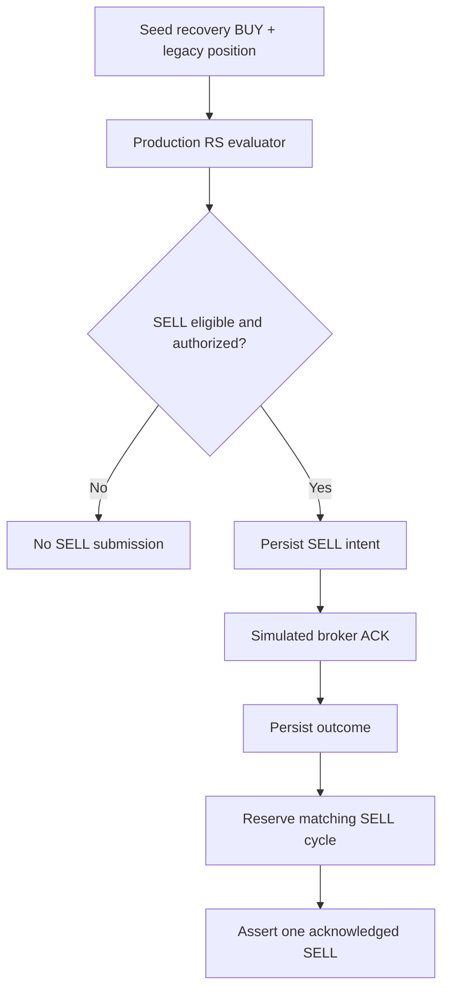

#### RS-RUNTIME-SELL-INTENT-PERSISTENCE-FAILURE-001 — fail before broker

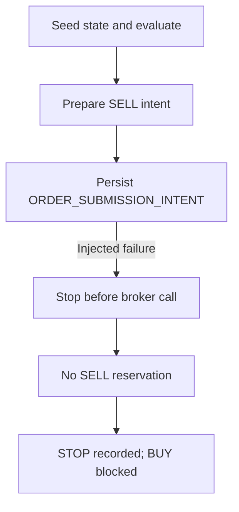

#### RS-RUNTIME-SELL-OUTCOME-PERSISTENCE-FAILURE-001 — ACK but outcome write fails

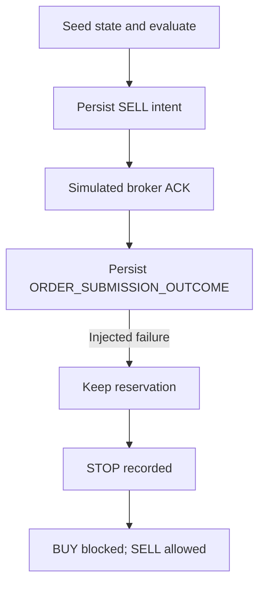

#### RS-RUNTIME-SELL-OUTCOME-AND-STOP-PERSISTENCE-FAILURE-001 — two persistence failures

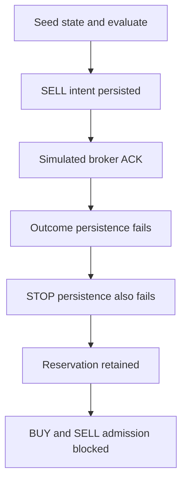

#### RS-RUNTIME-SELL-BROKER-EXCEPTION-001 — unknown broker outcome

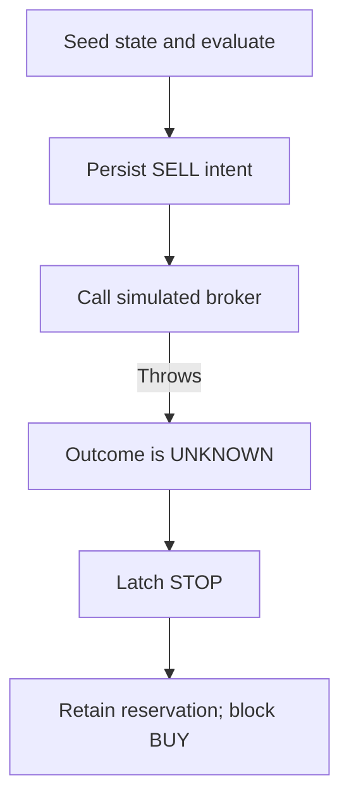

#### RS-RUNTIME-SELL-RESERVATION-FAILURE-001 — reservation callback fails

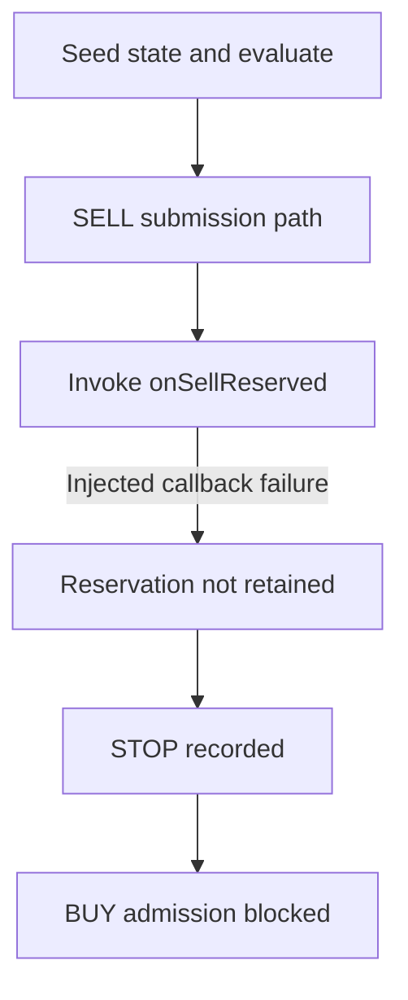

#### RS-RUNTIME-SELL-REJECTION-001 — explicit rejection

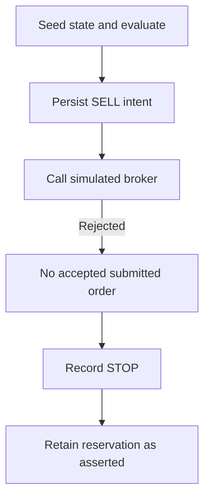

#### RS-RUNTIME-SELL-PARTIAL-CANCEL-001 — partial fill then CANCELED

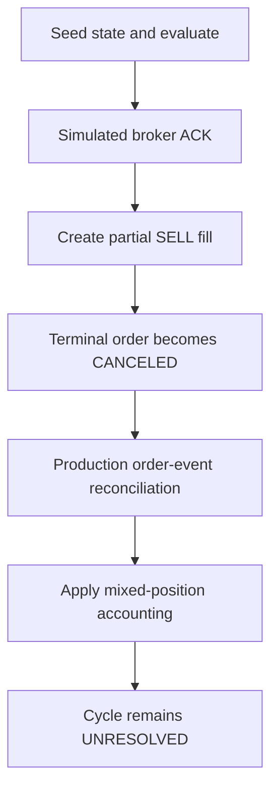

#### RS-RUNTIME-SELL-FILLED-UNDER-TARGET-001 — FILLED but not profitable enough

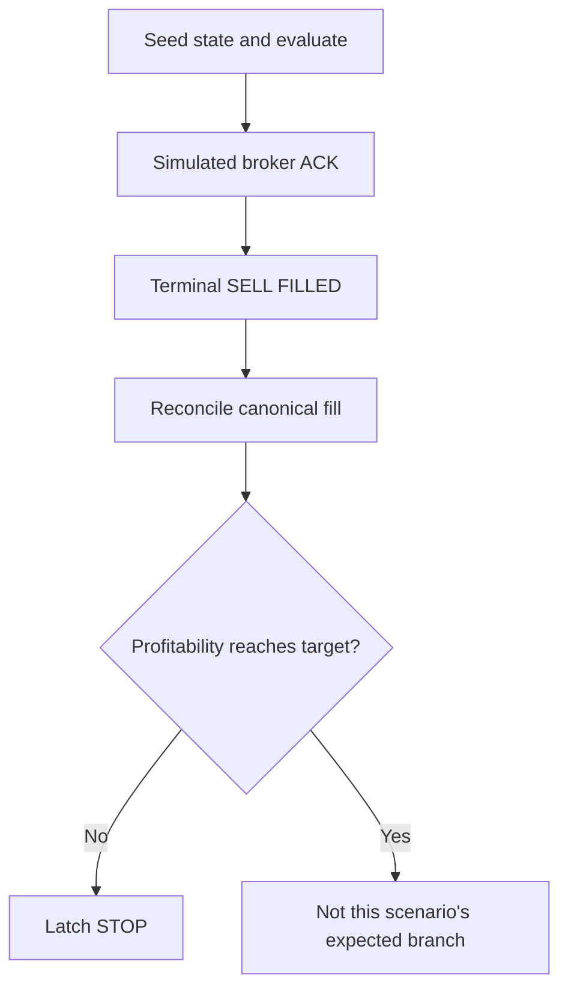

#### RS-RUNTIME-SELL-TERMINAL-RECONCILIATION-PERSISTENCE-FAILURE-001 — terminal fact write fails

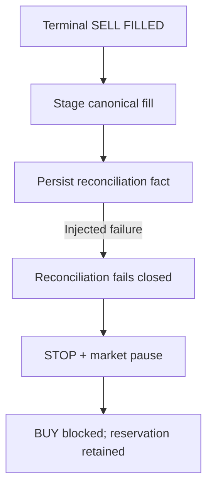

#### RS-RUNTIME-SELL-STOP-PERSISTENCE-FAILURE-001 — failed STOP write plus follow-up

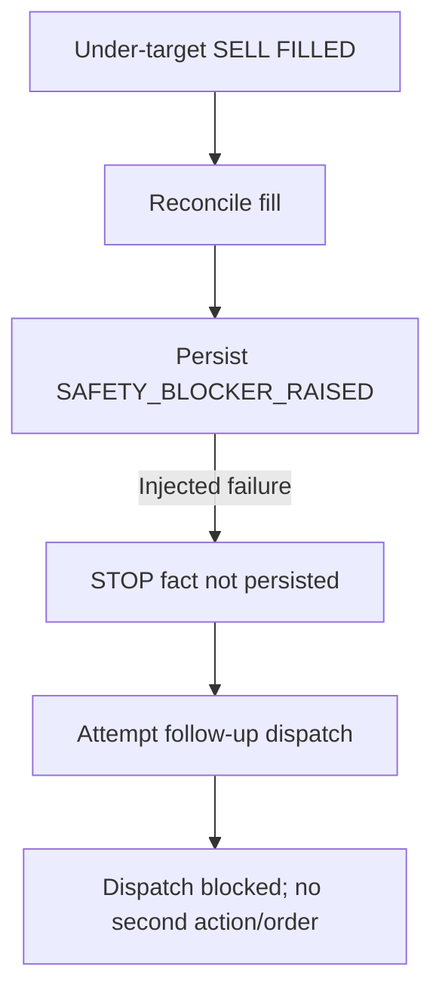

#### RS-RUNTIME-STOP-BLOCK-BUY-ALLOW-SELL-001 — direction-specific STOP gate

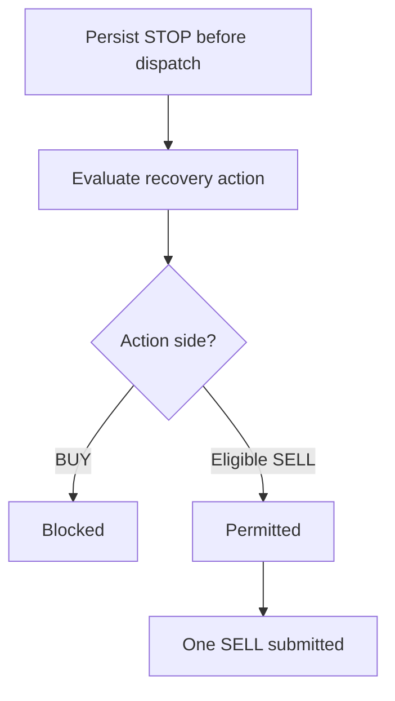

### RS-004-011 — preliminary helper-only profitability candidate

This entry is not one of the twelve runtime lifecycle scenarios and remains non-executable. It invokes only `calculateRecoverySellerProfitability` and asserts the recovery, legacy and combined-cycle calculation result.

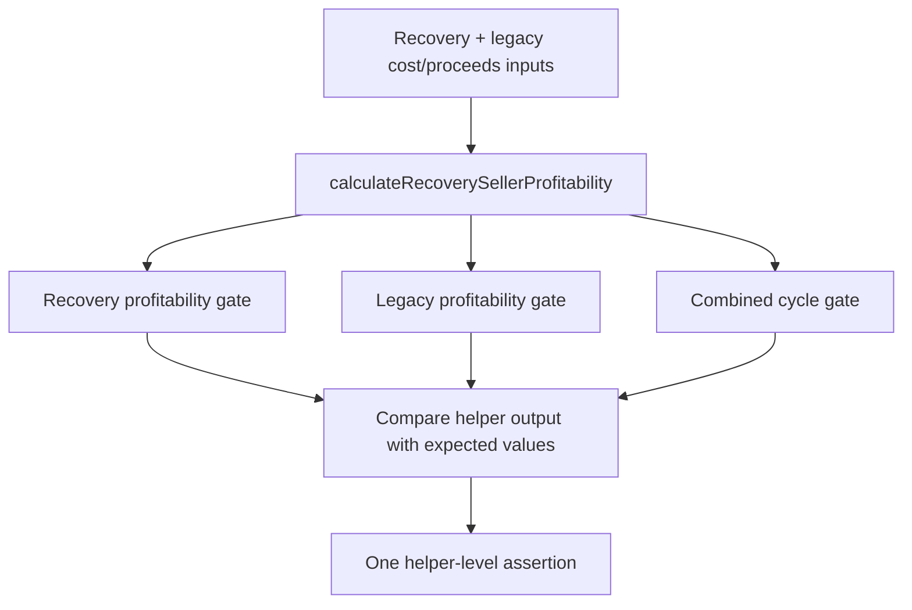

**Important reading rule:** these are expected scenario paths, not evidence that a run has already taken those steps. The Dashboard's separate Run Story is built from the returned run trace and source facts. It must never fill in missing steps from these intent diagrams.
