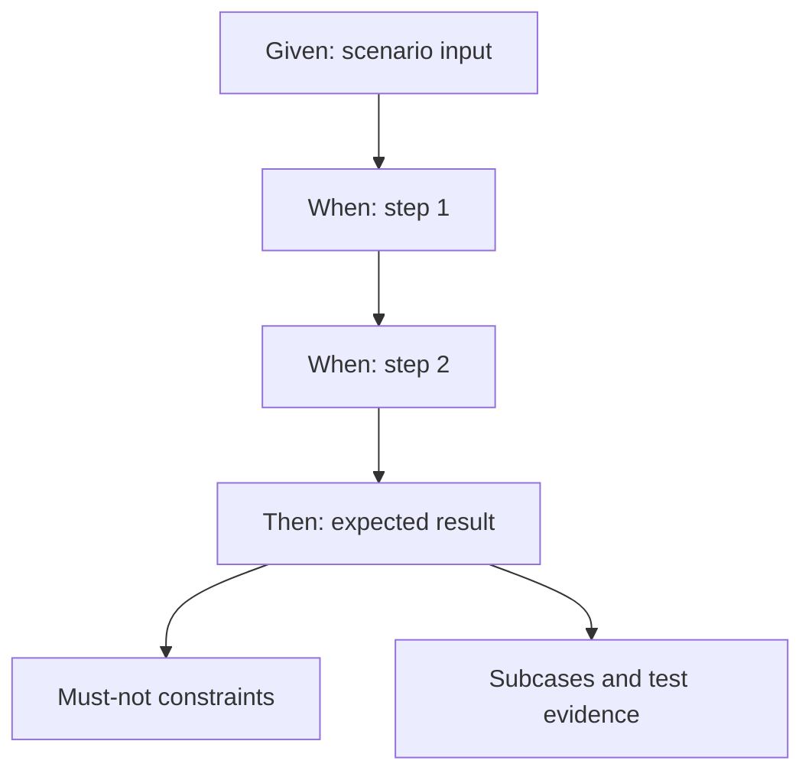

# RS Registry Explorer — first strategy adapter

- Status: draft design companion to [Scenario Explorer SPEC](SPEC.md)
- Initial source: [RS scenario-testing PR #1823](https://github.com/45s/coinzilla/pull/1823), its registry and issue [#1780](https://github.com/45s/coinzilla/issues/1780)
- Strategy scope: Recovery Seller (RS) first; GC later

## Goal
Turn the existing structured RS scenario records into interactive, navigable diagrams. The first milestone is a **registry reader/visualizer**, not a simulator. Read scenario definitions and build interactive graphs from their relationships rather than manually drawing one diagram per case.

## Source model and fields
PR #1823 registry records contain these relevant fields (exact schema remains owned by the registry):
- Identity/family: id, family, name, priority, layer, status.
- Authority: specification anchors and task/matrix references.
- Inputs and steps: given, ordered when records with step types/input keys/saveAs references, and then expected outputs.
- Constraints: mustNot clauses, blocker where applicable.
- Traceability: covers.rules, covers.decisions, covers.states, covers.transitions, covers.invariants, configuration fields.
- Test links: mapped test file/title and subcases with status/evidence.
- Implementation/source links.

The Explorer adapts these records into a presentation-neutral graph model; it must not mutate registry data, invent expectations or silently fill missing links.

## Graph modes

### 1. Scenario path diagram
Render each record as Given → ordered When step(s) → Then, with separate inspectable Must-not constraints and subcase nodes. A step is a distinct node. Only branch when source data explicitly represents branching; sequential steps must not be turned into invented decision forks.

Illustrative rendering for a record (not a verified RS case's exact steps):

### 2. Coverage/relationship graph
Render linked entities from registry metadata:
- Scenario and subcase.
- Rules and decisions.
- State and transition references.
- Invariants and configuration fields.
- Implementation/source files.
- Test mappings and evidence/status.

Render relationships only when supplied by the registry. Missing links are shown as missing/unknown rather than inferred from filenames or source text. Shared nodes can group multiple records and navigate to their references.

### 3. Runtime evaluation graph — later
Static registry records do not provide runtime evaluation. This mode requires an approved Harvester simulation-safe evaluator/trace boundary. Only emitted steps/branches/calculations are presented as evaluated; no private production call path, broker, exchange or live order execution.

## Node inspector
Selecting a node synchronizes the scenario text and graph highlight. Display, where applicable:
- Node kind and source field/reference.
- Exact registry value/raw text.
- Related IDs/links.
- Provenance/source anchor.
- Status/evidence and mapped test link without representing status as runtime result.
- Structured inputs/outputs as readable key/value detail; long data can be collapsed but raw values remain accessible.

## Navigation, filters and graph behavior
- Browse by RS family, case ID, name, priority, layer and status; search identifiers/terms.
- Select a case for behavior view or compare/reference multiple cases in relationship view.
- Filter relationship nodes by rules, decisions, states, transitions, invariants, config fields, implementation paths, tests, subcase status and blockers.
- Family overview: group case nodes by RS family; calculate counts/status distribution from registry dynamically.
- Shared-reference navigation: selecting rule/invariant/test/source shows all scenario records referencing it.
- Search/filter changes only Explorer UI state, never source records.
- Graph selection synchronizes graph, record list and text/detail panels.
- Zoom, pan, fit, keyboard navigation and accessible textual/list fallback.
- If graph/layout fails, text, list navigation and inspector remain usable.

## Status semantics
Statuses describe evidence state, not decision results:
- TEST-MAPPED: mapped test exists; not necessarily passing or verified at current head.
- PARTIAL: evidence/mapping exists but some specified behavior remains unresolved.
- BLOCKED: specific blocker prevents verification/implementation.
- VERIFIED: only if registry evidence policy supports it; the UI never promotes statuses.
- Missing/unknown is shown as such.

## Initial RS scope from PR #1823
Based on its description and records at PR head (not a fresh checkout audit):
- RS-001 authorization/custody: 14 records, including freshness-related blocked subcases.
- RS-002 BUY accounting: 21 records (20 reserved IDs plus cross-cutting RS-002-004), with mapped/partial cases and blockers.
- RS-004-011 profitability scenario.
- Catalogs for rules, decisions, states, transitions, invariants and configuration fields; DOMAIN/APPLICATION runner and test mappings.

The Explorer reads records available from source rather than hardcoding the family count/list. Registry schema changes are handled explicitly; incompatible input fails visibly.

## Proposed implementation phases
1. **RS Registry read-only explorer:** registry source adapter, normalization, browse/filter, family overview, Given/When/Then diagram, mustNot/subcase nodes, inspector and source/test navigation. No execution.
2. **Traceability graph:** cross-case relationships for rules/decisions/states/transitions/invariants/config/source/test/evidence; missing mappings and blockers surfaced.
3. **Scenario comparison:** compare selected cases/subcases; highlight input, steps, expectations, mustNot, coverage, statuses and blocker differences without issuing correctness verdicts.
4. **Execution/trace simulator design:** after review, define Harvester-owned simulation contract. Actual evaluator traces remain distinct from declarative expectations.
5. **GC adapter:** reuse neutral graph model once GC scenario source and simulation boundary are separately scoped.

## Design questions
1. Registry source: bundled read-only JSON export or supported API? Initial implementation must not import private Harvester test modules into the Dashboard browser bundle.
2. Schema compatibility: explicit export version and validation; tolerate unknown display fields but reject malformed required structure.
3. Source/test links: Dashboard internal navigation, safe external links, or approved source-browser endpoint?
4. Graph size: per-case graph by default; family summaries and progressively filtered relationship graphs.
5. Comparison mode: which structural changes should be highlighted?
6. CI evidence: show run links only when registry includes exact commit/run reference? Proposal: yes, never infer CI state.
7. Import/export and saved filters: later and safe; imported scenario text must not become executable input.
8. Renderer/accessibility: choose after review, keep graph data renderer-neutral.

## Acceptance — RS phase 1
- [ ] Registry records are consumed through a stable export/API boundary, not private Harvester test imports in Angular bundle.
- [ ] Every record is discoverable; none silently omitted.
- [ ] Given/When/Then and mustNot represented faithfully and in order.
- [ ] Subcases and coverage links navigable.
- [ ] Node inspection synchronizes graph, list and details.
- [ ] Statuses and missing references accurately represented with provenance.
- [ ] No simulation, broker/exchange connection, credentials or production mutation.
- [ ] Rendering failure leaves text/list/inspector accessible.
- [ ] Tests verify mapping completeness, stable IDs, fidelity, navigation, filters and safe links.

## Discussion log
- **2026-11-25:** RS selected as first strategy because its scenario registry already exists. Scope clarified as reconstructing scenario text/registry into interactive illustrations, with specification continuing to evolve. No runtime simulation yet.
