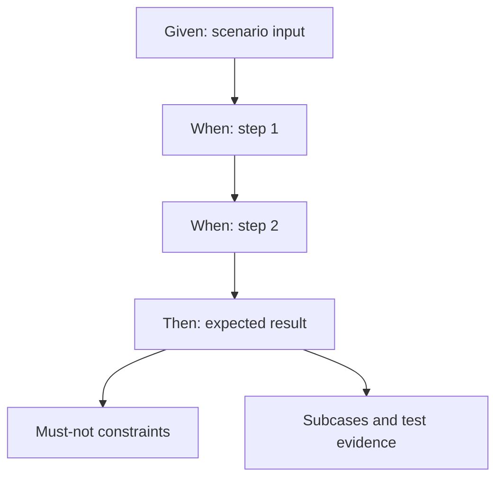

# RS scenario catalogue — first strategy adapter

- Status: draft design companion to [Scenario Explorer SPEC](SPEC.md)
- Original source history: [PR #1823](https://github.com/45s/coinzilla/pull/1823) (closed unmerged as superseded). Consolidated test registry: [PR #1852](https://github.com/45s/coinzilla/pull/1852), merged into develop at `ef5f5e25b0994f244eb6b29b62f5d48235df4544`. Issue [#1780](https://github.com/45s/coinzilla/issues/1780) remains the live RS matrix.
- Strategy scope: Recovery Seller (RS) first; GC later

## Goal
Provide the initial strategy-owned scenario catalogue adapter for the strategy-neutral Scenario Runner. RS is the first integration target because its production runtime evaluator, accounting workflow, action authorizer and order submitter exist on develop. The structured RS registry and mapped records are now merged in PR #1852, but they live under Harvester test support and remain the authoritative **test-coverage registry**, not a production runtime catalogue. Do not import private Harvester test modules into the production host or Dashboard bundle. A supported production catalogue/export boundary is still required. The current public catalogue exposes only RS-004-011 as a provisional PRELIMINARY candidate, and its adapter invokes only the pure profitability helper. A separate deterministic SELL dispatch fixture lives under Harvester test support; it has no scenario ID, is not RS-004-012, and is not exposed in the public catalogue. No RS scenario is executable through the host. The generic runner owns discovery, configuration orchestration, isolated execution lifecycle, result comparison and graph presentation; the RS adapter supplies source-backed scenarios only when their registry and execution contracts are available.

## Source model and fields
PR #1852 registry records contain these relevant fields (exact schema remains owned by the registry):

- Identity/family: id, family, name, priority, layer, status.
- Authority: specification anchors and task/matrix references.
- Inputs and steps: given, ordered when records with step types/input keys/saveAs references, and then expected outputs.
- Constraints: mustNot clauses, blocker where applicable.
- Traceability: covers.rules, covers.decisions, covers.states, covers.transitions, covers.invariants, configuration fields.
- Test links: mapped test file/title and subcases with status/evidence.
- Implementation/source links.

The Explorer adapts these records into a presentation-neutral graph model; it must not mutate registry data, invent expectations or silently fill missing links.

## Graph modes

### 1. Scenario path diagram
Render each record as Given → ordered When step(s) → Then, with separate inspectable Must-not constraints and subcase nodes. A step is a distinct node. Only branch when source data explicitly represents branching; sequential steps must not be turned into invented decision forks.

Illustrative rendering for a record (not a verified RS case's exact steps):

### 2. Coverage/relationship graph
Render linked entities from registry metadata:

- Scenario and subcase.
- Rules and decisions.
- State and transition references.
- Invariants and configuration fields.
- Implementation/source files.
- Test mappings and evidence/status.

Render relationships only when supplied by the registry. Missing links are shown as missing/unknown rather than inferred from filenames or source text. Shared nodes can group multiple records and navigate to their references.

### 3. Runtime evaluation graph — later
Static registry records do not provide runtime evaluation. This mode requires an approved Harvester simulation-safe evaluator/trace boundary. Only emitted steps/branches/calculations are presented as evaluated; no private production call path, broker, exchange or live order execution.

## Node inspector
Selecting a node synchronizes the scenario text and graph highlight. Display, where applicable:

- Node kind and source field/reference.
- Exact registry value/raw text.
- Related IDs/links.
- Provenance/source anchor.
- Status/evidence and mapped test link without representing status as runtime result.
- Structured inputs/outputs as readable key/value detail; long data can be collapsed but raw values remain accessible.

## Navigation, filters and graph behavior

- Browse by RS family, case ID, name, priority, layer and status; search identifiers/terms.
- Select a case for behavior view or compare/reference multiple cases in relationship view.
- Filter relationship nodes by rules, decisions, states, transitions, invariants, config fields, implementation paths, tests, subcase status and blockers.
- Family overview: group case nodes by RS family; calculate counts/status distribution from registry dynamically.
- Shared-reference navigation: selecting rule/invariant/test/source shows all scenario records referencing it.
- Search/filter changes only Explorer UI state, never source records.
- Graph selection synchronizes graph, record list and text/detail panels.
- Zoom, pan, fit, keyboard navigation and accessible textual/list fallback.
- If graph/layout fails, text, list navigation and inspector remain usable.

## Status semantics
Statuses describe evidence state, not decision results:

- TEST-MAPPED: mapped test exists; not necessarily passing or verified at current head.
- PARTIAL: evidence/mapping exists but some specified behavior remains unresolved.
- BLOCKED: specific blocker prevents verification/implementation.
- VERIFIED: only if registry evidence policy supports it; the UI never promotes statuses.
- Missing/unknown is shown as such.

## Initial RS scope carried into PR #1852
Based on its description and records at PR head (not a fresh checkout audit):

- RS-001 authorization/custody: 14 records, including freshness-related blocked subcases.
- RS-002 BUY accounting: 21 records (20 reserved IDs plus cross-cutting RS-002-004), with mapped/partial cases and blockers.
- RS-004-011 profitability helper candidate (PRELIMINARY; helper-only and non-executable. PR #1852's test registry is merged, but it is not a production runtime catalogue).
- The deterministic production SELL dispatch fixture is internal test support with a fixture ID, not a registry scenario or public RS-004-012 record.
- Catalogs for rules, decisions, states, transitions, invariants and configuration fields; DOMAIN/APPLICATION runner and test mappings.

The Explorer reads records available from source rather than hardcoding the family count/list. Registry schema changes are handled explicitly; incompatible input fails visibly.

## Implementation phases

1. **Runner foundation:** strategy-neutral registration/capability contracts, scenario catalogue port, schema-driven configuration model, isolated run lifecycle, result/trace contracts and framework-independent application core.
2. **RS executable vertical slice:** RS catalogue adapter, actual production-use-case integration, editable strategy/market configuration, isolated state and simulated broker/market adapters, real assertions and trace.
3. **Runner visualization and diagnostics:** renderer-neutral execution graph, synchronized trace/list/inspector, expected-vs-actual comparison, failure diagnostics and accessible text fallback.
4. **Hardening and conformance:** production-code parity tests, no-live-side-effect tests, deterministic repeat/reset, malformed scenario/config/event tests, and a second-strategy adapter conformance fixture.
5. **Additional strategies:** implement strategy-owned adapters as executable scenario catalogues and production-safe runtime contracts become available; runner core remains unchanged.

## Design questions

1. Registry source: bundled read-only JSON export or supported API? Initial implementation must not import private Harvester test modules into the Dashboard browser bundle.
2. Schema compatibility: explicit export version and validation; tolerate unknown display fields but reject malformed required structure.
3. Source/test links: Dashboard internal navigation, safe external links, or approved source-browser endpoint?
4. Graph size: per-case graph by default; family summaries and progressively filtered relationship graphs.
5. Comparison mode: which structural changes should be highlighted?
6. CI evidence: show run links only when registry includes exact commit/run reference? Proposal: yes, never infer CI state.
7. Import/export and saved filters: later and safe; imported scenario text must not become executable input.
8. Renderer/accessibility: choose after review, keep graph data renderer-neutral.

## Acceptance — RS phase 1

- [ ] Registry records are consumed through a stable export/API boundary, not private Harvester test imports in Angular bundle.
- [ ] Every record is discoverable; none silently omitted.
- [ ] Given/When/Then and mustNot represented faithfully and in order.
- [ ] Subcases and coverage links navigable.
- [ ] Node inspection synchronizes graph, list and details.
- [ ] Statuses and missing references accurately represented with provenance.
- [ ] No simulation, broker/exchange connection, credentials or production mutation.
- [ ] Rendering failure leaves text/list/inspector accessible.
- [ ] Tests verify mapping completeness, stable IDs, fidelity, navigation, filters and safe links.

## Discussion log

- **2026-11-26 post-merge audit:** PR #1823 is closed unmerged as superseded; PR #1852 is merged into `develop` and supplies the RS test-coverage registry and mapped records. Those records remain test-only and are not a production runtime catalogue. RS-004-011 remains a provisional helper-only candidate, marked PRELIMINARY and non-executable. The production SELL dispatch integration fixture is test-only and is not a registry scenario. The host requires a simulation-only adapter with verified OS sandbox attestation; no production launcher currently provides that attestation, so no RS scenario is executable.

## Framework-independent execution architecture — required runner foundation

Dashboard-wide DDD/framework-neutral rule is mandatory (see [Dashboard AGENTS.md](../../../AGENTS.md) and SPEC section 2.1). Registry adapters, parsing/validation, normalization, scenario semantics, execution orchestration, assertions and renderer-neutral graph construction live outside Angular. Components delegate and render. Core must remain reusable if UI is rewritten in React/Vue.

First execution milestone: execute one RS scenario/subcase independently. Registry loader -> parse/validate/normalize -> selection -> fresh isolated context -> supported safe action/evaluator contract -> real assertions and trace -> renderer-neutral graph model -> presentation adapter. Use declarative records and constrained typed actions; never run registry-supplied arbitrary JS. Each case reports capability and actual outcome; do not attribute suite results to individual cases.

Execution is Harvester-hosted: the browser submits a typed request through a framework-independent API contract; Harvester invokes production use cases inside an isolated simulation runtime. No private Harvester modules are bundled into Dashboard. No live broker/exchange, credentials, orders, production mutation or direct database access. Contract and isolation remain open dependencies; do not implement a duplicate strategy rules engine in Dashboard.

Layer separation: domain (scenario/run/result semantics), application (use cases/ports), adapters (registry/evaluator/storage/graph renderer/framework), Angular presentation (thin components/composition). Framework-swap acceptance: changing Angular to React/Vue does not require changing domain/application logic, execution contracts or core tests.

## Approved strategy-neutral runner direction (2026-11-25)

RS is only the first adapter, not the runner's scope. The same runner must eventually support every strategy with properly defined executable scenarios: RS, Generic Conservative/Aggressive, GC Conservative/Aggressive, futures strategies, grids and future families. Strategy-specific configuration fields/defaults and supported events come from the selected strategy adapter, never generic runner conditionals.

The MVP is an executable RS vertical slice, not a read-only registry MVP. It must invoke the exact production functions/use cases used by normal runtime. Simulation replaces infrastructure side effects only (broker/order gateway, market/event source, isolated state/persistence and controlled clock as needed). It must not fork or duplicate strategy decisions, calculations, validation, accounting or lifecycle behavior.

The runner core owns strategy-neutral registration/discovery, configuration orchestration, isolated execution lifecycle, event sequencing, results/assertions, expected-vs-actual comparison, trace/graph semantics and diagnostics. Strategy adapters bind scenarios/configuration to the actual production application entry points. Angular is only a replaceable presentation adapter; DDD/framework independence applies to all core behavior.

A scenario that cannot invoke production behavior safely is blocked/not executable until its boundary is solved. Never downgrade it to a simplified Dashboard evaluator. No real broker/exchange calls, credentials, live orders, production state or persistence may be reachable from a simulation run.

## Execution ownership decision (2026-11-25)

Approved: scenario execution belongs to Harvester, not the Dashboard browser. Dashboard authors inputs/configuration and renders server-produced results and trace. Harvester hosts the isolated run and strategy adapters, invoking the same production business/application functions as live runtime. The API is a transport boundary, not a second business layer. Runtime/process isolation and resource/lifecycle controls remain open for the next design decision.

## Approved simulation isolation decision (2026-11-25)

Each run is executed by a dedicated worker process managed by the Harvester runner host, separate from the live trading process. Every worker receives fresh run-local state and simulation-only adapters, has no credentials or production persistence/live-account access, and cannot fall back to real broker/exchange infrastructure. Worker timeouts, concurrency/resource limits, cleanup and fail-closed diagnostics are mandatory; exact operational values and launch mechanism are to be established during implementation audit.

## Approved transport decision — REST API + WebSocket (2026-11-25)

The Dashboard-to-Harvester Scenario Runner transport is **REST API + WebSocket**. REST is the command/query interface for submitting a scenario run, retrieving run status/results and diagnostics, requesting cancellation, and inspecting run details/history where supported. WebSocket carries server-pushed run lifecycle/progress and execution updates, including terminal completion/failure notifications. The asynchronous run-job contract remains transport-independent: Dashboard receives a run identifier and lifecycle state, then observes updates and retrieves authoritative results from Harvester.

The transport is an adapter, not a business layer. Domain/application contracts and use cases must not depend on HTTP, WebSocket APIs, Angular, RxJS or browser APIs. Keep request/event DTOs typed and versionable; define reconnect/resubscription and missed-update recovery so REST status/result retrieval remains authoritative if a WebSocket connection drops. Do not introduce GraphQL, gRPC or a message broker for the initial implementation without a demonstrated requirement.

## Approved run lifecycle and cancellation decision (2026-11-25)

Use a server-owned asynchronous run lifecycle with explicit, observable states:

- **Accepted / Queued** — request validated and accepted; execution has not started.
- **Starting** — dedicated worker is being created and its simulation-only boundary is being verified.
- **Running** — production use cases are executing inside the isolated worker.
- **Cancelling** — cancellation requested; the host asks the worker to stop cooperatively and perform bounded cleanup.
- **Completed**, **Failed**, **Cancelled**, **Timed out**, or **Blocked** — terminal outcomes. Initialization/isolation failures are explicit blocked outcomes or diagnostics, never ordinary successful runs.

Cancellation is **cooperative first, forced termination second**. The host sends a cancellation signal and allows a configurable grace period for the worker to stop safely and flush permitted partial trace/diagnostics. If the worker does not exit within that period, the host forcibly terminates it. Cancellation is idempotent; repeated requests do not create duplicate shutdown work. A cancelled run is never reported as completed/passed. Preserve partial trace and diagnostics when safely available, but do not delay termination to guarantee their persistence. Every terminal path, including crash, timeout and forced termination, must release worker/process resources and finalize an authoritative status.

A timeout is reported distinctly as **Timed out**, not conflated with user-requested cancellation or generic failure. A worker that cannot safely initialize or verify simulation isolation must not execute scenario actions. The host/API owns lifecycle truth; WebSocket publishes lifecycle changes, while REST status/result/diagnostics remain authoritative after disconnect or missed events. Dashboard domain/application logic consumes framework-neutral lifecycle states and must not own worker termination policy.

The exact cancellation grace-period default, timeout values, process signals, cleanup deadlines and partial-result persistence policy are operational parameters to establish during implementation/runtime audit; this decision does not invent numeric limits.

The RS adapter must not implement its own worker lifecycle or cancellation policy; it supplies production-flow execution and diagnostics to the strategy-neutral host.

## Approved result history and AI-debug export (2026-11-25)

The generic runner host persists bounded server-side run history under configurable retention/size limits. It records enough simulation-only evidence to inspect and debug a run, including identity/version metadata, effective config and inputs, ordered events, lifecycle/status history, outputs, assertions, trace/steps/decisions and diagnostics. Secrets, credentials, live account data and production state are excluded. Scenario-definition storage has a separate policy.

The client provides **Copy AI Debug Package** for each inspectable run. It copies one self-contained, versioned JSON document with all available inputs, outputs, statuses/transitions, ordered events, steps, decisions, calculations, assertions, diagnostics and provenance. It identifies repository, executed production revision, strategy/adapter, scenario/scenarioId, runId and versions. It must not silently truncate; if a full clipboard copy is not possible, it offers an explicit complete export or segmented-copy fallback. Secret redaction is mandatory. Report generation is framework-independent; Angular is presentation only.

## Approved AI-debug workflow and local access decisions (2026-11-25)

The AI Debug Report is self-contained as a complete run-evidence snapshot; it does not duplicate source code or the repository's documentation. Repository access is permitted and expected for deeper debugging: the AI should use the report's exact executed commit, strategy/adapter, scenario/subcase and evidence to inspect the matching source code, architecture/specification docs, scenario definitions and mapped tests; establish the intended production call path and why/how the scenario should behave; then audit actual trace/results against that evidence and cite source files/lines/tests. The original server run is never required to understand the report.

The initial runner is unauthenticated **only for local development**, with a strict loopback-only host boundary. It must not be exposed on LAN/public/remote interfaces. Any future remote/shared access requires a separately designed and implemented authentication/authorization boundary before exposure. Bind enforcement and compatibility with existing local API hosting remain audit items.

## RS configuration semantics and scenario inputs — do not invent units

The RS adapter must expose field names, values and units from the actual Harvester configuration and production contracts. For the current LINEAUSDT TESTNET config in `apps/harvester/rs-recovery-seller.js`, the documented values are: `legacyPosition.invested = 400` quote-currency units (USDT), `legacyPosition.quantity = 25000` base units (LINEA), `sellQuantity = 10` base units, `investment = 100` quote-currency units, `orderQuantity = 7000` base units, `minProfit = 0.01` **absolute profit in the market's quote asset (0.01 USDT = one USDT cent for this LINEAUSDT example), never a percentage; this applies to every RS market**, `priceStepPercent = 0.5` (0.5%), and maker/taker fee percentages of `0.1` each. Volatility protection is disabled. Resolved TESTNET precision is price precision 6 and quantity precision 0.

Do not invent standalone inputs such as `averageEntryPrice` when production derives the historical average from `legacyPosition.invested / legacyPosition.quantity`. For this configured legacy basis, the derived value is 0.016 USDT/LINEA; label it as a derived value, not a configured field. The configured legacy basis does not establish current Spot custody or available inventory.

Market prices and simulated BUY/SELL broker outcomes belong to the scenario's ordered event/input sequence, not the RS configuration. Use values from an existing scenario/test fixture or explicitly authored and validated scenario inputs. Do not present invented prices or fills as existing project evidence. Every displayed monetary value must include its quote asset; every quantity must include its base asset; percent fields and absolute quote-currency amounts must be visually and semantically distinct.

**Universal RS `minProfit` semantics:** for every market, `minProfit` is an absolute net-profit threshold denominated in that market's quote asset. A value of `0.01` means 0.01 quote-asset units (for example, 0.01 USDT for a USDT-quoted market), never 1%. LINEAUSDT above is only the concrete config example; it does not narrow this rule to LINEA.

## Approved original replay, temporary Playground and JSON AI package (2026-11-25)

- **Original replay:** run the scenario with its exact recorded production revision and original inputs/configuration. Do not silently substitute current code. Newer-revision comparison is not in the approved scope.
- **Playground:** allow temporary configuration/input overrides on a run-local copy. Example: change a DOGEUSDT scenario's market to ZROUSDT and investment from 400 to 100. The original registry scenario remains untouched; Playground edits are not saved back or persisted as a new scenario.
- **One validation path:** file-loaded and Playground-provided configuration use the same production parsing, validation, normalization and market-metadata resolution. The strategy receives validated effective configuration and does not know or care about its source. Invalid input is rejected before execution.
- **Copy AI Debug Package:** copy complete versioned JSON only, including original scenario, temporary overrides, validated effective configuration, executed revision, metadata, ordered events, trace, outputs, assertions and diagnostics. Redact secrets; never silently truncate. Repository access at the recorded revision is expected for deeper agent debugging.

## Mandatory agent preflight and branch scope

Every agent must read root `AGENTS.md` and all applicable nested `AGENTS.md` files before any task work; the issue, PR and Runner roadmap repeat this rule. All implementation stays in the dedicated task branch/PR; no direct `develop`/`main` commits or merges. Trading logic/services may be refactored as needed to achieve faithful production reuse, with regression coverage.

## Current Windows runtime status — 2026-11-27 (supersedes the historical 2026-11-26 status above)

The Harvester composition root selects a factory-created Node guarded-simulation launcher by default on Windows. No Linux environment variable, WSL2, Bubblewrap, cgroup controller or separate server is required. The local HTTP API exposes all twelve RS production-flow scenarios as executable for simulation; the Windows integration test submits each scenario through REST and checks terminal Completed status, passed assertions and trace. These scenarios remain PARTIAL because Node guards are not OS isolation and do not establish production durability, live-account safety or trusted build provenance. The Linux Bubblewrap E2E is manual-dispatch only and optional. Exact replay remains blocked until an independent trusted artifact verifier is available.
