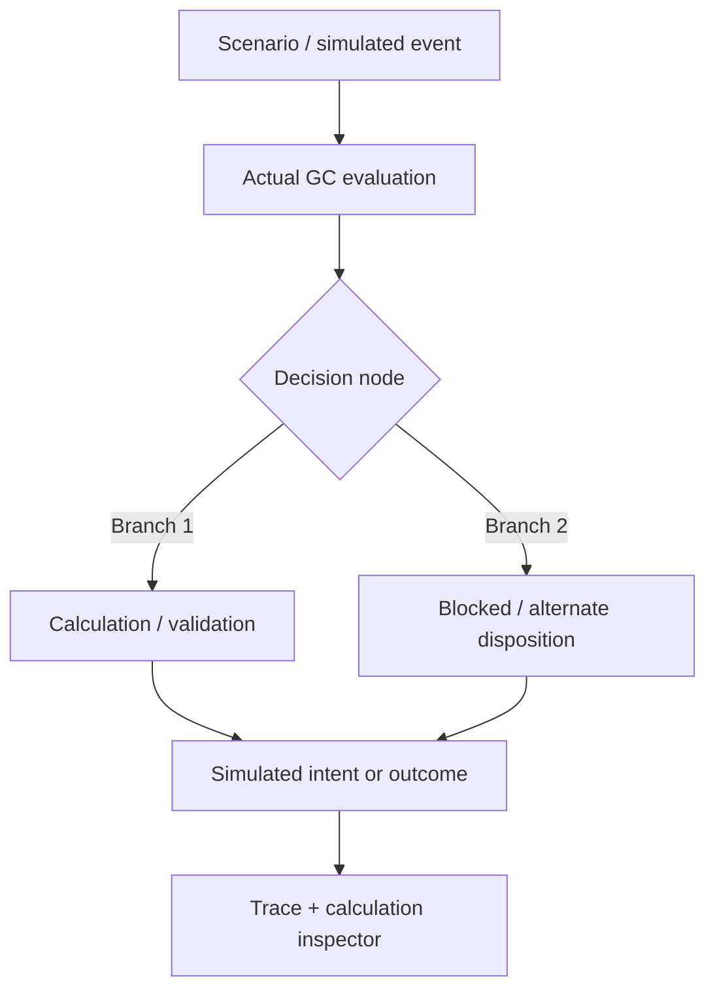

# Strategy Scenario Runner — strategy-neutral execution, RS first

- Status: draft
- Type: feature specification
- Owner: dashboard
- Created: 2026-11-25
- Tracking: [Issue #1836](https://github.com/45s/coinzilla/issues/1836)

## 1. Purpose

Provide a strategy-independent **Scenario Runner** in Dashboard. Users configure a strategy/market, select a declared scenario and subcase, execute the actual production strategy flow in an isolated simulation runtime, inspect the actual outcome/assertions and explore the emitted execution trace as an interactive graph. **Recovery Seller (RS) is the first strategy adapter** because its production runtime evaluator, accounting workflow, action authorizer and order submitter exist on develop. The original registry PR #1823 was closed unmerged as superseded; its replacement PR #1852 is now merged. It supplies a test-only/partial RS coverage registry, not a production runtime catalogue. RS is an initial example and integration target, not the runner's architectural boundary.

The long-term runner must support every strategy family for which executable scenarios and a supported simulation contract exist: RS, Generic Conservative/Aggressive, GC Conservative/Aggressive, futures strategies, grid strategies and future strategy types. Adding a strategy means providing its scenario definitions and strategy-owned runtime/configuration adapter; it must not require adding strategy-specific branches or business rules to the runner core.

This is a trading-flow runner with a simulated external world—not a read-only explorer and not a second implementation of trading logic. It must execute the same production functions/use cases, calculations, validations, decisions, state transitions and accounting paths used by normal runtime. Only external side-effect boundaries (broker/exchange, clock/market feeds and isolated state/persistence as required) are replaced by controlled simulation adapters.

## 2. Ownership and boundaries

- UI and runner experience: Dashboard; runner domain/application core remains framework-independent.
- Strategy policy, configuration semantics, production execution functions and authoritative calculations: their owning strategy/domain runtime (currently Harvester).
- Shared runner contracts define strategy registration/capabilities, scenario discovery, configuration schema/defaults, isolated runtime creation, event injection, execution results and trace output. Strategy adapters bind those contracts to actual production use cases.
- The runner must call the same production functions/methods as normal trading runtime. It must not fork, clone, approximate or reimplement strategy decisions in Dashboard or in a separate simulator.
- Replace only side-effecting infrastructure at explicit ports: simulated broker/order gateway, controlled market/event source, isolated account/order/inventory state, deterministic time where required, and simulation-scoped persistence. The simulated broker must never delegate to a real broker.
- Dashboard must not import private Harvester modules into the browser bundle, connect to exchanges, submit/cancel real orders, or read persistence directly. Use an approved runner host/API or shared package boundary that preserves production code reuse.
- Simulation output is a simulated strategy decision/intent only. It must not be presented as an acknowledged exchange order.

## 2.1 Mandatory framework-independent DDD architecture

This feature MUST comply with the Dashboard-wide framework-independence rule in [Dashboard AGENTS.md](../../../AGENTS.md): **business logic cannot depend on Angular or any UI framework**. DDD/clean architecture is mandatory for every Dashboard task.

For this Lab:

- Registry discovery/fetch contracts, parsing, schema validation, normalization, scenario selection semantics, run lifecycle, action interpretation, assertion evaluation, trace/result handling, graph-model construction and relationship derivation belong in framework-independent TypeScript core modules.
- The domain/application core must not import Angular, component/directive/template types, Angular DI, signals, RxJS, browser APIs, DOM or rendering libraries. Define ports and use adapters outside the core for transport/storage/browser concerns.
- Angular components are thin presentation adapters: bind state, dispatch actions to application use cases and render view models. No scenario business rules, parsing/validation, execution logic or graph semantics in components.
- The runner must be independently testable without Angular TestBed or a browser. Angular UI tests test presentation/adapters, not serve as the sole verification of domain logic.
- Graph renderer/layout technology is an adapter. Graph semantics and renderer-neutral graph models are produced by core logic so Angular/React/Vue replacement does not alter scenario logic.
- **Framework swap acceptance:** replacing Angular presentation must not require modifying scenario core, domain/application logic or their tests/contracts.

### Proposed framework-neutral module layers (illustrative)

```text
strategy-scenario-explorer/
  domain/               # Scenario concepts, run/result, validation rules
  application/           # use cases, orchestration, ports, runner contract
  adapters/
    registry-source/     # registry export/API adapter
    execution/           # safe evaluator adapter
    graph-renderer/      # replaceable renderer adapter
    storage/              # optional persistence adapter
  presentation-angular/   # Angular-only composition, components, view models
```

Names/layout are illustrative; responsibility and dependency direction are mandatory. Domain/application core owns behavior and contracts; adapters implement ports; UI framework code depends inward, never the reverse.

## 2.1.1 Scenario graph visualization

The Scenario Runner displays a read-only native SVG graph for the currently selected scenario. A framework-independent adapter projects the source-reviewed guide's ordered steps into graph nodes and connections; Angular only renders the graph. The guide does not publish branch topology, so the projection must not invent YES/NO branches. The graph model/schema is visual-only and separate from Harvester's executable scenario contract. Actual run status and source trace remain separate evidence and are never inferred from expected steps. Scenarios without a reviewed guide show an unavailable state. Graph editing, persistence and graph execution are out of scope.

## 2.2 Strategy-neutral execution architecture and MVP flow

The first executable milestone is an end-to-end RS scenario/subcase run using the generic runner contract. RS supplies the first strategy adapter and scenario catalogue; the runner itself has no RS-specific logic. The MVP is executable, not registry-only.

```ts
// Pseudocode: framework-neutral core, not Angular component code
const registry = await registrySource.load();       // source port/adapter
const scenarios = normalizeAndValidate(registry);   // pure core
const selected = selectScenario(scenarios, scenarioId, subcaseId);
const isolatedRun = runFactory.create(selected);     // isolated context
const result = await scenarioRunner.execute(isolatedRun);
const graph = graphBuilder.fromScenarioAndResult(selected, result);
viewAdapter.present({ graph, result });             // presentation adapter
```

Registry loading may use a versioned JSON/export or supported API, not private Harvester test imports in the Dashboard bundle. Validation and normalization belong in framework-independent modules. Unsupported/malformed definitions are explicit errors, never silently omitted or replaced by fixtures.

The runner interprets a constrained, typed action catalog; scenario data is declarative and MUST NOT contain arbitrary executable JavaScript. Each scenario/subcase receives fresh isolated run state. Execution and assertion behavior must invoke the actual production implementation through an approved simulation-safe runtime boundary—not copied/reimplemented strategy rules in Dashboard. If production code currently cannot run without live infrastructure, extract the smallest justified ports/adapters while preserving the same business functions and call path. If a case is not independently executable, show explicit not-executable/blocked status; do not attribute a whole-suite result to a single case.

Illustrative contracts (proposed shapes, not verified schemas):

```ts
interface ScenarioExecutionRequest {
  scenarioId: string;
  subcaseId: string;
  input: ScenarioInput;
}
interface ScenarioExecutionResult {
  status: 'passed' | 'failed' | 'blocked' | 'not-executable';
  assertions: AssertionResult[];
  trace: TraceStep[];
  diagnostics: Diagnostic[];
}
```

The engine returns actual assertion results, ordered trace and diagnostics. Registry expected values are not results. Graph runtime evidence is sourced only from execution results; declarative Given/When/Then and registry/test mapping views remain separately labelled.

### Strategy-neutral execution cycle (MVP)

1. Load a supported registry source through an adapter.
2. Validate export/schema/version and normalize records in the framework-neutral core.
3. Discover/select scenario and subcase; indicate independent-execution capability.
4. Create isolated context from explicit inputs; no shared mutable run state.
5. Execute constrained action sequence through the supported safe contract.
6. Capture real assertion results, ordered trace, status and diagnostics.
7. Build renderer-neutral graph from source and actual results; retain provenance.
8. Render through presentation/graph adapters and synchronize graph, list, inspector and trace.
9. Reset/close discards run-local state; optional persistence is a replaceable adapter.

No live broker/exchange access, credentials, real order submission/cancellation, production mutation or direct DB access is permitted. The runner may be browser-orchestrated but should execute production logic in the runtime host/package that owns it; a backend/Harvester-hosted isolated runner is preferred where that is necessary to reuse actual production modules safely. Never bundle private Harvester runtime internals into the browser merely to claim client-side execution.

### Illustrative strategy-neutral runner pseudocode

```ts
// Framework-neutral application module; exact implementation follows contract audit
async function executeScenario(request, ports): Promise<ScenarioExecutionResult> {
  const scenario = ports.registry.getValidated(request.scenarioId);
  const subcase = selectSubcase(scenario, request.subcaseId);
  const context = ports.runContext.createIsolated(subcase.inputs);
  const trace = [];
  for (const action of subcase.actions) {
    trace.push(await ports.safeEvaluator.execute(action, context));
  }
  const assertions = ports.assertions.evaluate(subcase.expectations, context);
  return assembleExecutionResult({ assertions, trace, diagnostics: context.diagnostics });
}
```

This illustrates separation only; it does not authorize a Dashboard-owned strategy evaluator. The execution port must invoke the same production use cases/functions as live runtime with simulation adapters injected at side-effect boundaries. Core remains independent of Angular and graph rendering.

## 3. Scope

### Included in the initial strategy-neutral runner capability (RS adapter first)

- A dedicated Dashboard navigation entry and Lab workspace.
- Discover available strategy adapters dynamically; initially expose RS because its production runtime boundary exists. Expose only individually mapped and independently verified scenarios; later strategies register without runner-core changes.
- Select strategy, market, scenario and subcase; load strategy-owned configuration schema/defaults and allow validated user-editable simulation configuration.
- Display scenario inputs and provenance; distinguish scenario records from live/runtime state.
- Reconstruct scenario given inputs, when steps, then expectations and mustNot constraints as graph nodes/links, with an inspector.
- Visualize RS registry and matrix relationships (rule, decision, state, transition, invariant, configuration field, implementation source, mapped test/subcase and evidence/status).
- Execute the actual production strategy flow in an isolated simulation runtime and visualize actual emitted trace/results. Registry expectation and test-evidence views remain separately labelled.
- Dynamic interactive diagrams, traceability graph, node inspection, filtering, search, grouping and graph↔text synchronization.
- Step forward/back through a deterministic run where the simulation contract supports replay.
- Scenario presets, temporary Playground overrides and reset.
- Simulation history for the current run and selected node/event.
- Explicit simulation-only safety messaging and guards.

### Explicitly excluded from the simulation runner

- Live order submission/cancellation, broker/exchange connections or exchange credentials.
- Production Portfolio, Journal, Operational State Store or other persisted-data mutation.
- Direct browser-to-exchange/API calls.
- Copying, reimplementing or approximating strategy decision rules, calculations, validators, accounting or lifecycle logic in the runner.
- Treating mock scenario inputs or outputs as live account data.
- Full exchange matching-engine/market simulation, queue priority, latency or slippage modeling unless a separately reviewed extension defines it.
- Strategy changes, behavior overrides that are not accepted by the actual evaluator, or changing the production strategy configuration.
- Recovery/restart persistence simulation in the first scope unless explicitly added later.

## 4. UI concept — RS Scenario Explorer

Illustrative layout (decision-flow diagram concept):



For the RS-first version, support these views/modes:

- **Scenario behavior view:** Given → ordered When → Then graph, including mustNot expectations and subcases.
- **Coverage/traceability view:** scenario → rule → decision → state/transition → invariant/config field → implementation → test/subcase → evidence. Missing links and statuses are visible, not inferred.
- **Registry explorer:** browse/filter scenario families and IDs, status, priority, layer, names, blockers, source and test mappings.
- **Execution view:** actual evaluated path, branch result and calculation trace emitted by production execution under simulation adapters. Registry expectations are never presented as runtime observations.

The concept uses a workspace split into:

1. **Scenario setup (left):** market selector, actual strategy defaults, editable simulation overrides, initial state and filters.
2. **Event injection (left/lower):** explicit event buttons and event parameters; events append to the run rather than silently changing state.
3. **Decision flow (center):** graph of the evaluated path, decision branches, completed nodes and outcomes. This is the primary visual explanation.
4. **Execution trace/history (center/lower or tab):** ordered list of events and evaluator steps. Selecting a row/node synchronizes the other panels.
5. **Calculation inspector (right):** inputs, outputs, intermediate values, validations, calculation details and reason codes for the selected step.
6. **Scenario result (right or summary):** final decision(s), intents, dispositions and safety status.

### 4.1 Diagram behavior

- Diagram nodes are generated from structured evaluation trace/decision data, not hardcoded for one scenario or drawn as an independent rules engine.
- The diagram renders only the actual path taken and any branches/outcomes exposed by the simulation contract. It must not imply unexecuted paths were evaluated.
- Node types distinguish event/input, calculation, decision, validation, intent/output, blocked/failure and classification nodes.
- Decision branches are labelled with actual evaluated predicates/results.
- Each node carries stable run-local identity, step order and links to its input/output details.
- Selecting a node highlights it and its path context, selects the matching trace entry and populates the inspector.
- Navigation/replay supports stepping and selecting prior steps; the selected state is read-only until the user explicitly changes the scenario or resumes at an allowed point.
- Diagram zoom, pan, fit-to-view and accessible textual trace are required for usability.
- Diagram layout is presentational; graph meaning comes from the evaluation trace. Diagram layout failure must not affect simulation correctness or hide the trace.

### 4.2 Visual semantics (proposal)

| Visual | Meaning |
|---|---|
| Green | Evaluated/accepted/valid/completed |
| Yellow/amber | Decision, branch or attention-needed condition |
| Blue | Input, event or calculation |
| Red | Blocked, failure or fail-closed result |
| Purple | Classification, disposition or alternate result |

Use color plus text/icon/shape, not color alone.

## 5. Scenario and event model — strategy-neutral runner, RS adapter first

### 5.1 Initial state

The scenario setup should support relevant evaluator inputs without implying an actual account snapshot:

- Market and configuration defaults.
- Explicit override values with provenance shown as “strategy default” or “scenario override”.
- Simulated market price and, where relevant, prior reference prices.
- Inventory quantity and accumulated cost basis.
- Simulated fee assumptions and market metadata/filter snapshot.
- Existing BUY/SELL reservations/orders as explicitly simulated state.
- Other evaluator-required state only after its input contract is established.

The specification does not yet define the complete initial-state schema; that will be resolved with the Harvester simulation interface.

### 5.2 Event injection

The Lab should offer typed event actions, not free-form edits to hidden runtime state. Initial candidate events:

- BUY fill / partial BUY fill.
- SELL fill / partial SELL fill.
- Market price update.
- Existing-order add/remove/update.
- Filter or market-metadata update/unavailable.
- Simulated rejection/error.
- Reset to initial scenario.

Each injected event is validated, displayed in the event log, and processed by the simulation runner. The available event catalog must be based on the supported simulation contract; unsupported events are not fabricated.

## 6. Scenario presets and temporary Playground state

- Provide starter presets for representative success, existing-order, dust/minimum-filter, filter-unavailable, price-boundary, rejection and partial-fill cases as supported by the evaluator.
- The selected scenario definition is the immutable starting point. Playground configuration/input edits exist only in the current run-local working copy; there is no save-over or save-as-new action for Playground changes.
- Reloading the scenario restores its original configuration and inputs. Run-result history is retained in-memory for the current MVP; durable persistence and bounded retention are deferred and are not blockers. History does not persist modified scenario definitions.
- Reset clears the run's simulation state/history and returns to the selected scenario's original starting state; it does not alter real runtime state.

## 7. Production execution reuse and simulation boundary

The strategy-owned simulation boundary must expose execution of production use cases, structured trace data and decisions/intents without live execution side effects. Candidate trace fields include:

- Step identity/order and type.
- Inputs and input provenance.
- Evaluated rule/predicate and branch outcome (where available).
- Exact calculations and rounding/filter results.
- Output/result, reason code and disposition.
- Links to predecessor/successor graph nodes.
- Event that triggered the evaluation.

Exact trace shape, public entry point, determinism, decimal representation, configuration/filter boundaries, and support for stepwise replay are OPEN and require coordinated design before implementation. Dashboard may format and graph trace records but must not infer missing rule outcomes by reverse-engineering final intents.

## 8. Safety and failure behavior

- Persistent, prominent **SIMULATION ONLY — NO LIVE ORDERS** banner and a distinct Lab mode.
- No live broker credentials or broker calls; tests should enforce the boundary.
- Simulation evaluation must use an isolated interface that cannot submit/cancel orders.
- Unsupported/malformed event input is rejected without corrupting prior scenario state.
- Evaluation failures are displayed as explicit error/fail-closed trace nodes, not silently omitted or rendered as successful decisions.
- Missing filter/config inputs remain unavailable or blocked according to the evaluator contract; the UI must not synthesize valid defaults.
- A failed simulation run remains inspectable and resettable.
- No simulated value is displayed with live-data styling or live account labels.
- The UI must never imply that an intent was acknowledged or filled unless a simulated subsequent event explicitly models it.

## 9. Acceptance criteria

- [ ] Dedicated Lab workspace with clear simulation-only identity.
- [ ] Market and configuration defaults are visibly loaded and overrides distinguished.
- [ ] Scenario initial state and supported events can be configured.
- [ ] Run, reset, and step/replay affordances work as defined by the simulation interface.
- [ ] Decision diagram is generated from structured actual evaluator trace.
- [ ] Selecting a diagram node/trace step synchronizes the calculation inspector.
- [ ] Calculations, filters, reason/disposition and generated intents are inspectable without UI-derived strategy rules.
- [ ] Presets and temporary Playground overrides are available; original scenario definitions remain unchanged.
- [ ] Failure, invalid input, unavailable metadata, blocked/dust outcomes and partial runs are explicit.
- [ ] No live orders, exchange access or production state mutations are possible from the Lab.
- [ ] Deterministic tests verify event sequence, trace/graph mapping and safety isolation.
- [ ] A coordinated Harvester interface and acceptance contract is approved before UI implementation relies on it.

## 10. Open design decisions

1. What exact Harvester-owned pure/use-case boundary will expose strategy evaluation in simulation without invoking broker execution or production state?
2. Which trace representation will preserve decisions, intermediate calculations, validations, reason codes and graph edges without Dashboard reverse inference?
3. Can each evaluation be deterministic/replayable, and what evaluator/configuration version metadata is required?
4. Which inputs and event types are supported initially, and which remain deferred?
5. How should exchange metadata/filter snapshots be supplied: operator fixture, verified fixture set or simulation adapter?
6. How should graph layout and trace navigation handle very large/branching scenarios?
7. Should the initial feature simulate only Conservative GC, or allow other strategies later through an explicit capability registry?

## 11. Verification expectations

- Unit tests for scenario/event validation, run state, replay and graph mapping.
- Contract tests for the Harvester simulation boundary and its non-execution guarantee.
- Scenario tests covering success, active order, no sellable quantity/dust, filters unavailable, price/filter boundary, invalid event, rejection, partial fills and replay.
- UI tests for node selection/trace synchronization, inspector contents, errors, reset and temporary-override isolation.
- Security tests/architecture checks confirming the feature cannot access broker APIs, credentials, database or production mutation endpoints.
- Full Dashboard test/coverage/build and relevant workspace checks on the implementation PR.

## 12. RS adapter decisions and recorded discussion

- RS is the first adapter because its production runtime/use-case flow exists on develop. The original registry PR #1823 was closed unmerged as superseded; its replacement PR #1852 is merged and provides the test-only RS coverage registry. The generic runner must consume supported, reconciled source records through a production-safe catalogue/export boundary rather than importing private test modules or inventing samples.
- The graph engine should eventually accept strategy-neutral normalized scenario data with strategy-specific registry adapters, not hardcode RS.
- Separate **scenario expectation**, **coverage status**, and **execution evidence** visually and semantically. TEST-MAPPED, PARTIAL, BLOCKED, or VERIFIED describes registry/evidence state—not the result of evaluating a trading decision.
- Label graph modes: (1) behavior path assembled from declarative scenario steps, (2) traceability graph assembled from registry references, and (3) runtime evaluation trace only when sourced from the actual evaluator. Preserve provenance.
- User discussion: first rebuild text-format RS scenarios into interactive illustrations; continue refining the feature spec and note substantive decisions/questions in it or its companion.

## 12. Related docs

- [Dashboard documentation index](../../README.md)
- [Feature scenarios](DOMAIN_SCENARIOS.md)
- [Dashboard instructions](../../../AGENTS.md)
- [Dashboard roadmap](../../../ROADMAP.md)
- [Feature Specification Standard](../../../../../docs/FEATURE_SPECIFICATION_STANDARD.md)
- Tracking issue [#1836](https://github.com/45s/coinzilla/issues/1836)

This is an initial proposal. Behavior, simulation contract, data boundaries and event catalog are expected to be refined before implementation.

## 13. Approved direction — strategy-neutral production-flow runner

This section records the approved product direction and supersedes any earlier wording in this draft that describes a read-only registry explorer as the initial deliverable or treats actual execution as a later optional capability.

### 13.1 Strategy neutrality

The runner is a reusable platform capability, not an RS feature. Strategy identity is data/registration, not a switch statement in runner code. It must support any strategy family that supplies:

- A versioned scenario catalogue with independently executable scenario/subcase definitions.
- A strategy adapter exposing its configuration schema, defaults, validation and supported market/configuration capabilities.
- An isolated runtime factory that wires the actual production application/strategy use cases.
- A declared set of simulation inputs/events and side-effect ports.
- Structured execution results, assertions and trace provenance.

Initial adapter: Recovery Seller (RS), because its production runtime and use-case contracts exist on develop. The separate structured test-coverage registry is merged in PR #1852, but it is not a production runtime catalogue. Future adapters may include Generic Conservative/Aggressive, GC Conservative/Aggressive, futures, grids and other strategies when their scenarios and execution contracts are ready. Unsupported strategies/scenarios are reported as unavailable/not executable with an explicit reason; the runner must not fabricate support.

### 13.2 Production-code reuse is a hard invariant

For a given strategy, the simulation must invoke the exact same production business functions/use cases used in normal runtime for:

- Configuration parsing/validation and normalization.
- Strategy evaluation and decision-making.
- Calculations, precision/rounding, fee and filter handling.
- Order planning and lifecycle transitions.
- Inventory/accounting and state updates.
- Domain invariants and business assertions where reusable.

The runtime composition may differ, but the business implementation must not. Production and simulation should share the same application/domain entry points and dependency graph, with different adapters only at explicit infrastructure ports. If a function is currently inseparable from a real broker or production persistence, refactor only the necessary boundary; do not create a parallel simulator implementation.

A parity test must prove that both runtime compositions resolve to the same production use-case/function implementation. Contract/integration tests must prove that simulation replaces all side-effect ports and cannot reach real broker/exchange or production persistence.

### 13.3 Runner responsibilities vs strategy adapter responsibilities

**Generic runner core:** strategy discovery/registration, scenario catalogue discovery, schema-driven configuration UI model, validation orchestration, isolated run lifecycle, event sequencing, execution request/result contracts, trace/result normalization, graph model, expected-vs-actual comparison, diagnostics, repeat/reset and framework-neutral application orchestration.

**Strategy-owned adapter:** scenario source, market/configuration schema and defaults, mapping to actual production use cases, isolated runtime composition, supported simulation events, domain-specific assertion bridge and trace instrumentation. The adapter must delegate business decisions to production code; it is not a second strategy engine.

**Replaceable infrastructure adapters:** simulated broker/order gateway, deterministic market/event source, isolated account/order/inventory state, controlled clock, simulation-only persistence and execution host/API.

**Presentation adapter:** Angular initially; renders generic runner view models and dispatches application commands. No business logic, strategy-specific behavior, evaluator or graph semantics.

### 13.4 Configuration and execution UX

The user must be able to:

1. Select an available strategy, market, scenario and independently executable subcase.
2. Load the selected strategy's actual configuration schema/defaults and edit supported market/strategy settings.
3. See required vs optional fields, validation errors, source/default provenance and scenario overrides.
4. Provide isolated starting state (balances, inventory, open simulated orders, market metadata/prices and other declared inputs).
5. Configure/inject supported market and broker-result events (ticks, fills, partial fills, rejects, cancellations, etc.) without mutating live runtime.
6. Execute, step/replay where deterministic support exists, reset and rerun.
7. Inspect actual decisions, calculations, validations, planned orders, simulated broker outcomes, state transitions, accounting changes, assertions and diagnostics.
8. Compare actual results against scenario expectations, preserving exact expected/actual provenance.

Configuration fields must come from strategy-owned contracts and actual production configuration definitions; do not hardcode RS/GC field lists into generic UI. Overrides apply only to the isolated run and never rewrite production configuration.

### 13.5 Runtime and safety guarantees

- Simulation creates a fresh isolated run context; no shared mutable production state.
- The simulated broker implements the same required broker-facing port but records/returns controlled simulated outcomes and has no real-broker fallback.
- The runner cannot access credentials, live exchange endpoints, production order submission/cancellation, live account state or production persistence.
- All events are typed, validated and sequenced; invalid events do not partially mutate the prior valid state.
- Runtime trace records are emitted by production execution/instrumentation, not reverse-inferred by Dashboard.
- Results distinguish strategy intent/planned order, simulated broker acceptance/rejection, simulated fill and final domain state. No simulated outcome is represented as a real exchange acknowledgement.
- Run metadata records strategy/adapter version, production code revision, config snapshot, scenario version, input/event sequence and determinism guarantees.
- If production behavior cannot be executed faithfully under isolation, the scenario is blocked until the missing boundary is addressed. Never silently substitute a simplified evaluator.

### 13.6 MVP acceptance — executable RS vertical slice, generic runner foundation

The MVP is complete only when one real RS scenario/subcase can be configured and executed end-to-end through actual production code using simulation adapters, and the generic runner architecture is reusable by a second strategy without changing runner domain/application logic.

- [ ] Generic strategy registration/discovery and capability contract; no RS-specific branches in runner core.
- [ ] RS strategy adapter backed by the actual RS scenario registry.
- [ ] Actual strategy configuration schema/defaults exposed; user can edit and validate market settings.
- [ ] Isolated runtime invokes the same production functions/use cases as live runtime.
- [ ] Simulated broker and controlled market/event adapters; no real side effects possible.
- [ ] Scenario initial state and supported event sequence are editable/configurable.
- [ ] Actual assertions, execution results, state changes and structured trace captured.
- [ ] Expected-vs-actual comparison with provenance and diagnostics.
- [ ] Renderer-neutral graph generated from actual trace; synchronized trace/list/inspector.
- [ ] Deterministic isolation, production-code parity and no-live-side-effect tests.
- [ ] Framework-independent DDD core and architecture enforcement; Angular remains presentation-only.
- [ ] A second-strategy contract/adapter conformance fixture demonstrates extensibility without runner-core strategy changes (does not require implementing that strategy's business logic in this MVP).

## Approved execution ownership decision (2026-11-25)

**Harvester owns Scenario Runner execution; Dashboard owns the client experience.** The runner executes in an isolated Harvester-side application/runtime boundary and reuses Harvester's actual production domain and application use cases. It does not execute inside the browser and does not share the live trading process's mutable runtime state.

Dashboard is a client of a versioned, framework-independent execution contract. It owns strategy/scenario selection, configuration editing UX, simulation input/event authoring, execution requests, and presentation of returned results, assertions, diagnostics, trace and renderer-neutral graph data. Angular components remain thin presentation adapters; replacing Angular with React/Vue must not change scenario semantics, orchestration, contracts or core tests.

Harvester owns strategy discovery/adapters, production-use-case invocation, isolated simulation composition, simulated infrastructure, event processing, assertion/result capture and production-emitted trace. The browser must not bundle/import private Harvester runtime modules. The client must never directly access broker/exchange interfaces, credentials, persistence or production state.

The execution API/contract is a transport boundary only; it must not move business rules into Dashboard or cause Harvester strategy logic to depend on Angular. Simulation must fail closed when a production path cannot be safely isolated. This decision selects the Harvester-hosted execution boundary over browser execution or a Dashboard-owned evaluator; exact process/runtime isolation, lifecycle and resource limits remain to be decided.

## Approved simulation isolation decision (2026-11-25)

Each scenario run executes in a **dedicated worker process**, managed by the Harvester-side runner host and separate from the live trading process. Do not execute scenarios inside the live trading process, even in a separate object/container.

- The host receives and validates a run request, starts/manages the worker, and returns the run result.
- Every run receives fresh isolated state and simulation-only infrastructure adapters.
- The worker receives no broker credentials and has no access to production persistence, live account state, or real broker/exchange interfaces.
- The worker composition root must inject simulated broker/order and controlled market/event adapters; no real-infrastructure fallback is permitted.
- Worker execution is bounded by explicit timeout, concurrency/resource limits and deterministic cleanup. Exact values and process-launch mechanism are implementation decisions to verify against repository/runtime constraints.
- A worker crash, timeout, unsupported production boundary or isolation failure yields an explicit failed/blocked diagnostic; it must never retry through live infrastructure.

This process boundary is a safety and fault-containment requirement, not permission to duplicate production business logic. The worker must load/invoke the same production use cases and domain functions as live runtime with only the approved infrastructure ports replaced.

## Approved transport decision — REST API + WebSocket (2026-11-25)

The Dashboard-to-Harvester Scenario Runner transport is **REST API + WebSocket**. REST is the command/query interface for submitting a scenario run, retrieving run status/results and diagnostics, requesting cancellation, and inspecting run details/history where supported. WebSocket carries server-pushed run lifecycle/progress and execution updates, including terminal completion/failure notifications. The asynchronous run-job contract remains transport-independent: Dashboard receives a run identifier and lifecycle state, then observes updates and retrieves authoritative results from Harvester.

The transport is an adapter, not a business layer. Domain/application contracts and use cases must not depend on HTTP, WebSocket APIs, Angular, RxJS or browser APIs. Keep request/event DTOs typed and versionable; define reconnect/resubscription and missed-update recovery so REST status/result retrieval remains authoritative if a WebSocket connection drops. Do not introduce GraphQL, gRPC or a message broker for the initial implementation without a demonstrated requirement.

## Approved run lifecycle and cancellation decision (2026-11-25)

Use a server-owned asynchronous run lifecycle with explicit, observable states:

- **Accepted / Queued** — request validated and accepted; execution has not started.
- **Starting** — dedicated worker is being created and its simulation-only boundary is being verified.
- **Running** — production use cases are executing inside the isolated worker.
- **Cancelling** — cancellation requested; the host asks the worker to stop cooperatively and perform bounded cleanup.
- **Completed**, **Failed**, **Cancelled**, **Timed out**, or **Blocked** — terminal outcomes. Initialization/isolation failures are explicit blocked outcomes or diagnostics, never ordinary successful runs.

Cancellation is **cooperative first, forced termination second**. The host sends a cancellation signal and allows a configurable grace period for the worker to stop safely and flush permitted partial trace/diagnostics. If the worker does not exit within that period, the host forcibly terminates it. Cancellation is idempotent; repeated requests do not create duplicate shutdown work. A cancelled run is never reported as completed/passed. Preserve partial trace and diagnostics when safely available, but do not delay termination to guarantee their persistence. Every terminal path, including crash, timeout and forced termination, must release worker/process resources and finalize an authoritative status.

A timeout is reported distinctly as **Timed out**, not conflated with user-requested cancellation or generic failure. A worker that cannot safely initialize or verify simulation isolation must not execute scenario actions. The host/API owns lifecycle truth; WebSocket publishes lifecycle changes, while REST status/result/diagnostics remain authoritative after disconnect or missed events. Dashboard domain/application logic consumes framework-neutral lifecycle states and must not own worker termination policy.

The exact cancellation grace-period default, timeout values, process signals, cleanup deadlines and partial-result persistence policy are operational parameters to establish during implementation/runtime audit; this decision does not invent numeric limits.

## Approved result persistence and AI-debug report decision (2026-11-25)

### Bounded server-side run history

Harvester owns persisted run history. Persist the run record needed to inspect and reproduce/debug completed or interrupted runs: run identity and lifecycle/status, strategy/adapter/scenario identity and versions, production code revision, configuration and input snapshots, ordered injected event sequence, execution outputs, assertions/expected-vs-actual comparison, structured steps/decisions/trace, diagnostics and timestamps. Persist only simulation data; never credentials, secrets, live account data or production trading state. Worker process memory/state is not persisted as production state.

Retention and storage limits must be configurable and bounded (including age/count/size policy as established by operational audit). Expiry/deletion must be explicit in API/UI behavior; a result that has expired must not appear as an empty or successful run. REST exposes authoritative run details/history and WebSocket remains notification-only. Scenario-definition persistence is a separate concern from execution-result retention and must not be conflated with it.

### One-click AI Debug Report

Every inspectable run must offer a client-side **Copy AI Debug Package** action. It copies one self-contained, versioned JSON document (not Markdown) for AI agents. The report must include all available scenario inputs, outputs, lifecycle/status history, ordered events, execution steps, decisions, calculations, validations, assertions, expected-vs-actual results, diagnostics and relevant metadata—not merely a short summary or a link to server state.

The report envelope should include, where applicable:

- Repository (45s/coinzilla), source branch/ref and production code commit/revision used by the run (do not label the repository's current target branch as the executed code revision unless it actually was).
- Strategy identifier and display name (e.g. RS / Recovery Seller), adapter/version, scenario name, stable scenarioId, scenario/catalogue version and independently executable subcase identifier.
- runId, report schema/version, runner version, run creation/start/end timestamps, duration, final status and full lifecycle/status transitions.
- Execution mode explicitly marked simulation-only, worker/isolation outcome, timeout/cancellation/forced-termination information when relevant.
- Exact effective configuration snapshot with defaults/overrides and provenance; initial state and every declared input with units/precision where relevant.
- Complete ordered injected event list with sequence numbers and payloads.
- Ordered execution steps and trace records, including step identity, triggering event, inputs, decisions/branches, calculations, validations, reason/disposition, outputs and links/provenance when supplied by the execution contract.
- Final output/state, generated intents, simulated broker outcomes, accounting/state changes, assertions and expected-vs-actual comparison.
- Errors, warnings, blocked reasons, worker/transport diagnostics and trace completeness indicators.

Use stable field names, explicit null/unavailable/omitted semantics, deterministic ordering and enough provenance to correlate every step with its source event and production revision. Include the complete available evidence; never silently truncate a report. If size or browser clipboard constraints prevent a full copy, clearly report that and offer an explicit complete export/download or segmented-copy path rather than presenting a partial report as complete. The client should show a clear copied/failure confirmation and provide a selectable-text fallback if clipboard access is unavailable.

The report must redact secrets and credentials by construction. It must not include broker/API keys, authentication tokens, private account data or other sensitive live data. Exported content is a diagnostic snapshot; it must not expose server-side secrets or permit replay against live infrastructure. The report generator and report schema belong to framework-independent application/domain contracts; Angular only invokes the use case and presents the copy/fallback affordance.

The JSON package contains metadata, original scenario definition, temporary Playground overrides, validated effective configuration, initial state, ordered events, lifecycle, steps, decisions, outputs, assertions, diagnostics and provenance. Its schema is versioned independently of REST/WebSocket transport DTO versions.

## Approved AI-debug workflow clarification — repository-assisted audit (2026-11-25)

The AI Debug Report is self-contained as **execution evidence**: it must contain the complete available run inputs, outputs, lifecycle, events, trace, decisions, assertions, diagnostics and provenance, so understanding what happened never depends on retrieving the original run or server-side record. Self-contained does **not** mean duplicating the repository's source code or all documentation into every report.

Repository access is explicitly permitted and expected to accelerate deeper debugging. Given a report, the AI-assisted investigation should:

1. Identify the exact executed production commit/revision, strategy adapter, scenario/scenarioId/subcase and relevant versions from the report.
2. Inspect the repository source code, architecture/specification docs, scenario definitions and mapped tests at the matching revision (and compare later revisions only when useful and clearly labelled).
3. Establish from those sources why and how the scenario is supposed to behave, including the production call path, rules, calculations, validations, state transitions and intended outcomes.
4. Audit the captured execution evidence against that documented/implemented behavior, distinguish expected behavior from defects or missing evidence, and cite precise source files/lines/tests in its explanation.
5. State uncertainty or source/report revision mismatches explicitly; never invent missing run evidence or treat scenario expectations as observed runtime results.

The report therefore carries enough evidence to stand alone, while repository access supplies the authoritative implementation and design context for explaining *why/how* the observed behavior should occur. This workflow must not require the original server run to remain available.

## Approved Scenario Runner access boundary — local development (2026-11-25)

For the current local-development use case, the runner API is **unauthenticated and loopback-only**. The host must bind only to loopback interfaces and must reject/avoid any configuration that exposes the runner on a LAN, public interface or remote host. This is a deliberate local-dev limitation, not a general production security model.

Do not add dedicated runner credentials or reuse Dashboard authentication for this initial local-only mode. Before any remote, shared, hosted or otherwise non-loopback access is supported, authentication and server-side authorization must be designed and implemented for run creation, cancellation, run/history access and report retrieval. Until then, non-loopback exposure is out of scope and must fail closed. Exact bind/configuration enforcement and interaction with existing local API hosting must be verified during implementation audit.

## RS configuration values and units — mandatory documentation rule

Scenario examples and the configuration editor must use the actual strategy-owned configuration contract and preserve each field's real unit. Never invent similarly named inputs (for example, a standalone average entry price) when the production strategy derives them from configured legacy basis or runtime state. Never reinterpret a configured field as a different unit.

For the current approved LINEAUSDT Recovery Seller configuration on TESTNET (source: `apps/harvester/rs-recovery-seller.js`):

| Field | Configured value | Meaning / unit |
|---|---:|---|
| `legacyPosition.invested` | `400` | Historical legacy quote-currency basis (USDT for LINEAUSDT) |
| `legacyPosition.quantity` | `25000` | Historical legacy base quantity (LINEA) |
| `sellQuantity` | `10` | Configured legacy sell slice, in base-asset units (LINEA) |
| `investment` | `100` | Configured investment amount, in quote-currency units (USDT) |
| `orderQuantity` | `7000` | Configured order quantity, in base-asset units (LINEA) |
| `minProfit` | `0.01` | **Absolute minimum profit in the market's quote asset, not a percentage. This unit rule applies to every RS market. For LINEAUSDT this example is 0.01 USDT = one USDT cent.** |
| `priceStepPercent` | `0.5` | Price-step percentage (0.5%), not an absolute price increment |
| `makerPercent` / `takerPercent` | `0.1` / `0.1` | Fee percentages |
| `enableVolatilityProtection` | `false` | Volatility protection disabled |

The RS profitability implementation compares monetary net profit directly with `minProfit`; it does not interpret `0.01` as a 1% rate. This is the universal RS field contract for **every market**: `minProfit` is an absolute amount in that market's quote asset. Thus a configured `0.01` means 0.01 quote-asset units regardless of symbol (for example, 0.01 USDT on LINEAUSDT or 0.01 FDUSD on a *FDUSD-quoted* market). It never means 1%, and the threshold is not converted into a percentage. Documentation, labels, validation messages, scenario fixtures and AI reports must preserve this semantic and display the actual market quote asset. The LINEAUSDT values in the table are one concrete configuration example, not a restriction of the rule to LINEA.

The configured legacy basis is not proof of current exchange custody or available inventory. Derived values such as legacy average cost must be shown as derived outputs with provenance, not invented as independent configuration fields. For this LINEAUSDT example, the configured basis implies 400 USDT / 25,000 LINEA = 0.016 USDT per LINEA; that is a derived historical average cost, not a separately configured input.

Scenario market-price updates and simulated broker outcomes are separate, explicit event inputs. Their values must come from the selected scenario definition/test evidence or be deliberately authored as scenario inputs and validated against the actual production flow and market filters. Do not fabricate illustrative prices/fills and present them as repository configuration or existing scenario evidence.

## Approved original replay and Playground decisions (2026-11-25)

### Original scenario replay

Replay the selected scenario against the exact production code revision and original scenario/configuration/input package recorded for it. This mode exists to let the user inspect and verify the original behavior. Do not silently substitute current code or configuration. A newer-revision regression comparison is not part of this approved scope.

### Temporary Playground

The user may temporarily override the selected scenario's configuration and inputs to explore how the strategy behaves under different valid settings. Example: start from a DOGEUSDT scenario configured with investment 400 and fee settings 0.1%/0.1%, then temporarily select ZROUSDT and investment 100 while retaining or editing other actual strategy-owned fields. This is a run-local copy; the original scenario remains unchanged and Playground edits are not saved back or persisted as a new scenario.

Configuration source is irrelevant to the strategy. Whether values originate from a configuration file or the client Playground, they pass through the same production configuration parsing, validation, normalization and market-metadata resolution pipeline. The strategy receives only the validated effective configuration and must not branch based on its source. Invalid configuration is rejected before execution; valid configuration invokes the same production business/use-case implementation. No Playground-specific validator or strategy implementation is allowed.

### Copy AI Debug Package — JSON only

Provide a **Copy AI Debug Package** action. Copy one complete, versioned JSON package containing the original scenario identity/definition, original configuration, temporary Playground overrides (if any), validated effective configuration, exact executed production revision, market metadata/precision, initial state, ordered market and simulated broker events, run identity/status, outputs, assertions, decisions, calculations, execution trace, diagnostics and provenance. Preserve exact values and units. The package must be self-contained as execution evidence, redact secrets, and never silently truncate; if clipboard limits prevent a complete copy, report failure and provide an explicit complete export/fallback. AI agents may use repository access at the recorded revision to inspect implementation/docs/tests for deeper debugging or scenario maintenance.

## Approved refactoring scope and branch restrictions

Trading logic and services may be refactored as required to reuse production flows faithfully within this task branch. Preserve real trading behavior and safety invariants, add regression tests, document changed paths and inspect affected consumers. Do not permit simulation to reach live brokers, production state, credentials or live orders.

Work exclusively on the task branch/PR. No direct commits to `develop`/`main`, no merge or auto-merge; the user reviews and merges.

**Mandatory preflight:** read repository-root `AGENTS.md` and every applicable nested `AGENTS.md` before any exploration or edits. Issue #1836, PR #1837 and the Runner roadmap repeat this rule. Re-read if scope expands.

## Implementation checkpoint (2026-11-25)

RS-004-011 is a provisional PRELIMINARY candidate and invokes only `calculateRecoverySellerProfitability`; the merged PR #1852 registry supplies test-coverage records, not a production runtime catalogue, and this helper does not cover the full strategy lifecycle. RS-004-012 is not a source-registry scenario and is not exposed by the public catalogue. The deterministic ZROUSDT production SELL dispatch fixture is test-only under Harvester test support and has its own fixture ID. The host requires a simulation-only adapter with a matching OS-level sandbox attestation; no production launcher provides one, so no RS scenario is executable. The default LINEA pair also lacks an explicit `thirdAssetFeeQuoteValue`; the SELL planner must not infer zero. Bounded in-memory history, REST routes, WebSocket lifecycle hints, Dashboard presentation, trace graph and debug-package scaffold exist. Same-revision replay now records source SHA/replay ancestry, reuses the original validated input and blocks unknown/mismatched revisions; it does not retrieve historical code or restore dependency/config/event artifacts. The merged #1852 RS registry remains test-only; a production-safe catalogue/export boundary, full RS lifecycle adapter, complete evidence, resource enforcement, OS isolation and end-to-end acceptance remain incomplete. In-memory history is accepted for this MVP.

## Mandatory agent preflight and branch-only implementation

Before any work, read root `AGENTS.md` and all applicable nested `AGENTS.md` files. This requirement is repeated in Issue #1836, PR #1837 and the Runner roadmap. Trading logic/services may be refactored as necessary on the task branch to achieve faithful production-flow reuse, with regression tests and safety preservation. Never commit directly to `develop`/`main` or merge/auto-merge the PR.

## Verified implementation boundary — 2026-11-26

The current branch is scaffolding, not the executable RS MVP described above. Its only public RS catalogue entry is the preliminary RS-004-011 profitability-helper projection; it invokes one pure production calculation and does not run the Recovery Seller runtime lifecycle. The production host registers no executable adapter, and the process adapter remains fail-closed without a real trusted OS sandbox launcher. Worker runtime guards are defense-in-depth, not an OS security boundary. Run history is in-memory and accepted for this MVP. The runner records a full source SHA when supplied by validated build metadata or a clean Git checkout, and same-revision replay is available only when that SHA matches; it cannot claim historical code/artifact reconstruction or complete original execution context. The current debug JSON records only available evidence and marks trace completeness and worker isolation unverified. These limitations must remain visible in the UI and PR until the corresponding acceptance gates are implemented and proven.

## Current implementation status — Windows local Scenario Runner (2026-11-27; supersedes older status snapshots)

The Harvester runtime catalogue now contains twelve RS production-flow scenarios. On Windows, the API composes a dedicated Node child-process worker by default, and all twelve scenarios are locally executable through the real REST API using simulated broker/order and run-local state adapters. The Windows acceptance test checks catalogue discovery, submit, authoritative status, assertions, trace and replay remaining unverified. This is functional local simulation only: Node guards are not an OS security boundary, the scenarios remain PARTIAL, and exact replay remains blocked pending independent trusted artifact verification. Linux Bubblewrap/cgroup acceptance is optional OS hardening and does not gate local Windows development.

## Run details: evidence-first lifecycle presentation

The Scenario Runner run-details view is an evidence-first presentation of the authoritative run record. It is not an execution simulator and does not synthesize missing lifecycle events.

### Presentation adapter

- The framework-independent `createScenarioRunPresentation` adapter accepts the source run record or a versioned debug report and retains the original source object by reference.
- Run identity, effective input, execution mode, trace, assertions, decisions, submitted orders, terminal order evidence, cycle state, safety facts and provenance are mapped only when supported by source fields.
- Trace steps retain their source index and exact source evidence reference. Unknown kinds and incomplete steps remain visible; absent labels/IDs are represented as unavailable rather than invented lifecycle events.
- Trace ordering supplies the ordered timeline. Diagram branch relationships are displayed only when the source explicitly supplies graph/trace edges; no causal edge is inferred from unrelated IDs.
- Order submission and terminal evidence are joined only by matching client or broker order IDs. Submission acknowledgement is distinct from terminal order status and execution quantity.
- Partial execution classification compares decimal quantity strings; no proceeds, fees, realized P/L, remaining inventory or cycle completion are calculated without source evidence.

### Independent outcomes

The run story presents execution status, assertion results, trading lifecycle, accounting/cycle status, safety admission facts and provenance independently. A completed runner status or passing assertions never promotes an unresolved cycle, catalog status or unverified replay provenance.

### Technical investigation

- Every visual step exposes its original source trace object. Order, decision and cycle summaries also expose their exact submission, terminal, calculation and cycle-state evidence.
- Assertion inspection retains each source assertion name, expected value, actual value, pass/fail state and complete source record.
- Provenance inspection retains source/checked-out commit SHAs, source tree SHA, dependency-lock SHA-256, runtime identity, scenario registry SHA-256, catalog snapshot provenance and build artifact identity.
- Multiple terminal order records are correlated by broker/client identity rather than array order; repeated cycle-state records remain individually visible in source order.
- The complete source run payload remains available as the raw object and a JSON serialization that preserves its data fields and values.
- The technical panel provides a recursive expandable JSON tree, copy controls for individual values and branches, text search across serialized field names and values, copy-all and JSON download.
- Unknown fields, explicit `null`, `false`, empty strings and empty arrays are not removed from the source object.
- The existing generated/redacted AI debug-package action remains separate from the original source-payload inspection/export.

### Responsive and accessible interaction

Timeline steps are keyboard-operable buttons with `aria-pressed` state; the ordered list is the textual alternative to the visual flow. The outcome cards reflow on narrow screens. JSON tree branches use native `details` / `summary` disclosure controls.

### Regression fixture

The regression fixture `core/fixtures/rs-runtime-sell-partial-cancel.debug.json` is the supplied 2026-11-28 debug report for `RS-RUNTIME-SELL-PARTIAL-CANCEL-001`. Tests assert the simulation-only mode, 55 ZRO SELL submission, 2.5 ZRO executed before CANCELED, successful terminal reconciliation, UNRESOLVED cycle, STOP recorded, market paused, BUY blocked, SELL permitted, 16/16 assertions, PARTIAL catalog and unverified replay/build provenance. No realized profit/loss is inferred because the fixture does not provide the required fill price/commission evidence.

## Scenario catalogue intent diagrams — 2026-11-28

The Scenario Runner presents a source-reviewed explanation for the selected catalogue entry **before** execution. The explanation contains:

- The business question the scenario is designed to prove.
- The common seeded state or helper inputs.
- The exact condition/failure injected by that scenario.
- An ordered intent-flow diagram with production path, decision, failure/condition and expected-outcome nodes.
- The expected assertion outcome and explicit limitations.

The current RS guide set covers all twelve executable runtime entries and the preliminary helper-only `RS-004-011` entry. The latter is labelled PRELIMINARY and explicitly says it does not run the full strategy lifecycle.

These diagrams describe **scenario intent**, not observed execution. They do not create trace events, infer missing branches, or substitute for returned run evidence. After execution, the evidence-linked Run Story remains the authority for what actually happened. Unknown scenario IDs display an unavailable explanation rather than a guessed generic flow.

The framework-independent guide mapping is `apps/dashboard/src/app/features/scenario-runner/core/scenario-guides.ts`; Angular renders the nodes in `page.html`. The source-reviewed scenario index and Mermaid diagrams are maintained in [DOMAIN_SCENARIOS.md](./DOMAIN_SCENARIOS.md). The scenario runtime source remains `apps/harvester/src/infrastructure/scenario-runner/rs-runtime-scenario.js`.
