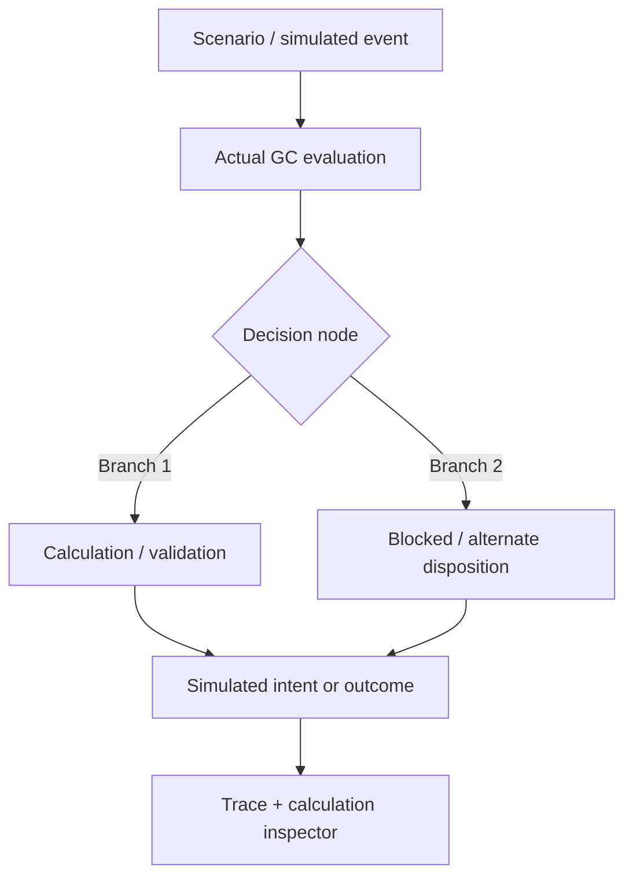

# Strategy Scenario Runner — strategy-neutral execution, RS first

- Status: draft
- Type: feature specification
- Owner: dashboard
- Created: 2026-11-25
- Tracking: [Issue #1836](https://github.com/45s/coinzilla/issues/1836)

## 1. Purpose

Provide a strategy-independent **Scenario Runner** in Dashboard. Users configure a strategy/market, select a declared scenario and subcase, execute the actual production strategy flow in an isolated simulation runtime, inspect the actual outcome/assertions and explore the emitted execution trace as an interactive graph. **Recovery Seller (RS) is the first strategy adapter** because it is currently the only strategy with a structured scenario registry. RS is an initial example and integration target, not the runner's architectural boundary.

The long-term runner must support every strategy family for which executable scenarios and a supported simulation contract exist: RS, Generic Conservative/Aggressive, GC Conservative/Aggressive, futures strategies, grid strategies and future strategy types. Adding a strategy means providing its scenario definitions and strategy-owned runtime/configuration adapter; it must not require adding strategy-specific branches or business rules to the runner core.

This is a trading-flow runner with a simulated external world—not a read-only explorer and not a second implementation of trading logic. It must execute the same production functions/use cases, calculations, validations, decisions, state transitions and accounting paths used by normal runtime. Only external side-effect boundaries (broker/exchange, clock/market feeds and isolated state/persistence as required) are replaced by controlled simulation adapters.

## 2. Ownership and boundaries

- UI and runner experience: Dashboard; runner domain/application core remains framework-independent.
- Strategy policy, configuration semantics, production execution functions and authoritative calculations: their owning strategy/domain runtime (currently Harvester).
- Shared runner contracts define strategy registration/capabilities, scenario discovery, configuration schema/defaults, isolated runtime creation, event injection, execution results and trace output. Strategy adapters bind those contracts to actual production use cases.
- The runner must call the same production functions/methods as normal trading runtime. It must not fork, clone, approximate or reimplement strategy decisions in Dashboard or in a separate simulator.
- Replace only side-effecting infrastructure at explicit ports: simulated broker/order gateway, controlled market/event source, isolated account/order/inventory state, deterministic time where required, and simulation-scoped persistence. The simulated broker must never delegate to a real broker.
- Dashboard must not import private Harvester modules into the browser bundle, connect to exchanges, submit/cancel real orders, or read persistence directly. Use an approved runner host/API or shared package boundary that preserves production code reuse.
- Simulation output is a simulated strategy decision/intent only. It must not be presented as an acknowledged exchange order.


## 2.1 Mandatory framework-independent DDD architecture

This feature MUST comply with the Dashboard-wide framework-independence rule in [Dashboard AGENTS.md](../../../AGENTS.md): **business logic cannot depend on Angular or any UI framework**. DDD/clean architecture is mandatory for every Dashboard task.

For this Lab:
- Registry discovery/fetch contracts, parsing, schema validation, normalization, scenario selection semantics, run lifecycle, action interpretation, assertion evaluation, trace/result handling, graph-model construction and relationship derivation belong in framework-independent TypeScript core modules.
- The domain/application core must not import Angular, component/directive/template types, Angular DI, signals, RxJS, browser APIs, DOM or rendering libraries. Define ports and use adapters outside the core for transport/storage/browser concerns.
- Angular components are thin presentation adapters: bind state, dispatch actions to application use cases and render view models. No scenario business rules, parsing/validation, execution logic or graph semantics in components.
- The runner must be independently testable without Angular TestBed or a browser. Angular UI tests test presentation/adapters, not serve as the sole verification of domain logic.
- Graph renderer/layout technology is an adapter. Graph semantics and renderer-neutral graph models are produced by core logic so Angular/React/Vue replacement does not alter scenario logic.
- **Framework swap acceptance:** replacing Angular presentation must not require modifying scenario core, domain/application logic or their tests/contracts.

### Proposed framework-neutral module layers (illustrative)

```text
strategy-scenario-explorer/
  domain/               # Scenario concepts, run/result, validation rules
  application/           # use cases, orchestration, ports, runner contract
  adapters/
    registry-source/     # registry export/API adapter
    execution/           # safe evaluator adapter
    graph-renderer/      # replaceable renderer adapter
    storage/              # optional persistence adapter
  presentation-angular/   # Angular-only composition, components, view models
```

Names/layout are illustrative; responsibility and dependency direction are mandatory. Domain/application core owns behavior and contracts; adapters implement ports; UI framework code depends inward, never the reverse.

## 2.2 Strategy-neutral execution architecture and MVP flow

The first executable milestone is an end-to-end RS scenario/subcase run using the generic runner contract. RS supplies the first strategy adapter and scenario catalogue; the runner itself has no RS-specific logic. The MVP is executable, not registry-only.

```ts
// Pseudocode: framework-neutral core, not Angular component code
const registry = await registrySource.load();       // source port/adapter
const scenarios = normalizeAndValidate(registry);   // pure core
const selected = selectScenario(scenarios, scenarioId, subcaseId);
const isolatedRun = runFactory.create(selected);     // isolated context
const result = await scenarioRunner.execute(isolatedRun);
const graph = graphBuilder.fromScenarioAndResult(selected, result);
viewAdapter.present({ graph, result });             // presentation adapter
```

Registry loading may use a versioned JSON/export or supported API, not private Harvester test imports in the Dashboard bundle. Validation and normalization belong in framework-independent modules. Unsupported/malformed definitions are explicit errors, never silently omitted or replaced by fixtures.

The runner interprets a constrained, typed action catalog; scenario data is declarative and MUST NOT contain arbitrary executable JavaScript. Each scenario/subcase receives fresh isolated run state. Execution and assertion behavior must invoke the actual production implementation through an approved simulation-safe runtime boundary—not copied/reimplemented strategy rules in Dashboard. If production code currently cannot run without live infrastructure, extract the smallest justified ports/adapters while preserving the same business functions and call path. If a case is not independently executable, show explicit not-executable/blocked status; do not attribute a whole-suite result to a single case.

Illustrative contracts (proposed shapes, not verified schemas):

```ts
interface ScenarioExecutionRequest {
  scenarioId: string;
  subcaseId: string;
  input: ScenarioInput;
}
interface ScenarioExecutionResult {
  status: 'passed' | 'failed' | 'blocked' | 'not-executable';
  assertions: AssertionResult[];
  trace: TraceStep[];
  diagnostics: Diagnostic[];
}
```

The engine returns actual assertion results, ordered trace and diagnostics. Registry expected values are not results. Graph runtime evidence is sourced only from execution results; declarative Given/When/Then and registry/test mapping views remain separately labelled.

### Strategy-neutral execution cycle (MVP)
1. Load a supported registry source through an adapter.
2. Validate export/schema/version and normalize records in the framework-neutral core.
3. Discover/select scenario and subcase; indicate independent-execution capability.
4. Create isolated context from explicit inputs; no shared mutable run state.
5. Execute constrained action sequence through the supported safe contract.
6. Capture real assertion results, ordered trace, status and diagnostics.
7. Build renderer-neutral graph from source and actual results; retain provenance.
8. Render through presentation/graph adapters and synchronize graph, list, inspector and trace.
9. Reset/close discards run-local state; optional persistence is a replaceable adapter.

No live broker/exchange access, credentials, real order submission/cancellation, production mutation or direct DB access is permitted. The runner may be browser-orchestrated but should execute production logic in the runtime host/package that owns it; a backend/Harvester-hosted isolated runner is preferred where that is necessary to reuse actual production modules safely. Never bundle private Harvester runtime internals into the browser merely to claim client-side execution.

### Illustrative strategy-neutral runner pseudocode

```ts
// Framework-neutral application module; exact implementation follows contract audit
async function executeScenario(request, ports): Promise<ScenarioExecutionResult> {
  const scenario = ports.registry.getValidated(request.scenarioId);
  const subcase = selectSubcase(scenario, request.subcaseId);
  const context = ports.runContext.createIsolated(subcase.inputs);
  const trace = [];
  for (const action of subcase.actions) {
    trace.push(await ports.safeEvaluator.execute(action, context));
  }
  const assertions = ports.assertions.evaluate(subcase.expectations, context);
  return assembleExecutionResult({ assertions, trace, diagnostics: context.diagnostics });
}
```

This illustrates separation only; it does not authorize a Dashboard-owned strategy evaluator. The execution port must invoke the same production use cases/functions as live runtime with simulation adapters injected at side-effect boundaries. Core remains independent of Angular and graph rendering.

## 3. Scope

### Included in the initial strategy-neutral runner capability (RS adapter first)
- A dedicated Dashboard navigation entry and Lab workspace.
- Discover available strategy adapters dynamically; initially expose RS because it has executable scenario definitions. Later strategies register without runner-core changes.
- Select strategy, market, scenario and subcase; load strategy-owned configuration schema/defaults and allow validated user-editable simulation configuration.
- Display scenario inputs and provenance; distinguish scenario records from live/runtime state.
- Reconstruct scenario given inputs, when steps, then expectations and mustNot constraints as graph nodes/links, with an inspector.
- Visualize RS registry and matrix relationships (rule, decision, state, transition, invariant, configuration field, implementation source, mapped test/subcase and evidence/status).
- Execute the actual production strategy flow in an isolated simulation runtime and visualize actual emitted trace/results. Registry expectation and test-evidence views remain separately labelled.
- Dynamic interactive diagrams, traceability graph, node inspection, filtering, search, grouping and graph↔text synchronization.
- Step forward/back through a deterministic run where the simulation contract supports replay.
- Scenario presets, save/load and reset.
- Simulation history for the current run and selected node/event.
- Explicit simulation-only safety messaging and guards.

### Explicitly excluded from the initial RS registry visualization
- Live order submission/cancellation, broker/exchange connections or exchange credentials.
- Production Portfolio, Journal, Operational State Store or other persisted-data mutation.
- Direct browser-to-exchange/API calls.
- Copying, reimplementing or approximating strategy decision rules, calculations, validators, accounting or lifecycle logic in the runner.
- Treating mock scenario inputs or outputs as live account data.
- Full exchange matching-engine/market simulation, queue priority, latency or slippage modeling unless a separately reviewed extension defines it.
- Strategy changes, behavior overrides that are not accepted by the actual evaluator, or changing the production strategy configuration.
- Recovery/restart persistence simulation in the first scope unless explicitly added later.

## 4. UI concept — RS Scenario Explorer

Illustrative layout (decision-flow diagram concept):



For the RS-first version, support these views/modes:

- **Scenario behavior view:** Given → ordered When → Then graph, including mustNot expectations and subcases.
- **Coverage/traceability view:** scenario → rule → decision → state/transition → invariant/config field → implementation → test/subcase → evidence. Missing links and statuses are visible, not inferred.
- **Registry explorer:** browse/filter scenario families and IDs, status, priority, layer, names, blockers, source and test mappings.
- **Execution view (future):** actual evaluated path, branch result and calculation trace from an approved simulation contract. Registry expectations are never presented as runtime observations.

The concept uses a workspace split into:

1. **Scenario setup (left):** market selector, actual strategy defaults, editable simulation overrides, initial state and filters.
2. **Event injection (left/lower):** explicit event buttons and event parameters; events append to the run rather than silently changing state.
3. **Decision flow (center):** graph of the evaluated path, decision branches, completed nodes and outcomes. This is the primary visual explanation.
4. **Execution trace/history (center/lower or tab):** ordered list of events and evaluator steps. Selecting a row/node synchronizes the other panels.
5. **Calculation inspector (right):** inputs, outputs, intermediate values, validations, calculation details and reason codes for the selected step.
6. **Scenario result (right or summary):** final decision(s), intents, dispositions and safety status.

### 4.1 Diagram behavior

- Diagram nodes are generated from structured evaluation trace/decision data, not hardcoded for one scenario or drawn as an independent rules engine.
- The diagram renders only the actual path taken and any branches/outcomes exposed by the simulation contract. It must not imply unexecuted paths were evaluated.
- Node types distinguish event/input, calculation, decision, validation, intent/output, blocked/failure and classification nodes.
- Decision branches are labelled with actual evaluated predicates/results.
- Each node carries stable run-local identity, step order and links to its input/output details.
- Selecting a node highlights it and its path context, selects the matching trace entry and populates the inspector.
- Navigation/replay supports stepping and selecting prior steps; the selected state is read-only until the user explicitly changes the scenario or resumes at an allowed point.
- Diagram zoom, pan, fit-to-view and accessible textual trace are required for usability.
- Diagram layout is presentational; graph meaning comes from the evaluation trace. Diagram layout failure must not affect simulation correctness or hide the trace.

### 4.2 Visual semantics (proposal)

| Visual | Meaning |
|---|---|
| Green | Evaluated/accepted/valid/completed |
| Yellow/amber | Decision, branch or attention-needed condition |
| Blue | Input, event or calculation |
| Red | Blocked, failure or fail-closed result |
| Purple | Classification, disposition or alternate result |

Use color plus text/icon/shape, not color alone.

## 5. Scenario and event model — RS registry visualization first

### 5.1 Initial state

The scenario setup should support relevant evaluator inputs without implying an actual account snapshot:

- Market and configuration defaults.
- Explicit override values with provenance shown as “strategy default” or “scenario override”.
- Simulated market price and, where relevant, prior reference prices.
- Inventory quantity and accumulated cost basis.
- Simulated fee assumptions and market metadata/filter snapshot.
- Existing BUY/SELL reservations/orders as explicitly simulated state.
- Other evaluator-required state only after its input contract is established.

The specification does not yet define the complete initial-state schema; that will be resolved with the Harvester simulation interface.

### 5.2 Event injection

The Lab should offer typed event actions, not free-form edits to hidden runtime state. Initial candidate events:

- BUY fill / partial BUY fill.
- SELL fill / partial SELL fill.
- Market price update.
- Existing-order add/remove/update.
- Filter or market-metadata update/unavailable.
- Simulated rejection/error.
- Reset to initial scenario.

Each injected event is validated, displayed in the event log, and processed by the simulation runner. The available event catalog must be based on the supported simulation contract; unsupported events are not fabricated.

## 6. Scenario presets and persistence

- Provide starter presets for representative success, existing-order, dust/minimum-filter, filter-unavailable, price-boundary, rejection and partial-fill cases as supported by the evaluator.
- Users can save and reload named scenarios in Lab-local storage or a later approved persistence mechanism. Storage format, versioning, size limits and import/export are open design decisions.
- Saved scenarios contain simulation inputs/events only, never secrets or broker credentials.
- A scenario run is reproducible from its stored input/event sequence and evaluator version/context, subject to the contract's determinism guarantees.
- Reset clears the run's simulation state/history and returns to its scenario starting state; it does not alter real runtime state.

## 7. Production execution reuse and simulation boundary

The future Harvester-owned contract should expose simulation-safe evaluation, structured trace data and decision/intents without live execution side effects. Candidate trace fields include:

- Step identity/order and type.
- Inputs and input provenance.
- Evaluated rule/predicate and branch outcome (where available).
- Exact calculations and rounding/filter results.
- Output/result, reason code and disposition.
- Links to predecessor/successor graph nodes.
- Event that triggered the evaluation.

Exact trace shape, public entry point, determinism, decimal representation, configuration/filter boundaries, and support for stepwise replay are OPEN and require coordinated design before implementation. Dashboard may format and graph trace records but must not infer missing rule outcomes by reverse-engineering final intents.

## 8. Safety and failure behavior

- Persistent, prominent **SIMULATION ONLY — NO LIVE ORDERS** banner and a distinct Lab mode.
- No live broker credentials or broker calls; tests should enforce the boundary.
- Simulation evaluation must use an isolated interface that cannot submit/cancel orders.
- Unsupported/malformed event input is rejected without corrupting prior scenario state.
- Evaluation failures are displayed as explicit error/fail-closed trace nodes, not silently omitted or rendered as successful decisions.
- Missing filter/config inputs remain unavailable or blocked according to the evaluator contract; the UI must not synthesize valid defaults.
- A failed simulation run remains inspectable and resettable.
- No simulated value is displayed with live-data styling or live account labels.
- The UI must never imply that an intent was acknowledged or filled unless a simulated subsequent event explicitly models it.

## 9. Acceptance criteria

- [ ] Dedicated Lab workspace with clear simulation-only identity.
- [ ] Market and configuration defaults are visibly loaded and overrides distinguished.
- [ ] Scenario initial state and supported events can be configured.
- [ ] Run, reset, and step/replay affordances work as defined by the simulation interface.
- [ ] Decision diagram is generated from structured actual evaluator trace.
- [ ] Selecting a diagram node/trace step synchronizes the calculation inspector.
- [ ] Calculations, filters, reason/disposition and generated intents are inspectable without UI-derived strategy rules.
- [ ] Presets and scenario save/load support are documented and implemented per agreed persistence contract.
- [ ] Failure, invalid input, unavailable metadata, blocked/dust outcomes and partial runs are explicit.
- [ ] No live orders, exchange access or production state mutations are possible from the Lab.
- [ ] Deterministic tests verify event sequence, trace/graph mapping and safety isolation.
- [ ] A coordinated Harvester interface and acceptance contract is approved before UI implementation relies on it.

## 10. Open design decisions

1. What exact Harvester-owned pure/use-case boundary will expose strategy evaluation in simulation without invoking broker execution or production state?
2. Which trace representation will preserve decisions, intermediate calculations, validations, reason codes and graph edges without Dashboard reverse inference?
3. Can each evaluation be deterministic/replayable, and what evaluator/configuration version metadata is required?
4. Which inputs and event types are supported initially, and which remain deferred?
5. How should exchange metadata/filter snapshots be supplied: operator fixture, verified fixture set or simulation adapter?
6. What scenario persistence is preferred: browser storage, import/export files, or a backend-owned safe scenario store?
7. How should graph layout and trace navigation handle very large/branching scenarios?
8. Should the initial feature simulate only Conservative GC, or allow other strategies later through an explicit capability registry?

## 11. Verification expectations

- Unit tests for scenario/event validation, run state, replay and graph mapping.
- Contract tests for the Harvester simulation boundary and its non-execution guarantee.
- Scenario tests covering success, active order, no sellable quantity/dust, filters unavailable, price/filter boundary, invalid event, rejection, partial fills and replay.
- UI tests for node selection/trace synchronization, inspector contents, errors, reset and save/load.
- Security tests/architecture checks confirming the feature cannot access broker APIs, credentials, database or production mutation endpoints.
- Full Dashboard test/coverage/build and relevant workspace checks on the implementation PR.

## 12. RS-first design decisions and recorded discussion

- RS-first is deliberate: RS has a structured scenario registry and matrix; visualization should use real records rather than invented samples.
- The graph engine should eventually accept strategy-neutral normalized scenario data with strategy-specific registry adapters, not hardcode RS.
- Separate **scenario expectation**, **coverage status**, and **execution evidence** visually and semantically. TEST-MAPPED, PARTIAL, BLOCKED, or VERIFIED describes registry/evidence state—not the result of evaluating a trading decision.
- Label graph modes: (1) behavior path assembled from declarative scenario steps, (2) traceability graph assembled from registry references, and (3) runtime evaluation trace only when sourced from the actual evaluator. Preserve provenance.
- User discussion: first rebuild text-format RS scenarios into interactive illustrations; continue refining the feature spec and note substantive decisions/questions in it or its companion.

## 12. Related docs

- [Dashboard documentation index](../../README.md)
- [Feature scenarios](DOMAIN_SCENARIOS.md)
- [Dashboard instructions](../../../AGENTS.md)
- [Dashboard roadmap](../../../ROADMAP.md)
- [Feature Specification Standard](../../../../../docs/FEATURE_SPECIFICATION_STANDARD.md)
- Tracking issue [#1836](https://github.com/45s/coinzilla/issues/1836)

This is an initial proposal. Behavior, simulation contract, data boundaries and event catalog are expected to be refined before implementation.


## 13. Approved direction — strategy-neutral production-flow runner

This section records the approved product direction and supersedes any earlier wording in this draft that describes a read-only registry explorer as the initial deliverable or treats actual execution as a later optional capability.

### 13.1 Strategy neutrality

The runner is a reusable platform capability, not an RS feature. Strategy identity is data/registration, not a switch statement in runner code. It must support any strategy family that supplies:
- A versioned scenario catalogue with independently executable scenario/subcase definitions.
- A strategy adapter exposing its configuration schema, defaults, validation and supported market/configuration capabilities.
- An isolated runtime factory that wires the actual production application/strategy use cases.
- A declared set of simulation inputs/events and side-effect ports.
- Structured execution results, assertions and trace provenance.

Initial adapter: Recovery Seller (RS), because its structured scenarios exist today. Future adapters may include Generic Conservative/Aggressive, GC Conservative/Aggressive, futures, grids and other strategies when their scenarios and execution contracts are ready. Unsupported strategies/scenarios are reported as unavailable/not executable with an explicit reason; the runner must not fabricate support.

### 13.2 Production-code reuse is a hard invariant

For a given strategy, the simulation must invoke the exact same production business functions/use cases used in normal runtime for:
- Configuration parsing/validation and normalization.
- Strategy evaluation and decision-making.
- Calculations, precision/rounding, fee and filter handling.
- Order planning and lifecycle transitions.
- Inventory/accounting and state updates.
- Domain invariants and business assertions where reusable.

The runtime composition may differ, but the business implementation must not. Production and simulation should share the same application/domain entry points and dependency graph, with different adapters only at explicit infrastructure ports. If a function is currently inseparable from a real broker or production persistence, refactor only the necessary boundary; do not create a parallel simulator implementation.

A parity test must prove that both runtime compositions resolve to the same production use-case/function implementation. Contract/integration tests must prove that simulation replaces all side-effect ports and cannot reach real broker/exchange or production persistence.

### 13.3 Runner responsibilities vs strategy adapter responsibilities

**Generic runner core:** strategy discovery/registration, scenario catalogue discovery, schema-driven configuration UI model, validation orchestration, isolated run lifecycle, event sequencing, execution request/result contracts, trace/result normalization, graph model, expected-vs-actual comparison, diagnostics, repeat/reset and framework-neutral application orchestration.

**Strategy-owned adapter:** scenario source, market/configuration schema and defaults, mapping to actual production use cases, isolated runtime composition, supported simulation events, domain-specific assertion bridge and trace instrumentation. The adapter must delegate business decisions to production code; it is not a second strategy engine.

**Replaceable infrastructure adapters:** simulated broker/order gateway, deterministic market/event source, isolated account/order/inventory state, controlled clock, simulation-only persistence and execution host/API.

**Presentation adapter:** Angular initially; renders generic runner view models and dispatches application commands. No business logic, strategy-specific behavior, evaluator or graph semantics.

### 13.4 Configuration and execution UX

The user must be able to:
1. Select an available strategy, market, scenario and independently executable subcase.
2. Load the selected strategy's actual configuration schema/defaults and edit supported market/strategy settings.
3. See required vs optional fields, validation errors, source/default provenance and scenario overrides.
4. Provide isolated starting state (balances, inventory, open simulated orders, market metadata/prices and other declared inputs).
5. Configure/inject supported market and broker-result events (ticks, fills, partial fills, rejects, cancellations, etc.) without mutating live runtime.
6. Execute, step/replay where deterministic support exists, reset and rerun.
7. Inspect actual decisions, calculations, validations, planned orders, simulated broker outcomes, state transitions, accounting changes, assertions and diagnostics.
8. Compare actual results against scenario expectations, preserving exact expected/actual provenance.

Configuration fields must come from strategy-owned contracts and actual production configuration definitions; do not hardcode RS/GC field lists into generic UI. Overrides apply only to the isolated run and never rewrite production configuration.

### 13.5 Runtime and safety guarantees

- Simulation creates a fresh isolated run context; no shared mutable production state.
- The simulated broker implements the same required broker-facing port but records/returns controlled simulated outcomes and has no real-broker fallback.
- The runner cannot access credentials, live exchange endpoints, production order submission/cancellation, live account state or production persistence.
- All events are typed, validated and sequenced; invalid events do not partially mutate the prior valid state.
- Runtime trace records are emitted by production execution/instrumentation, not reverse-inferred by Dashboard.
- Results distinguish strategy intent/planned order, simulated broker acceptance/rejection, simulated fill and final domain state. No simulated outcome is represented as a real exchange acknowledgement.
- Run metadata records strategy/adapter version, production code revision, config snapshot, scenario version, input/event sequence and determinism guarantees.
- If production behavior cannot be executed faithfully under isolation, the scenario is blocked until the missing boundary is addressed. Never silently substitute a simplified evaluator.

### 13.6 MVP acceptance — executable RS vertical slice, generic runner foundation

The MVP is complete only when one real RS scenario/subcase can be configured and executed end-to-end through actual production code using simulation adapters, and the generic runner architecture is reusable by a second strategy without changing runner domain/application logic.

- [ ] Generic strategy registration/discovery and capability contract; no RS-specific branches in runner core.
- [ ] RS strategy adapter backed by the actual RS scenario registry.
- [ ] Actual strategy configuration schema/defaults exposed; user can edit and validate market settings.
- [ ] Isolated runtime invokes the same production functions/use cases as live runtime.
- [ ] Simulated broker and controlled market/event adapters; no real side effects possible.
- [ ] Scenario initial state and supported event sequence are editable/configurable.
- [ ] Actual assertions, execution results, state changes and structured trace captured.
- [ ] Expected-vs-actual comparison with provenance and diagnostics.
- [ ] Renderer-neutral graph generated from actual trace; synchronized trace/list/inspector.
- [ ] Deterministic isolation, production-code parity and no-live-side-effect tests.
- [ ] Framework-independent DDD core and architecture enforcement; Angular remains presentation-only.
- [ ] A second-strategy contract/adapter conformance fixture demonstrates extensibility without runner-core strategy changes (does not require implementing that strategy's business logic in this MVP).

