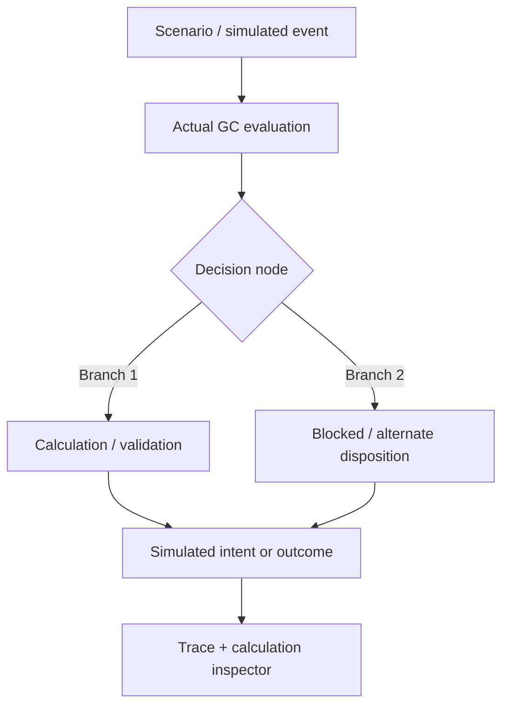

# GC Strategy Lab

- Status: draft
- Type: feature specification
- Owner: dashboard
- Created: 2026-11-25
- Tracking: [Issue #1836](https://github.com/45s/coinzilla/issues/1836)

## 1. Purpose

Provide an interactive, simulation-only workspace in the Dashboard to explore Generic Conservative (GC / Coin Grabber) strategy decisions. Operators can configure a market and scenario state, inject events, step through actual strategy evaluation, and inspect a visual decision path, exact calculations and execution history.

The Lab is a behavior exploration and specification-driven testing aid, not an exchange simulator or a live trading interface.

## 2. Ownership and boundaries

- UI and simulation orchestration experience: Dashboard.
- Strategy policy and authoritative calculation behavior: Harvester domain.
- Exchange metadata/filter semantics: Harvester's existing market-metadata boundary and its source contracts.
- A future supported simulation interface must be coordinated with Harvester. The Dashboard must not import private Harvester modules, copy strategy rules, connect to exchanges, submit/cancel orders, or read persistence directly.
- Simulation output is a simulated strategy decision/intent only. It must not be presented as an acknowledged exchange order.

## 3. Scope

### Included in the initial capability
- A dedicated Dashboard navigation entry and Lab workspace.
- Select/configure a supported GC market and load its strategy configuration as defaults.
- Display clearly identified scenario overrides separately from loaded defaults.
- Configure an initial simulation state: inventory, cost basis, market price, fees/metadata/filter inputs where permitted, and active order state.
- Inject supported events, including fills, partial fills, price updates, active-order changes, filter changes and rejection/failure events.
- Evaluate the real GC strategy behavior through an isolated simulation contract.
- Visual, dynamically generated decision flow, execution trace and calculation inspector.
- Step forward/back through a deterministic run where the simulation contract supports replay.
- Scenario presets, save/load and reset.
- Simulation history for the current run and selected node/event.
- Explicit simulation-only safety messaging and guards.

### Explicitly excluded
- Live order submission/cancellation, broker/exchange connections or exchange credentials.
- Production Portfolio, Journal, Operational State Store or other persisted-data mutation.
- Direct browser-to-exchange/API calls.
- Copying or reimplementing strategy decision rules in Dashboard.
- Treating mock scenario inputs or outputs as live account data.
- Full exchange matching-engine/market simulation, queue priority, latency or slippage modeling unless a separately reviewed extension defines it.
- Strategy changes, behavior overrides that are not accepted by the actual evaluator, or changing the production strategy configuration.
- Recovery/restart persistence simulation in the first scope unless explicitly added later.

## 4. UI concept

Illustrative layout (decision-flow diagram concept):

The concept uses a workspace split into:

1. **Scenario setup (left):** market selector, actual strategy defaults, editable simulation overrides, initial state and filters.
2. **Event injection (left/lower):** explicit event buttons and event parameters; events append to the run rather than silently changing state.
3. **Decision flow (center):** graph of the evaluated path, decision branches, completed nodes and outcomes. This is the primary visual explanation.
4. **Execution trace/history (center/lower or tab):** ordered list of events and evaluator steps. Selecting a row/node synchronizes the other panels.
5. **Calculation inspector (right):** inputs, outputs, intermediate values, validations, calculation details and reason codes for the selected step.
6. **Scenario result (right or summary):** final decision(s), intents, dispositions and safety status.

### 4.1 Diagram behavior

- Diagram nodes are generated from structured evaluation trace/decision data, not hardcoded for one scenario or drawn as an independent rules engine.
- The diagram renders only the actual path taken and any branches/outcomes exposed by the simulation contract. It must not imply unexecuted paths were evaluated.
- Node types distinguish event/input, calculation, decision, validation, intent/output, blocked/failure and classification nodes.
- Decision branches are labelled with actual evaluated predicates/results.
- Each node carries stable run-local identity, step order and links to its input/output details.
- Selecting a node highlights it and its path context, selects the matching trace entry and populates the inspector.
- Navigation/replay supports stepping and selecting prior steps; the selected state is read-only until the user explicitly changes the scenario or resumes at an allowed point.
- Diagram zoom, pan, fit-to-view and accessible textual trace are required for usability.
- Diagram layout is presentational; graph meaning comes from the evaluation trace. Diagram layout failure must not affect simulation correctness or hide the trace.

### 4.2 Visual semantics (proposal)

| Visual | Meaning |
|---|---|
| Green | Evaluated/accepted/valid/completed |
| Yellow/amber | Decision, branch or attention-needed condition |
| Blue | Input, event or calculation |
| Red | Blocked, failure or fail-closed result |
| Purple | Classification, disposition or alternate result |

Use color plus text/icon/shape, not color alone.

## 5. Scenario and event model

### 5.1 Initial state

The scenario setup should support relevant evaluator inputs without implying an actual account snapshot:

- Market and configuration defaults.
- Explicit override values with provenance shown as “strategy default” or “scenario override”.
- Simulated market price and, where relevant, prior reference prices.
- Inventory quantity and accumulated cost basis.
- Simulated fee assumptions and market metadata/filter snapshot.
- Existing BUY/SELL reservations/orders as explicitly simulated state.
- Other evaluator-required state only after its input contract is established.

The specification does not yet define the complete initial-state schema; that will be resolved with the Harvester simulation interface.

### 5.2 Event injection

The Lab should offer typed event actions, not free-form edits to hidden runtime state. Initial candidate events:

- BUY fill / partial BUY fill.
- SELL fill / partial SELL fill.
- Market price update.
- Existing-order add/remove/update.
- Filter or market-metadata update/unavailable.
- Simulated rejection/error.
- Reset to initial scenario.

Each injected event is validated, displayed in the event log, and processed by the simulation runner. The available event catalog must be based on the supported simulation contract; unsupported events are not fabricated.

## 6. Scenario presets and persistence

- Provide starter presets for representative success, existing-order, dust/minimum-filter, filter-unavailable, price-boundary, rejection and partial-fill cases as supported by the evaluator.
- Users can save and reload named scenarios in Lab-local storage or a later approved persistence mechanism. Storage format, versioning, size limits and import/export are open design decisions.
- Saved scenarios contain simulation inputs/events only, never secrets or broker credentials.
- A scenario run is reproducible from its stored input/event sequence and evaluator version/context, subject to the contract's determinism guarantees.
- Reset clears the run's simulation state/history and returns to its scenario starting state; it does not alter real runtime state.

## 7. Simulation execution and trace contract

The future Harvester-owned contract should expose simulation-safe evaluation, structured trace data and decision/intents without live execution side effects. Candidate trace fields include:

- Step identity/order and type.
- Inputs and input provenance.
- Evaluated rule/predicate and branch outcome (where available).
- Exact calculations and rounding/filter results.
- Output/result, reason code and disposition.
- Links to predecessor/successor graph nodes.
- Event that triggered the evaluation.

Exact trace shape, public entry point, determinism, decimal representation, configuration/filter boundaries, and support for stepwise replay are OPEN and require coordinated design before implementation. Dashboard may format and graph trace records but must not infer missing rule outcomes by reverse-engineering final intents.

## 8. Safety and failure behavior

- Persistent, prominent **SIMULATION ONLY — NO LIVE ORDERS** banner and a distinct Lab mode.
- No live broker credentials or broker calls; tests should enforce the boundary.
- Simulation evaluation must use an isolated interface that cannot submit/cancel orders.
- Unsupported/malformed event input is rejected without corrupting prior scenario state.
- Evaluation failures are displayed as explicit error/fail-closed trace nodes, not silently omitted or rendered as successful decisions.
- Missing filter/config inputs remain unavailable or blocked according to the evaluator contract; the UI must not synthesize valid defaults.
- A failed simulation run remains inspectable and resettable.
- No simulated value is displayed with live-data styling or live account labels.
- The UI must never imply that an intent was acknowledged or filled unless a simulated subsequent event explicitly models it.

## 9. Acceptance criteria

- [ ] Dedicated Lab workspace with clear simulation-only identity.
- [ ] Market and configuration defaults are visibly loaded and overrides distinguished.
- [ ] Scenario initial state and supported events can be configured.
- [ ] Run, reset, and step/replay affordances work as defined by the simulation interface.
- [ ] Decision diagram is generated from structured actual evaluator trace.
- [ ] Selecting a diagram node/trace step synchronizes the calculation inspector.
- [ ] Calculations, filters, reason/disposition and generated intents are inspectable without UI-derived strategy rules.
- [ ] Presets and scenario save/load support are documented and implemented per agreed persistence contract.
- [ ] Failure, invalid input, unavailable metadata, blocked/dust outcomes and partial runs are explicit.
- [ ] No live orders, exchange access or production state mutations are possible from the Lab.
- [ ] Deterministic tests verify event sequence, trace/graph mapping and safety isolation.
- [ ] A coordinated Harvester interface and acceptance contract is approved before UI implementation relies on it.

## 10. Open design decisions

1. What exact Harvester-owned pure/use-case boundary will expose strategy evaluation in simulation without invoking broker execution or production state?
2. Which trace representation will preserve decisions, intermediate calculations, validations, reason codes and graph edges without Dashboard reverse inference?
3. Can each evaluation be deterministic/replayable, and what evaluator/configuration version metadata is required?
4. Which inputs and event types are supported initially, and which remain deferred?
5. How should exchange metadata/filter snapshots be supplied: operator fixture, verified fixture set or simulation adapter?
6. What scenario persistence is preferred: browser storage, import/export files, or a backend-owned safe scenario store?
7. How should graph layout and trace navigation handle very large/branching scenarios?
8. Should the initial feature simulate only Conservative GC, or allow other strategies later through an explicit capability registry?

## 11. Verification expectations

- Unit tests for scenario/event validation, run state, replay and graph mapping.
- Contract tests for the Harvester simulation boundary and its non-execution guarantee.
- Scenario tests covering success, active order, no sellable quantity/dust, filters unavailable, price/filter boundary, invalid event, rejection, partial fills and replay.
- UI tests for node selection/trace synchronization, inspector contents, errors, reset and save/load.
- Security tests/architecture checks confirming the feature cannot access broker APIs, credentials, database or production mutation endpoints.
- Full Dashboard test/coverage/build and relevant workspace checks on the implementation PR.

## 12. Related docs

- [Dashboard documentation index](../../README.md)
- [Feature scenarios](DOMAIN_SCENARIOS.md)
- [Dashboard instructions](../../../AGENTS.md)
- [Dashboard roadmap](../../../ROADMAP.md)
- [Feature Specification Standard](../../../../../docs/FEATURE_SPECIFICATION_STANDARD.md)
- Tracking issue [#1836](https://github.com/45s/coinzilla/issues/1836)

This is an initial proposal. Behavior, simulation contract, data boundaries and event catalog are expected to be refined before implementation.
