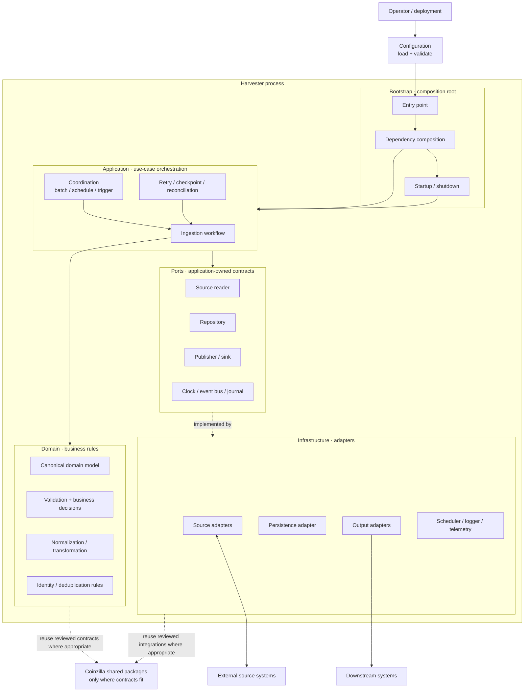

# Harvester

Harvester is a private Node.js application workspace in the Coinzilla pnpm monorepo. Its architecture is intended to follow the same separation of concerns used by `apps/bot-coin-farmer`: a small composition root, application orchestration, a pure domain core, explicit ports, and replaceable infrastructure adapters.

This document describes both the implemented foundation and the intended architecture. The trading-config loader is implemented; Harvester's wider business purpose, source systems, processing rules, persistence guarantees, and consumers still require explicit product decisions. Do not infer them from the application name.

## Package

- Package: `@coinzilla/harvester`
- Runtime: Node.js `>=22.23.4`
- Modules: native ECMAScript modules
- Dependencies: none currently; add only when an agreed requirement needs them

Run from the repository root:

```sh
pnpm --filter @coinzilla/harvester test
pnpm --filter @coinzilla/harvester test:coverage
```

## Architectural direction

Use a ports-and-adapters (hexagonal) architecture, with the domain at the center:

1. **Bootstrap** is the composition root. It loads and validates configuration, constructs dependencies, owns resource lifecycle, and starts/stops the runtime.
2. **Application** coordinates use cases. It controls workflow ordering, retries, checkpoints, and calls to ports; it does not contain business policy or vendor-specific code.
3. **Domain** owns the business meaning of the data and the rules for accepting, transforming, correlating, or rejecting it. Domain functions should be deterministic and independent of I/O.
4. **Ports** are the contracts the application needs from the outside world: source access, persistence, publication, time, and other capabilities only when a real use case requires them.
5. **Infrastructure** implements those ports: concrete source clients, storage, queues, schedulers, event/journal integrations, and logging. Vendor payloads are translated at this boundary.

Dependencies point inward. Domain code must not import application, infrastructure, SDKs, network clients, or environment configuration. Application code depends on domain rules and port contracts, never on a concrete provider implementation. Bootstrap is allowed to know concrete implementations because it wires them together.

## Configuration loading

The initial configuration baseline lives at `trading-config.json`. It preserves the strategy and pair values copied from `apps/bot-free-roll/trading-config.json`; it is a starting data contract, not evidence that Harvester currently executes that strategy.

Load it with the infrastructure adapter:

```js
import { loadTradingConfig } from './src/infrastructure/config/load-trading-config.js';

const tradingConfig = await loadTradingConfig();
```

The loader defaults to `apps/harvester/trading-config.json`. It also accepts a filesystem path or `file:` URL for tests and deployment-specific configuration. It reads and parses JSON, then calls the pure `validateTradingConfig` function. Read and parse errors include the source path and preserve the original cause; invalid structure raises a `TypeError` with the failing configuration path.

The validator currently checks the shape needed by the initial config:

- at least one strategy and at least one pair per strategy;
- boolean strategy/pair enablement flags;
- a non-negative `minProfit`, `keepQuantity`, and fee percentages;
- positive order quantity and price-step percentage;
- non-negative integer price and quantity precision.

The loader does not read environment variables, mutate configuration, apply defaults, or decide trading policy. The composition root should call it during startup and pass the validated object to whichever application components need it. Domain/application code must not read the JSON file directly. Extend the schema only alongside an agreed configuration requirement and corresponding tests.

## Target component diagram

The boxes describe responsibilities and boundaries, not a request to create one file or class per box. Introduce a module only when an implemented use case needs it.



The diagram is a logical target. The actual source types, destination types, domain entities, and required capabilities remain open until the product contract is defined. In particular, do not add a queue, database, scheduler, event bus, or third-party integration merely because it appears as a possible adapter in the diagram.

## Intended data path

The first end-to-end business workflow should be specified as a contract before implementation. At the architectural level, it should follow this sequence:

1. **Acquire** — an adapter obtains a source record or batch and translates provider-specific data into an application-facing representation.
2. **Normalize** — map external representation into canonical domain values. Keep raw provider payloads at the adapter boundary unless an explicit audit requirement says otherwise.
3. **Validate** — check structural validity and domain invariants. Invalid or incomplete input must have an explicit outcome; do not silently treat it as valid.
4. **Apply business rules** — domain policy determines what the input means and what action, if any, should follow. This is the part that must be defined from Harvester's actual requirements, not guessed.
5. **Commit state** — persist the accepted result and any processing checkpoint with clearly defined consistency and replay semantics.
6. **Publish outcome** — expose successful results and operational failures through an agreed output port. Publication failure must not silently corrupt or duplicate committed business state.

This is a logical sequence, not a commitment to a particular transport, storage engine, delivery guarantee, or batch/streaming model.

## Reliability and safety rules

These are engineering constraints for future workflows; their concrete implementation depends on the selected source and sink contracts.

- **Idempotency:** define a stable identity for an input and the scope in which duplicate processing is forbidden. Retries and replay must not create duplicate business effects.
- **Explicit outcomes:** distinguish accepted, ignored, rejected, deferred, and failed inputs where the business contract requires those distinctions. Preserve actionable reasons.
- **Checkpoint correctness:** advance a source checkpoint only when the corresponding business effects have reached the agreed durable boundary.
- **Failure isolation:** a failure in one input should not corrupt unrelated work. Choose per-record, per-batch, or per-source isolation based on the actual source semantics.
- **Bounded retries:** retry only classified transient failures, with limits and backoff. Permanent validation or business-rule failures are not retry candidates.
- **Observability:** log correlation identifiers and processing outcomes; never log credentials or unrestricted sensitive payloads.
- **Graceful lifecycle:** startup validates configuration before opening external resources. Shutdown stops intake, settles or safely leaves in-flight work, flushes required records, and closes resources within bounded time.
- **No false guarantees:** do not claim exactly-once processing, lossless recovery, or restart safety unless the chosen adapters and persistence protocol actually provide and test those guarantees.

## Implementation boundaries

| Area | Owns | Must not own |
|---|---|---|
| Bootstrap | Composition, configuration validation, startup and shutdown | Business decisions |
| Application | Use-case orchestration, sequencing, retries, checkpoints | Provider-specific payload parsing or business policy |
| Domain | Canonical meaning, invariants, business decisions | I/O, SDKs, persistence, environment variables |
| Ports | Stable capabilities required by use cases | Concrete vendor implementations |
| Infrastructure | Provider mapping, network/storage/queue integrations, operational adapters | Business rules that belong in the domain |
| Tests | Prove domain rules, workflow behavior, adapter contracts, and recovery semantics | Require live credentials or external services in the default test suite |

Keep interfaces small and driven by actual use cases. Avoid speculative abstractions, one-method wrapper classes, empty directories, placeholder modules, and duplicate shared-package contracts. Prefer a direct function or module until there is a concrete reason to introduce another boundary.

## Decisions required before business implementation

The following are intentionally unresolved and must be answered with product evidence:

- What business outcome does Harvester produce, and who or what consumes it?
- Which source systems are authoritative, and are inputs pushed, polled, streamed, or fetched in batches?
- What is the canonical domain record and its stable identity?
- Which records are accepted, ignored, rejected, or deferred, and why?
- Which transformations and business invariants must be applied?
- What freshness, ordering, completeness, and duplicate-handling guarantees are required?
- What state must survive restart, and what is the source of truth during reconciliation?
- Which outputs are required, and what delivery/retry semantics do they support?
- What operational controls are required (pause, resume, backfill, replay, rate limits)?

Record material decisions in the application documentation before encoding them in code. Reuse existing Coinzilla packages only after verifying that their public contracts match the requirement; do not couple the domain to a package merely because another application uses it.

## Development status

The package foundation and initial trading-config loading/validation are implemented. No Harvester business workflow or external integration has been selected yet. The next implementation step is to agree on the first business use case and its input/output contract, then wire the validated configuration into that use case through the composition root.

AI coding agents working in this directory must follow [AGENTS.md](./AGENTS.md) and applicable repository-level engineering guidance.