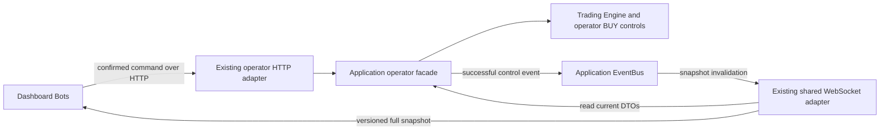
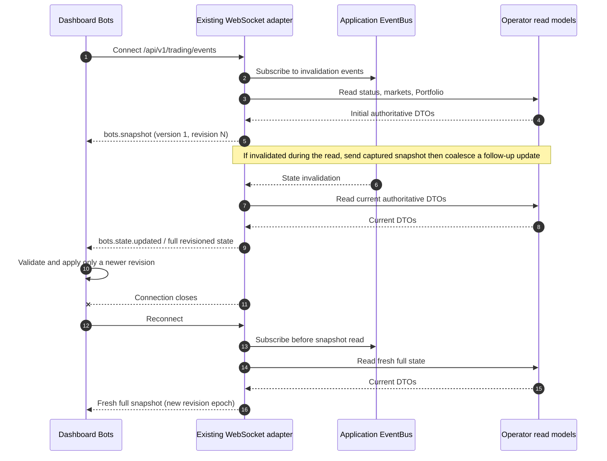

# Harvester Architecture

> **Audit companion:** See [DDD and Clean Architecture Audit](./DDD_CLEAN_ARCHITECTURE_AUDIT.md) for the source-based assessment, scorecard, current architectural risks, and sequenced follow-up roadmap. The audit is pinned to the source revision stated in that report; it is not a live status feed. The roadmap remains authoritative for delivery priority and implementation status.
>
> **Multi-provider audit:** See the [source-verified multi-provider migration audit and implementation plan](../../../docs/architecture/multi-provider-migration-plan.md) for the current Binance-only composition, provider capability matrix, order provenance gaps, account isolation and phased implementation prerequisites under #1339.
>
> **Documentation rule:** this guide contains both stable architecture rules and implementation examples/snapshots. Treat claims about what is currently wired or not wired as time-sensitive; verify them against the current source and [Harvester Roadmap](../ROADMAP.md). Historical snapshots must not be used as current implementation instructions.

## Purpose

Harvester uses one shared Trading Engine with multiple strategy policies. The engine coordinates trading workflows; a strategy decides what trading action should be taken. This lets Conservative and Aggressive use the same execution, broker, and portfolio capabilities without sharing their trading rules.

This document records the current architectural direction. It does not define implementation APIs or settle the strategy and portfolio decisions listed in the roadmap.

## Product priority: make the trading loop work first

The architecture exists to deliver a running trading application, not to postpone it. The mandatory first workflow is: load configuration → connect and subscribe to enabled-market prices → evaluate Conservative → validate and submit a broker order → process order updates and actual fills → update trading state → evaluate again and place the next required order. See [Trading First](./TRADING_FIRST.md), which takes precedence over optional architecture work.

For the first controlled TESTNET cycle, implement only the minimum execution safeguards needed for valid orders, balance/market-rule checks, fill correctness, duplicate prevention, and safe pause on uncertain state. Journal integration, durable state, comprehensive restart recovery/reconciliation, dashboards, optimization, and Aggressive are later work. Do not build those systems before the actual strategy-to-order-to-execution path exists and works. Keep the code simple and use existing contracts; do not add abstractions solely for hypothetical future needs.

## Product rule: DDD must not delay the trading loop

Harvester implements the Conservative strategy through its own domain, application, and infrastructure boundaries. Keep the lifecycle simple and improve it incrementally without changing approved financial behavior.

The reference workflow is config → broker connection/price subscription → price → strategy decision → BUY/SELL submission → execution report → actual-fill accounting → next decision. DDD means pure strategy/domain rules, state-owning entities, injected use cases, broker adapters, and bootstrap composition. It does not mean adding a new layer, state machine, persistence store, or reconciliation process for every event.

**Account/readiness rule:** use in-process actual-fill accounting for the ordinary strategy loop. Do not fetch a full account snapshot after each execution report unless a concrete broker-state uncertainty requires it. Perform the minimum specific free-balance/market-rule checks before submission. A clean TESTNET account is a controlled-test recommendation, not a reason to permanently prevent app startup. Never silently adopt external balances/orders as strategy-owned inventory.

**Pending-order rule:** register PENDING before submission so events can be correlated, but keep it non-cancellable until broker acknowledgement provides a validated broker order ID. If a replacement is needed while submission is pending, defer that replacement intent; after acknowledgement, cancel and reconcile fills before placing the replacement.

**Cancellation-outcome rule:** the broker reports `NOT_SENT` only when a local guard proves the exchange cancellation RPC was never invoked. Harvester preserves the last known canonical order state for that result, publishes `order.cancel_failed` with outcome `NOT_SENT`, and still pauses the pair. A failed/ambiguous state-changing RPC remains `UNKNOWN` / `UNCONFIRMED` until authoritative reconciliation. Harvester accepts `NOT_SENT` only on an unsuccessful broker result (`ok: false`) with that exact classification. A success-shaped, contradictory, missing, or unknown classification is treated as unconfirmed and remains fail-closed.

Before changing an execution path, compare it with the approved Conservative Domain Specification and the current Harvester implementation. Keep only the minimum safeguards that prevent a demonstrated duplicate, oversell, double-accounting, or unknown-outcome hazard. Do not build generic polling, sleeps, or broad reconciliation to handle ordinary event ordering.

## Architectural roles

| Concept | Responsibility | Architectural role |
| --- | --- | --- |
| Portfolio | Holds spot positions and applies fill-driven state changes | Domain entity |
| Position | Tracks holdings and quote cash flow for its defined market scope | Domain entity |
| Conservative strategy | Defines Conservative capital-recovery and retained-inventory rules | Domain policy |
| Aggressive strategy | Defines rules for managing multiple BUY and SELL orders | Domain policy |
| Trading Engine | Coordinates market updates, strategy evaluation, order workflows, and fill processing | Application layer / orchestrator |
| Use case | Performs an application goal by coordinating domain objects and ports | Application layer |
| Broker adapter | Communicates with an exchange and translates exchange-specific messages | Infrastructure / interface adapter |

These are responsibility boundaries, not a requirement that every concept must be represented by a class. The Trading Engine is not a Portfolio-like domain entity. A strategy policy is implemented as a plain pure function when its decision is deterministic. Calling it a domain policy describes its business responsibility; it does not imply a class or stateful strategy object.

## Live Bots operator snapshots

The Dashboard Bots workspace is a read-only projection of the existing application-owned operator read models. It does not create a second runtime model or query an exchange. The shared local HTTP server owns both the existing operator command API and `/api/v1/trading/events`; the WebSocket adapter reuses the existing origin validation, connection limits, frame/buffer bounds, heartbeat, and shutdown lifecycle.

The connection and synchronization sequence is:

The application facade publishes `harvester.operator_buy_control_completed` only after a market/global BUY pause or resume use case returns success. Its payload distinguishes `MARKET` plus symbol from `GLOBAL` without symbol and records `PAUSE` or `RESUME`. Strategy safety pauses are a separate concern: they are not operator BUY-control events and are never presented as operator commands.

The EventBus message is an invalidation hint, not a copy of trading state. The WebSocket adapter reads the authoritative application query facade (`getStatus`, `getMarkets`, and `getPositions`) and sends a complete `bots.snapshot` version-1 envelope containing a server-process revision, observation time, and status/markets/portfolio resources. It subscribes before accepting connections; if a newer event arrives during an in-flight read, the captured revision is sent and a follow-up state update is sampled at the newest requested revision. A reconnect receives a fresh full snapshot. A process restart begins a new revision epoch, which the reconnecting client accepts before applying normal duplicate/out-of-order revision checks.

If one of the required application reads fails, the adapter sends `bots.snapshot.unavailable` with explicit per-resource errors. It must not replace an unavailable market or Portfolio read with an empty list. The Dashboard retains its last complete snapshot as stale, distinguishes socket health from snapshot freshness, and disables controls until a complete snapshot returns. Financial values remain the exact strings supplied by the application read models. The stream does not publish every market-price tick; the latest price and its freshness flag are sampled when a relevant state invalidation triggers a snapshot.

The WebSocket is read-only. Confirmed commands continue through the existing HTTP adapter and application facade, preserving the engine's `beforeApply` Operational State Store boundary and all existing BUY/SELL safety gates. The stream adds no broker connection, database access, order execution, financial calculation, per-strategy registry, or per-Position strategy attribution. See the [trading-history and Bots WebSocket API contract](./api/trading-history-api.md#live-bots-operator-snapshots) for the wire format and lifecycle details.

## Volatility market-data intake (current implementation)

The runtime composes `createCandleHistoryService` after the existing price intake. It subscribes to each enabled market's one-minute Kline stream before requesting 101 historical candles, retains up to 100 completed candles, buffers live events during warm-up, and backfills detected gaps through the application broker port. It computes ATR(14), NATR and the current/reference ratio using the previous 60 NATR observations. The per-market snapshot is available through runtime `getVolatilityData({ symbol })`.

The candle-history service allows one 1-minute interval plus a 5-second grace before marking its Kline feed stale. This timeout is separate from the trading engine's 5-second market-price and order-book freshness gates. The runtime sends snapshots to the market-owned volatility protection state machine configured from the effective market-pair union, independent of CG/RS execution ownership. PROTECTED and RECOVERING block ordinary strategy actions through the shared submission gate used by CG and RS; only explicitly marked recovery SELLs may pass. Only Harvester-owned active BUYs are eligible for protection cancellation. Volatility diagnostics carry a neutral component identity. Existing recovery SELLs and their accounting remain active. Initial ratio thresholds are provisional pending offline historical validation.

## Operational notifications

Telegram is an optional outbound observer composed at the process boundary. The named `appConfig` export in `apps/harvester/config/index.js` owns the `notifications.telegram` profile, per-event overrides, market filter, and enabled switch. It imports the named `NOTIFICATIONS_TG_PROFILES` constants from `apps/harvester/config/notifications-tg-profiles.js`; the validator checks the selected identifier at runtime. Harvester resolves that policy, maps application events, and formats Harvester-specific Telegram messages; `@coinzilla/notifiers` owns generic event subscription, bounded serialized delivery queueing, transport delivery, and transport validation. The notifier package must not own Harvester event semantics or message templates. The domain and trading engine must not depend on Telegram or its credentials.

Profiles are `minimal`, `trader`, `verbose`, and `custom`. Per-event overrides merge with the chosen profile; `markets: []` means all markets. Critical startup, broker-disconnect, order-failure, pair-pause, recovery-failure, account-safety, blocked user-data readiness, and confirmed readiness-restoration alerts cannot be disabled and bypass market filters. The stable Harvester lifecycle vocabulary includes `user_data.readiness_changed`; transitions are validated by the dedicated `user-data-readiness-event-dto.js` application event mapper before publication. A recovered user-data transport remains explicitly BLOCKED until authoritative application reconciliation and broker-wide acknowledgement complete. `recoveryFailed` and `executionNormalizationFailed` statuses alert even if the broker omits the recovery-required flag; `rpcError` and `terminated` alerts require an explicit recovery-required flag, while retry-progress and diagnostic-only RPC errors are suppressed. Blocked recovery-cycle outcomes alert; expected sell-through continuation does not. Telegram bot token and chat ID remain environment-only secrets.

The table below is the canonical icon contract for **producer-backed outbound Telegram notifications**. It describes the message actually formatted after the Harvester event bridge maps a source event; it is not a list of every formatter key. Order-failure icons use the bridge's explicit `operation` and `side` fields. Account-safety icons use the mapped alert `category`, because several distinct source events share the `account.safety_alert` notification name.

| Active Telegram notification | Producer-backed condition | Icon |
| --- | --- | :---: |
| Bot started | `bot.started` | 🚀 |
| Bot stopped | `bot.stopped` | 🔒 |
| Startup failed | `bot.startup_failed` | 🛠️ |
| Market paused | `bot.pair_paused` | ⏸️ |
| Broker disconnected | `broker.disconnected` | 💤 |
| Broker subscription failed | `account.safety_alert` · `broker-subscription-failed` | 🚨 |
| User-data stream ready | `bot.user_data_ready` | 🔗 |
| User-data readiness blocked | `account.safety_alert` · `user-data-readiness-blocked` | 🚨 |
| Reconnected; reconciliation pending | `account.safety_alert` · `user-data-reconnected-reconciliation-pending` | 🚨 |
| User-data recovery failed | `account.safety_alert` · `user-data-recovery-failed` | 🚨 |
| User-data stream terminated | `account.safety_alert` · `user-data-stream-terminated` | 🚨 |
| Execution normalization failed | `account.safety_alert` · `user-data-execution-normalization-failed` | 🚨 |
| User-data stream error | `account.safety_alert` · `user-data-stream-error` | 🚨 |
| Order submission failed — BUY / SELL | `order.failed` · `operation=submission` | ❌ / ❌ |
| Order cancellation failed — BUY / SELL | `order.failed` · `operation=cancellation` | 🚫 / ⛔ |
| Fill received — BUY / SELL | `fill.received` | ✔️ / 💸 |
| Recovery completed | `bot.recovery_completed` | 💰 |

The user left five notifications without a replacement selection. They deliberately retain their previous formatter icons until a separate choice is made:

| Notification | Existing icon retained |
| --- | :---: |
| Recovery cycle blocked | 🚨 |
| Execution accounting failed (`bot.recovery_failed`) | 🚨 |
| Unowned order detected | ⚠️ |
| Invalid fill | ⚠️ |
| Account-wide open orders blocked | 🚨 |

Successful order submission, successful order cancellation, broker connected, and `order.filled` remain formatter/policy vocabulary only: the current Harvester Telegram bridge has no producer mapping that sends them. They are therefore not part of the active notification icon contract. Fill direction is taken from the canonical applied-fill event and carried through the Telegram bridge; notification formatting does not affect trading or accounting.

Notification setup and delivery are best-effort. An explicit `enabled: false` or missing credentials disables notifications; malformed application configuration fails normal configuration validation rather than silently falling back. Transport/setup failures remain isolated from the trading workflow. Notifications must never be awaited from order submission, fill accounting, strategy evaluation, or recovery transitions. Telegram delivery failures/overflow are observable through structured logs containing immutable process-local delivery counters, and a final summary is logged after shutdown drains and closes the subscriber; the notifier does not send recursive health alerts to itself. During process shutdown, stop event production, flush accepted EventBus work, and drain/close the notifier before closing the EventBus. Delivery is not durable and must not be represented as an audit record or trading-state authority. Automatic retries remain disabled because an ambiguous timeout may duplicate a Telegram message.

## Entity versus policy

A **domain entity** represents something whose state and business invariants matter to the domain. Portfolio and Position are examples: actual executions change their state, and their rules govern valid accounting transitions.

A **domain policy** expresses a business decision rule: given relevant facts, what action should be taken? Conservative and Aggressive are policies because they define different trading decisions. They do not need exchange connectivity or order-submission mechanics.

A policy can use domain entities such as Portfolio as input. It should not own broker clients, WebSocket subscriptions, timers, or exchange SDK objects.

## Implementation style: classes versus plain pure functions

Harvester uses two complementary styles. Choose based on responsibility, not personal preference.

### Plain pure functions — required default for deterministic logic

**Calculations and decisions MUST be plain pure functions.** A pure function receives all required facts through arguments, derives its result only from those arguments, and has no observable side effects. The same inputs must produce the same output.

Use plain pure functions for:

- price, quantity, fee, and profit calculations;
- trading-policy and strategy decisions;
- validation and predicates;
- parsing, normalization, mapping, and deterministic transformations.

Meaningful pure functions MUST live in focused, cohesive modules separate from classes, use cases, and large orchestration files—even when there is only one caller. Keep related functions together by domain responsibility. Do not create artificial files for trivial one-line expressions or tightly coupled callbacks.

A pure function must not read object/instance state, globals, process environment, the clock, randomness, files, databases, networks, or broker clients. Supply the required facts explicitly. Pure domain modules must remain independent of infrastructure and application workflows.

### Classes — for owned domain state

Use classes when a domain concept owns state and must protect invariants across state changes. `Fill`, `Position`, and `Portfolio` demonstrate this style.

- Keep internal state private where appropriate.
- Expose deliberate getters and domain methods.
- Enforce state-transition invariants inside the object.
- Keep the object immutable when that matches its domain contract.
- Extract independent calculations and decisions into plain pure functions instead of adding methods solely to access private fields.

A value object can be a class when construction and encapsulation protect meaningful invariants. A simple data value does not need a class just to match `Fill`.

### Use cases — injected workflow functions

Use cases are focused functions created with explicit dependencies. They coordinate domain objects, pure functions, and application ports. Side effects happen through injected ports at application/infrastructure boundaries; deterministic domain logic stays pure.

**Decision rule:** if a behavior can be calculated from explicit inputs without side effects, implement it as a plain pure function. If a concept must own state and protect its lifecycle invariants, use a class. Do not choose a class merely for stylistic uniformity.

## Trading Engine versus Strategy

- **Strategy decides what and when:** whether to BUY or SELL, which price and quantity to request, and how its trading plan should respond to market and portfolio state.
- **Trading Engine coordinates execution:** invokes the selected policy, applies shared safety and broker constraints, submits/cancels orders through ports, and coordinates processing of resulting events.
- **Broker adapter performs exchange I/O:** translates normalized requests into exchange operations and exchange responses into application/domain facts.
- **Portfolio records executed reality:** it changes from actual fills, not from market prices, strategy intentions, or accepted orders.

The engine must not contain Conservative- or Aggressive-specific trading rules. Strategies must not duplicate broker communication or order-lifecycle mechanics.

**Shared repricing safety invariant:** all strategy BUY repricing paths must consult
the latest Portfolio Position inside the serialized engine transition before
threshold evaluation or BUY cancellation/replacement. Repricing is allowed only
when active `baseQuantity.amount` is exactly zero (or the Position is absent);
retained `freeBaseQuantity` does not count. Conservative trailing BUY already
enforces this. Aggressive grid repricing is not executable yet and must use the
same gate when implemented.

## Typical interaction

~~~text
Market Data
    |
    v
Trading Engine
    |
    +----------> Portfolio state
    |                  |
    v                  |
Strategy Policy <------+
    |
    v
Trading Decision
    |
    v
Trading Engine
    |
    v
Broker Port / Adapter
    |
    v
Exchange
    |
    v
Actual Execution / Fill
    |
    v
Fill normalization
    |
    v
use-cases/update-portfolio.js
    |
    v
Portfolio
    |
    v
Updated state available to the next strategy evaluation
~~~

The diagram is a responsibility flow, not a mandated synchronous call sequence. The accepted target contract for process-restart durable facts and readiness is defined in [ADR-0001](./architecture/decisions/0001-application-owned-recovery-facts.md); runtime restoration and replay remain disabled until the roadmap's later implementation and verification steps are complete.

### Historical implementation snapshot — superseded

> **Historical note:** The following paragraphs describe an earlier Aggressive-first implementation snapshot. They are retained only as migration history and are not authoritative for current runtime behavior. In particular, statements below that the user-data stream is not normalized into canonical fills and that Aggressive is the only composed policy are obsolete. Use the [Harvester Roadmap](../ROADMAP.md) for current implementation status and the [DDD/Clean Architecture audit](./DDD_CLEAN_ARCHITECTURE_AUDIT.md) for the assessment and documentation follow-up.

Bootstrap dynamically imports the named `appConfig` export from `config/index.js`, validates it before connecting the selected broker, and subscribes only to enabled markets. The Binance adapter receives the broker package's normalized aggregate-trade stream; the application validates the symbol, decimal price string, and event timestamp before invoking the strategy. A failed subscription aborts startup and cleans up subscriptions already created. Shutdown unsubscribes before disconnecting.

For TESTNET trading, bootstrap establishes the aggregate-trade subscription first, then requests the current Binance `ticker.price` snapshot through the existing broker `getPrices()` operation. If no fresh WebSocket event has already arrived, the snapshot is validated and immediately seeds Conservative evaluation; if neither source provides a usable price, startup fails and cleans up. Binance `ticker.price` is a request/response WebSocket API operation (not an HTTP REST call) and does not include a source timestamp, so Harvester stamps it at receipt. Aggregate-trade timestamps are checked against a 5-second maximum age and 1-second future-clock tolerance before evaluation. Cached prices are checked again before later order decisions, including decisions resumed by order/fill events. Stale events are ignored without canceling existing standing orders; a fresh price is required before another strategy decision. The engine enforces cached-price freshness at both order-submission gates, including after PENDING registration and before each action in a multi-order decision. If the price expires, the pending local record is removed and broker I/O is deferred until a fresh event. This does not add timers or persistence.

Bootstrap composes the plain pure function `evaluateAggressiveStrategy`, an in-memory immutable Portfolio, and the `updatePortfolio` application workflow. Each strategy evaluation receives the latest Portfolio snapshot. A normalized Fill can be applied through runtime.updatePortfolio({ fill }); the current runtime workflow is CG-owned and resolves its stable CG Position identity internally. a successful transition replaces the current snapshot and becomes visible to the next market-price evaluation. Portfolio updates are serialized within the process to prevent concurrent fill callbacks from overwriting one another.

The Portfolio is updated only from canonical Fill facts. The current broker user-data stream is not yet normalized into canonical Fill events, so live broker executions are not automatically wired into this use case.

The Aggressive policy currently returns NO_ACTION with explicit blocker codes. It does not submit orders. This is deliberate until grid depth, percentage-step arithmetic, maximum-price-drop calculation, and SELL price/fee/rounding rules are agreed. This is not a claim that Aggressive trading is live or fully implemented.

## Use cases

Use cases coordinate application workflows and keep infrastructure details outside the domain. For example, `src/use-cases/update-portfolio.js` receives a normalized fill and coordinates applying it to the Portfolio. It should not parse raw Binance messages or contain strategy-specific decisions.

The Trading Engine may itself be implemented as a composition of focused use cases rather than one large class. Keep each use case focused on an application goal and use the repository's object-input/object-output convention and `toResult` for outcomes.

## Source layout direction

~~~text
src/
  domain/
    portfolio/
    strategies/
      conservative/
      aggressive/
  use-cases/
    update-portfolio.js
    # other focused application workflows
  infrastructure/
    brokers/
    market-data/
~~~

This is a conceptual direction, not a request to create every directory immediately. Keep ports/interfaces in the agreed application boundary location once their contracts are designed; keep concrete exchange integrations in infrastructure.

## Shared engine, separate policies

Conservative and Aggressive are the two CG strategy modes. They use the same Trading Engine and CG-owned Position, but do not control a pair simultaneously:

- **Conservative:** aims to recover invested quote capital while accumulating free base-asset quantity from realized net profit.
- **Aggressive:** may maintain multiple active BUY and multiple active SELL orders while it controls the pair. Its exact order planning and risk rules remain partly undecided.

Conservative and Aggressive share one CG-owned Position per trading pair; they are modes within CG, and the Trading Engine grants control to only one CG mode at a time. RS may own independent Position(s) for the same market in the shared Portfolio; it does not receive a duplicate wallet or custody balance. A configurable `conservativeTakeoverPercent` setting defaults to `20` (20%). It switches from Aggressive to Conservative when actual executed BUY investment exceeds that percentage of the pair's planned total quote budget; open/unfilled BUY orders and their reserved quote commitment are excluded. Conservative retains control until the entire position is sold and the invested quote capital has been recovered. If the position is losing money, the strategy must stop creating new BUY orders while keeping existing SELL orders active; it must never force a sale at a loss merely to switch strategies. Aggressive resumes only after the full position is closed and the invested capital is back. During a handover, the outgoing strategy stops issuing new orders and the engine reconciles/cancels its outstanding orders before the incoming strategy acts. The exact reservation lifecycle and cross-pair account-balance coordination remain unresolved. See [Trading Strategies](./trading-strategies.md) for the behavior contract.

### Recovery Seller and Conservative concurrency

The current Conservative/Aggressive handover above describes those two existing CG strategy modes; it is not a general rule that only one strategy may operate a market. RS and CG can run concurrently, including on the same market when both are configured. PR #1515 composes RS through the same account-owned serialized Trading Engine; scoped RS-5 offline acceptance is complete. PR #1696 adds legacy single-provider RS route inference and a deduplicated CG/RS market-data union. PR #1711 enables RS globally and configures LINEAUSDT for TESTNET only; pair-level `tradingEnvironment` excludes it from LIVE. RS is enabled by default and runtime activation remains route/configuration-dependent. The controlled TESTNET runbook remains CLOSED / PAUSED; configuration does not authorize exchange writes.

For that integration:

- Keep one shared Portfolio aggregate that may contain multiple independent strategy-owned Positions per market; keep RS/CG policy state and Position attribution separate.
- Preserve originating-strategy and Position identity in immutable Harvester-owned order-ownership metadata; resolve each canonical Fill through that registered ownership. Do not add strategy-specific fields to exchange-neutral `CanonicalOrder` or `Fill` entities.
- Represent mixed recovery/legacy SELL allocation as separate immutable application metadata referencing the canonical Fill ID; never split one execution into synthetic broker Fills.
- Keep any non-Portfolio tracked Spot allocation baseline separate from `portfolioBaseQuantityBaseline`; the account snapshot and shared allocator must reconcile its current-minus-snapshot delta exactly once.
- Serialize order submission, verified shared Spot allocation, Portfolio/legacy projections and terminal reconciliation through the shared Trading Engine.
- Aggregate quote and base reservations across both strategies before accepting any new intent.
- Resolve competing intents deterministically; never rely on timing to avoid double-spend or oversell.
- Pause/disable remains strategy-scoped and must not silently stop the other strategy.

The in-memory ownership-registry contract from merged [PR #1144](https://github.com/45s/coinzilla/pull/1144) records immutable strategy/Position/purpose attribution against the Harvester client order identity and links the broker identity when acknowledged. RS accounting and canonical mixed-SELL reconciliation from [PR #1276](https://github.com/45s/coinzilla/pull/1276), plus the pure mixed-SELL planner from [PR #1379](https://github.com/45s/coinzilla/pull/1379), remain the domain/application foundation. PR #1515 composes the production RS transition evaluator and dispatcher through the shared serialized Trading Engine, engine-owned order submitter, shared Portfolio/OrderRegistry and account-wide quote/base commitment allocator. The allocator preserves RS-specific pair budgets while accounting for active commitments across all strategies and markets sharing the same assets. RS BUY fills are routed to RS accounting; terminal RS SELL fill history is reconciled before atomic recovery/legacy accounting commits and reservation release. Missing or contradictory evidence latches durable global STOP. `RECOVERY_SELLER_RUNTIME_ACCEPTANCE_COMPLETE` is true after scoped RS-5 lifecycle/failure/concurrency acceptance. `RS_RECOVERY_SELLER_CONFIG.enabled` is true by default; each configured market remains restricted by its own `tradingEnvironment`. Restart/replay and third-asset commission valuation are deferred; STOP is terminal and CC-operator exposes read-only status only. See the [Recovery Seller Domain Specification](./domain/recovery-seller-domain-specification.md) and [implementation roadmap](./domain/recovery-seller-implementation-roadmap.md).

### Strategy-aware provider execution routes

The provider resolver exposes two related views of the same validated route table:

- `resolveExecutionRoutesByProvider` retains each `strategyId` and `symbol` pair assigned to a provider. This is the account-runtime input; CG and RS routes remain distinct even when they share a symbol and provider.
- `resolveExecutionSymbolsByProvider` derives the deduplicated symbol list used for market-data subscriptions and provider capability checks. A shared market is subscribed once, not once per strategy.

Do not use the deduplicated symbol list as a substitute for strategy ownership. Runtime composition must preserve the strategy/market route records when selecting pair configuration, accounting ownership, and policy evaluation. This resolver contract does not by itself register RS in the Trading Engine or enable RS execution.

## Non-negotiable boundaries

- Market-price updates do not directly change Portfolio holdings.
- Order requests, acknowledgements, cancellations, rejections, and expirations without execution do not change holdings.
- Actual fills, including partial fills and actual commissions, drive Portfolio updates.
- Strategies return decisions; they do not submit exchange requests directly.
- Loss protection takes priority over strategy switching: stop new BUY orders when the position is losing money, keep existing SELL orders active, and never force a loss-making sale.
- The engine coordinates execution and shared safety; it does not decide strategy-specific trading rules.
- Domain policies and entities do not depend on exchange SDKs or raw broker payloads.
- Infrastructure adapters normalize and validate external data at the boundary.
- Do not claim exactly-once processing, restart recovery, or reconciliation until designed, implemented, and tested.

## Related documentation

- [Portfolio Domain](./domain/portfolio.md)
- [Trading Strategies](./trading-strategies.md)
- [Harvester Roadmap](../ROADMAP.md)
- [Harvester Broker Port and Adapter](./infrastructure/broker-port-and-adapter.md)
- [Broker–Harvester Trading Flow](./architecture/BROKER_HARVESTER_TRADING_FLOW.md)

## Implementation pattern for use cases

Harvester follows a dependency-injected, factory-based style for application workflows. This is the useful part of the Clean Architecture tutorial pattern: separate domain behavior, application orchestration, external adapters, and composition. The pattern is adapted to Harvester's trading-process architecture; it does **not** require copying the tutorial's Express/MongoDB/controller stack.

The dependency direction is:

~~~text
Strategy / inbound event
        |
        v
Application use case  <------ Bootstrap composes and injects dependencies
        |
        +------> Domain factories / pure domain functions
        |
        +------> Application ports (broker, persistence, clock, journal)
                         ^
                         |
                Infrastructure adapters
                         |
                    Exchange / DB
~~~

A use case may call domain behavior and ports. Domain code must not depend on use cases, ports, adapters, or exchange SDKs. Infrastructure implements the ports; bootstrap is the composition root that selects concrete implementations.

### Example: placing an order

This is a responsibility example, not a claim that the following APIs already exist. Before implementation, inspect Harvester and shared-package contracts and use their actual names and shapes.

1. A strategy evaluates market and portfolio facts and returns a trading decision. It does not submit the order.
2. The engine/application workflow applies shared safety checks and invokes a focused `place-order` use case.
3. The use case validates/co-ordinates the application request using existing domain contracts, then calls an injected broker port.
4. A Binance adapter translates the normalized request into the Binance SDK/API format and normalizes the response.
5. The use case returns the established result type. It does not update Portfolio merely because the exchange accepted the order.

Conceptually:

~~~js
// Illustrative only: adapt names and contracts to the existing repository.
const makePlaceOrder = ({ broker, validateOrderRequest }) => {
  return async function placeOrder({ request }) {
    const validation = validateOrderRequest(request);

    if (!validation.ok) {
      return toResult({ error: validation.error });
    }

    try {
      const order = await broker.placeOrder({ request });
      return toResult({ data: order });
    } catch (error) {
      return toResult({ error });
    }
  };
};
~~~

The example deliberately shows dependency injection and orchestration only. Do not add a new `validateOrderRequest`, `broker.placeOrder`, or result shape if equivalent contracts already exist. Preserve actionable errors and follow the app's established error/result semantics; never catch an error only to disguise it as success.

### Example: applying an actual fill to Portfolio

`update-portfolio` is a different use case with a different trigger and invariant:

1. An adapter/event boundary normalizes an exchange execution into the shared Fill contract.
2. The `updatePortfolio({ portfolio, fill, positionId, strategyId })` workflow receives that normalized fill and its resolved owner; it does not parse a raw Binance event.
3. The use case supplies the originating stable `positionId` and `strategyId` from order ownership; Portfolio applies the fill to exactly that Position and records the attribution with its global fill identity.
4. It persists or publishes the resulting state only through explicit ports, according to the implemented persistence contract.
5. Duplicate fills, partial fills, invalid quantities, and third-asset commissions must follow the canonical domain rules—not be silently discarded. A third-asset commission requires reliable quote-currency valuation; otherwise the affected accounting transition fails closed. See [Conservative Domain Specification](./domain/CONSERVATIVE_DOMAIN_SPECIFICATION.md).

**Critical accounting rule:** order submission, acknowledgement, cancellation, rejection, and market-price updates do not change holdings. Only actual normalized fills change Portfolio state, including partial fills and actual commissions. See [Portfolio Domain](./domain/portfolio.md).

### Where responsibilities belong

| Responsibility | Harvester location / owner |
| --- | --- |
| Trading invariants, value construction, calculations, deterministic policy | `src/domain/` |
| Market-data timestamp freshness | `src/domain/market/is-market-data-fresh.js`; caller supplies current time and policy bounds |
| Candle shape validation, UTC interval alignment, contiguous-series validation and ATR/NATR metric composition | `src/domain/market/volatility-candle.js`; indicator formulas are delegated to `@coinzilla/indicators` |
| Historical/live Kline warm-up, buffering, freshness snapshots and bounded gap backfill | `src/use-cases/create-candle-history-service.js`; uses the application-owned BrokerPort and owns no exchange protocol details |
| One application goal and coordination of dependencies | Focused module under `src/use-cases/` |
| Shared contracts/ports required by application workflows | Existing agreed application boundary; coordinate missing shared contracts with their owning package |
| Dependency construction, configuration, process lifecycle | `src/bootstrap/` and explicit CLI composition roots under `scripts/`; use cases receive injected ports and adapters |

`src/index.js` is the process entry/composition root. It creates the immutable process identity and EventBus, loads and validates configuration, acquires the host/global process locks, initializes the ADR-0001 Operational State Store only when its directory is missing or empty, then verifies it before broker startup, starts the Journal observer, and passes the same Operational State Store into `startHarvester`. A clean `PROCESS_STOPPED` fact is appended only after runtime shutdown is confirmed; Journal close and process-lock release retain their existing failure gates. The Journal is an operational observer, not the restart-recovery authority.

`src/bootstrap/start-harvester.js` composes the application runtime: it resolves enabled markets and exchange settings, prepares the enabled-by-default Telegram operator control, verifies the Operational State Store, and while restart recovery is disabled reads process-boundary facts only (without projection or replay); if a prior process session exists, it keeps trading disabled while allowing the Command Center to start. It then records the configuration/process-start facts, connects the Binance adapter, and creates the Portfolio workflow, account-snapshot manager, Conservative engine, user-data event/status/recovery handlers, market-data subscriptions, candle-history service, and shutdown handler. The sequence is source-defined: load exchange market metadata; activate the engine; start the Telegram operator adapter; establish user-data subscription and pass the durable PREFLIGHT account/open-order audit; then subscribe to market data and start candle history. Same-process transport recovery repeats the RECOVERY account/open-order audits before broker recovery acknowledgement. Shutdown stops operator polling, delegates order/user-data cleanup to the shutdown handler, writes the trading-enabled account-wide CLOSING open-order snapshot followed by the filtered CLOSING balance audit, disconnects, and only then records the Operational State Store process-stop record.

### Operational State Store implementation

The ADR-0001 Operational State Store boundary separates deterministic serialization, durable-fact schema validation, record validation, and the filesystem protocol:

- `src/infrastructure/operational-state/operational-state-canonical.js` contains pure helpers for bounded canonical JSON cloning/serialization, SHA-256 record digests, canonical timestamp normalization, and canonical non-empty-string validation. Object keys are recursively sorted, array order is retained, economic decimals remain strings, and every numeric value must be a safe integer other than negative zero. Negative zero is rejected before JSON serialization can silently turn it into ordinary zero.
- `src/infrastructure/operational-state/fact-validation.js` owns the allowlisted fact-type set and canonical fact-payload validation/dispatch. `helpers/operational-state-fact-schema.js` owns shared format/protocol bounds, while `helpers/operational-state-decimal-validation.js` owns canonical exact-decimal string predicates.
- `src/infrastructure/operational-state/helpers/validate-operational-state-*-facts.js` groups pure fact validators by lifecycle, order, execution, recovery-cycle, and account/history evidence. `fact-validation.js` canonicalizes and dispatches fact payloads to those family validators.
- `src/infrastructure/operational-state/record-validation.js` owns fact input/envelope validation, sequence and digest integrity, committed-head manifest validation, and JSONL parsing. This keeps the durable record contract independent of filesystem access.
- `src/infrastructure/operational-state/create-file-store.js` owns the filesystem protocol: missing/empty-directory genesis initialization through `initializeIfEmpty()`, explicit no-overwrite initialization through `initialize()`, private directory/file permissions, per-directory operation serialization, fact-before-checkpoint append/fsync ordering, stream verification, idempotency, and fail-closed poisoning after an uncertain write. The remaining operations intentionally stay together because they share the same lock/queue, store context, commit ordering, and uncertain-write state.
- `src/domain/time/is-canonical-non-negative-safe-integer.js` is the shared pure timestamp guard used by MarketPrice, AccountSnapshot, VolatilityCandle, account reconciliation, and market-history coverage/fact recording. It accepts zero and positive safe integers, and rejects negative zero, negative, fractional, unsafe, and non-number values before they cross domain or persistence boundaries.
- Genesis initialization and each new fact append capture the injected clock once. The store accepts either a `Date` or an already-canonical UTC ISO-8601 string, and an append uses that same captured timestamp for market-history future-time validation and the record envelope. The Operational State Store projector validates operator pause facts as session-bound audit records but excludes them from the restart candidate; only durable strategy pauses and sticky safety blockers are projected. An idempotent duplicate returns the existing record without consuming a new clock value.
- `src/infrastructure/operational-state/project-harvester.js` validates the verified stream and projects facts into candidate recovery events; it does not make the Journal authoritative or enable runtime restart restoration.

The store's public regression suite exercises the fact families and durable filesystem protocol. The extracted validation boundary also has direct tests: `operational-state-record-validation.test.js` covers fact allowlisting/session binding, genesis and digest integrity, manifest linkage, and canonical JSONL completeness; `helpers/operational-state-decimal-validation.test.js` covers exact-decimal acceptance and rejection boundaries; `helpers/validate-operational-state-recovery-facts.test.js` covers completed-cycle accounting, exact fill/SELL identity, all supported dust-evidence reasons, and blocked/continue-sell-through outcome invariants. `helpers/validate-operational-state-order-facts.test.js` covers submission intent/outcome and cancellation intent/outcome identity, exact amount, and state contracts; `helpers/validate-operational-state-execution-facts.test.js` covers fill identity, exact amounts, timestamps, commission completeness, and quote-asset valuation. The canonical JSON helper has independent pure-helper tests in `operational-state-canonical.test.js`. These tests are characterization/contract coverage for the behavior-preserving extraction; they were added after the original implementation and are not represented as retroactive RED evidence. Harvester source coverage is now enforced in CI with package thresholds of 80% lines, 80% branches, and 80% functions; the workflow no longer skips the Harvester threshold step. The canonical JSON helper is application/domain-specific: do not move it to `@coinzilla/utils` because its bounds and secret-key rejection are part of the ADR-0001 durable evidence contract.

#### Genesis directory-entry durability

Initialization now includes the directory metadata in its durability barrier. It discovers missing path components from the ledger directory up to the nearest existing ancestor, creates the path, then fsyncs each parent directory from the existing ancestor down to the ledger directory. The fact log and committed-head manifest are fsynced first; the ledger directory is fsynced by the verifier before durable acknowledgement. Directory sync errors after genesis writes are classified as uncertain and fail closed.

The regression in `create-file-operational-state-store.test.js` verifies the exact parent/ledger directory sync order for a nested new store and proves a parent-directory fsync failure cannot be acknowledged. Filesystems that cannot sync directories fail closed; no fallback to file-only durability is reported.
