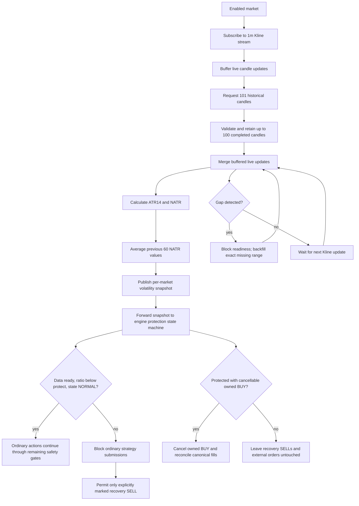

# Broker–Harvester Trading Flow

This document describes the current Conservative trading path at the application/infrastructure boundary. Method names and responsibilities below were checked against the Harvester broker port, Binance adapter, bootstrap, Trading Engine, and shared Binance broker implementation. A [Mermaid-free text version](./BROKER_HARVESTER_TRADING_FLOW_TEXT.md) is also available. For stable reasons when an executable intent is deferred before broker I/O, see [Submission deferrals and missing-order diagnostics](../operations/submission-deferrals.md).

## Responsibilities

### Broker and infrastructure adapter — exchange communication

The Binance broker and Harvester adapter perform exchange I/O and translate exchange data into normalized application-facing values.

| Capability | Current method / boundary | Responsibility |
| --- | --- | --- |
| Live market prices | `subscribeForPrices({ symbol, onPrice })` | Subscribes to the aggregate-trade price stream and invokes `onPrice` with a normalized price event. |
| Initial ticker price | `getPrices({ symbol })` | Requests a ticker snapshot when startup has not received a fresh stream price. |
| Historical candles | `getCandles({ symbol, interval, limit, startTime?, endTime? })` | Loads the initial completed history and backfills missing one-minute candles. |
| Live candle updates | `subscribeForCandles({ symbol, interval, onCandle })` | Feeds the per-market history service; the subscription is drained during shutdown. |
| Trading constraints | `getSymbolFilters({ symbol })` | Loads symbol filters and converts them into Harvester market metadata. |
| Best bid/ask | `subscribeForBookTicker({ symbol, onBookTicker })` | Delivers normalized best-bid/best-ask updates used by the trading engine's LIMIT_MAKER safety checks. |
| Submit an order | Harvester port: `placeOrder({ order })`; Binance client: `createCanonicalOrder(order)` or `createOrder(order)` | The adapter prefers canonical submission when the client supports it; otherwise it uses the regular order method. |
| User-data events | `subscribeForUserData({ onEvent })` | Delivers order updates. For execution reports, the Binance broker normalizes the order and, for TRADE events, the execution into canonical values before forwarding the event. |

The adapter is `src/infrastructure/brokers/binance-broker-adapter.js`; the application-owned contract is `src/application/ports/broker.port.js`. Binance-specific API operations, stream names, and payload mappings stay behind this boundary.

The candle methods are part of the required Harvester port and are forwarded unchanged by the adapter ([PR #1019](https://github.com/45s/coinzilla/pull/1019)). The startup candle-history service uses them ([PR #1021](https://github.com/45s/coinzilla/pull/1021)). The service itself remains a data producer separate from strategy decisions; bootstrap forwards its snapshots to the engine's per-market protection state machine and central submission gate ([PR #1041](https://github.com/45s/coinzilla/pull/1041)). See [Volatility Protection](../volatility-protection.md) for the canonical policy.

**Naming clarification:** `createCanonicalOrder()` and `createOrder()` are methods on the shared Binance broker client, not Harvester's application port. Harvester submits through `broker.placeOrder({ order })`. Likewise, `subscribeForBookTicker()` is an available broker-port capability; it supplies order-book safety data and is not the Conservative price-decision input.

### Harvester — trading decisions and accounting

| Method / component | Responsibility |
| --- | --- |
| `processMarketPrice()` | Validates and processes an incoming market-price event in the Trading Engine. |
| `makeConservativeTradingEngine()` | Coordinates serialized market/order transitions, strategy evaluation, shared safety checks, order submission, order ownership, and execution processing. |
| Conservative strategy policy | Decides whether to BUY, SELL, or take NO_ACTION from market, configuration, Portfolio, RecoveryLedger, and active-order facts. It does not communicate with the exchange or submit orders. |
| `updateTradingAccounting({ fill })` | Applies one canonical actual fill to Portfolio and RecoveryLedger as one accounting transition. |

Bootstrap composes the broker adapter, engine, strategy policy, and accounting workflow. The engine uses the injected broker port; the strategy policy remains exchange-independent.

## Candle history warm-up and live maintenance

The candle service is composed after the existing market-price intake. It establishes all enabled-market Kline subscriptions before requesting historical data, buffers callbacks received during warm-up, and exposes data readiness separately from trading policy.



A market is not data-ready until it has at least 74 contiguous completed candles (61 NATR observations), a successful live subscription, and a fresh valid Kline update. A detected gap immediately removes readiness while its exact historical backfill is pending; readiness returns only after continuity is restored. Delayed events outside the retained window do not refresh freshness. The current five-second stream freshness rule is reused. A zero reference NATR, invalid candle, unresolved gap, failed subscription or stale stream remains explicitly unavailable. Shutdown drains accepted candle/backfill callbacks before broker disconnect, even when the unsubscribe operation itself fails. The candle service itself reports data readiness only; bootstrap forwards its snapshots to the engine's per-market protection state machine. The engine's central gate blocks ordinary submissions while data is unavailable, protection is `PROTECTED`/`RECOVERING`, or the latest ratio is at or above the protection threshold; only explicitly marked recovery SELLs may pass the volatility gate. It cancels only acknowledged, Harvester-owned active BUYs; existing recovery SELLs and external orders remain untouched. See [Volatility Protection](../volatility-protection.md) for exact thresholds, three-candle recovery and cancellation/fill-reconciliation requirements.

## Interaction diagram

The sequence below separates the order acknowledgement from the later execution report. Acknowledgement confirms the broker's response to submission; it does **not** by itself mean the order has filled or change Portfolio holdings.

```mermaid
sequenceDiagram
participant Binance as Binance
participant Broker as Binance broker + Harvester adapter
participant Bootstrap as Harvester bootstrap / intake
participant Engine as Conservative Trading Engine
participant Strategy as Conservative strategy
participant Accounting as updateTradingAccounting
participant Portfolio
participant Ledger as RecoveryLedger

Note over Bootstrap,Broker: Startup setup for each enabled symbol
Bootstrap->>Broker: getSymbolFilters({ symbol })
Broker->>Binance: exchangeInfo request
Binance-->>Broker: Exchange trading filters
Broker-->>Bootstrap: normalized market metadata

Note over Bootstrap,Broker: User-data subscription is established before market intake
Bootstrap->>Broker: subscribeForUserData({ onEvent })

opt TESTNET trading — order-book safety input
    Bootstrap->>Broker: subscribeForBookTicker({ symbol, onBookTicker })
    Binance-->>Broker: best bid / ask stream update
    Broker-->>Bootstrap: normalized bookTicker
    Bootstrap->>Engine: processBookTicker({ symbol, bookTicker })
    Note over Engine: Cached for fresh LIMIT_MAKER crossing checks; not a strategy price decision
end

Bootstrap->>Broker: subscribeForPrices({ symbol, onPrice })
Binance-->>Broker: aggregate-trade market price
Broker-->>Bootstrap: onPrice(priceEvent)
Bootstrap->>Engine: processMarketPrice({ symbol, priceEvent, pairConfig, settings })
Engine->>Strategy: evaluate(current price, Portfolio, RecoveryLedger, active orders)
Strategy-->>Engine: BUY / SELL decision or NO_ACTION

alt NO_ACTION
    Note over Engine,Strategy: No order is submitted
else BUY or SELL action
    Engine->>Engine: Evaluate all submission safety gates
    alt Gate denies or data is not ready
        Engine-->>Bootstrap: deferred=true with stable reason/details; no broker call
    else Gate permits action
        Engine->>Engine: Register PENDING and durably publish submission intent
        Engine->>Engine: Recheck all submission safety gates
        alt Readiness changed after PENDING registration
            Engine->>Engine: Remove local PENDING order
            Engine-->>Bootstrap: deferred=true with stable reason/details; no broker call
        else Still safe to submit
            Engine->>Broker: placeOrder({ order })
            Note over Broker: Adapter selects createCanonicalOrder(order) when available; otherwise createOrder(order)
            Broker->>Binance: order.place
            Binance-->>Broker: order acknowledgement
            Broker-->>Engine: normalized acknowledged order
            Note over Engine: Register/update order state; acknowledgement is not a fill
        end
    end
end

loop Each volatility snapshot
    Bootstrap->>Engine: processVolatilitySnapshot({ symbol, snapshot })
    Engine->>Engine: Update per-market protection state
    opt Protected and acknowledged active owned BUY exists
        Engine->>Broker: cancelOrder(owned BUY)
        Broker-->>Engine: Canonical cancellation outcome
        alt Cancellation confirmed
            Engine->>Broker: getFills({ symbol, orderId })
            Broker-->>Engine: Canonical fills, including cancellation race
            Engine->>Engine: Reconcile terminal order and apply fills exactly once
        else Cancellation unresolved
            Note over Engine: Keep market protected; unresolved BUY remains active
        end
    end
end

opt No fresh stream price arrived during startup
    Bootstrap->>Broker: getPrices({ symbol })
    Broker->>Binance: ticker.price request/response
    Binance-->>Broker: initial ticker snapshot
    Broker-->>Bootstrap: ticker price
    Bootstrap->>Engine: processMarketPrice({ symbol, priceEvent })
    Note over Bootstrap: Seed only if no fresh WebSocket price was received
end

Note over Binance,Broker: Actual execution is reported separately from submission acknowledgement
Binance-->>Broker: user-data executionReport
Note over Broker: Normalize executed order; for executionType=TRADE, normalize canonical Fill
Broker-->>Bootstrap: onEvent({ event: normalized execution report })
Bootstrap->>Engine: processUserDataEvent({ event })

alt executionType = TRADE
    Engine->>Engine: Validate registered order and canonical Fill identity
    Engine->>Accounting: updateTradingAccounting({ fill })
    Accounting->>Portfolio: applyFill({ fill })
    Accounting->>Ledger: applyFill({ fill })
    Accounting-->>Engine: updated Portfolio + RecoveryLedger
    Note over Portfolio,Ledger: Actual fill facts and commissions update both accounting projections
    Engine-->>Bootstrap: execution processed
else order status update without a trade
    Engine->>Engine: Update order lifecycle / registry
    Note over Engine,Portfolio: No fill means no Portfolio or RecoveryLedger accounting change
end

opt Submission acknowledgement already reports FILLED
    Engine->>Broker: getFills({ symbol, orderId })
    Broker-->>Engine: canonical execution history
    Engine->>Accounting: Apply reconciled canonical fills
end
```

## Startup paths and important distinctions

- **Market filters:** bootstrap loads `getSymbolFilters({ symbol })` for every configured market before market subscriptions. Enabled markets are validated for trading readiness; disabled markets retain canonical base/quote metadata for account-audit coverage but are not order-readiness validated and do not emit trading-rule capture events. The Harvester's process-local `marketMetadata` map retains this startup snapshot for strategy use. The Binance adapter itself does not cache exchange filters: each `getSymbolFilters` request fetches current exchange metadata and normalizes it. Current bootstrap loads the map once; no background refresh is claimed.
- **Initial price fallback:** bootstrap first establishes every enabled market-price subscription. It then calls `getPrices({ symbol })` and seeds the engine only when no fresh WebSocket price was received for that symbol. The current Binance implementation sends `ticker.price` as a request/response operation over its WebSocket API; it is **not an HTTP REST call**.
- **Book ticker:** when TESTNET trading is enabled, bootstrap subscribes to best bid/ask updates and forwards them to `processBookTicker()`. The engine requires fresh same-symbol book data for `LIMIT_MAKER` submission and rejects a price that would cross the opposite best quote.
- **Submission deferral:** an executable strategy intent may still be withheld before broker I/O. The result and DEBUG log distinguish `ok` from `deferred`, include a stable reason and safe context, and preserve any earlier acknowledged orders in a multi-action decision. If readiness changes after durable PENDING registration, the local PENDING order is removed and the broker is not called. See the [submission deferral runbook](../operations/submission-deferrals.md).
- **Acknowledgement versus execution:** `placeOrder()` returns an order acknowledgement/status. It is not evidence that any quantity traded. A later `executionReport` with `executionType: "TRADE"` carries the actual execution. If the submission acknowledgement itself is already `FILLED`, the engine retrieves canonical fills with `getFills()` and reconciles/applies them before completing that serialized transition.
- **Volatility protection:** bootstrap forwards candle snapshots to `processVolatilitySnapshot()`; the engine owns the per-market state machine and central submission gate. While data is unavailable, protection is active, or the latest ratio is at the protection threshold, only an explicitly marked recovery SELL may pass the volatility-specific gate. Only acknowledged owned BUYs are eligible for cancellation; canonical cancellation/fill reconciliation must settle before recovery.
- **Accounting authority:** only canonical actual fills update Portfolio and RecoveryLedger. Status-only reports, market prices, order requests, and acknowledgements do not change holdings.

## Source references

- [Harvester broker port](../../src/application/ports/broker.port.js)
- [Binance broker adapter](../../src/infrastructure/brokers/binance-broker-adapter.js)
- [Bootstrap composition and subscriptions](../../src/bootstrap/start-harvester.js)
- [Conservative Trading Engine](../../src/use-cases/conservative-trading-engine.js)
- [Market-price use case](../../src/use-cases/process-market-price.js)
- [Trading accounting use case](../../src/use-cases/update-trading-accounting.js)
- [Volatility protection state machine](../../src/domain/market/volatility-protection-state.js)
- [Volatility protection state-machine tests](../../src/domain/market/volatility-protection-state.test.js)
- [Harvester Broker Port and Adapter](../infrastructure/broker-port-and-adapter.md)
- [Harvester Architecture](../architecture.md)
