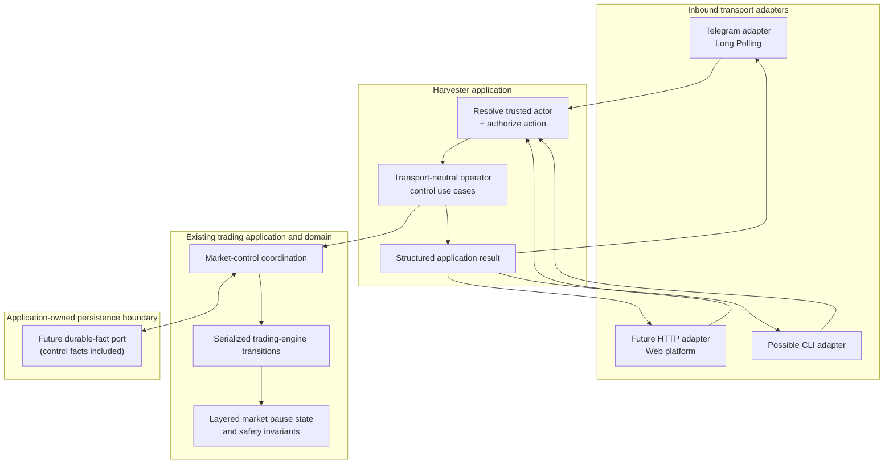

# Operator control interface — design proposal

> **Status: DISCUSSION DRAFT — NOT AN ACCEPTED ADR OR IMPLEMENTATION CONTRACT.**
> This document is a proposal for review. It introduces no runtime behavior, public API, configuration contract, dependency, server, polling worker, or trading-state change. Resolve the decisions in [Open design decisions](#open-design-decisions) before implementation. Once the architecture is agreed, record durable decisions in an ADR and update this proposal into the implementation contract.

## 1. Goal

Provide a transport-independent application capability for authorized operators to inspect and control individual markets.

The first proposed transport is Telegram. A future web platform may send the same application-level requests over HTTP. The application and domain layers must not depend on Telegram, HTTP, chat IDs, bot updates, request objects, or transport-specific command syntax.

**Core rule: Telegram is an adapter, not the operator-control system.**

The design should allow:

- Telegram to submit an operator request.
- A future web API to submit the same request.
- A future CLI or another adapter to reuse the same use cases.
- All transports to receive the same structured application result.
- Trading safety rules to remain centralized in existing Harvester workflows.

## 2. Current implementation — source-verified baseline

The current implementation is notification-only:

- `src/index.js` optionally constructs `TelegramNotifier` and subscribes to Harvester lifecycle events.
- `src/bootstrap/notifications/subscribe-harvester-telegram-notifications.js` maps Harvester events into the Notifiers package's outbound notification vocabulary.
- `@coinzilla/notifiers` implements Telegram `sendMessage` delivery. It does not receive operator commands.
- There is no inbound Telegram update poller, operator authorization flow, public market-control use case, or HTTP server.
- `makeConservativeTradingEngine()` already owns serialized market transitions and internal pause/recovery state. Its internal `pause()` path is a safety mechanism, not a public operator API.
- The current engine's pause sets are process-local. Runtime startup does not restore prior pause state from Journal.
- The Journal is an operational observer, not the authoritative durable trading-state store. The accepted [ADR-0001 recovery contract](./decisions/0001-application-owned-recovery-facts.md) defines a future application-owned durable-fact boundary, but runtime restoration and that durable store are not implemented.

Do not infer that an existing `strategy.paused` notification means an operator can pause or resume a market. Notification and command directions are separate.

## 3. Proposed architecture

### 3.1 Dependency direction



All adapters terminate at the same application use cases. No adapter calls a strategy policy, Portfolio, OrderRegistry, broker client, or exchange API directly.

The diagram is a proposed responsibility boundary, not a claim that these modules or APIs currently exist.

### 3.2 Application boundary

Prefer focused use cases over a generic command bus or a new framework. The initial application surface could be:

| Application operation | Purpose |
| --- | --- |
| `pauseMarket` | Request an operator pause for one configured market |
| `resumeMarket` | Remove the operator pause only, subject to safety checks |
| `getMarketStatus` | Return a safe, read-only status for one market |
| `listMarketStatuses` | Return safe status summaries for configured markets |

These operations should accept plain object inputs and return the repository's structured result convention. Their contracts must not contain Telegram or HTTP types.

Illustrative shape only — names and fields are not yet accepted:

```js
await operatorControl.pauseMarket({
  symbol: "LINKUSDT",
  actor: { id: "operator-identity", source: "telegram" },
  requestId: "transport-neutral-idempotency-key",
  reason: "operator-request",
})
```

The adapter resolves its external identity to a trusted application actor. The application authorizes the requested operation and validates that the symbol refers to a configured market. Do not accept an arbitrary symbol as proof that a market exists.

A generic dispatcher should be added only if the actual command set demonstrates a need for one. A small adapter-to-use-case mapping is sufficient initially.

### 3.3 Proposed source layout

This is a candidate layout aligned with the existing `src/use-cases/`, `src/application/`, `src/infrastructure/`, and `src/bootstrap/` boundaries. It is not an instruction to create every file or directory mechanically.

```text
apps/harvester/src/
  use-cases/
    operator-control/
      create-operator-control.js
      pause-market.js
      resume-market.js
      get-market-status.js
      list-market-statuses.js

  application/
    ports/
      # Add a control-fact persistence port only when its contract is agreed.
      # Reuse the accepted durable-fact boundary; do not make Journal authoritative.

  infrastructure/
    telegram/
      telegram-update-poller.js
      parse-telegram-command.js
      format-telegram-command-response.js

    http/
      # Future web adapter; do not create now.

  bootstrap/
    operator-control/
      start-operator-control.js
```

Naming guidance:

- Use **market** in application/domain APIs if that matches the existing Harvester vocabulary; do not create a parallel `Pair` entity just to support commands.
- Use transport-specific names only inside the adapter, such as `parseTelegramCommand` and `telegram-update-poller`.
- Use application names such as `pauseMarket`, `resumeMarket`, and `getMarketStatus` outside adapters.
- Keep outbound notification names and modules separate from inbound command handling.
- Do not put command receiving into `@coinzilla/notifiers`; that package currently owns outbound notification delivery.
- Keep `src/index.js` as composition/lifecycle wiring, not a command parser or business workflow.
- Add an application port only for a real outbound dependency (for example, durable control-fact storage); inbound use cases do not need a speculative port interface merely to mirror folder names.

## 4. Telegram connection — first adapter only

### 4.1 Proposed transport

Use Telegram Bot API **Long Polling** for the first deployment:

1. Harvester starts the optional Telegram command adapter after its application control use cases are ready.
2. The adapter makes outbound HTTPS requests to Telegram's `getUpdates` endpoint with a long-poll timeout.
3. Telegram returns updates containing messages/commands.
4. The adapter validates the update shape, parses the command and resolves the sender/chat to a trusted actor.
5. It invokes the transport-neutral application use case.
6. It formats the structured result and replies with `sendMessage`.

No public web server, inbound port, public IP, domain name, reverse proxy, or webhook is required for this approach. Harvester only needs outbound network access to Telegram.

A single active poller should own a bot token. The existing single-writer process lock is relevant to deployment composition, but the command adapter must still define duplicate-update and shutdown behavior explicitly. Polling failures must remain isolated from trading execution.

### 4.2 Notifications and commands are separate capabilities

Keep the existing `notifications.telegram` configuration for outbound alerts. Do not turn it into a combined notification-and-command subsystem.

Inbound control needs its own enablement, authorization and lifecycle policy. The exact config namespace is an open decision; a transport-neutral root section with a Telegram-specific adapter subsection is preferable to nesting commands under `notifications`.

The same Telegram bot token may be reused if the operator deliberately enables both directions, but the notifier and command receiver must have separate responsibilities, error handling, and shutdown. A failure in either direction must not silently enable or disable the other.

## 5. Security and authorization

Remote commands can change live trading behavior. Treat the inbound channel as a privileged control plane.

Required design constraints:

- Default inbound control to disabled.
- Require an explicit allowlist of Telegram sender/chat identities; never trust a symbol or identity supplied only in message text.
- Resolve external identities to an application actor before invoking a use case.
- Centralize authorization for each operation in the application boundary. An adapter may authenticate its transport, but it must not implement a separate business authorization policy.
- Reject unknown users, unsupported commands, malformed symbols, oversized input, stale/duplicate updates and unauthorized markets without side effects.
- Never expose bot tokens, exchange credentials, raw broker payloads, account secrets or sensitive diagnostics in command responses.
- Keep responses bounded and redact errors.
- Record actor, operation, market, request identity, outcome and reason in the appropriate application audit facts.
- Make state-changing commands idempotent. Repeated pause/resume requests must not produce duplicate side effects or misleading success.
- Do not support arbitrary shell commands, code evaluation, exchange RPC passthrough, or arbitrary URL execution.

Telegram chat IDs and bot tokens are not interchangeable. Credentials remain environment/secret-manager material; authorization allowlists and feature enablement need an explicit configuration contract.

## 6. Pause and resume are domain-safety questions

This is the most important design gap. The existing engine has several reasons to pause a market, including safety and recovery conditions. An operator pause must not overwrite or clear those reasons.

### 6.1 Layered pause reasons

The target model should distinguish at least:

- **Operator pause** — an explicit request to stop or restrict strategy activity for a market.
- **Safety pause** — a fail-closed condition raised by the trading engine after an uncertain or unsafe operation.
- **Recovery-managed pause** — a temporary pause owned by an existing recovery/cancellation workflow.
- **Configuration disabled** — the market is not enabled for strategy operation; this is not an operator pause.

The effective market state is the combination of active reasons, not one boolean that any caller can clear.

`resumeMarket` may remove only the operator-owned pause reason. It must never clear a safety pause, recovery pause, accounting failure, unresolved order/cancellation outcome, or readiness gate. Those require their existing reconciliation or explicit safety-resolution workflow.

Do not reuse the current internal `pause()` function as an operator API without first defining ownership and clearing rules.

### 6.2 What does “pause” do to orders?

This is intentionally **not decided**. A command that pauses a market while owned orders are already open needs an explicit contract.

Options to review:

1. Block new strategy BUYs and new exposure, while continuing fill processing and risk-reducing/recovery SELL workflows.
2. Block all new strategy order submissions, while leaving already acknowledged exchange orders untouched and continuing reconciliation/accounting.
3. Cancel selected owned orders as part of the pause, with explicit order-side policy, durable cancellation intent, exchange acknowledgement and fill reconciliation.

Do not silently cancel orders. Do not stop user-data intake, fill accounting, broker reconciliation or shutdown safety work. An already-resting order may still fill after a pause request; the design must specify how that fill is processed and which follow-up actions remain permitted.

**Proposed conservative default for discussion:** no automatic exchange cancellation in the first version. Pause should be an application-level strategy-control state; existing orders remain subject to normal execution/fill reconciliation. Whether risk-reducing SELLs remain allowed must be explicitly settled before implementation.

## 7. Durability, restart and acknowledgement

The current engine pause sets are process-local. The current Journal records `strategy.paused` events but does not make them a durable, restored operator-control contract. Runtime startup does not replay prior Journal sessions.

Therefore:

- Do not claim an operator pause survives restart until it is stored and restored through an authoritative application-owned mechanism.
- Do not use Journal as the durable command store or infer that a logged notification is proof of a committed control transition.
- Align control facts with the accepted [ADR-0001](./decisions/0001-application-owned-recovery-facts.md), which explicitly includes strategy control and safety facts in the future durable-fact model.
- Define a durable acknowledgement boundary: a state-changing command must not report success before the operator-control fact is committed according to the agreed durability contract.
- If the process restarts with an unresolved control fact or an incomplete durable history, fail closed; do not silently resume the market.
- Preserve the existing Journal order/cancellation durability barriers and the rule that market-price, broker-event and fill-accounting paths must not wait on Journal I/O.

This is a dependency to resolve against the #654 recovery roadmap. It does not authorize wiring the current Journal replay helpers into runtime.

## 8. Future HTTP/web adapter

A future web platform should be another inbound adapter, not a second implementation of trading controls.

Illustrative mapping:

| Web request | Same application operation |
| --- | --- |
| `GET /markets` | `listMarketStatuses` |
| `GET /markets/{symbol}` | `getMarketStatus` |
| `POST /markets/{symbol}/pause` | `pauseMarket` |
| `POST /markets/{symbol}/resume` | `resumeMarket` |

The HTTP adapter would authenticate a web user/session, resolve it to the same trusted actor model, authorize the operation, invoke the use case and map the result to an HTTP response.

**Do not build an HTTP server now.** Do not add HTTP framework dependencies, public routes, webhook support or web-specific application contracts before a real web consumer exists.

## 9. Proposed command vocabulary

The first Telegram adapter could expose a small allowlisted vocabulary:

| Telegram command | Application operation | Access |
| --- | --- | --- |
| `/help` | Adapter help (no domain operation) | Authorized sender |
| `/pairs` | `listMarketStatuses` | Read |
| `/status LINKUSDT` | `getMarketStatus` | Read |
| `/pause LINKUSDT` | `pauseMarket` | State-changing |
| `/resume LINKUSDT` | `resumeMarket` | State-changing |

Command strings are Telegram syntax only. The application must not receive a raw `/pause` string.

Avoid `/pause_all` in the first scope until the single-market behavior, authorization, durability and partial-failure semantics are proven.

## 10. Lifecycle and failure isolation

Proposed process lifecycle:

1. Compose application control use cases and their required persistence dependencies.
2. Start the optional inbound adapter only when explicitly enabled and fully authorized/configured.
3. Keep polling and command processing outside the trading engine's critical event queues; invoke the serialized application control transition through a deliberate boundary.
4. On shutdown, stop accepting updates, stop/abort the long poll, wait for bounded in-flight command completion, then continue normal runtime shutdown.
5. Close the command adapter independently from the outbound notification subscriber.

A Telegram outage, malformed update, unauthorized sender, slow reply, or response-delivery failure must not stop market data, broker events, accounting, recovery or order safety. If a command's application transition succeeds but Telegram cannot deliver the reply, retrying the update must not repeat the state change.

## 11. Open design decisions

Resolve these before implementation:

1. **Pause semantics:** Does pause block only new exposure/BUYs, all new strategy submissions, or every strategy action? Are risk-reducing/recovery SELLs allowed?
2. **Existing orders:** Leave all orders untouched, cancel BUYs only, or cancel another explicit subset? What happens when an order fills during/after pause?
3. **Durable state dependency:** Is operator control delivered only after the ADR-0001 durable-fact port supports control facts, or is there a separately accepted safe persistence milestone?
4. **Resume policy:** Which operator role may resume? What safety/recovery states must remain blocking? Is explicit human acknowledgement required after a safety pause?
5. **Authorization model:** Allowlisted chat IDs, Telegram user IDs, or both? How are multiple operators and role levels represented?
6. **Configuration naming:** Keep outbound `notifications.telegram` separate from a transport-neutral control section. Agree the exact root key, enable flags and allowlist source before changing `config.json`.
7. **Bot lifecycle:** Reuse the existing bot token or use a separate bot? Can command polling be enabled independently from outbound notifications?
8. **Idempotency and audit:** Define update deduplication, durable request identity, actor attribution, and behavior when the application action commits but the Telegram reply fails.
9. **Read-only status contract:** Decide which market/order/recovery fields are safe and useful to expose without leaking account or exchange-sensitive data.
10. **Deployment ownership:** Confirm the single-process/single-poller assumption and how a future multi-instance web deployment would route commands to the process that owns trading state.

## 12. TDD-first implementation sequence — proposed only

After the open decisions are accepted:

1. **Contract tests (RED):** define transport-neutral use-case inputs/results, actor authorization, configured-market validation, idempotency and layered pause ownership. Prove the tests fail before production implementation.
2. **Domain/application tests (RED):** prove operator pause cannot clear safety/recovery blockers; prove repeated commands are idempotent; prove fill/accounting/reconciliation continue under the agreed pause semantics.
3. **Durability tests (RED):** prove operator pause/resume facts are acknowledged only after durable commit, survive restart, and fail closed on missing/ambiguous history.
4. **Application implementation (GREEN):** add the smallest use cases and engine-control integration using existing serialized transitions; no transport dependency.
5. **Telegram adapter tests (RED/GREEN):** parser, allowlist, malformed/duplicate updates, unauthorized sender, polling offset, timeout, Telegram errors, reply failure, bounded responses and graceful shutdown. Inject fetch; no live credentials/network in default tests.
6. **Composition tests:** prove inbound commands are optional, disabled by default, isolated from outbound notifications, and do not block trading startup/shutdown.
7. **Read-only rollout:** enable only `/help`, `/pairs`, and `/status` after security review.
8. **State-changing rollout:** enable pause/resume only after the pause semantics and durable-control contract are accepted and all safety tests pass.
9. **Future HTTP adapter:** add only when a real web platform exists; reuse the same application use cases and authorization model.

No live exchange operation or TESTNET order mutation is needed to prove the default unit contracts. Any exchange-connected validation requires its own bounded authorization and safety plan.

## 13. Scope of this proposal

This proposal does **not**:

- implement Telegram command polling or a webhook;
- add a web server or HTTP framework;
- change the current Telegram notification configuration or notifier package;
- change trading strategy, pair configuration, broker behavior or order lifecycle;
- decide cancellation behavior for already-open orders;
- make current process-local pause state durable;
- enable remote commands in any environment.

The implementation must be a separate, explicitly scoped follow-up after the decisions above are resolved.
