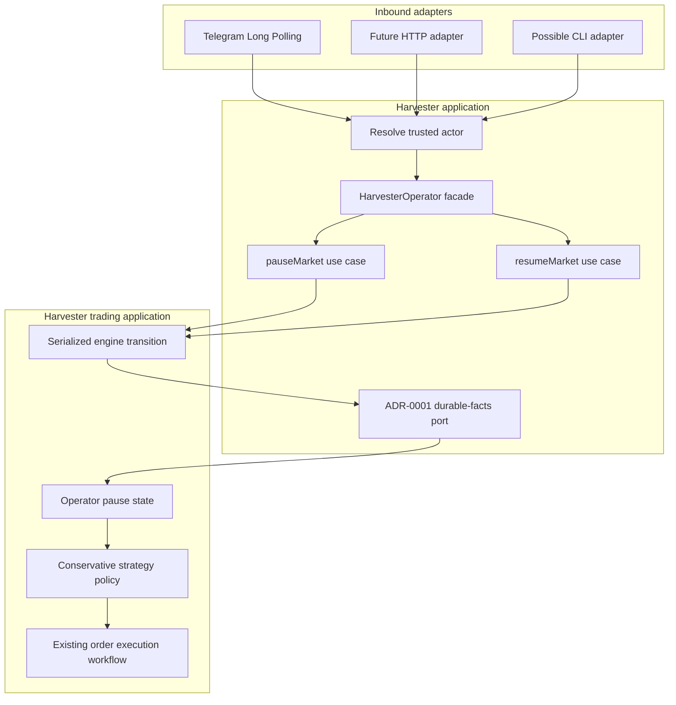
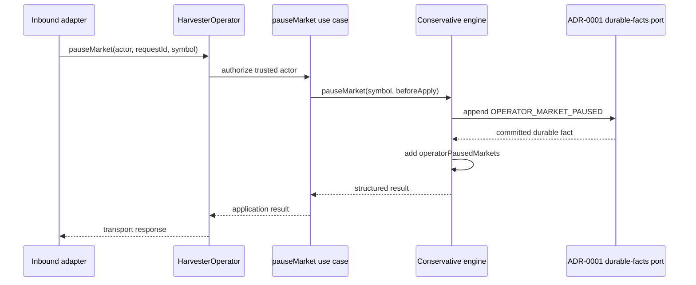

# Harvester operator control

> **Status: ACCEPTED IMPLEMENTATION CONTRACT.** Architectural decisions are recorded in [ADR-0002](./decisions/0002-transport-independent-operator-control.md) and the initial process-lifetime scope is clarified by [ADR-0003](./decisions/0003-process-lifetime-operator-pause.md). Runtime configuration and lifecycle wiring are implemented in PR #1067; inbound Telegram remains optional and disabled by default. Operator pause state is not restored after a process restart.

## Goal

Provide one Harvester-owned application capability that authorized operators can invoke through different transports. Telegram is the first inbound adapter. A future web/HTTP adapter must reuse the same application use cases; it must not implement a second trading-control workflow.

**Core rule: transports translate identity and syntax; the Harvester application owns authorization and behavior.**

## Current implementation baseline

- Outbound Telegram notifications remain in `notifications.telegram` and `@coinzilla/notifiers`.
- The Conservative engine exposes a serialized operator-pause boundary separate from safety pause state; the implementation and regression tests are in [PR #1045](https://github.com/45s/coinzilla/pull/1045).
- `src/application/operator/create-harvester-operator.js` composes explicit pause/resume use cases with actor-role authorization and the ADR-0001 durable-facts append port.
- The use cases pass the durable append callback into the engine transition; the engine changes in-memory state only after a confirmed durable commit.
- `src/infrastructure/telegram/telegram-operator-adapter.js` implements the private-chat allowlist, one-command parser, serial Long Polling, stable update request IDs, retry behavior and graceful stop. PR #1067 wires its optional lifecycle into Harvester bootstrap.
- The ADR-0001 file store and integrity checks are verified by the process bootstrap. The same process-owned store is injected into order/fill/recovery producers and the operator facade; never create a second writer for the same ledger. Application use cases append operator facts before applying in-memory state. **Restart restoration is out of scope:** the initial operator pause lasts only for the current process and is not replayed after restart. Disabled-by-default configuration and lifecycle validation are implemented independently of recovery Steps 7–9.

## DDD ownership and source layout

`HarvesterOperator` is an application facade over explicit use cases. It is not a Domain Entity, aggregate, strategy, broker adapter, or generic command bus.

```text
apps/harvester/src/
  application/
    operator/
      authorize-operator-actor.js
      create-harvester-operator.js
    ports/
      durable-facts.port.js
  use-cases/
    operator-control/
      pause-market.js
      resume-market.js
  infrastructure/
    telegram/
      telegram-operator-adapter.js       # implemented; runtime wiring remains gated
  bootstrap/
    operator-control/
      prepare-telegram-operator-control.js # runtime lifecycle composition
```

The engine remains under `src/use-cases/conservative-trading-engine.js` because it coordinates existing application workflows and serialized broker/market transitions. Domain strategy policies remain transport- and persistence-independent.

Do not create `packages/operator`, `packages/operators` or `packages/commands` now. Extract a shared package only after a second real application proves that actor, authorization, request/result and idempotency semantics are genuinely shared without Harvester trading dependencies.

## Architecture flow

The application capability is shared by inbound adapters. Only the adapter changes when another transport is introduced.



A pause transition commits its fact from inside the engine's serialized transition before applying the operator state:



If the durable append fails or is uncertain, the engine does not mutate operator state. If the process crashes after the fact is committed but before the in-memory update, the fact remains in the durable stream but is not replayed by this initial scope. A process restart starts without the operator pause; an operator who still wants the market paused must issue the command again.

## Application contracts

### Actor and request

Adapters resolve an authenticated external principal to a trusted application actor. The application requires the `trading-operator` role.

```js
const actor = {
  id: "telegram-user:12345",
  roles: ["trading-operator"],
}

await operator.pauseMarket({
  actor,
  requestId: "telegram:1001",
  symbol: "LINKUSDT",
})
```

The actor contains no Telegram chat object, HTTP request, session cookie or transport-specific method. The request ID is stable across retries and bounded to 256 characters.

### Durable fact contract

The application writes through the ADR-0001 durable-facts port. It does not use Journal, EventBus or notifier delivery as control-state persistence.

```js
{
  factId: "operator-control:telegram:1001",
  factType: "OPERATOR_MARKET_PAUSED",
  data: {
    requestId: "telegram:1001",
    actorId: "telegram-user:12345",
    symbol: "LINKUSDT"
  }
}
```

The durable-facts adapter must return `durable: true` only after the record and committed head satisfy ADR-0001. Exact duplicate fact identity/payload is idempotent; reuse of a fact identity with different data is an integrity failure.

The engine executes the append callback inside its serialized transition. Only a successful durable commit is followed by the in-memory operator state change. PR #1067 wires the same process-owned ADR-0001 store into the operator facade; the operator must not open an independent store instance. The initial process-lifetime scope deliberately does not restore operator facts at startup; this limitation is explicit and is not a dependency on full recovery.

## Application result shape

The application returns the repository's structured result envelope. A successful pause includes the configured market and whether it was already paused:

```js
{
  ok: true,
  data: {
    symbol: "LINKUSDT",
    paused: true,
    alreadyPaused: false,
    durable: true
  },
  errors: []
}
```

A rejected request uses a stable error code, for example `OPERATOR_UNAUTHORIZED`, `INVALID_OPERATOR_REQUEST_ID`, `INVALID_OPERATOR_MARKET` or `SAFETY_BLOCKER_ACTIVE`. Transport adapters map these codes to concise messages; they must not expose stack traces or internal storage details.

## Pause semantics

An operator pause is market-scoped and separate from safety/recovery pause ownership.

- Block new strategy BUY intents for the selected market.
- Suppress trailing-BUY replacement/repricing for that market.
- Allow Conservative recovery SELL decisions.
- Continue market prices, broker/user-data intake, fill accounting and reconciliation.
- Leave all existing exchange orders untouched. A resting BUY may still fill after the pause; its fill is accounted and recovery SELL behavior remains available.
- Do not cancel, adopt or modify orders, and do not mutate broker or OrderRegistry state outside the existing engine workflows.
- Do not affect unrelated markets.

This is not an exchange kill switch. The initial Telegram response must explicitly state that already-open orders remain open and may still fill.

### Resume safety

The application-level `resumeMarket` use case is available for a future trusted adapter, but the initial Telegram command set exposes only `/pause <SYMBOL>`.

Resume removes only the operator-owned pause. The engine refuses to invoke the durable resume callback if a safety/recovery blocker, durable safety pause, unresolved replacement/trailing intent or pending recovery-managed cancellation, or an active high-volatility protection state remains. It never clears a safety blocker or opens the global startup readiness gate.

## First transport: Telegram

The first adapter uses Telegram Bot API Long Polling and is optional; its module and runtime lifecycle are implemented and tested offline. Runtime control remains disabled unless explicitly enabled in app configuration.

- Configuration belongs under `operatorControl.telegram`, independent from `notifications.telegram`.
- Inbound control defaults disabled. Enabling it requires a non-empty list of allowed Telegram user IDs.
- Accept private chats only; do not accept group commands.
- Resolve `message.from.id` through the allowlist to a trusted `trading-operator` actor. Never authorize based on a display name, message text, chat title or caller-supplied role.
- Use Telegram `update_id` as the stable request identity and the durable fact ID as the final idempotency boundary.
- Process updates serially. Retry transport failures without advancing the update offset; duplicate delivery after a crash must be harmless.
- Start and stop the poller with the Harvester runtime. If the feature is enabled without a valid durable-fact append store, fail closed before strategy evaluation. Do not require full recovery projection for this initial process-lifetime capability; do not claim a pause survives restart.
- Reuse the existing `TELEGRAM_BOT_TOKEN` environment secret. Never commit credentials.
- Keep outbound notification delivery independent and best-effort.

The target configuration is intentionally separate from outbound notification policy and remains disabled by default:

```json
{
  "operatorControl": {
    "telegram": {
      "enabled": false,
      "allowedUserIds": []
    }
  }
}
```

When enabled, `allowedUserIds` contains decimal Telegram user-ID strings. The existing bot token remains in `TELEGRAM_BOT_TOKEN`. Runtime configuration validation and lifecycle wiring are implemented in PR #1067; the feature remains disabled by default.

The first and only Telegram command in this milestone is:

```text
/pause <SYMBOL>
```

No status, resume, start/stop, order-cancel, configuration-edit or arbitrary command execution is included. No HTTP server is part of this work.

## Failure behavior

| Condition | Behavior |
| --- | --- |
| Unauthorized actor | Reject before engine/store access. |
| Missing/invalid request ID or symbol | Return a stable application error; do not append a fact. |
| Unknown configured market | Engine rejects before applying state. |
| Durable fact write failed or uncertain | No state transition and no successful acknowledgement. |
| Process restart after a pause | The initial scope does not replay operator facts. The process starts without the operator pause; the operator must issue `/pause <SYMBOL>` again if needed. |
| Existing BUY fills after pause | Apply the fill normally; continue risk-reducing recovery SELL behavior; suppress new BUY intents. |
| Resume while safety/recovery blocker exists | Reject before writing a resume fact; preserve the blocker. |
| Telegram transport failure | Log actionable diagnostics; never mutate trading state outside the application use case. |

## TDD and delivery sequence

1. **Engine semantics — implemented:** RED/GREEN tests cover market isolation, BUY suppression, recovery SELL continuity, no cancellation/repricing of existing orders, durable-before-apply, initial-state restoration, idempotent pause and safety-blocked resume.
2. **Application capability — implemented:** tests cover actor-role authorization, stable fact identity/payload, durable append ordering, failed persistence and transport-neutral facade.
3. **Durable append — implemented foundation:** use the existing ADR-0001 append-only stream and committed-head contract for pause/resume acknowledgements. Do not create an operator-specific store.
4. **Restart restoration — explicitly out of scope:** the initial operator pause is process-lifetime only. Do not add projection, recovery replay or a startup-readiness dependency to this operator-control task. Track full restart recovery separately under ADR-0001 / issue #654.
5. **Telegram adapter — implemented in PR #1045:** parser, private-chat allowlist, serial polling, update idempotency, replies, retry/backoff and graceful stop, with mocked transport tests.
6. **Configuration/bootstrap — pending, independent of restart recovery:** add disabled-by-default config validation, fail-closed enablement and runtime lifecycle tests; keep this independent from outbound notification settings. The process-lifetime limitation must be explicit to operators.
7. **Verification — in progress:** focused engine/application/adapter tests are present; exact-head workspace CI and documentation-link checks remain required. No Binance/TESTNET/LIVE operations.

## References

- [ADR-0002 — Transport-independent operator control](./decisions/0002-transport-independent-operator-control.md)
- [ADR-0001 — Application-owned durable facts](./decisions/0001-application-owned-recovery-facts.md)
- [Harvester roadmap](../../ROADMAP.md)
- [Harvester architecture](../architecture.md)
- [Harvester documentation index](../README.md)
- [Trading First](../TRADING_FIRST.md)
