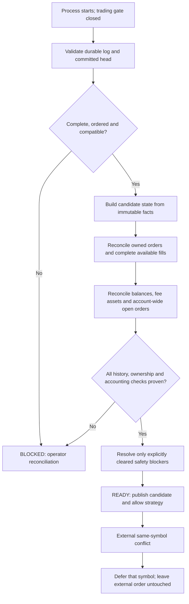

# ADR-0001: Application-owned durable facts for process-restart recovery

## Status

**Accepted — target architecture contract.** This decision freezes the recovery boundary and minimum durable-fact guarantees. It does not implement startup restoration, enable replay, or authorize unattended process restart.

**Owner:** Harvester

**Tracking:** [#654](https://github.com/45s/coinzilla/issues/654), umbrella [#626](https://github.com/45s/coinzilla/issues/626)
**Evidence:** findings F-035 through F-044 in [AUDIT_FINDINGS.md](../../audits/reports/AUDIT_FINDINGS.md) and the [2026-11-10 restart-recovery audit](../../audits/reports/2026-11-10_18-44-49_restart-recovery-audit.md).

## Context

The current startup composition creates fresh in-memory `Portfolio`, `RecoveryLedger`, and `OrderRegistry` state. It does not read previous Journal sessions or invoke the retained offline projection, restoration, and reconciliation helpers. Restart restoration is therefore not implemented.

The retained helpers are useful foundations, but they are not safe to wire into startup unchanged:

- F-035/F-040: the current Journal reader does not recursively discover the nested per-process session layout, and same-second sessions can be ordered by random session ID rather than actual chronology.
- F-036: account-wide external open orders are an ownership classification, not a blanket startup rejection. External orders must remain unowned and untouched; same-symbol conflicts still need narrow strategy protection. An actual unowned execution is a safety blocker.
- F-037/F-028/F-029: applied fills and safety pauses are not guaranteed durable before in-memory progression, while the Journal evidence contract explicitly forbids adding blocking Journal I/O to fill accounting and market/broker-event paths.
- F-038/F-041: the retained restore path has cost-basis and cycle-completion gaps. A full SELL alone does not prove that a recovery cycle completed or that retained inventory was allocated.
- F-039: exact third-asset commission facts, quote valuation, live/replay parity, fee-asset reconciliation, and invalid-fee atomicity are covered by merged PRs [#990](https://github.com/45s/coinzilla/pull/990), [#995](https://github.com/45s/coinzilla/pull/995), and [#1002](https://github.com/45s/coinzilla/pull/1002). This does not make Journal replay a supported startup path.
- F-042: valid middle records can be deleted without the current Journal reader detecting a gap.
- F-043/F-044: the projector can ignore recorded safety-failure events and rejects valid `RECOVERY` snapshots emitted by normal reconnect handling.

The current Journal is an operational evidence observer. Its existing mandatory PREFLIGHT/CLOSING and pre-side-effect order/cancel flush barriers remain in force under [Trading First](../../TRADING_FIRST.md). Those existing barriers do not make Journal a complete, crash-consistent trading-state ledger.

## Decision

### 1. Separate authoritative recovery facts from Journal evidence

Introduce one **application-owned durable-fact port** for restart-critical facts. The port belongs at the Harvester application boundary and is implemented by an infrastructure adapter.

- The durable-fact store is the only local source from which restart recovery may reconstruct trading state.
- The Journal remains a separate operational observer. Its optional evidence delivery must not become the durable-fact write path or gain new blocking calls from fill accounting, strategy evaluation, market processing, or broker-event callbacks.
- Preserve every currently mandatory Journal barrier until a separate implementation change explicitly migrates and verifies that boundary. This ADR does not weaken or remove them.
- Domain entities and policies remain independent of Journal, EventBus, filesystem, database, and storage adapters. Application use cases coordinate the durable-fact port through injected dependencies.
- Do not create a generic event-sourcing framework or a second set of Portfolio/RecoveryLedger accounting rules.

### 2. Use one append-only fact stream with a committed head

The smallest accepted storage shape is one append-only durable-fact stream per Harvester installation, independent of the per-process Journal session directories, plus a small committed-head manifest.

Each record has a versioned envelope containing:

- A global monotonically increasing `sequence` across process restarts, encoded as a canonical base-10 string (no leading zeroes except `0`) so JavaScript number rounding cannot change ordering.
- A stable `factId`; execution facts additionally retain the canonical fill identity (market plus exchange trade ID).
- `schemaVersion` and the originating `runtimeSessionId`.
- A recorded-at timestamp for diagnostics only; timestamps and random session IDs are never the ordering authority.
- A typed, allowlisted `factType` and bounded `data` payload.
- The previous record digest and the current record digest, calculated with SHA-256 over a versioned canonical UTF-8 JSON serialization. Object keys are recursively sorted, array order is preserved, and exact decimal amounts remain strings.

The committed-head manifest records its format version, the last committed sequence, and the last committed digest. The genesis record is created only by an explicit one-time initialization operation; normal startup never creates a new empty ledger when files are missing. A write is acknowledged as durable only after:

1. The complete canonical record has been appended and the log file has been synced.
2. The matching committed-head checkpoint has been appended to the manifest journal and the manifest file synced.
3. Startup/append verification confirms the fact-log head and final manifest checkpoint agree, including both digest chains.

A fact record beyond the committed-head manifest journal, a checkpoint ahead of the fact log, a missing or malformed stream, a partial/torn record, a sequence gap, a digest mismatch, or tail truncation is an unresolved integrity failure. Do not truncate, repair, skip, or reinterpret it as an empty history automatically. An uncertain write result is not success and must not be blindly retried with a new fact identity.

The global sequence and committed head avoid relying on directory enumeration, filename timestamps, or UUID lexical order for new authoritative history. The old Journal directory tree still needs explicit discovery when it is examined for legacy evidence or a one-time baseline assessment.

### 3. Persist facts; derive mutable trading projections

Persist the minimum immutable facts needed to reconstruct and reconcile state:

| Fact | Required contents and ordering |
| --- | --- |
| Process boundary | Process-start identity and a clean-stop marker written only after the durable store and runtime shutdown are confirmed. A missing clean-stop marker means the prior process ended uncleanly and requires full exchange reconciliation. |
| Configuration baseline | Schema version, strategy mode, enabled market set, and a non-secret fingerprint of every strategy setting that affects decisions. Never persist credentials. An incompatible configuration requires an explicit, tested migration or operator resolution. |
| Order submission intent/outcome | Stable `clientOrderId`, market and canonical market identity, side, order type, positive exact decimal price/quantity strings using the canonical entity representation, relevant immutable parameters, and the broker acknowledgement or classified rejected/unknown outcome. The intent must be durable before broker placement. The initial intent fact identity is deterministically derived from the client order ID (`order-submission-intent:<clientOrderId>`); reusing it with changed economic data is an integrity failure. Persist each classified outcome before local acknowledgement/failure handling, with a stable identity derived from client order ID and outcome. An acknowledged outcome carries broker order identity, canonical status and any execution already visible in the broker response; unacknowledged outcomes preserve PENDING state without inventing a broker identity. Definite rejection is recorded as `REJECTED` only for an explicit broker classification (`POST_ONLY_WOULD_TAKE` on LIMIT_MAKER or `DEFINITE_EXCHANGE_FILTER_REJECTED` without an unknown outcome); other failed broker responses remain `REJECTED_OR_UNKNOWN`, and transport/acknowledgement uncertainty remains `UNKNOWN`. When the durable intent/outcome callbacks are configured, both are required: intent is committed before broker placement, and the outcome is committed before local acknowledgement or failure handling. An outcome-write failure after a broker call is surfaced as UNKNOWN and blocks local progression. If the pre-broker intent barrier fails after local PENDING registration, the executor removes that registration through the existing deferred-submission port before returning the durability error. |
| Cancellation intent/outcome | Client/broker order identity and expected canonical state. The intent must be durable before broker cancellation; it preserves the exact expected canonical order state and a stable identity derived from client order ID, reason, status and executed quantity. The result preserves confirmed terminal states, still-active NOT_CANCELED, NOT_SENT, OUTCOME_UNKNOWN and UNCONFIRMED distinctly; unknown outcomes never invent a canonical terminal state. |
| Execution fact | Stable fill/trade/order identities, symbol, side, exact price, base quantity and quote quantity, execution time when supplied, liquidity role, and every actual commission amount/asset identity. Third-asset commissions retain their exact historical quote valuation and quote-asset identity. The fact must be durable before applying the fill to in-memory accounting or allowing subsequent strategy progression. Its identity is deterministically derived from the canonical fill identity (`execution-fill-applied:<marketId>:<tradeId>`). The durable payload includes fill/trade/broker/client-order IDs, canonical market and asset IDs, exact price/base/quote quantities, liquidity role, optional execution time, commission completeness, and every commission's exact asset amount plus optional historical quote valuation. Preserve commission completeness, every amount/asset identity, and nullable exact quote valuation without reconstructing fees from current prices. |
| Recovery-cycle outcome | Explicit `COMPLETED` or `NOT_COMPLETED` outcome tied to the exact cycle and terminal SELL identity. A completed outcome includes realized net profit and the exact retained/free allocation, including validated exchange-constrained dust. It must be durable before resetting basis or scheduling the next BUY. A full SELL without a proven outcome remains unresolved. |
| Strategy control and safety | Pair/account pauses, recovery-managed state, pending replacement/trailing intents that cannot be derived from canonical orders, sticky safety blockers, and explicit blocker-resolution facts with their reconciliation evidence. A blocker is never cleared merely because a process restarted. |
| Account reconciliation | Complete PREFLIGHT/RECOVERY balance snapshots and account-wide open-order snapshots, including all returned assets' exact free/locked/total quantities, fee assets required by applied commissions, source timestamps, and completeness/status metadata. |
| Operator-verified market-history coverage | A per-symbol `MARKET_HISTORY_COVERAGE_CONFIRMED` fact containing canonical symbol, earliest covered timestamp, verification timestamp, SHA-256 digest of the reviewed evidence artifact, and a non-secret verifier identity. Coverage is append-only and monotonic: later facts may widen coverage backward but may not narrow it or move verification time backward. This fact proves only the named market and never proves the historical account-wide market universe. |

Do not persist mutable `Portfolio`, `Position`, `RecoveryLedger`, or reservation totals as competing authorities. Rebuild them deterministically from execution facts and explicit cycle outcomes through the existing canonical accounting workflow. Reconstruct active/free inventory from those same facts and outcomes. Derive order commitments/reservations from durable order intents plus canonical exchange order state; do not independently persist a second mutable counter that can diverge.

Duplicate fact delivery is idempotent only when the stable identity and every economic fact match. Reuse of an identity with changed order, quantity, price, commission, or valuation facts is a hard integrity failure.

### 4. Define the acknowledgement and failure boundary

- Before an exchange side effect, its immutable intent must be durably acknowledged. If the durable-fact write is missing, failed, or uncertain, do not call the broker.
- For a confirmed exchange execution, the canonical execution fact must be durably acknowledged before the in-memory Portfolio/RecoveryLedger transition is committed and before another strategy decision or order side effect can proceed.
- A durable execution fact followed by a process crash before projection is replayed through the same canonical accounting workflow. A crash after projection must not apply the same fill twice.
- If an execution has occurred but its durable fact cannot be committed, the exchange action cannot be undone: close the trading gate, retain actionable diagnostics, and require canonical exchange reconciliation. Never continue as though the fill was safely recorded.
- If a durable write or integrity check is uncertain, do not advance the committed head, invent a replacement fact ID, or acknowledge success. A process session without a confirmed clean-stop marker is treated as unclean.
- A safety blocker is durable state. It is cleared only by a separate durable resolution fact after the required authoritative reconciliation or explicit operator action.

### 5. Restore behind a closed startup readiness gate

Every process starts with strategy evaluation and order submission disabled. Recovery is a distinct application readiness gate, not a side effect of broker connectivity or market subscription.

The gate may open only after all of the following succeed:

1. Validate the complete durable-fact stream, committed-head manifest journal, schema versions, process boundaries, global ordering, stable identities, and configuration compatibility.
2. Build a candidate projection deterministically and idempotently. Validate Position cost basis, RecoveryLedger, active/free inventory, completed-cycle outcomes, order ownership, reservations, strategy-control state, and sticky blockers before publishing any candidate state.
3. Reconcile every restored owned order by durable `clientOrderId` and canonical exchange identity/status. Reconcile complete available execution history and exact fill/commission parity; never infer ownership from symbol/side/price/quantity shape alone.
4. Reconcile current account-wide open orders and exact free/locked balances for all relevant assets, including third-asset commission assets. Compare outstanding commitments and reservations without double-counting snapshot-relative balances.
5. Prove the historical market universe and exchange-history coverage required by the chosen baseline. The current exchange catalog and symbol-scoped `getFills()` helper do not prove coverage of delisted/unknown historical symbols or an undocumented retention horizon. A caller-supplied `marketUniverseComplete: true` is not proof. A `MARKET_HISTORY_COVERAGE_CONFIRMED` fact can attest only to a reviewed per-market interval; it cannot be used to infer coverage for any other symbol.
6. Confirm every sticky blocker has an explicit durable resolution and no unresolved order, fill, cycle, account, or ownership discrepancy remains.

If any step is incomplete, ambiguous, unsupported, inconsistent, or unavailable, readiness remains closed with an actionable reason. No partial candidate state is published to the trading engine.

### 6. Preserve the external-order policy

- External/manual orders remain unowned. Never auto-adopt, cancel, or modify them.
- An external open order is not by itself a blanket global startup rejection. A conflicting unowned order on an enabled symbol defers strategy activity for that symbol; unrelated symbols may remain eligible only when account balances, shared-asset commitments, and all other account-level safety checks reconcile.
- An actual unowned execution is a sticky safety blocker until authoritative reconciliation resolves it.
- A prior Harvester order without a matching durable intent is not adopted by guessing. It is treated as unowned/ambiguous and follows the same conservative conflict policy.
- If an unowned order or unexplained balance movement makes account-wide reconciliation incomplete, the affected readiness remains blocked. Do not disguise an unresolved account-level conflict as a symbol-only issue.

### 7. Treat pre-contract Journal history as evidence, not trusted state

Existing Journal sessions predate the authoritative durable-fact stream and lack the global sequence/committed-head integrity guarantee. They may support forensic review and an operator-assisted baseline assessment, but must not be silently promoted to complete authoritative history.

A one-time baseline may be established only after the operator has reconciled the relevant account state and available exchange history, resolved ownership/commission/cycle ambiguities, and explicitly accepted the resulting starting state. If historical market-universe or retention completeness cannot be proven, the system remains blocked and requires operator intervention. A successful Journal parse, a PREFLIGHT snapshot, or an empty result is not proof of complete history.

## Recovery boundary



The diagram describes the accepted target contract, not current runtime behavior. The canonical Conservative rules remain in [the Conservative Domain Specification](../../domain/CONSERVATIVE_DOMAIN_SPECIFICATION.md).

## Alternatives considered

1. **Treat the existing Journal as the recovery authority.** Rejected. It is an observer under a non-blocking evidence contract, does not provide the required global sequence/committed-head integrity, and has session-discovery and ordering defects. Changing its semantics implicitly would violate the existing contract and expand its responsibility.
2. **Persist only Portfolio/RecoveryLedger snapshots.** Rejected. Snapshots alone cannot explain in-flight submission/cancellation outcomes, fills around a crash, cycle completion, sticky blockers, or exact order ownership. They also risk creating a second accounting authority.
3. **Build a generic event-sourcing framework or introduce a database immediately.** Rejected for this scope. The first implementation needs one narrow application-owned fact port, one append-only stream, and one pure projection/reconciliation path; additional abstractions or infrastructure are not justified by current requirements.
4. **Keep the current fresh-memory startup and rely on PREFLIGHT balances.** Rejected as a recovery design. Balances/open orders cannot reconstruct prior cost basis, fill identities, reservations, cycle outcomes, or safety pauses.

## Consequences

- Restart recovery remains **disabled** until the later roadmap steps are implemented, audited, tested, and accepted.
- The current runtime, Journal behavior, and mandatory Journal barriers are unchanged by this decision.
- The next delivery step is a deterministic offline recovery test harness. It must test the accepted fact contract and crash boundaries before any production recovery code is wired.
- Legacy Journal history cannot be assumed complete; a safe one-time baseline may require operator-assisted reconciliation.
- Full historical market-universe and exchange-retention completeness remain unresolved release blockers.
- No Binance connection, TESTNET/LIVE account query, order placement/cancellation, or trading-process restart is part of this decision.

## References

- [Harvester process-restart roadmap](../../../ROADMAP.md#process-restart-recovery--small-step-delivery-plan-654)
- [Process-restart reconciliation issue #654](https://github.com/45s/coinzilla/issues/654)
- [Recovery reliability issue #626](https://github.com/45s/coinzilla/issues/626)
- [Harvester Journal Operations](../../JOURNAL_OPERATIONS.md)
- [Harvester Journal Evidence Contract](../../JOURNAL_EVIDENCE_CONTRACT.md)
- [Harvester Trading First](../../TRADING_FIRST.md)
- [Findings register F-035–F-044](../../audits/reports/AUDIT_FINDINGS.md)

## Filesystem durability support

The filesystem adapter uses two append-only newline-delimited streams:

1. `facts.jsonl`: append the canonical fact record and sync the file.
2. `manifest.jsonl`: append a committed-head checkpoint that references the exact fact sequence/digest and chains to the previous checkpoint; sync this file before returning `durable: true`.

The committed-head manifest is therefore an append-only checkpoint journal, not a replace-in-place JSON document. This refinement avoids relying on directory fsync or atomic rename for every append and uses regular-file sync operations on both POSIX and Windows. Startup verification syncs both existing streams before publishing the verified head. A fact without its matching checkpoint, a checkpoint ahead of the fact log, a partial tail, or either broken digest chain is unresolved and fails closed.

Genesis is created only by the explicit one-time initialization operation. Normal startup, verification, reads, and append never create or repair a missing store. The two stream files are created only during genesis; if either file or the containing directory is missing later, startup fails closed rather than recreating an empty ledger. Store the directory on a local filesystem; network shares and cloud-synchronized folders are not a supported durability target.

POSIX installations create the directory with mode `0700` and both streams with mode `0600`. The SHA-256 chains detect accidental corruption, truncation, duplication and reordering; they are not a cryptographic defense against a privileged local actor who can rewrite both streams and recompute their digests. One Harvester writer process per installation remains a runtime invariant; the bootstrap process-singleton gate is delivered in the later readiness step.

The one-time genesis operation is exposed only through the explicit script `apps/harvester/scripts/initialize-durable-facts.js`. It requires an absolute `DURABLE_FACTS_DIRECTORY` and the `--confirm` flag; it refuses unknown arguments and non-empty directories. It is never called by application startup. Do not initialize a production directory until the runtime-integration step explicitly instructs the operator to do so.

```powershell
$env:DURABLE_FACTS_DIRECTORY = "C:\coinzilla-data\durable-facts"
node apps/harvester/scripts/initialize-durable-facts.js --confirm
```

## Implementation tracking (non-normative)

The accepted contract remains the authority for recovery boundaries; delivery status is maintained in the [Harvester roadmap](../../../ROADMAP.md#process-restart-recovery--small-step-delivery-plan-654).

- The durable-fact store, committed-head integrity, typed coverage facts and market-history coverage read/write primitives are implemented in merged recovery PRs through #1036.
- The read-only one-market reconciliation orchestrator and guarded operator confirmation workflow merged in [PR #1047](https://github.com/45s/coinzilla/pull/1047). They compose canonical owned-order reconciliation, current account balances, account-wide open orders and complete target-market fill history. The coverage fact is appended only after the target-market audit is READY and is read back after commit.
- The offline JSON context adapter, explicit audit-only/confirmation CLI and production-audit end-to-end evidence matrix merged in [PR #1053](https://github.com/45s/coinzilla/pull/1053) (merge commit `a6dd3412b21daa85b9767164e3619ad45a4de777`). The command consumes operator-supplied Journal/exchange evidence only; it does not connect to a broker, start Harvester or place/cancel orders. Step 7 is complete.
- Step 8 implementation is tracked in [PR #1055](https://github.com/45s/coinzilla/pull/1055). It now defines typed `ORDER_SUBMISSION_INTENT`, `ORDER_SUBMISSION_OUTCOME` and `EXECUTION_FILL_APPLIED` facts with application recorders. Executor barriers persist intent before broker placement and outcomes before local state transitions; fill facts are committed before Portfolio/RecoveryLedger references advance.
- `startHarvester` and `makeConservativeTradingEngine` accept an injected initialized durable-fact store and wire the order/fill barriers when supplied. When an initialized store is injected, `startHarvester` verifies ledger integrity and durable-write support before creating or connecting the broker; it never initializes a missing ledger. The process-level `main()` composition does not yet initialize or inject the production store.
- Cancellation facts, recovery-cycle outcomes, process/configuration boundaries, safety/control facts, deterministic candidate projection, invariant validation and exchange reconciliation remain pending. Step 9 crash/restart proof also remains pending. Runtime restoration and unattended restart readiness stay disabled.
