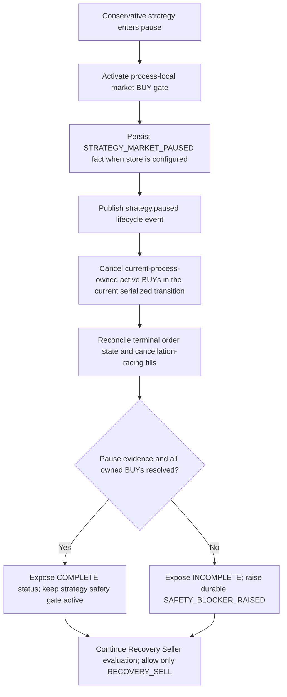

# ADR-0008: Strategy-originated safety pause cancels current-process-owned BUY orders

- **Status:** Accepted
- **Date:** 2026-11-23
- **Owners:** Harvester
- **Related:** [ADR-0001](0001-application-owned-recovery-facts.md), [ADR-0003](0003-process-lifetime-operator-pause.md), [ADR-0004](0004-startup-open-orders-are-external.md), [ADR-0006](0006-market-pause-cancels-owned-buys.md), [Conservative Domain Specification](../../domain/CONSERVATIVE_DOMAIN_SPECIFICATION.md), [issue #1749](https://github.com/45s/coinzilla/issues/1749)

## Context

The Conservative engine already had a process-local strategy pause gate, but a strategy-originated pause could leave current-process-owned active BUY orders resting at the exchange. Blocking future decisions does not remove existing BUY exposure. The operator market Pause workflow in ADR-0006 already owns a serialized cancellation/reconciliation transition, including cancellation-racing fills and strict order ownership. A second cancellation implementation would risk diverging order identity, fill accounting, and unknown-outcome handling.

The pause also must not disable Recovery Seller evaluation or allow ordinary strategy orders to continue. The existing Recovery Seller submission purpose is the narrow permitted SELL path.

## Decision

1. When the Conservative engine enters a strategy-originated pause, activate the in-memory market BUY gate before any cancellation side effect. Only safety-critical, non-retryable pause reasons trigger owned-BUY cancellation; retryability is taken from the structured failure metadata when available; expected preflight, metadata and strategy validation rejections plus explicitly retryable REST reconciliation failures keep existing standing BUYs untouched while blocking new strategy actions.
2. Record `STRATEGY_MARKET_PAUSED` when the Operational State Store is configured and publish the existing `strategy.paused` lifecycle event.
3. In the same serialized engine transition, call the existing owned-order cancellation transition directly (without re-entering the transition queue). Cancel only active BUY orders in the current process OrderRegistry for the affected symbol. A per-symbol/global in-progress guard prevents a cancellation failure from recursively starting another broker cancellation.
4. Reconcile cancellation-racing partial fills through the existing canonical user-data/fill path before committing the terminal cancellation response to the registry. The regression fixture exercises partial execution on a CANCELED response. This preserves valid OPEN → PARTIALLY_FILLED → CANCELED transitions. Never infer a fill from an order status or bypass the existing exact accounting/idempotency rules.
5. If the pause fact/event or cancellation/fill reconciliation is incomplete, retain the BUY gate, expose `safetyPauseCancellation.status = INCOMPLETE`, return `STRATEGY_SAFETY_PAUSE_INCOMPLETE`, and attempt a durable `SAFETY_BLOCKER_RAISED` fact with reason `STRATEGY_SAFETY_PAUSE_INCOMPLETE`.
6. Recovery Seller evaluation continues while Conservative is paused. The submission gate allows only `side === "SELL"` with `purpose === "RECOVERY_SELL"` through this strategy-safety pause; all BUYs and other SELL purposes remain blocked. Other independent readiness, ownership, volatility and shutdown gates remain authoritative.
7. Startup-snapshot, manual, external and prior-process orders remain untouched. The pause is process-local and is not restored or cleared by restart.

## Workflow

## Consequences

- Existing cancellation, order-ownership, terminal-fill and accounting invariants remain the single source of behavior.
- A successful safety pause means no current-process-owned active BUY remains unresolved; it does not mean all account-wide BUY orders were canceled.
- An incomplete pause is visible and fail-closed. No automatic resume, exchange-wide cancellation, or process-restart restoration is introduced.
- `STRATEGY_MARKET_PAUSED` and `SAFETY_BLOCKER_RAISED` are evidence facts, not a replay/restoration mechanism.
- Operator Pause/Resume remains the separate capability defined by ADR-0006.
