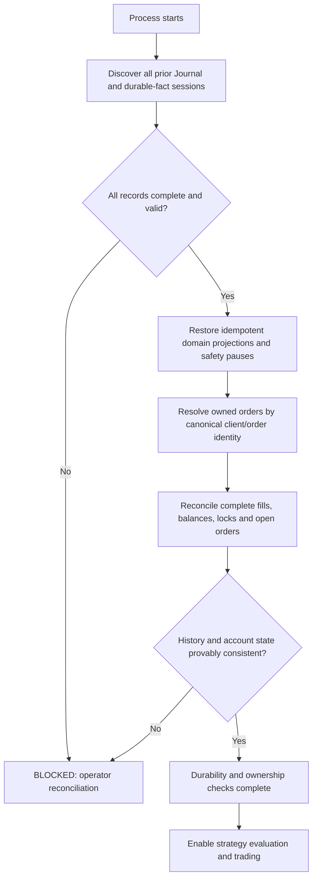

# Harvester process-restart recovery audit — 2026-11-10

> **Status:** forensic findings recorded; implementation not authorized or performed.
> **Observed at:** 2026-11-10 18:44:49 UTC.
> **Repository:** `45s/coinzilla`, branch `develop`.
> **Exact source baseline:** `71624bcabf1c37ae643dde23d448b8753266024b`.
> **Parent:** [issue #654](https://github.com/45s/coinzilla/issues/654), including [the original audit comment](https://github.com/45s/coinzilla/issues/654#issuecomment-6775656952).

## Scope and safety boundary

This is a read-only source, test, issue and documentation audit. No application source, tests, runtime configuration or exchange state were changed. No Harvester process was started or restarted. No Binance account query, TESTNET/LIVE connection, order submission, cancellation or modification was performed. Tests and CI were inspected but not executed in this audit.

The purpose is to establish what recovery foundations exist, identify unsafe gaps and requirements conflicts, and define the smallest safe sequence for a later, separately authorized implementation.

## Executive result

Process-restart restoration is not implemented in the current startup composition. The retained PR #606 helper stack is useful but cannot safely be re-enabled as-is. At least four independent gates must be resolved first:

1. Previous Journal sessions must be discoverable across the current nested per-process log layout and legacy flat files.
2. A durable execution-fact contract must be chosen without silently violating the current rule that optional Journal evidence must not block fill accounting.
3. Account-wide unowned open orders must have an explicit readiness policy; the current `BLOCKED` audit result does not block trading readiness.
4. Historical order/trade completeness must be provable for every relevant market, or recovery must remain blocked for operator intervention.
5. Restoring a completed recovery cycle must reset the authoritative `Position.spent` basis and prove exact retained-inventory allocation.

**Safety rule:** unknown, incomplete, contradictory or unprovable trading state must never be converted into READY.

## Existing foundations

- PR #606 is merged. The repository retains `projectHarvesterJournalRecovery()`, `restoreHarvesterJournalState()`, `fetchAccountTradeHistory()`, `auditRecoveredTradeHistory()` and `auditRecoveredAccountState()`. Projection, fetch and audit helpers have focused offline tests; no direct restore-helper test or replayed-cycle completion test was found in PR #606's changed-file list or the current Harvester bootstrap test suites.
- The projection/restore helpers cover order intents and acknowledgements, fill identities/fingerprints, Portfolio and RecoveryLedger reconstruction, order registry state, pauses/recovery intents, recovery-cycle events and account snapshots.
- The broker exposes canonical order lookup and symbol-scoped trade/fill history. Existing order-intent and cancellation-intent paths have durable Journal flush barriers before broker side effects.
- Same-process reconnect recovery is substantially more complete than process-death recovery. It must not be mistaken for restart recovery.
- Journal's lossless JSONL serialization and failure-propagation gap was fixed by PR #920 (issue #889); Harvester DTO compatibility was fixed by PR #925 (issue #923). These completed fixes should be reused, not reimplemented.

## Findings

### F-035 — Journal reader path does not discover previous per-process sessions

**Status:** CONFIRMED — integration blocker. **Severity:** HIGH.

**Expected vs actual:** recovery must discover and validate every prior process session. The current flat reader does not recurse; reading the `logs/sessions` parent can return successful empty history. **Potential financial consequence:** prior fills, open-order intents, retained inventory and pauses can be omitted, making an account with prior trading state appear fresh. **Required regression:** nested sessions plus legacy flat files are all discovered; an empty parent scan cannot be accepted as proof of no history.

`prepareOptionalJournal()` calls `createHarvesterLogSessionPaths()` when a process identity is supplied and passes the new process's `sessionDirectory` to `Journal`. The current layout is `logs/sessions/<timestamp>-<runtime-session-id>/<journal-session>.jsonl`.

`Journal.read()` delegates to `readJournalRecords()` using only its configured directory. `FileSystemJournalStore.listSessions()` enumerates immediate entries in that directory; `readJournalRecords()` accepts direct `.jsonl` files and does not recurse into child directories. A new process receives a new session directory, so reading from its configured directory cannot discover the previous process's sibling session directories. Reading the `logs/sessions` parent also does not recurse into those directories. There is a more dangerous detail: `readJournalRecords()` skips every entry whose name does not end in `.jsonl` before validating its type. The immediate children of `logs/sessions` are directories, so a direct `Journal.read()` against that parent can return a successful empty snapshot (`records: []`) rather than an error. A caller could mistake that for proof that no prior trading history exists. Recovery must explicitly enumerate child session directories and must never treat this parent-level empty result as a clean history. The older PR #606 integration predates the PR #874/#880 per-process layout.

**Severity:** HIGH — recovery discovery integrity.

**Reproduction:** call the current flat reader against `logs/sessions` when it contains only process-session directories. It skips every child and can return `ok: true` with zero records. **Expected:** discover and validate every nested session and legacy flat file, or explicitly report that the requested path is not a valid recovery root. **Actual:** a successful empty result can be mistaken for no prior trading history.

**Potential financial consequence:** previous fills, pending orders, retained inventory and safety pauses can be omitted from reconstruction, allowing a later integration to treat an account with existing trading state as fresh. No live incident is claimed.

**Required regression:** create two nested session directories plus a legacy flat file, read from the recovery root, and assert all sessions are discovered in validated order; an empty parent scan must never be accepted as proof of no history.

**Proposal only:** add a dedicated Harvester session enumerator with explicit legacy compatibility, manifest/record validation, deterministic ordering and resource bounds. Fail closed on any missing or unreadable session.

This is not a defect in Journal's documented flat-directory reader contract. It is a mismatch between Harvester's current nested session layout and the reader path recovery would need. Recovery must explicitly enumerate every prior process-session directory, retain legacy flat root-level sessions, impose deterministic ordering and resource bounds, and fail closed on missing, malformed, truncated or ambiguous history.

### F-036 — BLOCKED open-order audit does not block trading readiness

**Status:** CONFIRMED readiness gap; duplicate-order consequence STRONGLY INDICATED, NOT REPRODUCED. **Severity:** HIGH.

**Expected vs actual:** BLOCKED unowned-order audit must keep startup/reconnect readiness closed. Current callers ignore that classification and can reopen readiness/acknowledge recovery. **Potential financial consequence:** an unowned same-symbol order can be invisible to the in-memory registry, allowing overlapping orders or unexpected shared-fund use. **Required regression:** same-symbol manual order before startup and during reconnect; assert no strategy submission and no broker-generation acknowledgement.

`createAccountSnapshotManager()` classifies unmatched account-wide open orders as `readiness: BLOCKED` with `UNOWNED_OPEN_ORDERS` reasons, but returns only the order array. `subscribeToUserData()` awaits that audit but does not inspect readiness before setting `state.ready = true` and resuming deferred strategy evaluation. The same gap exists during same-process broker recovery: `createUserDataRecoveryHandler()` awaits the RECOVERY open-order audit but does not reject a BLOCKED result before acknowledging the broker recovery generation. The current startup regression explicitly allows runtime startup with an unowned open order.

That regression uses an unowned ZROUSDT order while BTCUSDT is enabled and emits no market-price tick. It proves that the order is neither adopted nor canceled and that startup proceeds; it does not prove that a later same-symbol market tick cannot cause a new strategy order. The Conservative engine's active-order and commitment guards use only its in-memory OrderRegistry. With no restored registry entry, a prior same-symbol order can be invisible to duplicate suppression if sufficient free quote remains.

Do not label a duplicate submission as an observed incident. Add deterministic same-symbol startup and reconnect regressions; verify readiness remains closed and broker recovery is not acknowledged while conflicting unowned orders remain. The policy must preserve manual-order ownership: never adopt, cancel or modify an external order. Decide whether conflicting unowned orders block the affected symbol, shared-asset account scope, or the whole trading process; do not leave `BLOCKED` as a diagnostic-only value without an explicit risk decision.

**Severity:** HIGH — trading readiness/ownership.

**Expected vs actual:** a conflicting unowned account-wide order must keep the applicable trading gate closed. Currently the manager records BLOCKED but returns only the order array; startup and reconnect callers do not enforce the classification.

**Potential financial consequence:** a same-symbol manual order can be invisible to the in-memory OrderRegistry, allowing overlapping Harvester orders or unexpected use of shared free funds. This duplicate-order outcome is strongly indicated, not reproduced.

**Required regression:** same-symbol manual open order before startup followed by a market tick; repeat during reconnect. Assert no strategy submission and no broker recovery acknowledgement while the order remains unowned.

**Proposal only:** return a typed readiness result and make both startup and reconnect gates consume it. Keep manual orders external and require operator resolution; never adopt/cancel them.

### F-037 — Durable recovery conflicts with the current Journal non-blocking contract

**Status:** CONFIRMED requirements conflict; design decision required before implementation. **Severity:** HIGH.

**Expected vs actual:** a canonical fill and safety blocker must be durably acknowledged by the chosen authority before the application progresses as if recoverable. Current fill accounting mutates memory first; best-effort event publication can fail or be skipped and its result is ignored. **Potential financial consequence:** a restart can omit a fill or pause and reconstruct incomplete cost basis/ownership. **Required regression:** inject publish failure/skipped outcomes and crash between in-memory accounting and persistence; assert no next strategy/order progression without durable fact acknowledgement.

`apps/harvester/AGENTS.md`, `TRADING_FIRST.md` and `JOURNAL_EVIDENCE_CONTRACT.md` state that additional Journal evidence is best-effort and must not add blocking I/O to market processing, broker-event handling or fill accounting. The Journal is an observer, not trading-state authority.

Process-restart safety nevertheless requires execution facts and safety pauses to survive abrupt termination before the application advances as though those facts are recoverable. The current engine applies a canonical fill to in-memory Portfolio/RecoveryLedger state, then calls `publishLifecycleEvent()` for `execution.fill_applied` without an immediate durable flush. `publishLifecycleEvent()` is explicitly best-effort and can return a mapping/publication failure or `skipped`; `processExecutionFillTransition()` ignores that result and returns success after the accounting mutation. `pause()` likewise publishes `STRATEGY_PAUSED` without a durable flush. Thus a fill may be applied and strategy progression may continue even when no corresponding Journal event was accepted. These existing F-028/F-029 gaps mean recent fill and pause facts are not guaranteed to be on disk after process death.

Do not silently extend the optional Journal observer into a trading-state authority or violate the no-blocking-I/O rule. Preferred design to evaluate: an application-owned durable execution-fact port/store with an explicit acknowledgement contract, while the Journal remains a separate observer. The application may gate progression to the next strategy decision/order side effect on that durable acknowledgement; domain objects remain independent of Journal, EventBus and storage. An alternative requires an explicit revision of the current architecture contract and a reviewed trade-off. No implementation choice is accepted by this audit.

**Severity:** HIGH — execution evidence durability.

**Reproduction:** apply a canonical fill to Portfolio/RecoveryLedger, then make `publishLifecycleEvent()` return a failure or `skipped`, or terminate before any later flush. `processExecutionFillTransition()` ignores the result and returns success. **Expected:** no further strategy progression until the execution fact is durably acknowledged by the chosen authority. **Actual:** accounting and progression can continue without an accepted Journal event.

**Potential financial consequence:** a restart may omit a fill or safety pause and reconstruct an incomplete position/cost basis. The exchange fill itself has already occurred and cannot be rolled back.

**Required regression:** inject lifecycle publication failure/skipped results and crash boundaries after fill accounting but before persistence; assert no next strategy/order progression without durable fact acknowledgement. Also verify the optional Journal observer contract remains non-blocking if a separate fact store is chosen.

**Proposal only:** choose the durable-fact authority first. Prefer a separate application-owned durable-fact port/store; do not make domain depend on Journal/EventBus or silently make the observer blocking.

### F-038 — Restoring a completed recovery cycle does not reset Position cost basis

**Status:** CONFIRMED latent domain-logic defect in the retained recovery helper; not active in current startup because replay is disabled. **Severity:** HIGH.

**Expected vs actual:** live completion allocates exact retained inventory and resets both Position cost basis and RecoveryLedger. Restore resets only the ledger and accepts a partial free-inventory allocation. **Potential financial consequence:** stale prior-cycle cost basis can distort recovery/profit decisions and leave retained inventory active/sellable. **Required regression:** restore a completed cycle and assert exact active/free allocation, `Position.spent === "0"`, and reset ledger; reject any `freeQuantity` smaller than active inventory.

`createPortfolioWorkflow.completeRecoveryCycle()` performs three coordinated transitions on a successful cycle: allocate the exact `freeQuantity`, call `portfolio.resetRecoveryBasis({ marketId })`, and reset the RecoveryLedger. The Conservative specification states that `Position.spent` is the authoritative recovery cost basis.

`restoreHarvesterJournalState()` replays the same `recovery.cycle_completed` event by calling `portfolio.allocateFreeQuantity()` and `recoveryLedger.resetCycle()`, but it never calls `portfolio.resetRecoveryBasis()`. Therefore, after restoring a completed cycle, `Position.spent` still contains the previous cycle's BUY cost while the RecoveryLedger has been reset. The account-balance audit does not detect this because cost basis is not a wallet balance. If replay were re-enabled, subsequent Conservative decisions could calculate recovery against stale prior-cycle cost.

There is a second validation gap in the same transition: restoration rejects only when `position.baseQuantity < freeQuantity`; it accepts `freeQuantity < position.baseQuantity`. The live `evaluateRecoveryCompletion()` can become eligible only when all remaining active inventory is exactly `keepQuantity` or `keepQuantity + classified dust`, and its `freeQuantity` equals that full active quantity. Restoration should reject any non-equal amount rather than leave active inventory behind while resetting the ledger.

**Required RED regression:** create a projection containing BUY/SELL fills followed by a completed-cycle event; assert the restored Position has exact retained free inventory, zero active inventory, and `spent === "0"`, with RecoveryLedger cycle totals reset. Add a contradictory event where `freeQuantity` is smaller than active inventory and assert restoration fails without returning a state. No such direct restore-helper test was found in PR #606's changed-file list; the existing live cycle tests exercise `createPortfolioWorkflow.completeRecoveryCycle()`, not the offline restore path.

Do not wire PR #606 into startup until this parity defect and the session-discovery/readiness blockers are corrected and tested.

**Severity:** HIGH — cost-basis and retained-inventory integrity.

**Reproduction:** replay a `recovery.cycle_completed` event with `freeQuantity` equal to all remaining active inventory. **Expected:** exact retained quantity is allocated to free inventory, `Position.spent` resets to zero and RecoveryLedger resets together. **Actual:** restore resets the ledger but not `Position.spent`; it also accepts a free allocation smaller than active inventory.

**Potential financial consequence:** subsequent recovery/profit decisions use stale prior-cycle cost basis and may leave inventory classified as active when it should be retained/free. Wallet balance reconciliation does not detect the basis mismatch.

**Required regression:** the existing RED test described above must assert exact active/free inventory and zero `spent`, plus rejection of a partial retained-inventory allocation.

**Proposal only:** restore by invoking the same pure domain transition used by live cycle completion, or extract a shared pure transition. Require exact equality and atomically update Position and RecoveryLedger.

### F-039 — Third-asset commission valuation is lost by the recovery DTO and restore path

**Status:** CONFIRMED recovery incompatibility; current runtime replay is disabled.

**Severity:** HIGH — accounting integrity.

**Source trace**

- `apps/harvester/src/domain/fills/validate-fill-commissions.js`, `validateFillCommissions()`: live accounting accepts a third-asset commission only when `commission.quoteValue` is supplied in the market quote asset. The quote value is included in both Position cost basis and Conservative recovery accounting.
- `apps/harvester/src/application/events/lifecycle-event-dtos.js`, `mapFillAppliedData()`: persists commission amount, asset ID and asset code, but omits `commission.quoteValue`.
- `apps/harvester/src/infrastructure/journal/project-harvester-journal-recovery.js`, `requireFill()`: projects only those three commission fields; the missing quote valuation cannot be recovered from the projection.
- `apps/harvester/src/use-cases/restore-harvester-journal-state.js`, `restoreFill()`: accepts only base-asset or quote-asset commissions and explicitly rejects third-asset commissions.

**Reproduction scenario**

A BUY or SELL Fill has a commission paid in BNB (or another asset outside the market's base/quote pair), with a valid historical quote-currency valuation. Live `validateFillCommissions()` and accounting accept it. The applied-fill DTO drops that valuation. After restart, projection has no quoteValue and `restoreFill()` rejects the third-asset commission.

**Expected:** replay reconstructs the same commission amount, asset identity and historical quote valuation, producing identical Position and RecoveryLedger values.

**Actual:** the retained recovery path cannot restore this valid live Fill. It fails closed; bypassing that rejection or guessing a current valuation would risk incorrect cost basis and profit calculations.

**Related reconciliation gap:** `createAccountSnapshotManager.refreshAccountSnapshot()` filters balances to configured markets' base/quote assets. A third commission asset not otherwise configured is omitted from the account snapshots, so the account-state audit cannot independently reconcile its raw balance movement.

**Required regression:** an end-to-end offline test must pass a third-asset commission with quoteValue through DTO mapping, Journal projection and restore; assert exact quote valuation and identical accounting projections. Also test that the relevant third-asset balance is included in the account reconciliation contract, or explicitly document why it is outside that contract.

**Proposal only:** persist quoteValue amount and quote-asset identity in the versioned fill DTO; validate and reconstruct it against canonical asset metadata. Do not infer historical valuation from a current market price. Extend account reconciliation to include every asset whose movement is required to prove owned execution accounting.

No implementation or tests were changed.

### F-040 — Same-second process sessions are sorted by random ID, not chronological start time

**Status:** CONFIRMED ordering weakness in the retained Journal reader; restart replay is not wired into current startup.

**Severity:** HIGH — recovery chronology / accounting integrity.

**Source trace**

- `apps/harvester/src/infrastructure/process/create-harvester-process-identity.js`, `createHarvesterProcessIdentity()`: captures a millisecond-precision `startedAt` and generates a runtime session ID using `generateUUID()`.
- `apps/harvester/src/infrastructure/logging/create-harvester-log-session-paths.js`, `createHarvesterLogSessionPaths()`: truncates `startedAt` to seconds with `.slice(0, 19)` and appends the runtime session ID.
- `packages/journal/src/adapters/filesystem-journal-store.js`, `createSession()`: uses the same second-precision filename.
- `packages/journal/src/read-journal-records.js`, session comparator: sorts by the second-precision timestamp prefix, then by the session-ID suffix. UUID lexical order has no chronological meaning.
- `packages/journal/src/journal-recovery.test.js`, `orders timestamp-only, numeric collision, and identity-suffixed sessions deterministically`: explicitly tests lexical ordering for same-timestamp identity suffixes, but does not establish that this order matches process chronology.
- `apps/harvester/src/infrastructure/journal/project-harvester-journal-recovery.js`, `projectHarvesterJournalRecovery()`: consumes the flattened record order and assigns global sequence numbers. It does not use the `harvester.process_started` event's millisecond `startedAt` to reorder sessions.

**Reproduction scenario**

Process A starts at `12:00:00.100Z` with session ID beginning `z`; it crashes. Process B starts at `12:00:00.900Z` with session ID beginning `a`. Both session filenames share the same second-precision timestamp. The reader sorts B before A because `a < z`, despite B being newer.

**Expected:** prior process sessions are replayed in validated chronological order, or ambiguous ordering is rejected before projection.

**Actual:** the reader deterministically but incorrectly uses random UUID lexical order as a tie-break. The recovery projection can therefore process later-session fills/cycle events before earlier-session facts. `auditRecoveredAccountState.getInitialTradingSnapshot()` selects the first trading session from that projection order, so the same ordering defect can also select the wrong PREFLIGHT balance baseline.

**Potential financial consequence:** a cross-session projection may fail inconsistently or reconstruct the wrong recovery-cycle sequence and cost basis. No production incident is claimed.

**Required regression:** use two valid session files with the same second, distinct millisecond `startedAt` values and deliberately reversed lexical UUID order. Assert chronological ordering based on validated process-start evidence; include a cross-session fill/recovery-cycle projection test. If chronology cannot be established, assert recovery fails closed.

**Proposal only:** use a durable global sequence that remains monotonic across process restarts, with session identity and a manifest/chain linking rotated sessions. Full-precision process-start metadata may be a consistency check, not the sole chronology authority. Keep legacy filename compatibility, detect duplicate/ambiguous identities, and never treat random session IDs or wall-clock time alone as proof of order.

No implementation or tests were changed.

### F-041 — Missing recovery-cycle completion can silently restore stale accounting

**Status:** CONFIRMED recovery-integrity gap in the retained offline projection; current runtime replay is disabled.

**Severity:** HIGH — financial accounting integrity.

**Source trace**

- `apps/harvester/src/use-cases/create-portfolio-workflow.js`, `completeRecoveryCycle()`: when eligible, commits a Portfolio with retained inventory allocated and `Position.spent` reset, alongside a reset RecoveryLedger.
- `apps/harvester/src/use-cases/conservative-trading-engine.js`, terminal FILLED SELL transition: after that in-memory transition, publishes `RECOVERY_CYCLE_COMPLETED` through best-effort `publishLifecycleEvent()`; the result is ignored and no durable flush/acknowledgement precedes subsequent strategy progression.
- `apps/harvester/src/infrastructure/journal/project-harvester-journal-recovery.js`, `projectHarvesterJournalRecovery()`: records a fully filled SELL in `lastFullyFilledSellBySymbol` and deletes it only when a later `RECOVERY_COMPLETED` event appears. It rejects a second full SELL before the completion event, but does not validate or return any unmatched entry left at end-of-input.
- `apps/harvester/src/use-cases/restore-harvester-journal-state.js`, `restoreHarvesterJournalState()`: resets cost basis only for projected `recoveryCycles`; it cannot know that an omitted completion event represented a completed cycle.
- `apps/harvester/src/use-cases/audit-recovered-account-state.js`, `auditRecoveredAccountState()`: reconciles wallet balance deltas and order commitments, not the authoritative `Position.spent` recovery basis.

**Reproduction scenario**

A SELL fills completely. The live completion evaluation is eligible, so the in-memory Portfolio and RecoveryLedger are reset. The process crashes or best-effort Journal publication fails before `recovery.cycle_completed` is persisted. The Journal contains the full SELL fill but no completion event.

**Expected:** restore the exact completed cycle, or explicitly identify an unresolved cycle and fail closed.

**Actual:** the projection can succeed with an unmatched fully filled SELL; the unmatched marker is discarded at the end. Restoration keeps the pre-completion `Position.spent` and RecoveryLedger basis and does not allocate the intended retained quantity to free inventory. Wallet balance reconciliation can still pass: `auditRecoveredAccountState()` compares `Position.totalBaseQuantity` and `quoteNetCashFlow`, not the active-versus-free inventory split or `Position.spent`. The retained quantity can therefore remain classified as active/sellable inventory.

**Potential financial consequence:** after restart, Conservative can calculate recovery/profit using the previous cycle's cost basis, potentially causing incorrect recovery decisions, profit reporting, and treating retained inventory as active inventory that may be sold again. No live incident is claimed.

**Required regression:** project a fully filled SELL with no subsequent recovery-cycle event. Assert that the projection returns an explicit unresolved-cycle blocker and cannot restore a READY state. Add an end-to-end test demonstrating that a missing completion event cannot silently retain stale cost basis. Include the legitimate residual-sell-through case: a full SELL may be followed by another SELL because completion was not eligible, so absence of a completion event must be represented explicitly rather than guessed.

**Proposal only:** durably record the recovery-cycle evaluation outcome (completed or explicitly not completed) before allowing subsequent strategy progression, or fail closed whenever a fully filled SELL has no durable outcome. Keep F-038 separate: F-038 is wrong restoration when a completion event exists; F-041 is missing-event ambiguity.

No implementation or tests were changed.

### F-042 — Journal cannot detect deletion of a complete, otherwise valid record

**Status:** CONFIRMED evidence-integrity limitation in the current Journal record format; the Journal is not an authoritative recovery ledger.

**Severity:** HIGH — historical evidence completeness.

**Source trace**

- `packages/event-bus/src/event-bus.js`, `publish()`: each event receives a random UUID and timestamp; there is no monotonic per-session event sequence.
- `packages/journal/src/journal.js`, `record()`: serializes the event and Journal schema/identity metadata; no sequence, previous-record digest or committed manifest is added.
- `packages/journal/src/helpers/journal-record.js`, record parsing: validates schema version, stable ID and payload identity, but cannot detect a missing whole record.
- `packages/journal/src/read-journal-records.js`, `readJournalRecords()`: validates encoding, JSONL record shape, duplicate IDs and resource bounds. It does not validate sequence continuity, a hash chain or an expected terminal record count.
- Existing `packages/journal/src/journal-recovery.test.js` covers duplicate stable IDs and deterministic filename sorting, but not deletion of a complete middle record.

**Reproduction scenario**

A valid session contains three complete JSONL records A, B and C with independent random IDs. Remove the entire valid line B while leaving A and C unchanged. The remaining file is valid UTF-8 and valid JSONL; the reader has no expected sequence or digest against which to detect the gap.

**Expected:** the recovery authority proves that every committed record is present, or rejects the session as incomplete.

**Actual:** the Journal reader can return `ok: true` with two records. Domain projection may catch some missing facts (for example, a fill without its order intent), but there is no general evidence-gap signal for a missing pause, cycle transition or other event.

**Potential financial consequence:** an omitted fill, pause, order intent or cycle transition can be absent from an otherwise structurally valid projection. Exchange history and account balances can detect some execution discrepancies only when their own market-universe and retention completeness are proven; they cannot establish completeness of every application safety fact.

**Required regression:** write a three-record session, remove the complete middle line, and assert that the authoritative recovery format detects the missing evidence. Include missing fill, pause and cycle-transition scenarios at the application projection level.

**Proposal only:** keep the current Journal as an observer unless its contract is explicitly revised. The authoritative durable-fact store should use a monotonic per-session sequence plus a verifiable previous-record hash/chain or committed manifest containing the expected record count and terminal digest. Readers must validate the entire chain before projection. Legacy sessions without completeness evidence require external reconciliation/operator handling; do not silently upgrade them to proven-complete history.

No implementation or tests were changed.

### F-043 — Recovery projector silently ignores recorded safety-failure events

**Status:** CONFIRMED gap in the retained recovery projection; current runtime replay is disabled.

**Severity:** HIGH — ownership and accounting safety.

**Source trace**

- `apps/harvester/src/application/events/event-names.js`: defines `EXECUTION_UNOWNED_ORDER`, `EXECUTION_INVALID_FILL`, `EXECUTION_ACCOUNTING_FAILED`, `EXECUTION_DUPLICATE_FILL`, and `BROKER_EXECUTION_REPORT`.
- `apps/harvester/src/use-cases/conservative-trading-engine.js`: publishes these events for unowned order updates, invalid/missing fills, accounting failures, duplicate fills and broker execution evidence.
- `apps/harvester/src/infrastructure/journal/project-harvester-journal-recovery.js`, `projectHarvesterJournalRecovery()`: recognizes only a subset of `HARVESTER_EVENT_NAMES`; it executes `if (!Object.values(EVENT).includes(name)) continue`. It does not validate the event source or distinguish known diagnostic events from unknown Harvester events.
- `restoreHarvesterJournalState()`: reconstructs safety pauses from `strategy.paused`, but does not receive the ignored failure events as sticky blockers.

**Reproduction scenario**

A recorded `execution.unowned_order` or `execution.accounting_failed` event is present, but the subsequent `strategy.paused` event is absent (for example, because best-effort publication failed or the process terminated between publications). The projector skips the failure event and has no corresponding pause to restore.

**Expected:** recorded ownership/accounting failure evidence remains a blocker until authoritative reconciliation or explicit operator resolution.

**Actual:** the projector can ignore the recorded failure and return a successful projection without that safety restriction.

**Potential financial consequence:** a prior ownership or accounting-integrity failure may not be represented in restored state. If all other gates pass, a future startup integration could resume trading despite recorded unresolved failure evidence. No live incident is claimed.

**Required regression:** persist each of `execution.unowned_order`, `execution.invalid_fill`, and `execution.accounting_failed` without a corresponding `strategy.paused` event; assert projection returns a sticky blocker. Add duplicate-fill evidence parity coverage. Unknown events from the Harvester source must fail closed, while explicitly allowlisted diagnostic-only events remain ignorable.

**Proposal only:** define an explicit versioned event classification registry for authoritative state facts, sticky safety blockers and diagnostic-only events. Validate the Harvester event source. Never silently skip an unknown Harvester event during recovery.

No implementation or tests were changed.

### F-044 — Normal reconnect snapshots are rejected by the recovery projector

**Status:** CONFIRMED DTO/projector compatibility defect in the retained recovery path.

**Severity:** HIGH — recovery compatibility.

**Source trace**

- `apps/harvester/src/application/events/lifecycle-event-dtos.js`, `mapAccountSnapshotCapturedData()`: explicitly accepts phase `RECOVERY`.
- The same file, `mapAccountOpenOrdersCapturedData()`: explicitly accepts phase `RECOVERY`.
- `apps/harvester/src/bootstrap/user-data/create-user-data-recovery-handler.js`: publishes account and account-wide open-order snapshots with `phase: "RECOVERY"` during normal same-process broker recovery.
- `apps/harvester/src/infrastructure/journal/project-harvester-journal-recovery.js`, `projectHarvesterJournalRecovery()`: the account-snapshot branch accepts only `PREFLIGHT`, `OPENING`, `CLOSING`; the open-order-snapshot branch accepts only `OPENING`, `PREFLIGHT`. Both reject `RECOVERY`.

**Reproduction scenario**

A normal process starts, experiences a user-data reconnect, and successfully records both RECOVERY snapshots. A later process-restart projection reads that session.

**Expected:** both valid RECOVERY snapshot types are accepted and validated according to their phase-specific semantics.

**Actual:** projection fails with an invalid account snapshot phase or invalid open-order snapshot phase. A routine reconnect therefore makes the retained restart-recovery projection unusable.

**Potential financial consequence:** process-restart recovery remains unavailable after a normal reconnect. A future implementation that tries to work around this by skipping the records would lose balance/order reconciliation evidence. This is a fail-closed blocker, not a claim of silent incorrect accounting.

**Required regression:** build a Journal session containing PREFLIGHT, RECOVERY account snapshot, RECOVERY open-order snapshot and CLOSING records. Assert valid projection and correct phase ordering; assert unsupported phases still fail.

**Proposal only:** include RECOVERY in both projector validators and explicitly define its chronology, session constraints and ownership/reconciliation semantics. Do not ignore these records.

No implementation or tests were changed.

### Existing F-031 — historical market/trade-history completeness remains unresolved

PR #606's integration passes `marketUniverseComplete: false`, while `auditRecoveredTradeHistory()` requires `true`; therefore the old trading-enabled path fails closed after prior trading activity. The current runtime bypasses this gate and starts with fresh in-memory state; it does not solve completeness.

`fetchAccountTradeHistory()` is symbol-scoped and receives a caller-supplied market list. The current exchange market catalog cannot prove all historical symbols, including delisted markets. The inspected official API documentation does not establish a guaranteed history-retention horizon. Pagination exhaustion for the supplied symbols is not proof that the supplied market universe is complete.

Do not change the flag to `true` merely to make recovery pass. Define the exact universe that can be proven (including Harvester-owned symbols from durable intents), prove per-order/per-symbol history completeness and retention coverage, and reconcile account-wide balance deltas for unexplained external activity. If completeness cannot be proven, fail closed and require an operator-assisted reconciliation path.

### Existing F-028/F-029 — fill and safety-pause durability gaps

- F-028: `execution.fill_applied` is published after in-memory accounting, but the fill path does not immediately flush the Journal. A later order-intent flush may incidentally include earlier events, but that does not protect the crash window before that barrier.
- F-029: per-market pause/recovery-intent Sets are process-local; `STRATEGY_PAUSED` publication is not itself a durable checkpoint. A restart can lose a prior safety pause unless another authoritative source rediscovers the cause.

These are missing guarantees, not proof that a specific historical fill or pause was lost.

## Proposed maximum-safety implementation roadmap

These are recommendations only. Each phase requires a separate implementation authorization and RED → GREEN evidence.

1. **Close the architecture decision first.** Define the durable fact source, ownership, failure semantics, schema/versioning, write acknowledgement, replay/idempotency contract, and how it coexists with the optional Journal observer. Do not start wiring PR #606 before this decision.
2. **Make history discovery correct.** Enumerate all nested process-session directories plus legacy flat Journal files. Validate the complete set before applying any projection; preserve immutable bytes; reject gaps, truncation, malformed records, unsupported schemas, duplicate/conflicting identities and resource-limit overflow. Define session ordering and checkpoint/manifest semantics.
3. **Persist immutable execution facts before progression.** Separate an exchange-observed execution fact from the derived `fill_applied` projection event. Durably record canonical fill identity, order identity, market, side, exact quantities/notional, commission asset/amount and transaction time. Only then apply the idempotent Portfolio/RecoveryLedger projection and allow subsequent strategy progression. A crash after durable fact but before projection must replay once; a crash after projection must not double-apply. Persistence failure closes the trading gate.
4. **Persist safety-control facts.** Restore market/account pauses, recovery-managed pauses, cancellation/replacement intents and operator holds. A restart must never clear a pause merely because process memory was recreated.
5. **Restore order ownership conservatively.** Restore client IDs and known broker IDs from durable intents; resolve UNKNOWN by canonical clientOrderId lookup; reconcile canonical order state and complete fill history. Never infer ownership from symbol/side/price/quantity alone. Never adopt, cancel or modify manual orders.
6. **Prove external-history and account completeness.** Define supported market universe, pagination exhaustion, cursor persistence, exchange retention limits, delisted-market behavior, shared-asset effects, and the manual/external activity policy. Compare restored Portfolio, active reservations, current free/locked balances, account-wide open orders and all available canonical fills. Any unexplained delta or missing proof blocks readiness.
7. **Add one startup readiness gate.** Connectivity and market subscriptions are not trading readiness. Do not resume deferred strategy evaluations or enable submissions until every recovery, ownership, history, account, pause and durability check is complete. A failed or unknown result must identify the blocking reason and require an explicit safe retry or operator action.
8. **Test every crash boundary offline.** Cover crash after intent flush/before broker call; broker acceptance/before acknowledgement; partial/full fill/before durable fact; after durable fact/before projection; after projection/before next intent; cancel/fill races; recovery-cycle completion; pause persistence; duplicate replay; truncated/missing sessions; missing/delisted markets; history limits; manual same-symbol and shared-asset orders; and account mismatch. Assert no duplicate order, no double/missed fill application, no lost reservation and no READY under uncertainty.
9. **Only then run controlled TESTNET validation.** Keep all default tests offline. Require a separate explicit TESTNET authorization and a clean, known account state. LIVE restart acceptance is a separate release decision.

The diagram is a proposed safety gate, not a description of current runtime behavior or an accepted architecture decision.

## Evidence reviewed

- Current `develop` source at `3ffaaa21c6543cc042087307b01c40630320e903` (documentation-only child of source baseline `71624bcabf1c37ae643dde23d448b8753266024b`): `apps/harvester/src/index.js`, `infrastructure/process/create-harvester-process-identity.js`, `infrastructure/logging/create-harvester-log-session-paths.js`, `bootstrap/start-harvester.js`, `bootstrap/user-data/subscribe-to-user-data.js`, `bootstrap/user-data/create-user-data-recovery-handler.js`, `bootstrap/account/create-account-snapshot-manager.js`, `infrastructure/journal/prepare-optional-journal.js`, `infrastructure/journal/project-harvester-journal-recovery.js`, `application/events/lifecycle-event-dtos.js`, `application/events/publish-lifecycle-event.js`, `use-cases/conservative-trading-engine.js`, `use-cases/create-portfolio-workflow.js`, `use-cases/restore-harvester-journal-state.js`, `use-cases/audit-recovered-trade-history.js`, `use-cases/audit-recovered-account-state.js`, `application/events/event-names.js`, `application/events/event-publisher.js`, `domain/fills/validate-fill-commissions.js`, `domain/fills/fill-fingerprint.js`, `domain/portfolio/position-accounting.js`, `domain/strategies/conservative/recovery-fill-accounting.js`, `domain/portfolio/portfolio.js`, `domain/portfolio/position.js`, `domain/strategies/conservative/recovery-ledger.js`, and `docs/domain/CONSERVATIVE_DOMAIN_SPECIFICATION.md`.
- Journal source: `packages/journal/src/read-journal-records.js`, `helpers/journal-record.js`, `journal.js`, and `adapters/filesystem-journal-store.js`.
- Journal reader/writer: `packages/journal/src/journal.js`, `read-journal-records.js`, `adapters/filesystem-journal-store.js`.
- Tests inspected: `apps/harvester/src/bootstrap/start-harvester.test.js` and recovery-helper tests; Journal read/replay implementation and package contract.
- Historical integration: PR #606; per-process layout: PRs #874/#880; Journal durability correction: issue #889 / PR #920; Harvester DTO correction: issue #923 / PR #925.
- Existing Harvester contracts: `AGENTS.md`, `TRADING_FIRST.md`, `JOURNAL_EVIDENCE_CONTRACT.md`, `JOURNAL_OPERATIONS.md`, `ROADMAP.md`, `ACCOUNTING_INVARIANTS.md` and architecture guidance.

## Existing safeguards observed — not proof of restart readiness

The independent review also found useful protections in the current owned-order execution/reconciliation path:

- `executeStrategyDecision()` creates a per-engine random UUID namespace (22 hexadecimal characters) and appends a local sequence to each `clientOrderId`. This gives orders strong practical uniqueness across process instances.
- The engine registers the PENDING canonical order before network I/O. `onPendingOrder()` publishes `ORDER_SUBMISSION_REQUESTED` and requires `eventPublisher.flush()` to report `durable: true` before `broker.placeOrder()` is attempted. If the barrier fails, it removes the pending order and pauses; unknown broker outcomes are not automatically retried.
- `reconcileOwnedOrders()` resolves unknown submissions by clientOrderId and validates canonical broker identity/shape. It does not adopt orders by matching shape alone.
- `collectOwnedOrderSnapshots()` fetches canonical order history and paginates fills with a bounded page count. It validates strictly increasing trade IDs across pages, exact aggregate fill quantity against exchange cumulative executed quantity, and Journal fill identity parity before applying reconciled transitions.
- `OrderRegistry.applyUpdate()` rejects stale/non-monotonic execution updates and conflicting canonical identity. Terminal-order paths reconcile REST fill history before continuing strategy processing.

No additional defect was identified in those specific checks during this pass. These safeguards cover known owned orders; they do not prove account-wide market/trade-history completeness (F-031), do not resolve the Journal authority conflict (F-037), and the fill-parity comparison still omits third-asset quote valuation (F-039). The existing order-intent barrier itself also demonstrates that the optional observer Journal is already required for safe broker submission, which must be an explicit architecture decision.

## Proposed recovery architecture evaluation — discussion only

The staged proposal is directionally correct, but it must not treat the existing Journal as the recovery authority without first resolving F-037 and F-039–F-043.

### Recommended boundary

Keep strategy/domain pure and independent of Journal/EventBus. Introduce an application-owned durable-fact port (or explicitly revise the Journal contract) whose acknowledgement means the complete fact has been appended, integrity-checked and fsynced. Keep Journal as an optional observer if its non-blocking contract is retained.

The minimum durable facts should be narrowly scoped:

- Order intent, with canonical clientOrderId and immutable order parameters, durably acknowledged before broker submission.
- Cancellation intent durably acknowledged before broker cancellation.
- Canonical execution fact, including trade identity, exact quantities/prices, all commission amounts/assets and historical quote valuation, durably acknowledged before applying the fill to in-memory projections or allowing subsequent strategy progression.
- Recovery-cycle evaluation outcome, explicitly completed or not completed, tied to the exact SELL order/cycle identity and retained inventory allocation. Persist before applying the reset or scheduling the next BUY.
- Sticky safety-blocker facts for unowned orders, invalid fills and accounting failures. A pause cannot depend on a separate best-effort event.
- PREFLIGHT/RECOVERY account and account-wide open-order snapshots, with explicit completeness and source-time evidence.

If an exchange fill has already happened but its durable fact cannot be recorded, the application cannot undo the fill. It must stop further trading and reconcile the exact order/trade history; it must not continue as if the fact were safely recorded.

### Evaluation of the eight stages

1. **Authoritative facts and acknowledgement:** required first. Prefer a separate application-owned durable-fact port over changing the observer-oriented Journal contract implicitly. Define exactly what `durable: true` guarantees and what happens on append/fsync failure.
2. **Session discovery:** recursively enumerate every nested process session plus legacy flat files. Validate every directory/file and a complete session manifest. Never use a successful empty read of the `logs/sessions` parent as proof of no history.
3. **Immutable facts and replay:** use stable fill identity (market + exchange trade ID), exact decimal facts and idempotent pure projections. Preserve third-asset quote valuations. Use a monotonic sequence and integrity chain; reject unknown stateful events and unresolved cycle outcomes.
4. **Owned-order restoration:** clientOrderId is a useful canonical lookup key only when backed by a durable intent. Require canonical exchange order history and exact symbol/side/type/price/quantity parity. Never infer ownership from order shape. Keep manual/external orders unowned and BLOCKED; never adopt, cancel or modify them.
5. **Exchange reconciliation:** compare all owned fills, current order states, account-wide open orders, free/locked balances and reservations. Include every asset required to reconcile commissions, including third-asset fees. Validate pagination and trade-ID continuity.
6. **Completeness proof:** a per-symbol trade-history scan is not proof of account-wide completeness unless the historical market universe (including disabled/delisted symbols) and API retention/window coverage are established. If not provable, require operator intervention.
7. **Readiness gate:** READY must be derived from explicit proof of every required invariant. The BLOCKED classification must be returned to and enforced by both startup and reconnect callers; currently it is only journaled.
8. **Fail closed:** any missing session, sequence gap, unknown event, incomplete history, unmatched full SELL, unowned open order, balance/locked-fund mismatch or unresolved safety event keeps trading disabled.

### Simpler implementation shape

Avoid a generic replay framework with many abstractions. Start with one append-only durable-fact log and one pure projection/reconciliation pipeline. Give each record a global monotonic sequence across restarts, session identity, schema version, stable fact ID and previous-record digest (or a committed manifest linking rotated session sequence ranges and hashes). Derive Portfolio, RecoveryLedger, free inventory, pending orders and pauses from those facts. Keep the exchange adapter behind existing ports and keep domain transitions free of persistence dependencies.

Legacy sessions without sequence/integrity evidence may be imported only when independent exchange evidence proves completeness; otherwise they require operator review. Do not silently promote them to trusted history.

This is a design recommendation, not implementation authorization.

## Verification boundary

Source and tests were inspected only. No local test command or coverage run was executed. GitHub Actions workflows for documentation PR #975 are the only automated validation; their final results are tracked on the PR and do not validate recovery behavior. No source or test files were changed. No Harvester process, Binance connection, account query or exchange order operation was performed.

**Disposition:** keep #654 open. Do not enable unattended process restart in TESTNET or LIVE until the architecture conflict, history discovery, market-universe completeness, open-order readiness policy, durable fill/pause facts and startup gate are resolved and exact-head verified.
