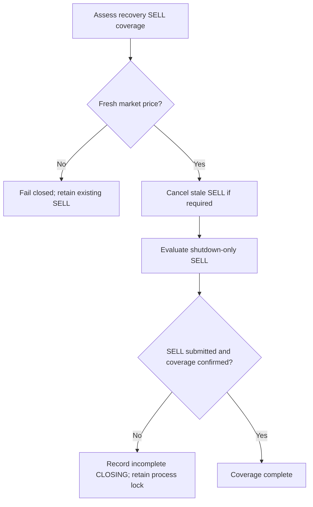

# F-055 shutdown recovery SELL safety remediation — 2026-11-15

- **Tracking:** [#1132](https://github.com/45s/coinzilla/issues/1132)
- **Scope:** shutdown recovery SELL replacement, market-data freshness and evidence interpretation.
- **Runtime under review:** TESTNET session `27a7b8cb-3f12-4d43-b7e6-30c716859b46`, source commit `75ecfbb25c077e83499900a2f413974a53311772`.
- **Current implementation baseline:** `develop` at the task branch base; F-054 fix from PR #1146 and shutdown diagnostic fix from PR #1148 are already present.
- **Safety:** offline source/test changes only. No TESTNET/LIVE API call or exchange order operation was performed.

## Incident facts retained

The session audit preserves the four original files and their integrity metadata:

| Artifact | Records / lines | SHA-256 |
|---|---:|---|
| Journal JSONL | 42 valid records | `743afaa3e6fe30652a13f2be39f6e499b02df2ca28d84872f92934eeac7c4148` |
| Structured application log | 681 valid JSON lines | `98229f4bb0170642d4517006a64bcc61d0582d7b5892fec755116d29fad75655` |
| Structured TRACE log | 727 valid JSON lines | `48687a8909e4e9c20bed07eff47b9241de8e46d3847d372777e9a37715b8e48b` |
| Terminal capture | 76 text lines | `ad576f288b0500a16521f5ce822925ae3a487ec1d7992f08fbcd32d5f176cd8a` |

F-055's observed final state remains:
- Shutdown recovery reconciliation failed.
- Coverage required SELL quantity **4.98 ZRO** at **1.387 USDT**.
- Committed SELL quantity **0**; active SELL count **0**.
- Outstanding recovery amount **6.89 USDT**.
- CLOSING audit was durably recorded INCOMPLETE; runtime did not reach STOPPED and the process lock was retained.

The retained audit did not preserve a specific inner evaluator skip/defer reason or an exchange acknowledgement for a replacement. Do not infer a broker rejection or a confirmed exchange submission from the generic `SHUTDOWN_RECOVERY_REPLACEMENT_UNCONFIRMED` result.

## Supplied trade-history chronology correction

The supplied TESTNET history rows are useful, but their timestamps show they do **not** establish that the 4.98 ZRO SELL was the F-055 shutdown replacement:

| Row | Exchange timestamp (UTC) | Side | Quantity | Gross | Interpretation |
|---:|---|---|---:|---:|---|
| 188 | 2026-11-14 22:11:09.022 | SELL | 4.98 ZRO | 6.8724 USDT | Predates the process start at 23:41:12.944Z; timestamp exactly matches the PREFLIGHT snapshot's source time. It cannot be the later shutdown replacement. |
| 189 | 2026-11-14 23:41:24.018 | BUY | 5.00 ZRO | 6.8900 USDT | Matches the session's BUY fill (trade 13588), not a recovery SELL. Its timestamp matches the CLOSING snapshot's source time. |
| 115 | 2026-11-07 23:38:39.055 | SELL | 4.98 ZRO | 8.16222 USDT | Earlier historical trade, unrelated to this shutdown attempt on the evidence available. |

Rows 188–189 therefore corroborate the account timeline and the F-054 BUY accounting, but they do not identify a F-055 replacement order. A trade-history row cannot prove an unfilled order's acknowledgement or absence. Preserve the export as supplied evidence; do not use quantity/amount similarity alone as an order identity.

## Source-level safety gap

The shutdown recovery workflow previously used the latest cached market price to calculate coverage and decide that an existing recovery SELL was stale/undersized. It then cancelled that SELL before asking the shared transition evaluator to submit a replacement.

The shared evaluator independently enforces market-price freshness and returns a successful *skipped* result when the cached price is stale. The shutdown wrapper treated any skipped result as the generic `SHUTDOWN_RECOVERY_REPLACEMENT_UNCONFIRMED`. Thus the sequence could be:

1. Cached price exists but is stale.
2. Coverage calculation still derives a replacement plan from it.
3. Existing SELL is cancelled.
4. Shared evaluator refuses submission because the price is stale.
5. No active SELL remains; CLOSING coverage fails.

This is a confirmed source-level unsafe ordering, and it can produce the same final coverage shape observed in F-055. The preserved incident summary does not include the evaluator's actual skip reason, so this remediation does **not** claim stale price was conclusively the historical trigger.

## Implemented correction

1. Pass the engine's market-price freshness predicate into the shutdown recovery workflow.
2. Refuse to plan/cancel/replace recovery SELLs when the cached market price is stale. Classify `STALE_MARKET_PRICE` as unavailable shutdown input, before the cancellation step.
3. Keep fail-closed behavior: do not submit a SELL using stale pricing, and do not cancel an existing SELL if a fresh replacement cannot be evaluated.
4. Preserve actionable replacement outcomes separately: failed, deferred (including reason), skipped (including reason), and no SELL submitted (including strategy/deferred reason). Avoid collapsing all of these into “unconfirmed”.

## Regression coverage

- A shutdown BUY fill increases required recovery coverage while an earlier SELL remains active. When the market-price freshness predicate turns false, shutdown reconciliation must fail with `STALE_MARKET_PRICE` **without cancelling** the existing SELL.
- The existing shutdown BUY-fill race now also delivers zero-cumulative NEW/OPEN reports with equal and newer timestamps after FILLED. Both must be ignored as stale, leave the pair unpaused, and allow the shutdown-only SELL replacement to complete. This connects the already-merged F-054 order-registry correction to the F-055 shutdown path.

## Shutdown decision flow

## Verification boundary

The task branch contains offline deterministic regressions. GitHub Actions is the verification runner; results must be checked against the exact PR head SHA. No local test result is claimed here. TESTNET integration is intentionally not part of CI and no exchange operation is authorized or performed by this change.
