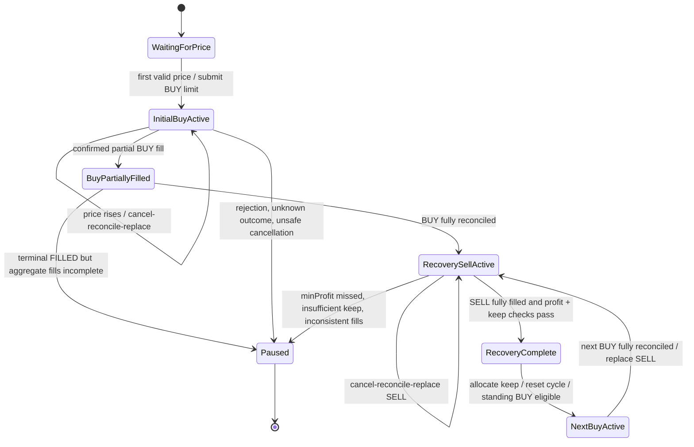

# Conservative Domain Specification

**Phase:** D0 — discovery and specification only  
**Reference:** current `apps/bot-free-roll` source/tests on `develop`  
**Comparison target:** current Harvester `src/domain` on `develop`  
**Status:** Proposed contract for review. This is not approval to implement D1.

## 1. Executive summary

The working Free-Roll implementation is a **standing-order accumulation strategy**. It maintains a BUY and a recovery SELL when the pair's state permits. A completed BUY is accounted from actual fills; Free-Roll then reconciles/replaces the recovery SELL and places the next standing BUY. Therefore a standing BUY may coexist with a recovery SELL. This is the actual current behavior; it is not the recovery-first rule proposed by paused PR #479.

**Correction to an earlier investigation note:** on the first usable price, Free-Roll both establishes its reference price and immediately submits a BUY limit order one configured step below that price. It does not wait for a second tick before submitting the initial order. Later, the initial BUY is trailed upward; subsequent standing BUYs are fixed at the last BUY fill price minus one step until the next recovery SELL completes and trailing resumes.

Harvester already contains useful broker-independent accounting and planning modules. Its current strategy is not yet an exact behavioral match: it creates a BUY from the current market price (or supplied last BUY price), does not implement Free-Roll's initial BUY trailing behavior in this domain function, supports an optional investment cap absent from the corresponding Free-Roll pair settings, and has some different fee/reset/completion semantics. These differences are listed rather than silently normalized.

## 2. Source authority and evidence

This specification gives priority to executable Free-Roll source and tests, not README claims. The references below are pinned to the inspected `develop` tree at commit `9cbbc9fb1affee8fe671724112d9457c25900a27` (after PR #482 merged).

### Free-Roll source

| Concern | Source |
|---|---|
| Per-pair state and configured fee/order setup | [bot-free-roll.js, initialization](https://github.com/45s/coinzilla/blob/develop/apps/bot-free-roll/src/bot/bot-free-roll.js#L130-L180) |
| Price handling, initial reference, trailing and subsequent BUY thresholds | [bot-free-roll.js, price handler](https://github.com/45s/coinzilla/blob/develop/apps/bot-free-roll/src/bot/bot-free-roll.js#L650-L740) |
| Actual execution event validation and order terminal handling | [bot-free-roll.js, order event handler](https://github.com/45s/coinzilla/blob/develop/apps/bot-free-roll/src/bot/bot-free-roll.js#L749-L855) |
| BUY completion → recovery SELL → next BUY | [bot-free-roll.js, BUY completion](https://github.com/45s/coinzilla/blob/develop/apps/bot-free-roll/src/bot/bot-free-roll.js#L857-L940) |
| SELL completion, minimum-profit check, keep allocation and cycle reset | [bot-free-roll.js, SELL completion](https://github.com/45s/coinzilla/blob/develop/apps/bot-free-roll/src/bot/bot-free-roll.js#L941-L1012) |
| Actual fill application | [bot-free-roll.js, fill application](https://github.com/45s/coinzilla/blob/develop/apps/bot-free-roll/src/bot/bot-free-roll.js#L1014-L1042) |
| BUY/SELL order quantity and price rounding, actual order submissions, cancel/reconcile | [order-execution.js](https://github.com/45s/coinzilla/blob/develop/apps/bot-free-roll/src/bot/order-execution.js) |
| Actual commission arithmetic | [helpers/accounting.js](https://github.com/45s/coinzilla/blob/develop/apps/bot-free-roll/src/bot/helpers/accounting.js#L140-L253) |
| Recovery SELL formula | [helpers/order-planning.js](https://github.com/45s/coinzilla/blob/develop/apps/bot-free-roll/src/bot/helpers/order-planning.js#L69-L148) |
| Canonical fill conversion, deduplication, inventory/cash accounting and history reconciliation | [fill-reconciliation.js](https://github.com/45s/coinzilla/blob/develop/apps/bot-free-roll/src/bot/fill-reconciliation.js#L31-L307) |
| Immutable fill identity ledger | [fill-ledger.js](https://github.com/45s/coinzilla/blob/develop/apps/bot-free-roll/src/bot/fill-ledger.js) |
| Strategy-owned versus unmanaged market inventory | [market-inventory-ledger.js](https://github.com/45s/coinzilla/blob/develop/apps/bot-free-roll/src/bot/market-inventory-ledger.js) |
| Permanent free-inventory allocation | [inventory-allocation.js](https://github.com/45s/coinzilla/blob/develop/apps/bot-free-roll/src/bot/inventory-allocation.js) |
| Configuration validation | [validate-config.js](https://github.com/45s/coinzilla/blob/develop/apps/bot-free-roll/src/validate-config.js) |

Important Free-Roll tests:
- [bot-free-roll.test.js](https://github.com/45s/coinzilla/blob/develop/apps/bot-free-roll/src/bot/bot-free-roll.test.js): duplicate BUY events (392), fee-bearing fills (490), partial SELL history and replay (667), partial BUY cancellation (1188), fill identity mismatch (1279), incomplete BUY/SELL aggregate fills (1913, 1974), below-minimum-profit completion (2039), base fee consuming keep quantity (2098), free allocation after base SELL fee (2496), oversell protection (2553), and terminal order failures (2367).
- [fill-reconciliation.test.js](https://github.com/45s/coinzilla/blob/develop/apps/bot-free-roll/src/bot/fill-reconciliation.test.js): canonical fill conversion, partial/multiple fills, deduplication, conflicting facts, history backfill and mismatches, unsupported commissions and replay.
- [helpers/accounting.test.js](https://github.com/45s/coinzilla/blob/develop/apps/bot-free-roll/src/bot/helpers/accounting.test.js): base/quote commission effects, third-asset rejection, exact decimal arithmetic.
- [helpers/planning.test.js](https://github.com/45s/coinzilla/blob/develop/apps/bot-free-roll/src/bot/helpers/planning.test.js): quantity-down/price-up rounding and invalid boundaries.
- [fill-ledger.test.js](https://github.com/45s/coinzilla/blob/develop/apps/bot-free-roll/src/bot/fill-ledger.test.js): immutable identities, equivalent decimal formatting, and conflicting duplicate facts.

### Harvester source

| Concern | Source |
|---|---|
| Strategy decisions and action generation | [conservative-strategy.js](https://github.com/45s/coinzilla/blob/develop/apps/harvester/src/domain/strategies/conservative/conservative-strategy.js) |
| Initial BUY price | [initial-buy-price.js](https://github.com/45s/coinzilla/blob/develop/apps/harvester/src/domain/strategies/conservative/initial-buy-price.js) |
| Portfolio and fill identity | [portfolio.js](https://github.com/45s/coinzilla/blob/develop/apps/harvester/src/domain/portfolio/portfolio.js) |
| Active/free base inventory and cash flow | [position.js](https://github.com/45s/coinzilla/blob/develop/apps/harvester/src/domain/portfolio/position.js), [position-accounting.js](https://github.com/45s/coinzilla/blob/develop/apps/harvester/src/domain/portfolio/position-accounting.js) |
| Recovery quote accounting and reset | [recovery-ledger.js](https://github.com/45s/coinzilla/blob/develop/apps/harvester/src/domain/strategies/conservative/recovery-ledger.js) |
| Per-fill recovery accounting | [recovery-fill-accounting.js](https://github.com/45s/coinzilla/blob/develop/apps/harvester/src/domain/strategies/conservative/recovery-fill-accounting.js) |
| Recovery SELL sizing/price | [recovery-sell-plan.js](https://github.com/45s/coinzilla/blob/develop/apps/harvester/src/domain/strategies/conservative/recovery-sell-plan.js) |
| Completion eligibility | [recovery-completion.js](https://github.com/45s/coinzilla/blob/develop/apps/harvester/src/domain/strategies/conservative/recovery-completion.js) |
| Fill fingerprint | [fill-fingerprint.js](https://github.com/45s/coinzilla/blob/develop/apps/harvester/src/domain/fills/fill-fingerprint.js) |
| Observed/configured fee reserve | [sell-fee-rate.js](https://github.com/45s/coinzilla/blob/develop/apps/harvester/src/domain/strategies/conservative/sell-fee-rate.js), [fill-commission-rate.js](https://github.com/45s/coinzilla/blob/develop/apps/harvester/src/domain/strategies/conservative/fill-commission-rate.js) |

## 3. Proposed domain responsibilities

### Portfolio

Portfolio is the authoritative in-process projection of strategy-owned base inventory and quote cash flow per market.

A Position contains:
- `baseQuantity`: active strategy inventory available for recovery planning.
- `freeBaseQuantity`: permanently retained inventory excluded from strategy SELL quantity.
- `quoteNetCashFlow`: executed quote cash-flow projection, including quote commissions.
- Derived `totalBaseQuantity = baseQuantity + freeBaseQuantity`.

Portfolio applies confirmed canonical fills, tracks applied fill identity/fingerprint, and allocates free quantity only after the recovery completion decision. Portfolio does **not** decide whether a BUY or SELL should be submitted and does not infer fills from orders.

### RecoveryLedger

One pooled recovery ledger per market contains:
- `buyCost`: cumulative executed BUY quote notional plus quote-asset BUY commissions.
- `netSellProceeds`: cumulative executed SELL quote notional less quote-asset SELL commissions.
- `outstandingRecoveryAmount = max(0, buyCost - netSellProceeds)`.
- `realizedNetProfit = netSellProceeds - buyCost`.
- Observed actual commission-rate history used only as a SELL planning reserve.
- Applied fill IDs and fingerprints to make recovery accounting idempotent.

The ledger is not an order ledger and does not contain open-order status, broker IDs, requested quantities, or market prices.

### Fill identity and application

A canonical Fill is one execution with a stable identity. Harvester currently fingerprints canonical fill facts (market, trade/order IDs, side, price, quantity, quote quantity, commissions, liquidity role, commission status, and related facts).

Portfolio and RecoveryLedger each guard their own projection against duplicate application. The application layer must apply the same confirmed fill consistently to both projections as one logical transition; it must not apply one and silently ignore failure from the other.

### Conservative strategy policy

A pure policy evaluates validated current market price, configuration, Portfolio, RecoveryLedger, normalized trading increments/order type, and active order facts. It returns order intents or NO_ACTION. It does not submit, cancel, poll, or reconcile orders.

### Recovery SELL planning

The policy calculates a price and quantity from active inventory, keep quantity, accumulated recovery shortfall, fee reserve, and normalized price/quantity increments. It does not claim that the order will fill or book proceeds.

### Recovery completion

Completion is a decision over actual confirmed fills plus reconciled terminal order status. It returns eligibility and the amount of base inventory that may be moved into free inventory. It must not infer success from an order acknowledgement, requested quantity, market price, or unconfirmed cumulative order status.

## 4. Business rules — behavioral baseline from Free-Roll

The following describes what the current Free-Roll source does. It is a behavioral baseline, not approval of every legacy limitation.

### 4.1 BUY eligibility and intent

1. A pair must be enabled and valid; the bot must be running, not recovering, and not paused.
2. If an active BUY exists, do not create another BUY.
3. On the first valid price, Free-Roll records the reference/highest price and immediately submits an initial BUY limit at `referencePrice × (1 - priceStepPercent / 100)`, rounded down to the price tick. Quantity is configured `orderQuantity`, rounded down to quantity step.
4. While the initial BUY is active, it trails upward: when market price reaches the adjustment threshold, cancel and reconcile the old order. Replace only after confirming zero fills; any partial/full fill during cancellation is reconciled and the pair pauses rather than submitting a replacement.
5. After a BUY fills, the next standing BUY is fixed from `lastBuyPrice × (1 - priceStepPercent / 100)`. It is not trailed while recovery is outstanding. After a successful recovery SELL, trailing resumes for that standing BUY.
6. Free-Roll has no explicit per-pair investment cap in the inspected configuration/decision path. Do not assume an account balance or an investment limit is a Free-Roll strategy rule.

**Blocked BUY conditions:** pair disabled; bot stopped or in user-data recovery; pair paused; an active BUY already exists; invalid/non-positive price or calculated threshold; invalid/zero quantity after step rounding; BUY submission failure; incomplete/ambiguous cancellation reconciliation; or the required recovery SELL submission failed before the next standing BUY could be placed.

A standing BUY may coexist with a recovery SELL. Free-Roll's actual order is: complete BUY accounting → replace recovery SELL → place next BUY. If the SELL submission fails, the pair pauses and next BUY is not placed.

### 4.2 BUY fill accounting

Only actual confirmed execution fills change inventory or recovery cost. A requested or acknowledged order quantity is not a fill.

For each BUY fill:
- Gross base quantity is the executed quantity.
- Base-asset commission reduces the base quantity received.
- Quote-asset commission increases quote BUY cost.
- Third-asset or incomplete commission data is unsupported and fails closed in the current Free-Roll conversion/accounting path.
- Add the resulting net base amount to active inventory.
- Add executed quote notional plus quote commission to `buyCost`.

Partial fills are accounted incrementally. A BUY order is considered complete for the lifecycle transition only when the order's actual fill quantities sum exactly to the order quantity and the broker reports FILLED. A FILLED status with incomplete aggregate fill history pauses; it does not trigger recovery completion/next-order transitions.

### 4.3 Recovery SELL planning

Let:
- `A` = active base quantity before planning;
- `K` = retained `keepQuantity`;
- `f` = conservative SELL fee reserve as a decimal fraction;
- `s` = quantity step;
- `t` = price tick;
- `C` = cumulative BUY cost;
- `P` = cumulative confirmed net SELL proceeds;
- `m` = required `minProfit`.

Sell quantity:
$$
Q = \operatorname{floorToStep}\left(\frac{\max(0,A-K)}{1+f},s\right)
$$

Remaining net quote proceeds required:
$$
R = \max(0,C+m-P)
$$

If `Q ≤ 0`, no SELL is submitted. Otherwise minimum price:
$$
p_{raw}=\frac{R}{Q(1-f)}
$$

The submitted limit price is rounded **up** to the price tick. If earlier proceeds already cover `C + m`, Free-Roll's exact planner still requires a positive sell price; Harvester currently floors that case to at least one tick. Actual fees are authoritative for accounting; the fee reserve is only a planning assumption.

The fee reserve is not a booked expense. Free-Roll initializes the planning reserve to its configured SELL fee rate (zero when makerPercent is zero / post-only is selected), then raises it when a higher actual commission rate is observed. After a successful cycle it resets the per-cycle actual rate and restores the configured reserve. Harvester currently differs: calculateSellFeeRate returns zero while no non-zero actual commission has yet been observed; after an actual fee it uses the higher of the configured ceiling and observed rate (with a zero configured ceiling when makerPercent is zero). Actual commission rate is calculated from the actual commission asset and fill price/notional. This activation-timing difference is D-15.

### 4.4 SELL fill accounting

For each SELL fill:
- Reduce active base inventory by executed quantity plus any base-asset commission charged on the SELL.
- Reduce quote proceeds by quote-asset commission.
- Add actual net quote proceeds to cumulative `saleProceeds`.
- A third-asset or incomplete commission is unsupported and must not be silently valued as zero.

Partial SELL fills are applied incrementally while the SELL order remains active. A cancellation/replacement must reconcile the order's fill history before recalculating quantity. A replacement order does not reset accumulated BUY cost, net proceeds, or fill identity.

### 4.5 Recovery completion

Free-Roll completes a recovery cycle only after:
1. The recovery SELL order is terminal FILLED.
2. Actual execution quantities reconcile exactly to the SELL order quantity.
3. Actual active inventory is at least `keepQuantity`.
4. Cumulative net SELL proceeds satisfy:
   $$
   P \ge C+m
   $$

If inventory is below `keepQuantity`, or the completed SELL misses the profit target, Free-Roll pauses and does not reset the cycle. If the SELL is only partial/open/cancelled, it is not a completed recovery cycle.

On success:
- Allocate exactly `K` from active to free inventory.
- Keep any additional active inventory in the active bucket.
- Reset cycle BUY cost and SELL proceeds to zero.
- Reset Free-Roll's per-cycle actual commission rate to zero and restore the configured fee reserve.
- Preserve free inventory outside future sellable quantity.
- Re-enable trailing behavior for the next standing BUY.

### 4.6 Next BUY eligibility

Free-Roll places the next standing BUY after the BUY has fully reconciled and the recovery SELL has been successfully submitted (or the planner confirms there is no sellable quantity). It does **not** wait for the recovery SELL to finish. This means an active BUY and active SELL can coexist.

After a successful recovery SELL, the standing BUY remains eligible and trailing resumes. A failed/ineligible recovery completion pauses the pair; it does not authorize a new BUY.

## 5. Commission and financial formulas

Let a canonical fill have gross base quantity `q`, gross quote notional `v`, base commission `c_b`, and quote commission `c_q`. All quantities are non-negative decimal strings; zero commission may omit an asset.

| Fill | Active base inventory delta | Recovery quote accounting |
|---|---:|---:|
| BUY | `+(q-c_b)` | `buyCost += v+c_q` |
| SELL | `-(q+c_b)` | `netSellProceeds += v-c_q` |

A SELL is invalid if its total base consumption exceeds active strategy inventory. A commission in a third asset is not included in these formulas; current Free-Roll and Harvester policies reject it.

The effective actual commission rate for planning is the quote-equivalent value of the commission divided by executed quote notional. Base commission is valued at the actual fill price. Configured maker/taker rates are not actual costs.

## 6. Worked examples

All examples are quote-denominated in USDT and use exact arithmetic for the stated values.

### Example A — one BUY, one successful SELL, retained coin

- BUY: 100 DOGE gross, 10.00 USDT quote notional, 0.02 USDT quote commission.
- Active inventory: 100 DOGE.
- Recovery BUY cost: `10.00 + 0.02 = 10.02`.
- `keepQuantity`: 1 DOGE; `minProfit`: 0.10 USDT; fee reserve: 0.
- SELL: 99 DOGE for 10.20 USDT gross; 0.02 USDT quote commission.
- Net SELL proceeds: 10.18 USDT.
- Profit: `10.18 - 10.02 = 0.16` USDT, which is at least 0.10.
- Active inventory after SELL: 1 DOGE.
- Completion: eligible; allocate 1 DOGE to free inventory; active becomes 0; reset cycle cost/proceeds.

### Example B — multiple BUY fills and partial SELL fills

BUY order fills in two executions:
- BUY fill 1: 40 DOGE, 4.00 USDT, 0.01 USDT quote commission.
- BUY fill 2: 60 DOGE, 6.00 USDT, 0.01 USDT quote commission.

Then:
- Active inventory = 100 DOGE.
- BUY cost = `4.00 + 0.01 + 6.00 + 0.01 = 10.02` USDT.

Recovery SELL fills across two orders (the first is partially filled then cancelled/replaced):
- SELL fill 1: 40 DOGE, 4.50 USDT gross, 0.01 USDT quote commission → 4.49 net.
- Replacement SELL fill 2: 59 DOGE, 6.00 USDT gross, 0.01 USDT quote commission → 5.99 net.

Cumulative:
- Net proceeds = `4.49 + 5.99 = 10.48` USDT.
- Realized net profit = `10.48 - 10.02 = 0.46` USDT.
- Active inventory = 1 DOGE (assuming no base commission).
- If the second SELL order is fully reconciled and `minProfit` is at most 0.46, recovery is eligible and 1 DOGE can be retained.

This example matches Harvester's existing RecoveryLedger test, which explicitly keeps the ledger across replacement orders.

### Example C — base-asset commissions and quantity reserve

- BUY: 100 DOGE gross, 10 USDT quote notional, 0.1 DOGE base commission.
- Active inventory received = 99.9 DOGE; BUY cost = 10 USDT.
- `keepQuantity` = 1 DOGE; `feeRate` = 0.001; quantity step = 0.1 DOGE.
- Sellable quantity before fee reserve = 98.9 DOGE.
- Planned quantity = floor-to-step(98.9 / 1.001) = 98.8 DOGE (98.8 × 1.001 = 98.898 DOGE consumed including the reserved base fee).
- Remaining active quantity after a 0.1% base commission on the SELL is 1.0012 DOGE before any exchange-specific fee rounding.
- The exact observed commission is applied to the actual fill, not assumed from the reserve. Completion must check actual active quantity against keep quantity.

The Harvester sell-plan test uses active 100, keep 1, fee 0.001 and step 0.1, resulting quantity 98.9; that test's current calculation treats `activeQuantity` as the pre-fee quantity and divides the sellable amount by `1 + f`. This exact boundary should be validated against actual base-fee semantics before D1 (Decision D-05).

### Example D — unsuccessful recovery despite a filled SELL

- BUY cost = 10.02 USDT.
- `minProfit` = 0.10 USDT.
- Fully filled recovery SELL yields 10.05 USDT net.
- Realized profit = 0.03 USDT, below minimum 0.10.
- The order is filled, but recovery is unsuccessful.
- Do not allocate free quantity, do not reset the ledger, and do not enable the next cycle. Current Free-Roll pauses and preserves the remaining position/ledger facts.

### Example E — proceeds already cover target, but SELL still has remaining quantity

If partial confirmed proceeds already exceed `C + m`, the planner's remaining required proceeds `R` is zero. The remaining recovery quantity is still planned at a positive valid limit price (at least one tick in Harvester) so the order can finish and the configured free quantity can be allocated only after the SELL order is fully filled. A positive zero-target order is not evidence of recovery completion.

## 7. State transition model

This diagram shows strategy-level states. An order can be partially filled while its state remains active; each confirmed fill updates accounting immediately.

**Concurrency note:** after a fully filled BUY, Free-Roll submits the recovery SELL first and then the next standing BUY. The two orders can subsequently be active simultaneously. The state diagram represents their logical cycle, not a single mutually exclusive order state.

## 8. Failure, idempotency, and ordering semantics

| Condition | Required behavior evidenced by Free-Roll | Domain contract recommendation |
|---|---|---|
| Identical fill replay | Do not account twice. | Return unchanged state with `duplicate: true`. |
| Same fill ID, changed facts | Treat as conflict; do not apply again; pause/fail closed. | Return a typed conflict result; never overwrite original facts. |
| Missing/unstable fill ID or order ID | Reject before accounting. | Reject invalid identity at canonical fill boundary. |
| Fill from another market/order/side | Reject; do not account. | Require matching market; application verifies order association. |
| Incomplete commission facts | Free-Roll fails closed. | Reject; never infer zero commission. |
| Unsupported third-asset commission | Free-Roll fails closed. | Reject until an approved valuation policy exists. |
| Partial fill | Apply incremental actual fill once; keep order active. | Account per fill; do not transition order lifecycle to complete. |
| FILLED status but sum of fills differs from order quantity | Pause; do not advance lifecycle. | Require reconciled exact aggregate quantity. |
| SELL exceeds active strategy inventory | Reject/pause; never allow negative inventory or consume free inventory. | Enforce active inventory only. |
| Local fill absent from complete exchange history | Reconciliation fails closed. | Application must resolve; domain must not guess. |
| Exchange history has additional fills | Backfill and apply each missing canonical fill once. | Application feeds missing canonical fills through same domain transition. |
| Out-of-order duplicate report | Identity guard makes replay idempotent. | Account each confirmed fill once; lifecycle decisions wait for authoritative reconciled order state. |
| Order cancellation/replacement | Reconcile fills before replacing; keep cumulative recovery accounting. | Order lifecycle stays outside domain; replacement itself never resets recovery ledger. |
| SELL completed below target | Pause and preserve recovery accounting. | Completion ineligible; no free allocation/reset. |
| SELL completed with active inventory below keep | Pause; no free allocation/reset. | Completion ineligible; no negative/free allocation. |
| Unknown broker outcome / untracked order | Free-Roll pauses. | Application boundary pauses; domain only consumes trusted canonical facts. |

**Important limit:** current Free-Roll's event/order orchestration handles ordering, cancellation, history backfill and pair pausing. These are not all pure domain responsibilities. D1 must not copy the runtime implementation into the domain.

## 9. Harvester comparison and known discrepancies

| Behavior | Free-Roll source behavior | Harvester current domain | D0 assessment |
|---|---|---|---|
| First BUY | First valid price establishes reference and immediately creates a BUY one step below it. | Creates a BUY one step below current price. | Broadly aligned. |
| Initial BUY trailing | Trails upward; cancel and reconcile before replacement. | No trailing state/decision in `evaluateConservativeStrategy`. | Missing from current domain. |
| Subsequent BUY | Fixed at last BUY price minus one step; placed after recovery SELL submission. | Uses supplied `lastBuyPrice` and may emit BUY whenever no active BUY exists. | Price basis broadly aligned; sequencing requires approval. |
| BUY/SELL coexistence | Yes; next standing BUY can coexist with recovery SELL. | Yes; can emit both actions in one evaluation. | Aligned in policy intent; action ordering differs. |
| Investment cap | No corresponding per-pair cap in inspected Free-Roll path. | Optional `pairConfig.investment` checks outstanding recovery plus new BUY notional. | Harvester-only policy; approval needed. |
| BUY quantity | Configured quantity rounded down to exchange step. | Same broad rule. | Aligned. |
| Fill accounting | Base/quote commissions handled; third-asset/incomplete unsupported. | Position and RecoveryLedger handle multiple base/quote commission entries; reject third asset/incomplete. | Stronger multi-entry representation in Harvester; confirm canonical Fill invariants. |
| Fill identity | Stable trade + order IDs and immutable fill ledger; identical replay ignored, conflict fails. | Canonical Fill ID/fingerprint; Portfolio and RecoveryLedger dedupe independently. | Aligned, but atomic application across both projections needs a contract. |
| Recovery SELL | Fee-reserved quantity, retained keep quantity, required net proceeds, quantity down / price up. | Same formula family. | Broadly aligned; exact base commission boundary needs validation. |
| Minimum profit | Positive at planning/runtime; completed actual proceeds must cover cost + minProfit. Config validator currently allows zero. | Sell planner/completion require strictly positive minProfit. | Validation inconsistency in Free-Roll; preserve as explicit decision. |
| Completion keep quantity | Free-Roll accepts configured keepQuantity >= 0; completion requires actual inventory >= keep. | Harvester completion requires keepQuantity > 0. | Different boundary. |
| Cycle reset | Resets cycle cost, proceeds and per-cycle observed actual commission rate; fill IDs remain in the runtime fill ledger. | `RecoveryLedger.resetCycle()` clears cost/proceeds but retains max observed fee rate and fill identities. | Different fee-history lifecycle. |
| Residual active inventory after allocation | Allocates exactly keep; any extra active inventory remains active. No immediate second recovery SELL is created by `#handleSellFilled`. | Completion helper allocates keep only; next strategy evaluation may propose a SELL for remaining active quantity even with a reset ledger. | Potential behavioral difference; needs explicit decision. |
| SELL submission failure | Pair pauses; next standing BUY is not placed. | Domain returns intents only; submission sequencing/failure is application-owned. | Must be specified at integration boundary. |
| FILLED status vs aggregate fills | Requires exact fill sum before completion; mismatch pauses. | Domain completion accepts boolean `sellOrderFullyFilled`; caller must provide trustworthy reconciled fact. | Requires clear adapter/application precondition. |

### Existing Harvester test coverage

- Strategy: initial BUY, active BUY de-duplication, BUY+SELL intents, active SELL de-duplication, missing increments, partial BUY wait, investment cap.
- Portfolio/Position: immutable fill application, market isolation, dedupe/conflicting IDs, base/quote commissions, free allocation and oversell prevention.
- RecoveryLedger: cumulative costs/net proceeds across multiple SELL fills, dedupe, market mismatch, conflicting identity, reset retains max fee rate and fill identities.
- Recovery accounting: quote/base commission behavior and unsupported commission cases.
- SELL plan: keep quantity, partial proceeds, fee reserve, no sellable quantity, zero remaining proceeds, invalid inputs.
- Completion: full-fill gate, minimum profit, sufficient keep inventory, exact free allocation.

These tests are meaningful but do not yet prove the entire Conservative lifecycle as one domain contract. The test matrix in `ACCOUNTING_INVARIANTS.md` identifies missing combinations and edge cases.

## 10. Proposed public domain API and engineering constraints

This is a design constraint, not a list of approved implementation tasks:

- Every function accepts one object argument and returns one object/result.
- Use `@coinzilla/utils` `toResult` for result-returning functions.
- Prefer pure functions and immutable state transitions; classes may own immutable state and enforce invariants.
- All financial values are decimal-safe strings and existing decimal utilities; no JavaScript floating-point financial arithmetic.
- Expose deliberate public APIs through each domain `index.js`.
- Keep dependency direction inward; no circular imports.
- No broker, Binance, WebSocket, application service, engine, timer, or runtime dependencies.
- No new dependency without a demonstrated and approved requirement.

## 11. Unresolved decisions requiring approval

The decisions are intentionally not made by this document.

| ID | Decision | Evidence / consequence |
|---|---|---|
| D-01 | Should Harvester reproduce Free-Roll's standing next BUY while a recovery SELL remains active, or adopt PR #479's recovery-first blocking rule? | Free-Roll and current Harvester domain permit coexistence; PR #479 blocks BUY until recovery completion. This changes strategy exposure and capital use. |
| D-02 | Should the optional Harvester `investment` cap remain? If yes, define exactly what is included (outstanding recovery, new BUY notional, fees, active BUY commitments, and whether it is a hard quote-currency cap). | No equivalent Free-Roll rule was found. |
| D-03 | Should Harvester implement Free-Roll's initial BUY trailing behavior? | Free-Roll trails initial BUY upward; current Harvester domain does not model trailing/cancel eligibility. |
| D-04 | When both BUY and SELL intents are produced, is action array order meaningful? Should SELL submission be required to succeed before next BUY is submitted? | Free-Roll submits SELL first and only then places next BUY. Harvester currently appends BUY before SELL. |
| D-05 | Confirm exact SELL quantity treatment for base-asset commissions and fee reserve. | Current formula divides available sellable inventory by (1+f); verify against whether fee is charged on gross SELL quantity and actual exchange fee rounding. Existing tests do not fully demonstrate all commission/step boundaries. |
| D-06 | Should `keepQuantity = 0` be valid? | Free-Roll config permits zero; Harvester completion currently rejects zero. |
| D-07 | Should `minProfit = 0` be valid? | Free-Roll config validator permits zero, but exact sell planner requires strictly positive minProfit; Harvester also requires positive. This is an existing internal inconsistency. |
| D-08 | Should max observed commission rate survive a successful cycle reset? | Free-Roll resets per-cycle actual rate; Harvester retains max observed rate forever. This affects later SELL reserve after fee changes/promotions. |
| D-09 | What should happen to active inventory above `keepQuantity` after a successful SELL completion? | Free-Roll leaves surplus active and does not immediately place another SELL; Harvester can propose another SELL on next evaluation after ledger reset. |
| D-10 | How should multiple commission entries be treated if a canonical Fill contains several base/quote commission entries? | Harvester aggregates them; Free-Roll's adapter conversion currently rejects more than one commission entry. Are multiple entries a supported canonical fact or should the boundary reject them? |
| D-11 | Is a third-asset commission permanently unsupported, or should a future valuation source be allowed? | Both current paths fail closed; valuing it requires a timestamped FX price/source policy. |
| D-12 | What exact fill/order status facts qualify as “fully reconciled”? | Domain completion currently accepts a boolean; the application/broker boundary must guarantee the fill sum and terminal state. |
| D-13 | Should `minProfit` be checked on cumulative cycle net proceeds only, or separately per SELL order/fill? | Current Free-Roll checks cumulative proceeds after each completed SELL order; partial fills contribute to the cumulative amount. |
| D-14 | How should fills be ordered if multiple valid fills arrive out of execution-time order? | Accounting sums are commutative, but lifecycle/order completion and fee-rate observations may not be. Need deterministic policy and tests. |

| D-15 | Should configured SELL fee reserve apply before the first actual commission is observed? | Free-Roll initializes `feeRate` to `configuredFeeRate`. Harvester currently returns zero until a non-zero actual fee is observed, then activates the configured ceiling. This can produce a smaller first recovery SELL reserve in Harvester. |

**D0 exit gate:** obtain explicit approval for decisions that change strategy behavior or accounting. Do not start D1 by treating an unresolved row as a default.
