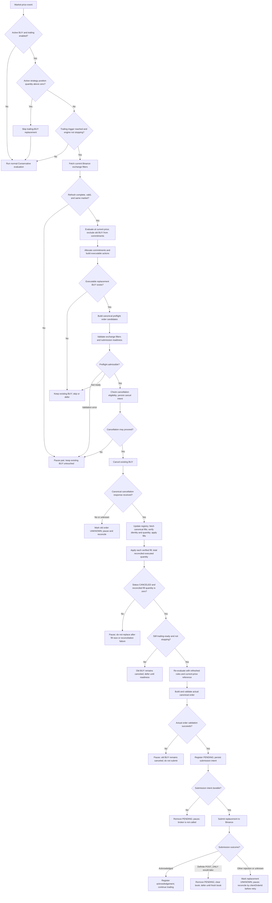

# Conservative Strategy — Canonical Domain Specification

**AUTHORITATIVE SOURCE OF TRUTH.** Owner-approved Conservative Strategy contract.

**Scope:** Harvester Conservative decisions, position accounting, SELL economics, order lifecycle, and recovery completion.

**Change control:** Only this document defines Conservative Strategy rules. Every other document, issue, PR, test, and implementation note is a reference, implementation, regression, or historical record.

## 1. Authority and boundaries

This is the one and only authoritative definition of Conservative Strategy behavior in this repository. If any other artifact disagrees with this document, that artifact is stale and must be corrected or explicitly marked historical/superseded. Do not copy strategy rules into other documents.

The specification defines expected behavior. The implementation coordinates it through domain policies and application workflows:

- The domain calculates valid BUY/SELL intents and recovery economics.
- The application owns order submission, cancellation, exchange reconciliation, fill application, and serialized lifecycle transitions.
- The broker supplies authoritative order state, executions, commission facts, and exchange filters.
- Tests prove implementation conformance; they do not redefine the contract.
- The Mermaid diagram below is a derived algorithm visualization, not a second source of truth.

Restart reconstruction is explicitly outside this specification's active implementation scope and remains separately tracked in [#654](https://github.com/45s/coinzilla/issues/654).

## 2. Position and recovery accounting

A Conservative position is represented by two financial values:

- **quantity** — current strategy-owned base quantity. BUY fills add gross executed base less base-asset commission. SELL fills subtract gross executed base plus base-asset commission. Retained inventory is excluded from future strategy-sellable quantity once recovery completion allocates it.
- **spent** — the entire accumulated BUY cost for the current recovery position: gross executed quote notional plus quote-asset BUY commissions, plus the reliable quote value of any third-asset BUY commission. SELL fills do not proportionally reduce or erase this cost basis.

Confirmed fills are the only source of accounting changes. Apply every fill exactly once using its stable execution identity. A duplicate with identical facts is a no-op; conflicting facts under the same identity fail closed. Portfolio and recovery accounting must accept the same fill as one atomic logical transition.

Actual exchange-reported commission amount and asset are authoritative. Never infer actual fees from configured rates or order type.

| Confirmed execution | Position quantity | Recovery proceeds / cost |
|---|---:|---:|
| BUY | gross executed base less base commission | spent += gross quote + quote commission + valued third-asset commission |
| SELL | subtract gross executed base plus base commission | netSellProceeds += gross quote less quote commission and valued third-asset commission |

A third-asset commission is supported only when a reliable quote-currency valuation is available for that execution. If its asset, amount, or valuation is missing, stale, ambiguous, or unavailable, do not treat it as zero: fail closed before committing either accounting projection.

Base-asset commissions change position quantity. Quote-asset commissions change quote cost/proceeds. A BUY commission belongs in accumulated position cost; it is not added again to the later SELL commission.

Keep cumulative confirmed netSellProceeds with the current position's full spent basis until sell-through and completion are resolved. A replacement order never resets cost, proceeds, or fill identities.

## 3. BUY behavior

1. An enabled, valid pair with no active BUY may place its initial BUY one configured priceStepPercent below the first valid market reference, rounded down to the exchange price tick. Quantity is configured orderQuantity, rounded down to the quantity step.
2. The initial BUY trails upward according to the existing Conservative trailing policy. A trailing replacement requires acknowledged/cancellable order identity, cancellation, and complete fill reconciliation. Never place a replacement from stale quantity or an uncertain cancellation result.
3. Each actual BUY fill is accounted immediately. A partially filled BUY does not advance the completed-BUY lifecycle. Before advancing, reconcile the terminal order and all fills; their distinct executed quantities must match the broker's executed quantity and the order's original quantity.
4. The next standing BUY is fixed one configured step below the completed BUY's volume-weighted execution price (total executed quote divided by total executed base). It is not trailed while recovery is outstanding. Conservative trailing-BUY repricing is eligible only while active strategy position quantity is zero; retained free inventory is excluded from that gate. After successful recovery completion, the existing trailing behavior resumes.
5. Submit a required recovery SELL before considering any later BUY. **No new Conservative BUY may be submitted while a recovery cycle remains unresolved.** The BUY gate remains closed while Position active quantity is positive, Position.spent is positive, or RecoveryLedger cycle totals remain non-zero. A successful SELL acknowledgement, a terminal SELL acknowledgement by itself, or realized proceeds reaching the cost basis does not release the gate. Only fully reconciled recovery-cycle completion—which allocates retained inventory and resets the Position recovery basis and RecoveryLedger cycle totals—makes the next BUY eligible. PENDING, OPEN, PARTIALLY_FILLED, and UNKNOWN recovery SELL states remain active reservations and never release BUY admission.
6. A standing BUY that was already submitted before a recovery cycle became active is not a new submission. Do not blindly cancel it or create a replacement. Continue its canonical order/fill lifecycle; reconcile every late fill exactly once, include it in the Position cost/inventory, and recalculate recovery SELL coverage from the updated reconciled state. If cancellation is independently required by an existing safety/replacement workflow, use its durable cancellation intent, authoritative terminal status, and complete fill reconciliation; an unknown cancellation remains unresolved and cannot release the BUY gate.
7. A Conservative Position may have only one active recovery SELL reservation. The final application submission gate must check the canonical OrderRegistry for another SELL owned by that market's COIN_GRABBER Position and defer a second RECOVERY_SELL while the existing order is PENDING, OPEN, PARTIALLY_FILLED, or UNKNOWN. Conservative currently has one Position per strategy/market, so an active owned SELL remains a reservation even if a legacy ownership record has a stale or missing Position ID. The candidate order itself is excluded during its post-registration gate recheck. The reservation is released only after the registry records a terminal order transition; strategy-level checks alone are not the final safety boundary.
8. Any configured investment/balance limit is an additional Harvester safety constraint. It must not alter position quantity, accumulated spent, or the full-cost recovery target.

## 4. Recovery SELL economics

The minimum realized net profit is configured independently for each pair as `pairs.<SYMBOL>.minProfit`, and must be at least 0.01 units of that pair's quote asset. For a USDT-quoted pair, `minProfit: 0.1` means 0.1 USDT; for an FDUSD-quoted pair, `minProfit: 0.01` means 0.01 FDUSD. The strategy compares quote-asset amounts directly and performs no USD conversion. A value below 0.01 is invalid. There is no global `settings.minProfit`; every configured pair must declare its own threshold. Never intentionally close a recovery position at a loss or break-even.

Sell all exchange-sellable strategy inventory except the exact configured pair-level keepQuantity. This is the only retained-inventory setting name. Do not introduce coinToKeep or keepCoinQuantity.

### Meaning of `keepQuantity` — retained amount per completed recovery cycle

`keepQuantity` is the **minimum base-asset quantity that must remain unsold when one recovery cycle completes**. It is configured per trading pair and applies independently to every completed cycle. It is **not** a cap on the Portfolio's total retained/free inventory, and it is **not** a target that the bot maintains as the account's lifetime balance.

For each recovery cycle:

1. Keep the configured `keepQuantity` out of the recovery SELL.
2. Sell every other unit of strategy-owned inventory that can legally be sold under the current exchange filters.
3. Complete the cycle only after the SELL/fill reconciliation and minimum realized-profit conditions below pass.
4. Transfer that cycle's `keepQuantity` into the Portfolio's retained/free inventory. This amount is no longer working inventory for later recovery cycles.
5. Start the next cycle with newly acquired strategy inventory. When that cycle completes, retain another `keepQuantity`.

Therefore, retained/free inventory **accumulates by one `keepQuantity` for every successfully completed recovery cycle**. The configured value is a per-cycle amount, not a lifetime maximum.

Example with `keepQuantity = 0.01 LINK` and no exchange-constrained dust:

| Successfully completed recovery cycles | LINK retained by that cycle | Total accumulated retained/free LINK |
| ---: | ---: | ---: |
| 1 | 0.01 | 0.01 |
| 2 | 0.01 | 0.02 |
| 3 | 0.01 | 0.03 |
| 4 | 0.01 | 0.04 |
| 100 | 0.01 | 1.00 |

After four successful cycles, **0.04 LINK is the expected retained/free balance**. After 100 successful cycles, the expected balance is at least 1.00 LINK (assuming no retained dust or other adjustments).

The word **minimum** matters: exactly `keepQuantity` is retained when all excess inventory is sellable. If a positive remainder above `keepQuantity` is proven to be exchange-constrained dust, that dust is retained as a bonus for that cycle. For example, `keepQuantity = 0.01 LINK` plus `0.005 LINK` of validated unsellable dust means that cycle contributes `0.015 LINK` to retained/free inventory. Do not classify ordinary sellable residual inventory as dust or complete the cycle while it remains unsold.

The Portfolio's accumulated retained/free balance must not be subtracted from the next cycle's `keepQuantity`: the next cycle must independently preserve its own configured minimum.

Let:

- A = current strategy-owned position quantity before retained allocation;
- K = exact configured keepQuantity;
- f = applicable conservative SELL fee reserve as a decimal fraction;
- s = exchange quantity step;
- t = exchange price tick;
- C = the entire accumulated position spent;
- P = cumulative confirmed net SELL proceeds;
- m = this pair's configured `minProfit`, with m >= 0.01 in its quote asset.

Maximum planned SELL quantity, accounting for a possible base-asset fee and quantity-step rounding:

\[
Q = \operatorname{floorToStep}\left(\frac{\max(0,A-K)}{1+f},s\right)
\]

Remaining net quote proceeds required to recover the full accumulated cost basis plus minimum profit:

\[
R = \max(0,C+m-P)
\]

When Q > 0 and R > 0, the minimum SELL limit price is rounded up to the price tick:

\[
p = \operatorname{ceilToTick}\left(\frac{R}{Q(1-f)},t\right)
\]

Do not prorate C by the fraction of inventory being sold. Retaining K does not reduce the cost target. The SELL must recover the entire accumulated BUY cost plus at least m net after applicable SELL commissions.

When R = 0, the recovery profit target is already secured. Continue selling every sellable residual unit above K; price that residual using the validated current market reference rounded up to the tick, not an artificial one-tick price. Positive additional net proceeds must not reduce the already-realized aggregate profit. Actual commissions still determine final realized profit.

### Fee reserve and order type

Preserve the existing order-type selection policy:

- makerPercent = 0 selects LIMIT_MAKER (POST-ONLY). Its planning reserve is the configured maker fee.
- Non-zero makerPercent selects regular LIMIT. Because it may execute as maker or taker, its planning reserve is the higher applicable configured maker/taker rate.
- The applicable reserve is a planning estimate only. It is not an actual commission and must never be booked as one.
- The actual commission amount and asset reported on every confirmed fill determine accounting and final realized profit.

A POST-ONLY order must pass the existing fresh, same-symbol best-bid/best-ask crossing checks immediately before broker I/O. Missing, stale, malformed, crossed, or mismatched book data fails closed. The exchange remains the final POST-ONLY authority; do not silently convert a rejected POST-ONLY order into regular LIMIT.

### Exchange filters and dust

Every candidate SELL must satisfy current price, quantity, and notional filters, including tick size, quantity step, minimum/maximum quantity, and minimum/maximum notional.

When a Conservative Position has active inventory above zero and no owned active recovery SELL is already working, the engine must obtain a validated same-market exchange-filter snapshot before strategy evaluation can plan a recovery SELL or classify recovery dust. The per-symbol cache is fresh for at most 30,000 milliseconds; the first evaluation with active inventory and every evaluation after expiry must call `getSymbolFilters({ symbol })`. A successful snapshot is revalidated against the configured pair and the active market identity. The cache is on-demand, not a background poller, and is shared with the existing forced trailing-BUY refresh. If the read is unavailable, malformed, the clock is invalid, or the snapshot identifies another market, pause only that market with `RECOVERY_SELL_FILTERS_UNAVAILABLE` and stop the evaluation; never fall back to startup filters. A backward clock movement invalidates the cache and forces a fresh read. This gate runs before both recovery SELL planning and dust completion. If an owned recovery SELL is already active, the engine must not plan a second recovery SELL; it leaves that order untouched and skips this refresh until the order becomes terminal or is reconciled. It does not cancel, replace, or otherwise mutate an already acknowledged exchange order.

Sell all quantity that can legally be sold above K. A remainder is EXCHANGE_CONSTRAINED_DUST only when the exact amount cannot currently satisfy the applicable quantity-step, minimum-quantity, or minimum-notional rules. Record its exact quantity, limiting filter, and evaluated values. When the fee-adjusted SELL quantity rounds to zero, classify the raw remainder against the exchange filters in this order: below quantity step is QUANTITY_INCREMENT; otherwise below minimum quantity is MIN_QUANTITY; otherwise a quantity-valid remainder whose value at the validated market reference (rounded up to the price tick and minimum price) is below minimum notional is MIN_NOTIONAL. Only classify the remainder as QUANTITY_INCREMENT when the fee-adjusted candidate itself is below one quantity step. Because the configured fee reserve is strictly below 100%, a zero-step candidate is only plausible when the physical remainder is less than twice the quantity step; completion validation enforces this bound as well as the evaluated candidate. The physical remainder may equal one step because the fee reserve can make that order unsafe. Do not label a quantity-valid, below-minimum-notional remainder as quantity-increment dust. **Unsellable dust is retained as a bonus on top of configured keepQuantity.** If configured K is 1.00 and 0.04 is exchange-constrained dust, retain 1.04 total; do not discard it, force an invalid SELL, or treat it as sold. Dust is not a reason to keep submitting futile SELLs or to block completion once all other completion conditions pass. Preserve its quantity and accounting provenance when transferring the completed retained inventory.

A price-filter or fee-valuation failure is not dust; it is a blocked/unsafe decision and must fail closed.

## 5. SELL order lifecycle

### Shared CG/RS submission ownership and durable intent

The shared submission-intent use case must validate the originating strategy rather than treating every `RECOVERY_SELL` as a Recovery Seller order. Purpose and strategy identity are separate, explicit facts:

| Originating strategy | Allowed recovery purpose | Required ownership |
| --- | --- | --- |
| `CG_coinGrabber` | `RECOVERY_SELL` (SELL only) | `strategyId`, non-empty `positionId`; no RS `cycleId` |
| `RS_recoverySeller` | `RECOVERY_BUY` (BUY only), `RECOVERY_SELL` (SELL only) | `strategyId`, non-empty `positionId`, non-empty `cycleId` |

The durable intent stores the canonical order's market/provider/account identity, client order ID, side/type, exact decimal price/quantity, purpose, and the normalized originating strategy/Position identity. The Conservative registration boundary supplies its immutable ownership record to the executor; ordinary CG BUY intents persist `CONSERVATIVE_BUY`, while the recovery SELL persists `RECOVERY_SELL`. The operational-state fact schema validates both strategy and purpose, including the absence of an RS cycle ID on CG records. Regression coverage exercises CG and RS SELL intents/outcomes, CG BUY intents, cross-strategy rejection, missing ownership, wrong-side/purpose combinations, and CG/RS cycle-identity separation. RS cycle identity is stored only for RS. Shared infrastructure must never rewrite CG as RS or infer ownership from a symbol, client-order-ID prefix, broker order ID, or a matching purpose string. Submission outcomes apply the same strategy/Position/cycle schema, so the acknowledged order cannot silently lose or change its origin.

Validation is fail-closed: a recovery purpose requires explicit ownership; strategy and purpose must be a supported combination; purpose must match the canonical order side; Position identity is mandatory; RS cycle identity is mandatory and CG cycle identity is forbidden. Missing, malformed, unknown-strategy, mismatched-purpose, wrong-side, and cross-strategy metadata is rejected before durable append or broker placement. An ordinary purpose-null order may be unowned only when no ownership object is supplied.

The Conservative order-registration callback returns its immutable CG ownership record to the shared executor. The executor carries that same record into durable submission intent, outcome, deferral and failure callbacks; it must not reconstruct or relabel strategy ownership downstream. If durable intent validation or append fails, remove the local unsubmitted PENDING registration, latch the market's `ORDER_INTENT_NOT_DURABLE` safety pause, and stop the ordered decision batch before any sibling action is registered or submitted. A later market tick must not create a fresh client order ID while that pause remains active. Before a new recovery SELL decision, sum the exact remaining quantities of every owned PENDING, OPEN, PARTIALLY_FILLED, and UNKNOWN SELL for the market. The aggregate must not exceed net sellable Position inventory after actual base-asset commissions and `keepQuantity`; missing/invalid remaining quantities or an excess reservation fail closed and pause the market. An UNKNOWN order remains reserved until canonical client-order-ID reconciliation proves its terminal state. A durable intent must be synchronously admitted and acknowledged through the Journal write-only `flushWrites()` barrier before broker placement or cancellation. Do not use global `flush()` as a per-order barrier: it drains EventBus subscribers and allows optional observer failures to block trading. A pending asynchronous publisher is not durable evidence; fail closed before broker I/O. If intent persistence fails, remove the local unsubmitted PENDING registration, retain the market safety pause, and do not call the broker. A PENDING lifecycle log is not an exchange acknowledgement. A transport timeout or ambiguous broker outcome remains UNKNOWN under the original client order identity; reconcile that identity and complete canonical order/fill history before any retry or replacement. See the [Recovery Seller Domain Specification](recovery-seller-domain-specification.md) for RS cycle ownership and lifecycle rules.

### Partial SELL while recovery remains active

When an acknowledged SELL is OPEN or PARTIALLY_FILLED and no additional fill from a pre-existing BUY has occurred:

- Keep the same exchange order and the same limit price.
- Do not cancel, replace, reprice, or recalculate its remaining quantity because of a partial fill.
- Apply every actual partial fill and commission exactly once to accounting.
- Let the exchange maintain the remaining quantity.
- Do not interpret a partial fill as recovery completion.

### Pre-existing BUY late fill while a recovery SELL is open — owner decision B

A BUY may still fill after its original acknowledgement if it was already submitted before the recovery cycle became active. This is an existing order lifecycle event, not permission to submit a new or replacement BUY. When such a late fill occurs while a recovery SELL is OPEN or PARTIALLY_FILLED:

1. Record the triggering fill from that already-acknowledged BUY order and its actual commission facts exactly once.
2. Request cancellation of the existing SELL. If it is still PENDING, wait for its broker acknowledgement and valid broker order ID; never cancel an unacknowledged order.
3. Reconcile the SELL's terminal exchange state and retrieve its complete canonical fill history, including every fill that raced with cancellation.
4. Validate ownership, market, side, order identity, unique fill identities, commission facts, and equality between summed distinct SELL fill quantity and broker-reported cumulative executed quantity.
5. Apply all newly discovered SELL fills exactly once and commit the BUY and SELL accounting updates consistently.
6. Only after terminal state and complete fill reconciliation succeed, calculate and submit a replacement SELL from the updated Position quantity, full accumulated spent, and cumulative net SELL proceeds. Do not submit a replacement or next standing BUY.
7. If cancellation, terminal state, fill history, commissions, or accounting cannot be reconciled completely, fail closed. Do not submit a replacement from stale or partial information. The Conservative BUY gate remains closed until the entire recovery cycle is completed and the Position/RecoveryLedger basis is reset.

If the SELL becomes FILLED while cancellation is in flight, reconcile and process it as a terminal FILLED order. Do not misclassify a successful terminal fill as a confirmed cancellation, and do not submit a duplicate replacement.

### Other terminal SELL outcomes

For FILLED, CANCELED, EXPIRED, and REJECTED orders, reconcile terminal status and all actual fills before taking another strategy action.

- FILLED does not by itself prove recovery completion. Distinct fill history must reconcile exactly to broker-reported executed quantity and original order quantity.
- A terminal CANCELED or EXPIRED order may be replanned only after its fills and commissions are reconciled and the remaining position is recalculated.
- A known REJECTED order has no assumed execution; verify any reported execution facts before a new valid intent.
- UNKNOWN status, unconfirmed cancellation, missing history, conflicting fills, or incomplete commission valuation pauses the pair and blocks replacement.

A replacement order never erases accumulated spent, net proceeds, or fill identities.

## 6. Recovery completion

Recovery is complete only when all of the following are true:

1. The relevant SELL order is authoritatively terminal and its complete distinct fill history reconciles to broker-reported execution facts.
2. Every BUY and SELL fill and every actual commission has been applied exactly once.
3. All exchange-sellable quantity above keepQuantity has been sold. Any remaining exchange-constrained dust is classified by exact quantity and limiting filter, then retained in addition to keepQuantity. The retained total is keepQuantity + dust (for example, 1.00 + 0.04 = 1.04); dust is not discarded, force-sold, or counted as sold.
4. Actual cumulative net SELL proceeds minus the full accumulated BUY spent are at least 0.01 quote currency.
5. The exact configured keepQuantity is preserved and is never sold.

Only after these conditions pass may keepQuantity plus any classified exchange-constrained dust be allocated as retained/free inventory, preserving the dust quantity and its accounting provenance, and the completed recovery basis be reset. If profit is below 0.01, fill history is incomplete, inventory accounting is inconsistent, or the full retained total cannot be preserved, fail closed and do not reset.

The durable `recovery.cycle_completed` record must preserve the pair's configured `keepQuantity` and `minProfit`, actual `realizedNetProfit`, final `freeQuantity`, and exact dust/filter evidence when dust exists. The recorded threshold is the value used for that market and cycle; replay validates the record against its own threshold rather than another market's current configuration. Replay must verify that realized profit meets the recorded threshold and that `freeQuantity = keepQuantity + dust` (or exactly `keepQuantity` when there is no dust). After replaying the fills, the recorded free allocation must consume all remaining active inventory. A journal record that leaves sellable active inventory behind or weakens the configured profit threshold is invalid and must fail closed. Older completion records that lack the configured threshold or retained-inventory proof are not silently upgraded; replay must fail closed and require reconciliation.

The application completion boundary must also receive the exact canonical terminal SELL order as evidence; it must not infer completion from profitability or a dust classification alone. The order must be a `CanonicalOrder` for the same market as the active Position and RecoveryLedger, with `side = SELL`, `status = FILLED`, a non-empty broker order ID, and `executedQuantity = originalQuantity`. The normal user-data SELL-fill path, cancellation/reconciliation race path, and exchange-constrained dust-completion path must all forward that same reconciled order identity. Recovery completion is serialized behind accepted fill-accounting transitions so it cannot evaluate or reset against a stale Portfolio/RecoveryLedger projection.

keepQuantity = 0 is permitted only after the complete workflow—including BUY, partial SELL, cancellation/reconciliation, terminal SELL, dust, profit verification, and exact-once completion—has passed end-to-end regression. Until then, fail closed at the precise unsupported boundary.

## 7. Workstation downtime and scope

Harvester runs on the owner's personal PC. 24/7 uptime is not required. Resting exchange orders may fill while the process is stopped; the stopped process cannot update in-memory state. This is expected, not a strategy defect.

Do not retroactively change historical shutdown snapshots. Safe process-restart reconstruction and reconciliation remain a separate workstream in [#654](https://github.com/45s/coinzilla); this specification does not implement Portfolio, RecoveryLedger, or OrderRegistry restoration. When process recovery is disabled, a new process starts a fresh current-process strategy session after its own account PREFLIGHT and current-process user-data readiness. Prior-process orders and fills remain external under ADR-0004 and the configured per-market policy; they are not adopted, cancelled, managed, or replayed. Unresolved ACCOUNT safety blockers and configured per-market BLOCK policy remain fail-closed. When process recovery is enabled, prior-session eligibility remains subject to the separate #654 acceptance gates.

No TESTNET order, cancellation, restart, or other exchange action is authorized by this specification.

## 8. Conservative trailing-BUY replacement safety

The following flowchart documents the implemented application workflow for replacing an existing Conservative trailing BUY. It is derived from the Conservative Trading Engine, Binance adapter, and strategy-decision execution path; source code and regression tests remain the evidence for exact behavior.

### Why preflight happens before cancellation

The engine runs this work inside its serialized market-price transition. It first requires an acknowledged active BUY, trailing enabled, no active strategy position, a reached repricing trigger, and a process that is not stopping. If an active strategy Position exists, only trailing-BUY replacement is skipped: the engine must continue normal Conservative evaluation so required recovery SELL coverage can be established or maintained. This is not an early return from strategy evaluation. The no-new-BUY rule in §3 and the final application submission gate remain authoritative throughout that evaluation. When trailing replacement is eligible, the engine then fetches current Binance symbol filters and validates that the refreshed market metadata is complete and still identifies the active symbol and market. The Conservative policy is evaluated using the current market price as the replacement reference. Commitment allocation excludes only the existing BUY that would be canceled, modeling the quote commitment that cancellation will release; it does **not** cancel the order or remove it from the live registry.

The executable replacement candidate is converted into canonical preflight order(s) and checked against the refreshed exchange rules, including quantity and price increments and minimum notional. The same submission-readiness gate checks current market-price freshness and, for `LIMIT_MAKER`, a fresh same-symbol book and a price that does not cross the opposite best quote. A validation error pauses the pair; unavailable readiness or the absence of an executable replacement BUY defers/skips the replacement. In every preflight failure or deferral case, the existing BUY remains open and untouched. This is essential: canceling first would remove the existing standing order even though the replacement might be rejected by exchange filters or could not safely be submitted, leaving the pair without its intended BUY.

### Cancellation and post-cancellation failure handling

Only an admissible preflight proceeds to cancellation. Harvester verifies cancellation eligibility and durably records the cancellation intent before calling the broker. If the intent cannot be persisted, no cancellation request is sent. An exception, rejected response, or otherwise unconfirmed cancellation is represented as UNKNOWN and pauses the pair for reconciliation.

After a canonical cancellation response, the engine updates the order registry, retrieves canonical fills, validates each fill's order identity, applies actual fills, and checks that the reconciled quantity equals the broker's cumulative executed quantity. Replacement proceeds only when the canonical order status is CANCELED and the reconciled fill quantity is zero. A fill racing with cancellation, a non-CANCELED terminal status, unavailable or incomplete fill history, or any identity/quantity mismatch pauses the pair; no replacement is submitted.

After confirmed cancellation with zero fills, the engine stores the current market price as the new reference and re-evaluates the Conservative policy using the refreshed filters. The actual order is rebuilt and validated again. Harvester registers it as PENDING and durably records the submission intent before broker I/O. If that intent cannot be persisted, the pending record is removed, the pair is paused, and the broker is not called. A generic broker rejection, transport error, or uncertain acknowledgement leaves the replacement explicitly UNKNOWN and pauses the pair; reconcile it by canonical `clientOrderId` before any retry. Binance's definite `POST_ONLY_WOULD_TAKE` rejection is a known rejection rather than an unknown outcome: the pending record is removed, the cached book is discarded, and evaluation is deferred until fresh book data arrives. An acknowledgement is not itself a fill; an immediately FILLED acknowledgement is reconciled against canonical execution history before the serialized transition completes.

### Strategy-originated safety pause and owned-BUY cancellation

A Conservative strategy-originated pause is distinct from the operator market Pause contract in ADR-0006. Whenever the engine pauses a market because a strategy/evaluation/order-safety path failed, it immediately retains the process-local market BUY gate and uses the existing serialized current-process-owned order cancellation and fill-reconciliation transition.

- Cancel only active BUY orders present in the current process OrderRegistry for the affected market when the pause reason is safety-critical (strategy evaluation, durability, order-state, fill/accounting, or reconciliation integrity). Expected preflight/metadata/strategy validation rejections and explicitly retryable REST reconciliation failures still pause new actions but do not cancel an already-standing BUY. Startup-snapshot, manual, external, and prior-process orders are not adopted or canceled.
- The pause fact `STRATEGY_MARKET_PAUSED` is committed when the Operational State Store is configured. The `strategy.paused` lifecycle event is published through the existing event publisher.
- Cancellation-racing fills are reconciled through the existing canonical fill path and applied once before the terminal cancellation status is committed to the registry; this preserves legal order transitions such as OPEN → PARTIALLY_FILLED → CANCELED. Fill accounting and user-data intake remain active.
- The gate remains active until every current-process-owned active BUY is terminal and reconciled. An UNKNOWN/unconfirmed order, failed pause fact/event, or incomplete cancellation yields `STRATEGY_SAFETY_PAUSE_INCOMPLETE`; the engine attempts to persist `SAFETY_BLOCKER_RAISED` with reason `STRATEGY_SAFETY_PAUSE_INCOMPLETE` and exposes the cancellation status in the operator market snapshot.
- Recovery Seller evaluation continues while Conservative is safety-paused. Only a submission whose side is SELL and purpose is exactly `RECOVERY_SELL` may pass this strategy-safety gate; every BUY and every other SELL purpose remains blocked. All other independent readiness, order-ownership, volatility, and shutdown gates still apply.
- This pause is process-local and is not restored or cleared by restart. A restart is not evidence that the original cause or any UNKNOWN order has been reconciled.

The full trigger, ordering, fail-closed behavior, and evidence contract are recorded in [ADR-0008](../architecture/decisions/0008-strategy-safety-pause-cancels-owned-buys.md).

## 9. Derived algorithm schema

The following Mermaid flowchart visualizes the rules above. If the diagram and prose ever differ, the prose in this specification controls.

\`\`\`mermaid
flowchart TD
  A[Confirmed BUY fill] --> B[Validate actual fill and commission facts]
  B --> C[Apply BUY quantity and full spent cost exactly once]
  C --> D{Recovery SELL open or partially filled?}
  D -- No --> H[Plan SELL from updated position and full accumulated cost]
  D -- Yes --> E[Request SELL cancellation; wait for acknowledgement if PENDING]
  E --> F[Reconcile terminal SELL state and complete canonical fill history]
  F --> G{Terminal state and every fill/fee reconciled?}
  G -- No --> X[Fail closed; no replacement]
  G -- Yes --> G2[Apply all raced SELL fills exactly once]
  G2 --> H
  H --> I[Calculate sellable quantity above exact keepQuantity]
  I --> J{Excess quantity satisfies quantity and minimum-notional filters?}
  J -- No --> K[Classify exact unsellable dust as retained bonus]
  J -- Yes --> L[Recover full accumulated spent plus at least 0.01 net]
  L --> M[Apply order-type-specific fee reserve and POST-ONLY checks]
  M --> N[Submit recovery SELL]
  N --> O{SELL event}
  O -- Partial fill; no new BUY --> P[Apply actual fill/fee; keep same order and same price]
  P --> O
  O -- Pre-existing BUY late fill while SELL open --> E
  O -- Terminal FILLED/CANCELED/EXPIRED/REJECTED --> Q[Reconcile terminal state and all actual fills/fees]
  Q --> R{Reconciliation complete?}
  R -- No --> X
  R -- Yes --> S[Update position quantity and cumulative net SELL proceeds]
  S --> T{Sellable quantity remains above keepQuantity?}
  T -- Yes --> H
  T -- No --> U{Only exchange-constrained dust remains above keepQuantity?}
  U -- Yes --> K
  U -- No --> W{Actual cumulative net profit at least 0.01?}
  K --> W
  W -- No --> X
  W -- Yes --> Y[Retain keepQuantity plus dust; complete once; preserve retained basis]
\`\`\`

**Change control:** Amend this document only when the owner explicitly changes a rule. Update implementation, tests, reference documents, and GitHub records to conform. Never create a competing Conservative rule definition.

## 10. Conservative graceful shutdown — protect trading before stopping services
### Bounded strategy-participant outcomes

The shared application shutdown coordinator gives every registered strategy participant a bounded `waitUntilSafe` deadline (default 120,000 ms; tests may inject a deterministic timer). Each participant receives an AbortSignal. A deadline produces a participant-specific `TIMED_OUT` blocker with strategy ID, operation, configured timeout and the latest safety snapshot. Rejection, explicit unsafe result, invalidated safety marker and timeout are failures, never success. The coordinator observes late settlement/rejection of the original promise and does not let it become an unhandled rejection.

A timeout does not prove safety and does not authorize teardown. The shutdown handler must retain market/user-data/operator/broker services required for reconciliation, keep the process lock, and report `SHUTDOWN_INCOMPLETE`; a later attempt must re-evaluate current authoritative state. Participants must check the supplied signal between awaited stages and stop advancing their safety proof after abort. The Conservative participant checks the signal before and after each owned-order reconciliation/cancellation, user-data drain, recovery reconciliation, coverage audit and Journal flush; an in-flight read may settle late, but no subsequent stage or safe audit may proceed. A timed-out operation that cannot be cancelled remains an unresolved operation and must never publish a safe marker or authorize STOPPED.

This contract applies to the Conservative strategy only. Every other strategy must own a separate shutdown policy and safety participant. The application-level shutdown coordinator must not contain Conservative-specific order or accounting rules.

On SIGINT or SIGTERM:

1. Activate the Conservative BUY shutdown gate before stopping any shared service. Reject every new BUY, replacement BUY, retry, trailing-BUY reprice and delayed BUY evaluation. Only the explicitly authorized shutdown recovery SELL path may submit a SELL.
2. Immediately begin cancellation of every Harvester-owned active Conservative BUY order. Never cancel, adopt or modify external/manual orders. An external open order alone is not a Harvester-owned shutdown blocker; an actual unowned execution or unresolved account-wide ownership/balance discrepancy remains a separate integrity blocker. Keep market-price intake, Binance user-data intake, broker connectivity and operator/runtime services alive.
3. Reconcile pending client-order identities and every cancellation outcome. Process cancellation-racing fills exactly once and apply actual broker commissions through the existing Portfolio and RecoveryLedger accounting. An UNKNOWN order or incomplete terminal-fill history is not safe.
4. Recalculate recovery SELL coverage from the final reconciled position and RecoveryLedger. If an old recovery SELL must be replaced, first confirm its terminal state and reconcile all fills and commissions. Never submit a replacement after an ambiguous cancellation or placement response; resolve the canonical order by its original client order ID first.
5. Verify the final owned recovery SELL against authoritative Binance state: remaining quantity and net proceeds must cover the final recovery obligation and configured profit target. If no recovery obligation remains, prove that fact and that no stale recovery SELL remains.
6. Mark each market SAFE_TO_SHUTDOWN as soon as its evidence is complete and Journal-durable. The marker is independent per market. Late execution/order evidence invalidates the affected marker immediately; re-reconcile and re-verify before marking it safe again.
7. Once every enabled Conservative market and every other registered strategy participant is safe, synchronously fence new market-price and book callbacks. Do not unsubscribe market feeds yet. Drain every accepted price/book task and the user-data events they enqueue while market subscriptions, user-data intake, operator control and broker connectivity remain available.
8. Re-prove strategy safety after the accepted market/user-data work drains. Publish and durably flush the account-wide CLOSING open-order snapshot, then the filtered CLOSING balance snapshot, while market subscriptions and all other required services remain connected. A failed, partial, or malformed open-order read must be recorded as BLOCKED and make the following balance audit INCOMPLETE. If drain, re-proof or either CLOSING durability barrier fails, reopen market callback processing and abort shutdown without stopping shared services.
9. Only after CLOSING is durable, unsubscribe market-price and book feeds. If unsubscription is partial or fails, reopen callbacks for any subscriptions that remain active and abort before user-data/operator/broker shutdown.
10. Stop user-data intake and drain accepted events. Re-prove safety if late execution evidence invalidates a marker; reconcile and re-verify recovery SELL coverage and durably publish an updated CLOSING snapshot when required. Flush the Journal before shared cleanup.
11. Stop operator control and disconnect Binance last. Publish STOPPED, close Journal/EventBus and release process locks only after runtime shutdown and cleanup are confirmed.

There are no arbitrary sleeps, 20-second delays, quiet periods or time-based guesses. A market already meeting every condition is safe immediately. If safety cannot be proven, fail closed: retain the connections and services needed for reconciliation/recovery, report the exact strategy, market and blockers, and do not report STOPPED.

**Shutdown blocker taxonomy:** `ORDER_OR_FILL_RECONCILIATION_INCOMPLETE` is reserved for failed canonical owned-order reconciliation or failed required user-data drains that may contain order/fill evidence. BUY-cancellation failures, recovery SELL input/reconciliation failures, recovery coverage findings, Journal durability failures and external integrity blockers remain separate diagnostics. Each still blocks shutdown when applicable; separating their labels never relaxes the safety proof.

When recovery pricing is unavailable or stale, the participant may wait for an accepted fresh market-stream event for at most `MARKET_DATA_MAX_AGE_MS` (5,000 ms), then retry the complete recovery reconciliation once. The wait does not block the serialized transition queue. A timeout or a price that becomes stale again remains unsafe. The accepted stream event is the freshness evidence; a one-shot ticker value without a source timestamp is insufficient. The shutdown BUY gate remains active throughout.
The participant's safety-marker loop is bounded to two complete passes: the initial proof and one re-audit for late accepted evidence. If markers are invalidated again, shutdown fails closed with `SHUTDOWN_SAFETY_REEVALUATION_LIMIT_EXCEEDED:2`. The outer shutdown handler then owns callback fencing, queue draining and the final shared safety re-proof; elapsed quiet time is never treated as proof.

The SAFE_TO_SHUTDOWN marker is a process-local projection, not a durable fact across restarts. On restart, rebuild safety from Journal evidence and authoritative exchange state; never trust a previous process's marker. The Journal must durably flush its published lifecycle/audit evidence before cleanup. Applied fills and order facts remain governed by [ADR-0001](../architecture/decisions/0001-application-owned-recovery-facts.md) and must be persisted before in-memory Portfolio/RecoveryLedger projections change.

The implementation and deterministic regression tests are tracked by [issue #1186](https://github.com/45s/coinzilla/issues/1186).

### Recovery completion failure evidence

When a Conservative strategy pause is caused by a failed recovery completion or residual-dust evaluation, the immutable `STRATEGY_MARKET_PAUSED` Operational State fact must include the sanitized original error identity (`name`, bounded `message`, and optional stable `code`) alongside the stable pause reason. Do not persist stacks or raw broker payloads. The generic pause reason remains a safety classification; it is not a substitute for the original failure. This evidence improves diagnosis without changing the fail-closed completion or BUY-admission rules. The evaluator regression also verifies that an already-active residual SELL prevents a duplicate submission on the next evaluation.

### Durable recovery sell-through evaluation evidence

Every residual sell-through plan and exchange-constrained dust disposition is published as a strategy.decision Journal event, including no-action decisions. A no-action dust decision is published before recovery completion is attempted, so a failed completion cannot erase the filter decision that preceded the pause.

The allowlisted recoveryEvidence records:

- Active inventory, keepQuantity, residual quantity, candidate quantity, actually sellable quantity, and any planned SELL.
- Evaluated price and residual, candidate, and sellable notionals.
- The exact inventory disposition and its minimum quantity/notional, quantity increment, evaluated quantity/notional/price, and filter reason.
- The validated market-filter inputs, local metadata capture timestamp, provider metadata version when available, and market-price evaluation timestamp.

metadataCapturedAt is the local time at which the validated filter snapshot was loaded/refreshed; it is not an exchange-generated version. metadataVersion is null when the provider does not expose a version. Missing filter snapshots remain explicitly unavailable and must never be inferred from current filters.

The deterministic strategy fixtures assert the evaluated price and notional for quantity-step dust, minimum-notional dust, and MAX_PRICE-blocked residuals. Configured metadata must still match the requested market symbol and expose canonical base/quote asset codes before it can be stored or used. The existing order lifecycle facts remain authoritative for submission and broker outcomes (PLANNED, SUBMITTED, ACKNOWLEDGED, REJECTED, UNKNOWN, or BLOCKED). The integration fixtures assert the evidence-before-completion ordering and the UNKNOWN, REJECTED, and BLOCKED submission outcomes. The Operational State pause fact separately retains the sanitized original completion error. Recovery remains unresolved until full reconciliation and Position/RecoveryLedger basis reset; no new Conservative BUY is permitted before that reset.

`candidateNotional` is calculated from the exchange-rounded `candidateQuantity`; `residualNotional` is calculated from the full `residualQuantity`. Do not reuse `inventoryDisposition.evaluatedNotional` for candidate notional, because that value describes the strategy's residual evaluation.

Recovery strategy-decision evidence is safety-critical: publication admission alone is not durability. Before recovery completion or residual SELL submission, the event must be published successfully and the Journal write-only flush (`flushWrites()`) must acknowledge durable persistence without draining EventBus. The global `flush()` must not be awaited from a pending EventBus handler. If the capability is unavailable or fails, evaluation fails closed with stable pause reason `RECOVERY_DECISION_EVIDENCE_PERSISTENCE_FAILED` and carries the original error into the safety pause. A blocked recovery SELL whose terminal deferral evidence cannot be durably flushed uses `RECOVERY_SELL_DEFERRAL_EVIDENCE_PERSISTENCE_FAILED`. Journal capability request #1910 was delivered by merged owner PR #1911.
