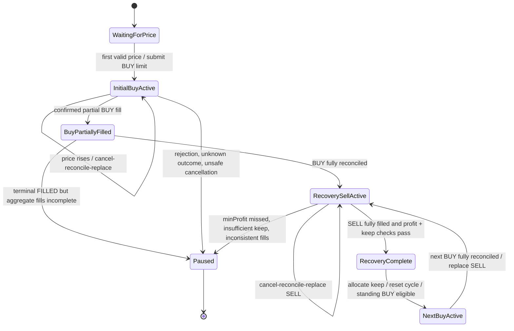

# Conservative Domain Specification

**Phase:** D0 — specification and implementation alignment  
**Authority:** Harvester's Conservative strategy contract  
**Comparison target:** current Harvester `src/domain` on `develop`  
**Status:** Working Conservative behavior contract; align implementation one behavior at a time.

## 1. Executive summary

The Conservative strategy is a **standing-order accumulation strategy**. It maintains a BUY and a recovery SELL when the pair's state permits. A completed BUY is accounted from actual fills; Conservative strategy then reconciles/replaces the recovery SELL and places the next standing BUY. Therefore a standing BUY may coexist with a recovery SELL. This is the required strategy behavior.

The initial BUY is submitted on the first valid price, one configured step below it. That initial order trails upward. After a BUY fills, the next standing BUY is fixed one step below the last BUY fill; trailing resumes after successful recovery completion.

Harvester already contains useful broker-independent accounting and planning modules. Its current strategy is not yet an exact behavioral match: it creates a BUY from the current market price (or supplied last BUY price), does not implement Conservative strategy's initial BUY trailing behavior in this domain function, requires a per-pair investment cap in its current config validator, a rule absent from the corresponding Conservative strategy pair settings, and has other documented behavioral differences. These differences are listed rather than silently normalized.

## 2. Source of truth and scope

This document defines the Conservative strategy in Harvester's own domain language. Its rules describe the intended trading behavior, financial accounting, and lifecycle independently of any particular application, executable, or repository path.

The existing working strategy behavior was inspected to establish the baseline. The behavior is now recorded here as a Harvester-owned contract; future changes must update this specification, implementation, and tests together.

The contract separates:
- strategy decisions and financial facts, owned by the Harvester domain;
- exchange order state and confirmed execution facts, supplied through application/broker boundaries;
- runtime orchestration, which coordinates submissions, cancellations, acknowledgements, and reconciliation without redefining strategy rules.

This document is not a runtime implementation guide. Broker APIs, exchange SDK payloads, WebSockets, timers, and application services do not belong in the domain.

## 3. Proposed domain responsibilities

### Portfolio

Portfolio is the authoritative in-process projection of strategy-owned base inventory and quote cash flow per market.

A Position contains:
- `baseQuantity`: active strategy inventory available for recovery planning.
- `freeBaseQuantity`: permanently retained inventory excluded from strategy SELL quantity.
- `quoteNetCashFlow`: executed quote cash-flow projection, including quote commissions.
- Derived `totalBaseQuantity = baseQuantity + freeBaseQuantity`.

Portfolio applies confirmed canonical fills, tracks applied fill identity/fingerprint, and allocates free quantity only after the recovery completion decision. Portfolio does **not** decide whether a BUY or SELL should be submitted and does not infer fills from orders.

### RecoveryLedger

One pooled recovery ledger per market contains:
- `buyCost`: cumulative executed BUY quote notional plus quote-asset BUY commissions.
- `netSellProceeds`: cumulative executed SELL quote notional less quote-asset SELL commissions.
- `outstandingRecoveryAmount = max(0, buyCost - netSellProceeds)`.
- `realizedNetProfit = netSellProceeds - buyCost`.
- Applied fill IDs and fingerprints to make recovery accounting idempotent.

The ledger is not an order ledger and does not contain open-order status, broker IDs, requested quantities, or market prices.

### Fill identity and application

A canonical Fill is one execution with a stable identity. Harvester currently fingerprints canonical fill facts (market, trade/order IDs, side, price, quantity, quote quantity, commissions, liquidity role, commission status, and related facts).

Portfolio and RecoveryLedger each guard their own projection against duplicate application. The application layer must apply the same confirmed fill consistently to both projections as one logical transition; it must not apply one and silently ignore failure from the other.

### Conservative strategy policy

A pure policy evaluates validated current market price, configuration, Portfolio, RecoveryLedger, normalized trading increments/order type, and active order facts. It returns order intents or NO_ACTION and owns pure strategy-specific repricing calculations. It does not submit, cancel, poll, or reconcile orders. The application engine receives the selected policy through bootstrap composition and coordinates its decisions without importing strategy calculators.

### Recovery SELL planning

The policy calculates a price and quantity from active inventory, keep quantity, accumulated recovery shortfall, fee reserve, and normalized price/quantity increments. It does not claim that the order will fill or book proceeds.

### Recovery completion

Completion is a decision over actual confirmed fills plus reconciled terminal order status. It returns eligibility and the amount of base inventory that may be moved into free inventory. It must not infer success from an order acknowledgement, requested quantity, market price, or unconfirmed cumulative order status.

## 4. Conservative strategy behavior

The following rules define the intended Conservative strategy behavior in Harvester.

### 4.1 BUY eligibility and intent

1. A pair must be enabled and valid; the bot must be running, not recovering, and not paused.
2. If an active BUY exists, do not create another BUY.
3. On the first valid price, Conservative strategy records the reference/highest price and immediately submits an initial BUY limit at `referencePrice × (1 - priceStepPercent / 100)`, rounded down to the price tick. Quantity is configured `orderQuantity`, rounded down to quantity step.
4. While the initial BUY is active, it trails upward: when market price reaches the adjustment threshold, cancel and reconcile the old order. Replace only after confirming zero fills; any partial/full fill during cancellation is reconciled and the pair pauses rather than submitting a replacement.
5. After a BUY fills, the next standing BUY is fixed from `lastBuyPrice × (1 - priceStepPercent / 100)`. It is not trailed while recovery is outstanding. After a successful recovery SELL, trailing resumes for that standing BUY.
6. The strategy baseline does not establish a separate per-pair investment cap; Harvester's configured investment limit is an additional safety constraint and must not silently alter recovery accounting. Harvester's current validator requires a positive `investment` value and its strategy applies a cap. Do not assume an account balance or an investment limit is a Conservative strategy strategy rule.

**Blocked BUY conditions:** pair disabled; bot stopped or in user-data recovery; pair paused; an active BUY already exists; invalid/non-positive price or calculated threshold; invalid/zero quantity after step rounding; BUY submission failure; incomplete/ambiguous cancellation reconciliation; or the required recovery SELL submission failed before the next standing BUY could be placed.

A standing BUY may coexist with a recovery SELL. The required order is: complete BUY accounting → replace recovery SELL → place next BUY. If the SELL submission fails, the pair pauses and next BUY is not placed.

### 4.2 BUY fill accounting

Only actual confirmed execution fills change inventory or recovery cost. A requested or acknowledged order quantity is not a fill.

For each BUY fill:
- Gross base quantity is the executed quantity.
- Base-asset commission reduces the base quantity received.
- Quote-asset commission increases quote BUY cost.
- Third-asset or incomplete commission data is unsupported and fails closed in the current Conservative strategy conversion/accounting path.
- Add the resulting net base amount to active inventory.
- Add executed quote notional plus quote commission to `buyCost`.

Partial fills are accounted incrementally. A BUY order is considered complete for the lifecycle transition only when the order's actual fill quantities sum exactly to the order quantity and the broker reports FILLED. A FILLED status with incomplete aggregate fill history pauses; it does not trigger recovery completion/next-order transitions. The next-BUY reference is calculated as total executed quote notional divided by total executed base quantity across every fill in that BUY order. It is not the submitted limit price and is not simply the price of the final partial fill. The completed order’s fill quantity must reconcile exactly to its reported executed quantity and original quantity before the recovery SELL/next-BUY transition proceeds.

### 4.3 Recovery SELL planning

Let:
- `A` = active base quantity before planning;
- `K` = retained `keepQuantity`;
- `f` = conservative SELL fee reserve as a decimal fraction;
- `s` = quantity step;
- `t` = price tick;
- `C` = cumulative BUY cost;
- `P` = cumulative confirmed net SELL proceeds;
- `m` = required `minProfit`.

Sell quantity:
$$
Q = \operatorname{floorToStep}\left(\frac{\max(0,A-K)}{1+f},s\right)
$$

Remaining net quote proceeds required:
$$
R = \max(0,C+m-P)
$$

If `Q ≤ 0`, no SELL is submitted. Otherwise minimum price:
$$
p_{raw}=\frac{R}{Q(1-f)}
$$

The submitted limit price is rounded **up** to the price tick. If earlier proceeds already cover `C + m`, Conservative strategy's exact planner still requires a positive sell price; Harvester currently floors that case to at least one tick. Actual fees are authoritative for accounting; the fee reserve is only a planning assumption.

## Commission and order-type policy

The same commission and order-type policy applies to Conservative and Aggressive. Shared market readiness selects the order type from `makerPercent`. Conservative currently has the executable recovery SELL planner; Aggressive still returns `NO_ACTION`, so its future order planner must use this same fee rule.

- If the pair's configured `makerPercent` is zero, submit `LIMIT_MAKER` (POST-ONLY). The exchange either executes it as a maker or rejects it; do not turn it into a taker order.
- If `makerPercent` is non-zero, submit a regular `LIMIT` order.
- Use configured `makerPercent` as the commission estimate for planning in both cases. For the recovery SELL formula, `f = makerPercent / 100` (for example, `0.1` means `0.001`); zero `makerPercent` means a zero reserve. Do not use `takerPercent`, the observed liquidity role, or a maximum observed commission rate to change that planning estimate.
- The broker-reported commission amount and asset on each confirmed fill are authoritative for accounting. Never book the planning estimate as an actual expense.
- Include the actual commissions charged on BUY fills in the accumulated BUY cost that the recovery SELL must recover. Also account for actual SELL-fill commissions when calculating net SELL proceeds.
- Do not maintain separate MAKER/TAKER commission-rate histories or reset commission-rate history at cycle boundaries; this policy does not use such histories.

### POST-ONLY crossing and definite rejection handling

Every `LIMIT_MAKER` submission requires a fresh Binance best-bid/best-ask snapshot for the same symbol. A BUY limit must be strictly below the best ask; a SELL limit must be strictly above the best bid. Equality is marketable and is deferred. Missing, stale, malformed, crossed, or mismatched book data fails closed. The engine checks this before registering the local PENDING order and again after registration immediately before broker I/O. A new book event resumes a deferred evaluation; no timer or polling loop is introduced.

The exchange remains the final POST-ONLY authority because the book can move after local validation. For Binance Spot, only error code `-2010` with the exact matching-engine message `Order would immediately match and take.` is normalized as a definite POST-ONLY rejection. Harvester removes that unacknowledged local PENDING record, invalidates the cached book, and waits for a new book-ticker event before reevaluating. It does not pause the pair for this one known rejection. Other `-2010` errors, other exchange errors, and transport/timeout outcomes are not reclassified; unknown outcomes remain fail-closed and pause the pair. No rejection is converted to a regular LIMIT order.

See the [official Binance Spot API errors reference](https://github.com/binance/binance-spot-api-docs/blob/master/errors.md#messages-for--1010-error_msg_received--2010-new_order_rejected--2011-cancel_rejected-and--2038-order_amend_rejected).

Example: with `makerPercent = 0` and `takerPercent = 0.1`, use POST-ONLY and plan with a 0% fee. With `makerPercent = 0.1` and `takerPercent = 0.2`, use regular LIMIT and plan with 0.1%. In both cases, account using the actual commission reported for every confirmed fill.

### 4.4 SELL fill accounting

For each SELL fill:
- Reduce active base inventory by executed quantity plus any base-asset commission charged on the SELL.
- Reduce quote proceeds by quote-asset commission.
- Add actual net quote proceeds to cumulative `saleProceeds`.
- A third-asset or incomplete commission is unsupported and must not be silently valued as zero.

Partial SELL fills are applied incrementally while the SELL order remains active. A cancellation/replacement must reconcile the order's fill history before recalculating quantity. A replacement order does not reset accumulated BUY cost, net proceeds, or fill identity.

### 4.5 Recovery completion

Conservative strategy completes a recovery cycle only after:
1. The recovery SELL order is terminal FILLED.
2. The sum of all distinct canonical SELL fill quantities for that order equals both its broker-reported executed quantity and its original order quantity. A FILLED status or cumulative order quantity alone is not proof of execution.
3. Every SELL fill has already been applied exactly once to Portfolio and RecoveryLedger, including actual commission effects.
4. Actual active inventory is at least `keepQuantity`.
5. Cumulative net SELL proceeds satisfy:
   $$
   P \ge C+m
   $$

If fill history is missing, duplicated with conflicting facts, or does not reconcile exactly, Conservative strategy pauses and does not allocate free inventory or reset the cycle. If inventory is below `keepQuantity`, or the completed SELL misses the profit target, Conservative strategy pauses and does not reset the cycle. If the SELL is only partial/open/cancelled, it is not a completed recovery cycle.

On success:
- Allocate exactly `K` from active to free inventory.
- Keep any additional active inventory in the active bucket.
- Reset cycle BUY cost and SELL proceeds to zero.
- Reset cycle BUY cost and SELL proceeds only after successful recovery completion; no commission-rate history is maintained.
- Preserve free inventory outside future sellable quantity.
- Re-enable trailing behavior for the next standing BUY.

### 4.6 Next BUY eligibility

Conservative strategy places the next standing BUY after the BUY has fully reconciled and the recovery SELL has been successfully submitted (or the planner confirms there is no sellable quantity). It does **not** wait for the recovery SELL to finish. This means an active BUY and active SELL can coexist.

The application submits the recovery SELL intent first. The next standing BUY is submitted only after the SELL receives a successful broker acknowledgement; if SELL submission fails or has an unknown outcome, the pair pauses and the BUY is not submitted. When no sellable quantity exists and no SELL intent is produced, the next BUY may be submitted directly.

After a successful recovery SELL, the standing BUY remains eligible and trailing resumes. A failed/ineligible recovery completion pauses the pair; it does not authorize a new BUY.

## 5. Commission and financial formulas

Let a canonical fill have gross base quantity `q`, gross quote notional `v`, base commission `c_b`, and quote commission `c_q`. All quantities are non-negative decimal strings; zero commission may omit an asset.

| Fill | Active base inventory delta | Recovery quote accounting |
|---|---:|---:|
| BUY | `+(q-c_b)` | `buyCost += v+c_q` |
| SELL | `-(q+c_b)` | `netSellProceeds += v-c_q` |

A SELL is invalid if its total base consumption exceeds active strategy inventory. A commission in a third asset is not included in these formulas; the current policy rejects it.

For each confirmed fill, Portfolio and RecoveryLedger accounting use the commission amount and asset actually charged by the exchange. BUY commissions increase recovery BUY cost when charged in quote; base-asset BUY commissions reduce received inventory. SELL commissions reduce net SELL proceeds or sellable base inventory according to the commission asset. No commission-rate history is inferred or maintained.

## 6. Worked examples

All examples are quote-denominated in USDT and use exact arithmetic for the stated values.

### Example A — one BUY, one successful SELL, retained coin

- BUY: 100 DOGE gross, 10.00 USDT quote notional, 0.02 USDT quote commission.
- Active inventory: 100 DOGE.
- Recovery BUY cost: `10.00 + 0.02 = 10.02`.
- `keepQuantity`: 1 DOGE; `minProfit`: 0.10 USDT; fee reserve: 0.
- SELL: 99 DOGE for 10.20 USDT gross; 0.02 USDT quote commission.
- Net SELL proceeds: 10.18 USDT.
- Profit: `10.18 - 10.02 = 0.16` USDT, which is at least 0.10.
- Active inventory after SELL: 1 DOGE.
- Completion: eligible; allocate 1 DOGE to free inventory; active becomes 0; reset cycle cost/proceeds.

### Example B — multiple BUY fills and partial SELL fills

BUY order fills in two executions:
- BUY fill 1: 40 DOGE, 4.00 USDT, 0.01 USDT quote commission.
- BUY fill 2: 60 DOGE, 6.00 USDT, 0.01 USDT quote commission.

Then:
- Active inventory = 100 DOGE.
- BUY cost = `4.00 + 0.01 + 6.00 + 0.01 = 10.02` USDT.

Recovery SELL fills across two orders (the first is partially filled then cancelled/replaced):
- SELL fill 1: 40 DOGE, 4.50 USDT gross, 0.01 USDT quote commission → 4.49 net.
- Replacement SELL fill 2: 59 DOGE, 6.00 USDT gross, 0.01 USDT quote commission → 5.99 net.

Cumulative:
- Net proceeds = `4.49 + 5.99 = 10.48` USDT.
- Realized net profit = `10.48 - 10.02 = 0.46` USDT.
- Active inventory = 1 DOGE (assuming no base commission).
- If the second SELL order is fully reconciled and `minProfit` is at most 0.46, recovery is eligible and 1 DOGE can be retained.

This example matches Harvester's existing RecoveryLedger test, which explicitly keeps the ledger across replacement orders.

### Example C — base-asset commissions and quantity reserve

- BUY: 100 DOGE gross, 10 USDT quote notional, 0.1 DOGE base commission.
- Active inventory received = 99.9 DOGE; BUY cost = 10 USDT.
- `keepQuantity` = 1 DOGE; `feeRate` = 0.001; quantity step = 0.1 DOGE.
- Sellable quantity before fee reserve = 98.9 DOGE.
- Planned quantity = floor-to-step(98.9 / 1.001) = 98.8 DOGE (98.8 × 1.001 = 98.898 DOGE consumed including the reserved base fee).
- Remaining active quantity after a 0.1% base commission on the SELL is 1.0012 DOGE before any exchange-specific fee rounding.
- The exact observed commission is applied to the actual fill, not assumed from the reserve. Completion must check actual active quantity against keep quantity.

The Harvester sell-plan test uses active 100, keep 1, fee 0.001 and step 0.1, resulting quantity 98.9; that test's current calculation treats `activeQuantity` as the pre-fee quantity and divides the sellable amount by `1 + f`. This exact boundary should be validated against actual base-fee semantics as a focused implementation check before changing this boundary.

### Example D — unsuccessful recovery despite a filled SELL

- BUY cost = 10.02 USDT.
- `minProfit` = 0.10 USDT.
- Fully filled recovery SELL yields 10.05 USDT net.
- Realized profit = 0.03 USDT, below minimum 0.10.
- The order is filled, but recovery is unsuccessful.
- Do not allocate free quantity, do not reset the ledger, and do not enable the next cycle. Current Conservative strategy pauses and preserves the remaining position/ledger facts.

### Example E — proceeds already cover target, but SELL still has remaining quantity

If partial confirmed proceeds already exceed `C + m`, the planner's remaining required proceeds `R` is zero. The remaining recovery quantity is still planned at a positive valid limit price (at least one tick in Harvester) so the order can finish and the configured free quantity can be allocated only after the SELL order is fully filled. A positive zero-target order is not evidence of recovery completion.

## 7. State transition model

This diagram shows strategy-level states. An order can be partially filled while its state remains active; each confirmed fill updates accounting immediately.

**Concurrency note:** after a fully filled BUY, Conservative strategy submits the recovery SELL first and then the next standing BUY. The two orders can subsequently be active simultaneously. The state diagram represents their logical cycle, not a single mutually exclusive order state.

## 8. Failure, idempotency, and ordering semantics

| Condition | Required Conservative behavior | Domain contract recommendation |
|---|---|---|
| Identical fill replay | Do not account twice. | Return unchanged state with `duplicate: true`. |
| Same fill ID, changed facts | Treat as conflict; do not apply again; pause/fail closed. | Return a typed conflict result; never overwrite original facts. |
| Missing/unstable fill ID or order ID | Reject before accounting. | Reject invalid identity at canonical fill boundary. |
| Fill from another market/order/side | Reject; do not account. | Require matching market; application verifies order association. |
| Incomplete commission facts | Conservative strategy fails closed. | Reject; never infer zero commission. |
| Unsupported third-asset commission | Conservative strategy fails closed. | Reject until an approved valuation policy exists. |
| Partial fill | Apply incremental actual fill once; keep order active. | Account per fill; do not transition order lifecycle to complete. |
| FILLED status but sum of fills differs from order quantity | Pause; do not advance lifecycle. | Require reconciled exact aggregate quantity. |
| SELL exceeds active strategy inventory | Reject/pause; never allow negative inventory or consume free inventory. | Enforce active inventory only. |
| Local fill absent from complete exchange history | Reconciliation fails closed. | Application must resolve; domain must not guess. |
| Exchange history has additional fills | Backfill and apply each missing canonical fill once. | Application feeds missing canonical fills through same domain transition. |
| Out-of-order duplicate report | Identity guard makes replay idempotent. | Account each confirmed fill once; lifecycle decisions wait for authoritative reconciled order state. |
| Order cancellation/replacement | Reconcile fills before replacing; keep cumulative recovery accounting. | Order lifecycle stays outside domain; replacement itself never resets recovery ledger. |
| SELL completed below target | Pause and preserve recovery accounting. | Completion ineligible; no free allocation/reset. |
| SELL completed with active inventory below keep | Pause; no free allocation/reset. | Completion ineligible; no negative/free allocation. |
| Unknown broker outcome / untracked order | Conservative strategy pauses. | Application boundary pauses; domain only consumes trusted canonical facts. |

**Important limit:** current Conservative strategy's event/order orchestration handles ordering, cancellation, history backfill and pair pausing. These are not all pure domain responsibilities. D1 must not copy the runtime implementation into the domain.

## 9. Harvester comparison and known discrepancies

| Behavior | Conservative baseline behavior | Harvester current domain | D0 assessment |
|---|---|---|---|
| First BUY | First valid price establishes reference and immediately creates a BUY one step below it. | Creates a BUY one step below current price. | Broadly aligned. |
| Initial BUY trailing | Trails upward; cancel and reconcile before replacement. | Dedicated pure `evaluateTrailingBuyRepricing` helper decides when to reprice; engine owns cancellation/reconciliation. | Implemented and covered by deterministic domain/engine tests. |
| Subsequent BUY | Fixed at last BUY price minus one step; placed after recovery SELL submission. | Uses supplied `lastBuyPrice`; engine submits recovery SELL first and waits for acknowledgement before next BUY. | Aligned; ordering regression tests cover the transition. |
| BUY/SELL coexistence | Yes; next standing BUY can coexist with recovery SELL. | Yes; both orders can be active after SELL acknowledgement and BUY submission. | Aligned; SELL-first submission order is tested. |
| Investment cap | No corresponding per-pair cap in inspected Conservative strategy path. | Current config validator requires positive `pairConfig.investment`; strategy checks outstanding recovery plus new BUY notional. | Harvester-only policy; approval needed. |
| BUY quantity | Configured quantity rounded down to exchange step. | Same broad rule. | Aligned. |
| Fill accounting | Base/quote commissions handled; third-asset/incomplete unsupported. | Position and RecoveryLedger handle multiple base/quote commission entries; reject third asset/incomplete. | Stronger multi-entry representation in Harvester; confirm canonical Fill invariants. |
| Fill identity | Stable trade + order IDs and immutable fill ledger; identical replay ignored, conflict fails. | Canonical Fill ID/fingerprint; Portfolio and RecoveryLedger dedupe independently; `updateTradingAccounting` commits both immutable projections as one result. | Aligned; fingerprint and cross-projection atomicity tests cover the contract. |
| Recovery SELL | Fee-reserved quantity, retained keep quantity, required net proceeds, quantity down / price up. | Same formula; actual base/quote commission accounting is verified at quantity-step and price-tick boundaries. | Aligned; post-fill inventory and minProfit boundaries are covered with exact decimals. |
| Minimum profit | Positive at planning/runtime; completed actual proceeds must cover cost + minProfit. Config validator currently allows zero. | Sell planner/completion require strictly positive minProfit. | Validation inconsistency in Conservative strategy; verify the intended validation boundary. |
| Completion keep quantity | Conservative strategy accepts configured keepQuantity >= 0; completion requires actual inventory >= keep. | Harvester completion requires keepQuantity > 0. | Different boundary. |
| Cycle reset | Resets cycle cost and proceeds; fill identities remain available for deduplication. | `RecoveryLedger.resetCycle()` clears cycle totals and preserves fill identities; no commission-rate history is retained. | Aligned. |
| Residual active inventory after allocation | Allocates exactly keep; any extra active inventory remains active. No immediate second recovery SELL is created by `#handleSellFilled`. | Completion helper allocates keep only; next strategy evaluation may propose a SELL for remaining active quantity even with a reset ledger. | Potential behavioral difference; needs explicit decision. |
| SELL submission failure | Pair pauses; next standing BUY is not placed. | Application waits for SELL acknowledgement and pauses before BUY on failed/unknown submission. | Implemented at the engine boundary and covered by regression tests. |
| FILLED status vs aggregate fills | Requires exact fill sum before completion; mismatch pauses. | Domain completion accepts boolean `sellOrderFullyFilled`; caller must provide trustworthy reconciled fact. | Requires clear adapter/application precondition. |

### Existing Harvester test coverage

- Strategy: initial BUY, active BUY de-duplication, BUY+SELL intents, active SELL de-duplication, missing increments, partial BUY wait, investment cap.
- Portfolio/Position: immutable fill application, market isolation, dedupe/conflicting IDs, base/quote commissions, free allocation and oversell prevention.
- RecoveryLedger: cumulative costs/net proceeds across multiple SELL fills, dedupe, market mismatch, conflicting identity, reset clears cycle totals; fill identities remain available for deduplication.
- Recovery accounting: quote/base commission behavior and unsupported commission cases.
- SELL plan: keep quantity, partial proceeds, fee reserve, no sellable quantity, zero remaining proceeds, invalid inputs.
- Completion: full-fill gate, minimum profit, sufficient keep inventory, exact free allocation.

These tests are meaningful but do not yet prove the entire Conservative lifecycle as one domain contract. The test matrix in `ACCOUNTING_INVARIANTS.md` identifies missing combinations and edge cases.

## 10. Proposed public domain API and engineering constraints

This is a design constraint, not a list of approved implementation tasks:

- Every function accepts one object argument and returns one object/result.
- Use `@coinzilla/utils` `toResult` for result-returning functions.
- Prefer pure functions and immutable state transitions; classes may own immutable state and enforce invariants.
- All financial values are decimal-safe strings and existing decimal utilities; no JavaScript floating-point financial arithmetic.
- Expose deliberate public APIs through each domain `index.js`.
- Keep dependency direction inward; no circular imports.
- No broker, Binance, WebSocket, application service, engine, timer, or runtime dependencies.
- No new dependency without a demonstrated and approved requirement.

## 11. Implementation alignment — one item at a time

The established Conservative behavior is the default contract. A difference in current Harvester code is an implementation gap unless there is a clear product reason to change the strategy.

Do not turn every difference into a new business decision. Work in this order:

1. Pick one concrete behavior that is not yet represented or is implemented differently.
2. Explain the current Harvester behavior and the required behavior in plain language, with one small example where useful.
3. Ask the user only if the difference cannot be resolved from the established strategy contract or would materially change financial exposure.
4. Implement the smallest domain change and add focused deterministic tests.
5. Update this specification only when the approved behavior itself changes.

Do not redesign the strategy, introduce a recovery-first restriction, or change order coexistence as an incidental refactor. A standing BUY and recovery SELL may coexist. After a BUY is fully reconciled, submit/replace the recovery SELL first; submit the next standing BUY only after that SELL submission succeeds. The recovery SELL need not finish before the next BUY becomes active.

**D0 outcome:** the Conservative strategy contract is documented in Harvester terminology. D1 should now address the next single verified implementation gap, not reopen the entire strategy for approval all at once.
