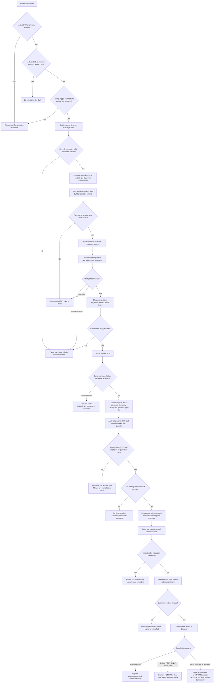

# Conservative Strategy — Canonical Domain Specification

**AUTHORITATIVE SOURCE OF TRUTH.** Owner-approved Conservative Strategy contract.

**Scope:** Harvester Conservative decisions, position accounting, SELL economics, order lifecycle, and recovery completion.

**Change control:** Only this document defines Conservative Strategy rules. Every other document, issue, PR, test, and implementation note is a reference, implementation, regression, or historical record.

## 1. Authority and boundaries

This is the one and only authoritative definition of Conservative Strategy behavior in this repository. If any other artifact disagrees with this document, that artifact is stale and must be corrected or explicitly marked historical/superseded. Do not copy strategy rules into other documents.

The specification defines expected behavior. The implementation coordinates it through domain policies and application workflows:

- The domain calculates valid BUY/SELL intents and recovery economics.
- The application owns order submission, cancellation, exchange reconciliation, fill application, and serialized lifecycle transitions.
- The broker supplies authoritative order state, executions, commission facts, and exchange filters.
- Tests prove implementation conformance; they do not redefine the contract.
- The Mermaid diagram below is a derived algorithm visualization, not a second source of truth.

Restart reconstruction is explicitly outside this specification's active implementation scope and remains separately tracked in [#654](https://github.com/45s/coinzilla/issues/654).

## 2. Position and recovery accounting

A Conservative position is represented by two financial values:

- **quantity** — current strategy-owned base quantity. BUY fills add gross executed base less base-asset commission. SELL fills subtract gross executed base plus base-asset commission. Retained inventory is excluded from future strategy-sellable quantity once recovery completion allocates it.
- **spent** — the entire accumulated BUY cost for the current recovery position: gross executed quote notional plus quote-asset BUY commissions, plus the reliable quote value of any third-asset BUY commission. SELL fills do not proportionally reduce or erase this cost basis.

Confirmed fills are the only source of accounting changes. Apply every fill exactly once using its stable execution identity. A duplicate with identical facts is a no-op; conflicting facts under the same identity fail closed. Portfolio and recovery accounting must accept the same fill as one atomic logical transition.

Actual exchange-reported commission amount and asset are authoritative. Never infer actual fees from configured rates or order type.

| Confirmed execution | Position quantity | Recovery proceeds / cost |
|---|---:|---:|
| BUY | gross executed base less base commission | spent += gross quote + quote commission + valued third-asset commission |
| SELL | subtract gross executed base plus base commission | netSellProceeds += gross quote less quote commission and valued third-asset commission |

A third-asset commission is supported only when a reliable quote-currency valuation is available for that execution. If its asset, amount, or valuation is missing, stale, ambiguous, or unavailable, do not treat it as zero: fail closed before committing either accounting projection.

Base-asset commissions change position quantity. Quote-asset commissions change quote cost/proceeds. A BUY commission belongs in accumulated position cost; it is not added again to the later SELL commission.

Keep cumulative confirmed netSellProceeds with the current position's full spent basis until sell-through and completion are resolved. A replacement order never resets cost, proceeds, or fill identities.

## 3. BUY behavior

1. An enabled, valid pair with no active BUY may place its initial BUY one configured priceStepPercent below the first valid market reference, rounded down to the exchange price tick. Quantity is configured orderQuantity, rounded down to the quantity step.
2. The initial BUY trails upward according to the existing Conservative trailing policy. A trailing replacement requires acknowledged/cancellable order identity, cancellation, and complete fill reconciliation. Never place a replacement from stale quantity or an uncertain cancellation result.
3. Each actual BUY fill is accounted immediately. A partially filled BUY does not advance the completed-BUY lifecycle. Before advancing, reconcile the terminal order and all fills; their distinct executed quantities must match the broker's executed quantity and the order's original quantity.
4. The next standing BUY is fixed one configured step below the completed BUY's volume-weighted execution price (total executed quote divided by total executed base). It is not trailed while recovery is outstanding. Conservative trailing-BUY repricing is eligible only while active strategy position quantity is zero; retained free inventory is excluded from that gate. After successful recovery completion, the existing trailing behavior resumes.
5. Submit a required recovery SELL before the next standing BUY. Submit the next BUY only after the SELL has a successful broker acknowledgement. A failed or unknown SELL submission blocks the BUY and fails closed.
6. A standing BUY may coexist with an acknowledged open recovery SELL. Active PENDING, OPEN, PARTIALLY_FILLED, or UNKNOWN orders suppress duplicate intents.
7. Any configured investment/balance limit is an additional Harvester safety constraint. It must not alter position quantity, accumulated spent, or the full-cost recovery target.

## 4. Recovery SELL economics

The minimum realized net profit is configured independently for each pair as `pairs.<SYMBOL>.minProfit`, and must be at least 0.01 units of that pair's quote asset. For a USDT-quoted pair, `minProfit: 0.1` means 0.1 USDT; for an FDUSD-quoted pair, `minProfit: 0.01` means 0.01 FDUSD. The strategy compares quote-asset amounts directly and performs no USD conversion. A value below 0.01 is invalid. There is no global `settings.minProfit`; every configured pair must declare its own threshold. Never intentionally close a recovery position at a loss or break-even.

Sell all exchange-sellable strategy inventory except the exact configured pair-level keepQuantity. This is the only retained-inventory setting name. Do not introduce coinToKeep or keepCoinQuantity.

### Meaning of `keepQuantity` — retained amount per completed recovery cycle

`keepQuantity` is the **minimum base-asset quantity that must remain unsold when one recovery cycle completes**. It is configured per trading pair and applies independently to every completed cycle. It is **not** a cap on the Portfolio's total retained/free inventory, and it is **not** a target that the bot maintains as the account's lifetime balance.

For each recovery cycle:

1. Keep the configured `keepQuantity` out of the recovery SELL.
2. Sell every other unit of strategy-owned inventory that can legally be sold under the current exchange filters.
3. Complete the cycle only after the SELL/fill reconciliation and minimum realized-profit conditions below pass.
4. Transfer that cycle's `keepQuantity` into the Portfolio's retained/free inventory. This amount is no longer working inventory for later recovery cycles.
5. Start the next cycle with newly acquired strategy inventory. When that cycle completes, retain another `keepQuantity`.

Therefore, retained/free inventory **accumulates by one `keepQuantity` for every successfully completed recovery cycle**. The configured value is a per-cycle amount, not a lifetime maximum.

Example with `keepQuantity = 0.01 LINK` and no exchange-constrained dust:

| Successfully completed recovery cycles | LINK retained by that cycle | Total accumulated retained/free LINK |
| ---: | ---: | ---: |
| 1 | 0.01 | 0.01 |
| 2 | 0.01 | 0.02 |
| 3 | 0.01 | 0.03 |
| 4 | 0.01 | 0.04 |
| 100 | 0.01 | 1.00 |

After four successful cycles, **0.04 LINK is the expected retained/free balance**. After 100 successful cycles, the expected balance is at least 1.00 LINK (assuming no retained dust or other adjustments).

The word **minimum** matters: exactly `keepQuantity` is retained when all excess inventory is sellable. If a positive remainder above `keepQuantity` is proven to be exchange-constrained dust, that dust is retained as a bonus for that cycle. For example, `keepQuantity = 0.01 LINK` plus `0.005 LINK` of validated unsellable dust means that cycle contributes `0.015 LINK` to retained/free inventory. Do not classify ordinary sellable residual inventory as dust or complete the cycle while it remains unsold.

The Portfolio's accumulated retained/free balance must not be subtracted from the next cycle's `keepQuantity`: the next cycle must independently preserve its own configured minimum.

Let:

- A = current strategy-owned position quantity before retained allocation;
- K = exact configured keepQuantity;
- f = applicable conservative SELL fee reserve as a decimal fraction;
- s = exchange quantity step;
- t = exchange price tick;
- C = the entire accumulated position spent;
- P = cumulative confirmed net SELL proceeds;
- m = this pair's configured `minProfit`, with m >= 0.01 in its quote asset.

Maximum planned SELL quantity, accounting for a possible base-asset fee and quantity-step rounding:

\[
Q = \operatorname{floorToStep}\left(\frac{\max(0,A-K)}{1+f},s\right)
\]

Remaining net quote proceeds required to recover the full accumulated cost basis plus minimum profit:

\[
R = \max(0,C+m-P)
\]

When Q > 0 and R > 0, the minimum SELL limit price is rounded up to the price tick:

\[
p = \operatorname{ceilToTick}\left(\frac{R}{Q(1-f)},t\right)
\]

Do not prorate C by the fraction of inventory being sold. Retaining K does not reduce the cost target. The SELL must recover the entire accumulated BUY cost plus at least m net after applicable SELL commissions.

When R = 0, the recovery profit target is already secured. Continue selling every sellable residual unit above K; price that residual using the validated current market reference rounded up to the tick, not an artificial one-tick price. Positive additional net proceeds must not reduce the already-realized aggregate profit. Actual commissions still determine final realized profit.

### Fee reserve and order type

Preserve the existing order-type selection policy:

- makerPercent = 0 selects LIMIT_MAKER (POST-ONLY). Its planning reserve is the configured maker fee.
- Non-zero makerPercent selects regular LIMIT. Because it may execute as maker or taker, its planning reserve is the higher applicable configured maker/taker rate.
- The applicable reserve is a planning estimate only. It is not an actual commission and must never be booked as one.
- The actual commission amount and asset reported on every confirmed fill determine accounting and final realized profit.

A POST-ONLY order must pass the existing fresh, same-symbol best-bid/best-ask crossing checks immediately before broker I/O. Missing, stale, malformed, crossed, or mismatched book data fails closed. The exchange remains the final POST-ONLY authority; do not silently convert a rejected POST-ONLY order into regular LIMIT.

### Exchange filters and dust

Every candidate SELL must satisfy current price, quantity, and notional filters, including tick size, quantity step, minimum/maximum quantity, and minimum/maximum notional.

Sell all quantity that can legally be sold above K. A remainder is EXCHANGE_CONSTRAINED_DUST only when the exact amount cannot currently satisfy the applicable quantity-step, minimum-quantity, or minimum-notional rules. Record its exact quantity and limiting filter. **Unsellable dust is retained as a bonus on top of configured keepQuantity.** If configured K is 1.00 and 0.04 is exchange-constrained dust, retain 1.04 total; do not discard it, force an invalid SELL, or treat it as sold. Dust is not a reason to keep submitting futile SELLs or to block completion once all other completion conditions pass. Preserve its quantity and accounting provenance when transferring the completed retained inventory.

A price-filter or fee-valuation failure is not dust; it is a blocked/unsafe decision and must fail closed.

## 5. SELL order lifecycle

### Partial SELL with no new BUY

When an acknowledged SELL is OPEN or PARTIALLY_FILLED and no new BUY fill has occurred:

- Keep the same exchange order and the same limit price.
- Do not cancel, replace, reprice, or recalculate its remaining quantity because of a partial fill.
- Apply every actual partial fill and commission exactly once to accounting.
- Let the exchange maintain the remaining quantity.
- Do not interpret a partial fill as recovery completion.

### New BUY fill while a recovery SELL is open — owner decision B

When a new BUY fill occurs while a recovery SELL is OPEN or PARTIALLY_FILLED:

1. Record the triggering BUY execution and its actual commission facts exactly once.
2. Request cancellation of the existing SELL. If it is still PENDING, wait for its broker acknowledgement and valid broker order ID; never cancel an unacknowledged order.
3. Reconcile the SELL's terminal exchange state and retrieve its complete canonical fill history, including every fill that raced with cancellation.
4. Validate ownership, market, side, order identity, unique fill identities, commission facts, and equality between summed distinct SELL fill quantity and broker-reported cumulative executed quantity.
5. Apply all newly discovered SELL fills exactly once and commit the BUY and SELL accounting updates consistently.
6. Only after terminal state and complete fill reconciliation succeed, calculate and submit a replacement SELL from the updated position quantity, full accumulated spent, and cumulative net SELL proceeds.
7. If cancellation, terminal state, fill history, commissions, or accounting cannot be reconciled completely, fail closed. Do not submit a replacement from stale or partial information.

If the SELL becomes FILLED while cancellation is in flight, reconcile and process it as a terminal FILLED order. Do not misclassify a successful terminal fill as a confirmed cancellation, and do not submit a duplicate replacement.

### Other terminal SELL outcomes

For FILLED, CANCELED, EXPIRED, and REJECTED orders, reconcile terminal status and all actual fills before taking another strategy action.

- FILLED does not by itself prove recovery completion. Distinct fill history must reconcile exactly to broker-reported executed quantity and original order quantity.
- A terminal CANCELED or EXPIRED order may be replanned only after its fills and commissions are reconciled and the remaining position is recalculated.
- A known REJECTED order has no assumed execution; verify any reported execution facts before a new valid intent.
- UNKNOWN status, unconfirmed cancellation, missing history, conflicting fills, or incomplete commission valuation pauses the pair and blocks replacement.

A replacement order never erases accumulated spent, net proceeds, or fill identities.

## 6. Recovery completion

Recovery is complete only when all of the following are true:

1. The relevant SELL order is authoritatively terminal and its complete distinct fill history reconciles to broker-reported execution facts.
2. Every BUY and SELL fill and every actual commission has been applied exactly once.
3. All exchange-sellable quantity above keepQuantity has been sold. Any remaining exchange-constrained dust is classified by exact quantity and limiting filter, then retained in addition to keepQuantity. The retained total is keepQuantity + dust (for example, 1.00 + 0.04 = 1.04); dust is not discarded, force-sold, or counted as sold.
4. Actual cumulative net SELL proceeds minus the full accumulated BUY spent are at least 0.01 quote currency.
5. The exact configured keepQuantity is preserved and is never sold.

Only after these conditions pass may keepQuantity plus any classified exchange-constrained dust be allocated as retained/free inventory, preserving the dust quantity and its accounting provenance, and the completed recovery basis be reset. If profit is below 0.01, fill history is incomplete, inventory accounting is inconsistent, or the full retained total cannot be preserved, fail closed and do not reset.

The durable `recovery.cycle_completed` record must preserve the pair's configured `keepQuantity` and `minProfit`, actual `realizedNetProfit`, final `freeQuantity`, and exact dust/filter evidence when dust exists. The recorded threshold is the value used for that market and cycle; replay validates the record against its own threshold rather than another market's current configuration. Replay must verify that realized profit meets the recorded threshold and that `freeQuantity = keepQuantity + dust` (or exactly `keepQuantity` when there is no dust). After replaying the fills, the recorded free allocation must consume all remaining active inventory. A journal record that leaves sellable active inventory behind or weakens the configured profit threshold is invalid and must fail closed. Older completion records that lack the configured threshold or retained-inventory proof are not silently upgraded; replay must fail closed and require reconciliation.

The application completion boundary must also receive the exact canonical terminal SELL order as evidence; it must not infer completion from profitability or a dust classification alone. The order must be a `CanonicalOrder` for the same market as the active Position and RecoveryLedger, with `side = SELL`, `status = FILLED`, a non-empty broker order ID, and `executedQuantity = originalQuantity`. The normal user-data SELL-fill path, cancellation/reconciliation race path, and exchange-constrained dust-completion path must all forward that same reconciled order identity. Recovery completion is serialized behind accepted fill-accounting transitions so it cannot evaluate or reset against a stale Portfolio/RecoveryLedger projection.

keepQuantity = 0 is permitted only after the complete workflow—including BUY, partial SELL, cancellation/reconciliation, terminal SELL, dust, profit verification, and exact-once completion—has passed end-to-end regression. Until then, fail closed at the precise unsupported boundary.

## 7. Workstation downtime and scope

Harvester runs on the owner's personal PC. 24/7 uptime is not required. Resting exchange orders may fill while the process is stopped; the stopped process cannot update in-memory state. This is expected, not a strategy defect.

Do not retroactively change historical shutdown snapshots. Safe process-restart reconstruction and reconciliation before new trading are a separate workstream in [#654](https://github.com/45s/coinzilla), outside this implementation scope.

No TESTNET order, cancellation, restart, or other exchange action is authorized by this specification.

## 8. Conservative trailing-BUY replacement safety

The following flowchart documents the implemented application workflow for replacing an existing Conservative trailing BUY. It is derived from the Conservative Trading Engine, Binance adapter, and strategy-decision execution path; source code and regression tests remain the evidence for exact behavior.

### Why preflight happens before cancellation

The engine runs this work inside its serialized market-price transition. It first requires an acknowledged active BUY, trailing enabled, no active strategy position, a reached repricing trigger, and a process that is not stopping. It then fetches current Binance symbol filters and validates that the refreshed market metadata is complete and still identifies the active symbol and market. The Conservative policy is evaluated using the current market price as the replacement reference. Commitment allocation excludes only the existing BUY that would be canceled, modeling the quote commitment that cancellation will release; it does **not** cancel the order or remove it from the live registry.

The executable replacement candidate is converted into canonical preflight order(s) and checked against the refreshed exchange rules, including quantity and price increments and minimum notional. The same submission-readiness gate checks current market-price freshness and, for `LIMIT_MAKER`, a fresh same-symbol book and a price that does not cross the opposite best quote. A validation error pauses the pair; unavailable readiness or the absence of an executable replacement BUY defers/skips the replacement. In every preflight failure or deferral case, the existing BUY remains open and untouched. This is essential: canceling first would remove the existing standing order even though the replacement might be rejected by exchange filters or could not safely be submitted, leaving the pair without its intended BUY.

### Cancellation and post-cancellation failure handling

Only an admissible preflight proceeds to cancellation. Harvester verifies cancellation eligibility and durably records the cancellation intent before calling the broker. If the intent cannot be persisted, no cancellation request is sent. An exception, rejected response, or otherwise unconfirmed cancellation is represented as UNKNOWN and pauses the pair for reconciliation.

After a canonical cancellation response, the engine updates the order registry, retrieves canonical fills, validates each fill's order identity, applies actual fills, and checks that the reconciled quantity equals the broker's cumulative executed quantity. Replacement proceeds only when the canonical order status is CANCELED and the reconciled fill quantity is zero. A fill racing with cancellation, a non-CANCELED terminal status, unavailable or incomplete fill history, or any identity/quantity mismatch pauses the pair; no replacement is submitted.

After confirmed cancellation with zero fills, the engine stores the current market price as the new reference and re-evaluates the Conservative policy using the refreshed filters. The actual order is rebuilt and validated again. Harvester registers it as PENDING and durably records the submission intent before broker I/O. If that intent cannot be persisted, the pending record is removed, the pair is paused, and the broker is not called. A generic broker rejection, transport error, or uncertain acknowledgement leaves the replacement explicitly UNKNOWN and pauses the pair; reconcile it by canonical `clientOrderId` before any retry. Binance's definite `POST_ONLY_WOULD_TAKE` rejection is a known rejection rather than an unknown outcome: the pending record is removed, the cached book is discarded, and evaluation is deferred until fresh book data arrives. An acknowledgement is not itself a fill; an immediately FILLED acknowledgement is reconciled against canonical execution history before the serialized transition completes.

## 9. Derived algorithm schema

The following Mermaid flowchart visualizes the rules above. If the diagram and prose ever differ, the prose in this specification controls.

\`\`\`mermaid
flowchart TD
  A[Confirmed BUY fill] --> B[Validate actual fill and commission facts]
  B --> C[Apply BUY quantity and full spent cost exactly once]
  C --> D{Recovery SELL open or partially filled?}
  D -- No --> H[Plan SELL from updated position and full accumulated cost]
  D -- Yes --> E[Request SELL cancellation; wait for acknowledgement if PENDING]
  E --> F[Reconcile terminal SELL state and complete canonical fill history]
  F --> G{Terminal state and every fill/fee reconciled?}
  G -- No --> X[Fail closed; no replacement]
  G -- Yes --> G2[Apply all raced SELL fills exactly once]
  G2 --> H
  H --> I[Calculate sellable quantity above exact keepQuantity]
  I --> J{Excess quantity satisfies quantity and minimum-notional filters?}
  J -- No --> K[Classify exact unsellable dust as retained bonus]
  J -- Yes --> L[Recover full accumulated spent plus at least 0.01 net]
  L --> M[Apply order-type-specific fee reserve and POST-ONLY checks]
  M --> N[Submit recovery SELL]
  N --> O{SELL event}
  O -- Partial fill; no new BUY --> P[Apply actual fill/fee; keep same order and same price]
  P --> O
  O -- New BUY fill while SELL open --> E
  O -- Terminal FILLED/CANCELED/EXPIRED/REJECTED --> Q[Reconcile terminal state and all actual fills/fees]
  Q --> R{Reconciliation complete?}
  R -- No --> X
  R -- Yes --> S[Update position quantity and cumulative net SELL proceeds]
  S --> T{Sellable quantity remains above keepQuantity?}
  T -- Yes --> H
  T -- No --> U{Only exchange-constrained dust remains above keepQuantity?}
  U -- Yes --> K
  U -- No --> W{Actual cumulative net profit at least 0.01?}
  K --> W
  W -- No --> X
  W -- Yes --> Y[Retain keepQuantity plus dust; complete once; preserve retained basis]
\`\`\`

**Change control:** Amend this document only when the owner explicitly changes a rule. Update implementation, tests, reference documents, and GitHub records to conform. Never create a competing Conservative rule definition.
