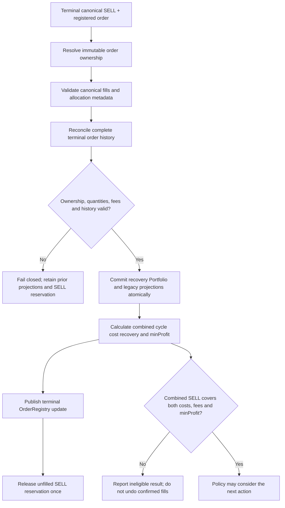

# Recovery Seller (RS) — Domain Specification

**Status: DRAFT — first-implementation owner decisions are recorded; remaining work is implementation and verification.**

**Authority:** This draft becomes the canonical RS contract after formal acceptance. Until then it records the agreed direction, hard safety invariants, accounting boundaries, and remaining implementation requirements. It does not amend the [Conservative Domain Specification](./CONSERVATIVE_DOMAIN_SPECIFICATION.md).

**Implementation status:** RS-2b accounting is complete. [PR #1276](https://github.com/45s/coinzilla/pull/1276) merged into `develop` as `9276b6c01bec62b743727548786c5af4a04b7908`; exact PR head `19448d63d117f563c31d8ab9422ac73623974782` passed the full Harvester suite (1,847/1,847) and all required checks, including documentation links. No TESTNET/LIVE operation was performed. PR #1276 adds the isolated application workflow that reconciles terminal canonical SELL history, atomically commits the recovery Portfolio and legacy projections, calculates separate recovery/legacy allocation diagnostics plus one combined cycle-level profitability result, and publishes the terminal OrderRegistry only after the accounting commit succeeds. The workflow exposes verified legacy Spot quantity and signed legacy quote cash flow to account-snapshot composition; providers remain empty by default. Confirmed fills are accounted even when a profitability gate fails; incomplete reconciliation or commission valuation still fails closed before commit. The combined profitability calculator and fee-aware mixed-SELL planner are pure RS domain policy only; neither is registered in bootstrap or connected to order submission. RS has no runtime configuration or executable policy, and no RS order can be submitted. RS-3 now includes combined cycle eligibility and fee-aware mixed-SELL planning, while order-type selection and broader pure policy outcomes remain. RS-4 shared Trading Engine integration and RS-5 lifecycle verification remain. This specification remains DRAFT and authorizes no trading or exchange operations.

The phased implementation plan is maintained in the [Recovery Seller Implementation Roadmap](./recovery-seller-implementation-roadmap.md).

## 1. Purpose and vocabulary

Recovery Seller is an independent strategy intended to reduce an explicitly authorized pre-existing spot position through repeated recovery cycles. Each conceptual cycle acquires a new recovery tranche, then sells that tranche together with a configured quantity of legacy inventory when all approved profitability and safety gates pass.

- **Recovery inventory:** net base quantity acquired by BUY fills attributed to the current RS cycle.
- **Legacy inventory:** pre-existing base quantity explicitly authorized for RS liquidation before that cycle. It is not created by that cycle's BUY fills.
- **Cycle SELL:** SELL execution(s) intended to dispose of recovery inventory and an additional legacy quantity, subject to the final approved quantity and profitability rules.
- **sellQuantity:** configured per-pair base-asset quantity of legacy inventory added to the recovery tranche in each cycle SELL. It is an additive legacy slice, not the total SELL quantity, not a maximum cap, and not CG's retained `keepQuantity`. The conceptual SELL target is the cycle's actual net recovery quantity plus `sellQuantity`.

Illustrative examples only; these are not approved trading defaults:

| Market | New BUY tranche | sellQuantity | Conceptual combined SELL |
|---|---:|---:|---:|
| DOGEUSDT | 400 DOGE | 1 DOGE | 401 DOGE |
| ZROUSDT | 10 ZRO | 0.01 ZRO | 10.01 ZRO |
| LINKUSDT | 2 LINK | 0.01 LINK | 2.01 LINK |

No independent fixed 1% market-rise wait is required merely to release the configured legacy quantity. This does not relax the requirement that every SELL satisfy all approved profitability gates.

## 2. Authority and responsibility boundaries

- RS owns strategy decisions, cycle attribution, legacy authorization state, and RS-specific risk policy.
- The shared Harvester Trading Engine owns serialized evaluation, order submission/cancellation, broker interaction, order identity, reservations, reconciliation, and execution safety.
- The broker adapter supplies canonical orders, canonical fills, actual commission facts, and current exchange filters. RS domain code must not import Binance SDK types or raw exchange messages.
- The shared Portfolio is the authoritative actual-accounting aggregate, but it is not limited to one Position per market. It may contain multiple independent Positions for the same market, including Positions owned by different strategies. RS must not create duplicate representations of the same strategy Position or mutate Portfolio outside established fill/accounting workflows.
- Actual holdings change only from confirmed canonical fills. A price, order intent, acknowledgement, cancellation request, or operator authorization is not an execution.
- RS is independent of CG_coinGrabber. It must not change Conservative behavior or its canonical specification.

### 2.1 Global fail-closed rule — owner-approved

**STOP whenever actual conditions do not match an explicitly covered and approved RS scenario.** This is a global RS invariant, not a SELL-only profitability rule.

If any input, state transition, exchange response, order outcome, fill, commission, balance, reservation, accounting result, or other observed condition is missing, contradictory, unexpected, or not covered by the approved domain contract, RS must:

1. **Stop all new trading actions immediately.** Do not submit a new BUY, SELL, replacement, retry, or other trading instruction; do not guess, improvise, or choose an unapproved recovery path.
2. **Preserve facts and commitments.** Do not erase or reverse confirmed fills, actual commissions, accounting, order ownership, inventory, or reservations. Apply every confirmed canonical fill exactly once using actual exchange facts.
3. **Reconcile what already exists.** Continue only the non-trading safety work needed to establish authoritative status of already-submitted orders and account for subsequent confirmed fills. Unknown order outcomes retain their original identity and reservations; never blindly resubmit.
4. **Make the stop visible.** Return a deterministic BLOCK decision with a stable reason code and enough context for operator review. The condition remains blocked until an explicitly approved and evidenced path resolves it.
5. **Do not self-resume.** A later observation that appears normal does not silently clear the stop. Resume/new trading requires the condition to be understood, reconciled, and covered by an approved domain rule or explicit operator decision.

This rule does **not** mean abandoning, cancelling, replacing, or ignoring an already-submitted order. Existing orders remain owned and must be reconciled; actual fills and fees continue to be accounted. It means RS initiates no further trading action while the unexpected condition is unresolved.

Examples include: a SELL realizes less profit than planned; an order response has an unknown status; actual fees cannot be valued; available Spot quantity disagrees with the verified allocation; a fill cannot be attributed unambiguously; a reservation or accounting projection conflicts; or a state transition occurs that the approved lifecycle does not define. In every case the response is STOP, not an invented workaround.

## 3. Legacy inventory and authorization

Legacy inventory is a specifically identified quantity of a market's base asset that existed before RS was authorized to manage it. It must not be inferred from an exchange free balance, Portfolio total/free quantity, manual/external order, prior process state, or unowned execution.

Hard invariants:

1. Without explicit authorization, RS-authorized legacy quantity is zero.
2. Authorization is market-scoped and denominated in the canonical base asset.
3. RS never silently adopts the whole wallet balance or an external/manual order.
4. Authorized quantity must be bounded by independently verified, unreserved, actually available base inventory before submission.
5. Authorization cannot override profitability, exchange filters, reservations, risk limits, or reconciliation gates.
6. Revoking/reducing authorization cannot erase fills, reverse accounting, or pretend a submitted order did not exist.

**Configured legacy position and average cost (agreed direction):**

The operator supplies the original aggregate quote investment and the corresponding original base quantity. RS calculates the average historical acquisition cost; the operator does not need to calculate or enter an average price.

Example for ZROUSDT:

- `legacyPosition.invested = 100` USDT
- `legacyPosition.quantity = 50` ZRO
- RS-calculated average historical cost = `100 / 50 = 2` USDT per ZRO.
- `sellQuantity = 0.01` ZRO per successfully completed cycle.

The names above describe the proposed configuration shape, not a runtime schema. The existing recovery-tranche `investment` setting is separate and must not be confused with the legacy position's historical `invested` amount. The configured legacy invested amount and original quantity establish the aggregate historical basis; they do not assert that the full quantity is currently in the Spot wallet.

**Spot custody is separate from logical legacy ownership and cost basis.** The operator may keep only 0.5 ZRO in Spot to support 50 cycles of 0.01 ZRO legacy releases and hold/transfer the remaining 49.5 ZRO to EARN. RS retains the configured logical legacy position and its $2 average cost basis; it must not infer that only 0.5 ZRO was originally acquired merely because that is the amount currently in Spot. Conversely, EARN-held quantity is not Spot-available inventory and must never be counted as immediately sellable or used to satisfy an exchange order's balance check. Each cycle may consume only the configured legacy slice that is actually available and unreserved in Spot, alongside its recovery inventory. Further cycles requiring legacy quantity must wait until the required quantity is again available in Spot (for example, after the operator redeems/transfers it from EARN).

The original configured quantity and invested amount establish one fixed original average cost; remaining logical legacy quantity, Spot-available quantity, EARN/externally held quantity, and active reservations are distinct facts. A transfer between Spot and EARN changes custody/availability, not historical cost basis or the original acquisition quantity. RS must not assume EARN balances are observable through the Spot broker or silently claim custody of them.

**Decision recorded — authorization model: explicit operator authorization (Question 1, accepted).**

RS must not infer authorization from a wallet balance, Portfolio quantity, deposit, manual/external order, or historical process state. The operator must explicitly authorize the market's pre-existing legacy position before RS may manage any legacy quantity. The configured original quote investment and original base quantity are historical-basis inputs; they do not by themselves establish Spot custody or immediately sellable quantity. Authorization is permission, not proof of custody, Portfolio accounting, or available balance. Actual Spot availability and reservations must be independently verified before each SELL. EARN/off-Spot inventory remains unavailable for Spot execution until returned and authoritatively reconciled. No authorization may bypass profitability, exchange filters, risk limits, or reconciliation gates.

**Decision recorded — legacy evidence/configuration (Question 2, accepted):** the operator will declare the legacy position directly in configuration by supplying its original aggregate quote investment and original base quantity. No exchange trade-history import or other historical proof is required. These configured values are the operator's declared historical basis, not proof of current ownership, Spot custody, Portfolio quantity, or sellable balance. Current Spot availability and reservations must still be independently verified before execution.

**Agreed configuration/authorization workflow:** the operator manually enters the legacy position's original quote investment and original base quantity in the RS configuration before starting the application. This explicit configuration is the operator's authorization; RS does not need an exchange trade-history import, a runtime authorization UI, or a separate approval step. The configuration is loaded at application startup. These values establish declared historical basis and authorization only—not proof of current Spot custody, Portfolio quantity, or sellable balance. Current Spot availability and reservations must still be authoritatively verified before every SELL. Invalid/missing configuration must fail closed. Advanced runtime authorization editing, revocation workflows, expiry, and durable authorization lifecycle are deferred under FITDIB; do not invent them for the first implementation.

## 4. Attribution and shared Portfolio accounting

### 4.1 Non-negotiable accounting invariants

Harvester has one shared Portfolio per account, with support for multiple independent Positions per market. A Position is an independently owned accounting/lifecycle unit (for example, a strategy-owned position or separately tracked acquisition exposure), not a wallet or custody balance. Portfolio.applyFill applies each canonical fill exactly once to the Position identified by canonical order ownership and the application's attribution rules. updateTradingAccounting currently coordinates the Portfolio and Conservative RecoveryLedger projections; RS integration must preserve CG behavior while adding an explicit RS attribution/Position workflow. Position quantities, quote cash flow, and spent basis are fill-driven. Applied-fill IDs and fingerprints prevent duplicate or conflicting executions.

RS must preserve these facts:

- Multiple independent Positions may exist for the same market. Each Position has a stable caller-assigned `positionId`, canonical `marketId`, and explicit `strategyId` owner; a strategy may own more than one Position when its domain requires it.
- Every canonical fill changes actual Portfolio accounting exactly once, using actual execution and commission facts, and is attributed to the one `positionId`/`strategyId` resolved from its originating order ownership.
- RS-owned Positions and attribution are part of the shared Portfolio accounting model; they do not create a second wallet, duplicate custody, or double-apply Portfolio accounting.
- RS attribution references the same canonical market/order/fill identities used by shared broker and Portfolio workflows.
- Portfolio and RS attribution commit as one logical accounting transition. If either rejects a fill or identity, neither projection advances.
- Identical duplicate fills for the same Position owner are no-ops; changed execution facts or a different `positionId`/`strategyId` under the same canonical fill ID fail closed.
- No synthetic BUY Fill may be fabricated to seed legacy inventory or represent operator authorization.

### 4.2 Required attribution facts

The RS attribution projection must distinguish:

- authorized legacy quantity and its approved historical cost-basis evidence;
- recovery BUY quantity and quote cost attributed to each cycle;
- actual base, quote, and third-asset commissions for each canonical fill;
- recovery and legacy quantities consumed by confirmed SELL fills;
- active order reservations and unresolved/unknown order quantities;
- remaining authorized legacy quantity and unresolved residuals; the original legacy average cost remains fixed.

It must reference canonical Fill IDs and retain fill-facts fingerprints. A single execution must never be represented as two Portfolio fills.

### 4.3 Opening-inventory accounting boundary — implemented

The operator-declared legacy position remains separate from the shared Portfolio's fill-derived inventory. RS does not seed configured legacy quantity into Portfolio and does not infer custody from EARN, external trades, or an unverified wallet balance.

The RS-2b implementation now provides the safe boundary:

- **Verified Spot allocation — PR #1152:** derive additional authorized legacy Spot quantity from the authoritative account total minus all Portfolio Positions for the canonical base asset, capped by the remaining operator authorization. Missing balances and Portfolio custody shortfalls fail closed.
- **Canonical allocation and terminal reconciliation — PRs #1153 and #1203:** bind recovery/legacy splits and commission/proceeds allocation to registered order ownership and canonical Fill identity; stage partial fills and reconcile the complete terminal order history before applying the cycle transition.
- **Atomic shared accounting — PR #1212:** apply the recovery Position share and legacy quantity/P&L share as one immutable transition, and include externally tracked base quantity and signed legacy quote cash flow in snapshot-relative shared allocation.
- **Application commit and reservation release — PR #1276:** stage the terminal OrderRegistry update, commit both accounting projections and separate allocation-level profitability results, then publish the new registry. If reconciliation or either projection fails, the prior Portfolio, legacy state and active SELL reservation remain unchanged.

The verified base-quantity and quote-cash-flow providers are exposed for account-snapshot composition but remain empty by default. This completes the RS-2b accounting boundary without synthetic fills, Portfolio seeding, duplicated custody, or inferred EARN inventory. The workflow is isolated and not registered in bootstrap; it cannot submit or manage RS orders.

### 4.4 Implemented accounting boundary and remaining runtime boundary

RS-2b implements the application-owned allocation boundary without changing the exchange-neutral `Fill` contract or pretending that configured legacy quantity is already in Spot.

1. **Order ownership:** retain immutable Harvester-owned metadata beside the canonical order, keyed by its registered `clientOrderId` and attached `brokerOrderId`. It identifies the originating `strategyId`, `positionId`, and RS cycle/purpose. Do not add these fields to `CanonicalOrder` or `Fill`; do not infer ownership from symbol, side, or a reserved client-ID prefix alone.
2. **Verified Spot allocation:** derive the amount available to RS legacy from the authoritative account snapshot for the canonical base asset, after accounting for every existing Portfolio Position and all account-wide active/in-flight SELL reservations. Cap this by the operator-authorized remaining legacy quantity. A configured legacy quantity, an EARN balance, an unrelated wallet balance, or a stale/unavailable snapshot is never evidence of Spot availability.
3. **Separate SELL allocation:** create immutable Harvester application metadata referencing the original canonical `fill.id` and the resolved order-ownership record. It carries the exact recovery and legacy gross quantities and the allocation of actual base, quote, and third-asset commission/proceeds facts. Its allocations must sum exactly to the canonical Fill facts; it must not construct or persist two synthetic broker Fills.

4. **Single shared custody debit:** the account-level Spot allocation records the full actual base debit (executed base plus actual base commission) once. The Portfolio recovery Position receives only its explicitly allocated recovery share; the RS legacy projection receives only its explicitly allocated legacy share. The updated legacy Position is used to recalculate the separately tracked Spot quantity; never add configured legacy quantity to Portfolio. The same verified additional-base provider must feed both account-snapshot baseline capture and the shared allocator, which applies the current-minus-snapshot delta alongside the Portfolio base delta. Net legacy quote proceeds are included in the shared quote-cash-flow baseline and current allocator delta, not legacy historical cost basis or realized profit.
5. **Exact-once reconciliation:** key allocation identity and duplicate detection by canonical Fill ID plus immutable allocation fingerprint. Stage each partial fill against its originating order/cycle. Do not commit the cycle's legacy decrement until complete terminal order/fill reconciliation proves the aggregate execution quantity and all allocation facts. Replays are no-ops only when both canonical facts and allocation metadata are identical; conflicting or missing attribution fails closed.
6. **Cycle-level economics and separate attribution:** retain recovery and legacy proceeds/cost allocations for accurate accounting, but decide SELL eligibility from the combined cycle result. Net SELL proceeds after actual SELL commissions and reliable third-asset valuation must cover the recovery BUY cost (including BUY commissions), the fixed historical cost allocated to the legacy quantity sold, and pair-level `minProfit`. Neither allocation is independently required to show a profit. Missing/incomplete commission facts or third-asset quote valuation reject the whole accounting transition before any projection commits.
7. **Central reservation gate:** the shared allocator remains responsible for the full mixed SELL reservation against verified account Spot availability. PR #1276 stages the terminal OrderRegistry update and publishes it only after successful accounting, releasing the unfilled reservation once. Because RS submission is not yet wired, creation of RS intents and their initial reservation remain RS-4 runtime-integration work.

A standalone legacy-only SELL is not part of the current RS cycle contract. While legacy remains, a cycle SELL contains the recovery tranche plus its permitted legacy slice; once legacy is exhausted, subsequent cycles are recovery-only. The shared allocator remains generic, but RS policy must reject a legacy-only action.

The shared snapshot/allocator plumbing is merged in PR #1137. The pure verified legacy Spot allocation calculation is merged in PR #1152: it aggregates every Portfolio Position by canonical base-asset ID, subtracts that total from the authoritative Spot account total, and caps the remainder at original/remaining operator authorization. Missing authorized balances and account custody below aggregate Portfolio quantity fail closed. The calculation remains outside Portfolio and injectable only, with an empty default; active/in-flight reservations remain separately reconciled by the shared allocator. It does not infer EARN/off-Spot quantity or adopt unrelated wallet assets, and it does not enable RS runtime execution.

The implemented accounting flow:

Merged PRs #1144, #1152, #1153, #1203 and #1212 provide immutable order ownership, verified legacy Spot allocation, canonical-Fill-bound mixed allocation, partial-fill staging, terminal reconciliation and atomic dual-projection accounting. [PR #1276](https://github.com/45s/coinzilla/pull/1276) completes the application workflow: it stages the terminal OrderRegistry update, commits the recovery Portfolio and legacy projections, calculates separate recovery/legacy allocation-level profitability results, and only then publishes the terminal registry state. RS-3 now replaces allocation-level eligibility gates with the approved combined cycle-level gate and adds a pure fee-aware SELL plan. A failed reconciliation or projection leaves the prior state and reservation intact. A confirmed execution is always accounted even if a profitability gate fails; profitability is a pre-submission policy gate, not permission to discard actual fills. The verified Spot and signed quote-cash-flow providers remain empty by default. The workflow is not registered in bootstrap and RS remains non-executable.

## 5. Profitability — one combined SELL target

**SELL ONLY IN PROFIT** is a hard pre-submission safety requirement evaluated across the complete cycle SELL. When legacy inventory is included, the one mixed SELL must recover both the current recovery tranche's full acquisition cost and the historical cost allocated to the legacy quantity being sold, cover all applicable BUY and SELL commissions, and earn at least the existing pair-level `minProfit`. Do not apply `minProfit` separately to the recovery allocation or require the legacy slice to make a separate profit. Actual confirmed fills are always accounted, even when the realized cycle result misses this target; a failed gate cannot reverse or suppress an exchange fill.

**Owner decision — one terminal SELL per recovery cycle (Question 5, accepted):** each recovery cycle may have exactly one SELL order/execution lifecycle. That one SELL is the mixed SELL: its target combines the cycle's actual net recovery quantity with the eligible configured legacy slice. Do not submit a second/continuation SELL in the same cycle and do not add a cycle-scoped cumulative-proceeds ledger for this first implementation. A terminal partial/canceled result does not authorize another SELL or a new BUY cycle; its remaining inventory and next action stay blocked/unresolved pending the separately defined failure/recovery policy. This keeps the current terminal-order profitability calculation aligned with the one-order-per-cycle contract.

### 5.1 Recovery-cycle profitability

**Owner-approved SELL price target:** calculate one required net quote-proceeds target for the complete mixed SELL:

`target net proceeds = recovery BUY investment + historical cost of the legacy quantity included + pair-level minProfit`.

This is the same combined-cycle gate stated below; the recovery and legacy portions are not tested independently. The submitted SELL limit price must be high enough that its expected proceeds, after the applicable commission allowance, meet that net target. For a percentage commission charged in the quote asset at estimated rate `r`, the corresponding gross quote-proceeds target is `target net proceeds / (1 - r)` (for `0 <= r < 1`), and the minimum price is that gross target divided by the SELL base quantity, rounded upward to the market's price tick. If no such commission applies, no quote-fee gross-up is added. Base-asset commission affects the gross base quantity required to deliver the intended net quantity; third-asset commission must be valued in quote currency and included in the cost target. Apply only the maker/taker estimate appropriate to the selected order behavior; configured rates are planning allowances, not actual fee facts. The exact order type and exchange-filter rounding/validation remain RS-3 implementation details. Actual confirmed commission amounts always replace estimates in final accounting.

Recovery-tranche cost must include gross executed BUY quote notional, actual quote-asset BUY commissions, and reliable quote valuation of actual third-asset BUY commissions. Base-asset BUY commissions reduce net acquired recovery quantity.

Cycle SELL proceeds must use actual confirmed SELL fills, less actual quote-asset SELL commissions and reliably valued third-asset SELL commissions. Base-asset SELL commissions change the base quantity consumed. Configured maker/taker rates are planning estimates only, never substitutes for actual commission facts.

For a mixed recovery-plus-legacy SELL, calculate one cycle-level result. The net SELL proceeds (after actual SELL commissions and reliable third-asset fee valuation) must cover: (1) the full quote cost of the recovery BUY fills, including applicable BUY commissions; (2) the historical acquisition cost of the legacy quantity actually included in this SELL, calculated using the fixed original legacy average cost; and (3) at least the existing pair-level `minProfit`, measured in the pair's quote asset. In formula form: `net SELL proceeds >= recovery BUY cost + allocated legacy historical cost + minProfit`. Do not impose a separate profit threshold on either allocation. The existing `minProfit` is the minimum profit for the whole mixed cycle, not just the recovery tranche. For a recovery-only cycle after legacy exhaustion, the legacy-cost term is zero and the same cycle-level formula applies.

**Owner decision — whole-cycle cost recovery plus minimum profit (Questions 2 and 3, clarified and accepted):** every proposed SELL must pass one combined economic gate before submission. For a mixed SELL, the net proceeds after all applicable commissions must recover the full recovery BUY investment, recover the historical cost of the legacy quantity included in that SELL, and exceed those combined costs by at least the existing pair-level `minProfit`. The recovery and legacy allocations are still tracked separately for correct accounting and cost-basis decrement, but neither has a separate profitability gate. Do not omit the configured legacy slice while authorized legacy remains, and do not create a legacy-only SELL. After legacy exhaustion, recovery-only SELLs must recover the recovery BUY investment and all applicable fees and earn at least `minProfit`.

**Implementation note:** the pure profitability calculation now returns one combined cycle-level eligibility result; separate recovery/legacy values are diagnostics only. The pure SELL planner includes the eligible authorized legacy slice, quote-fee gross-up, base-fee quantity gross-up, explicit third-asset quote valuation and upward price-tick rounding. Tests must continue to prove that a loss-making legacy allocation can pass when the combined cycle meets `minProfit`, and that no legacy quantity is silently omitted while authorized inventory remains.

This is a pre-submission guarantee, not a claim that market execution can be made risk-free. If actual fills/fees differ from the plan and a confirmed execution realizes a loss, the fill is a fact: it must be fully and exactly accounted for and must never be hidden, reversed, or omitted. The next action after such an adverse realized result is **Question 4 and remains unresolved**; the implementation must not invent a recovery action. Until that policy is approved, fail closed and do not start another cycle or submit a follow-up SELL after an adverse realized result.

### 5.2 Legacy historical cost basis

Legacy inventory has a historical acquisition cost separate from the current recovery tranche's BUY cost. That allocated legacy cost is included in the total amount the mixed SELL must recover before the cycle can meet `minProfit`.

**Legacy cost-recovery invariant:** include the historical acquisition cost of the legacy quantity actually sold in the mixed cycle's total required proceeds. Do not require the legacy slice to independently produce a profit. Use the fixed original average acquisition cost and actual SELL execution/commission facts; do not introduce proportional re-basing or a changing remaining cost basis.

Illustration: the recovery tranche's allocated proceeds may be above its BUY cost while the legacy slice's allocated proceeds are below its historical cost. That allocation-level difference does not decide eligibility by itself. The mixed SELL passes only if total net SELL proceeds recover both costs, cover all applicable fees, and still leave at least `minProfit` for the cycle.

**Agreed legacy cost-basis input:** operator supplies aggregate original quote invested and original base quantity; RS calculates average historical cost as invested quote divided by original quantity. Example: 100 USDT / 50 ZRO = 2 USDT per ZRO. The operator does not configure an average price separately. The existing pair-level `minProfit` setting governs the minimum net profit of the entire cycle SELL, including both recovery and legacy cost bases when legacy is included. **Simple legacy-quantity rule (owner-approved):** calculate the legacy average acquisition cost once from the configured original invested amount and original quantity. Keep that average fixed; never recalculate it after a disposal. After each successfully completed RS cycle, reduce the remaining legacy quantity by the legacy quantity actually sold (normally one `sellQuantity` lot; use a smaller remaining quantity when the approved smaller-remainder rule applies). Do not recalculate or maintain a changing average/remaining cost basis. Recovery-tranche accounting remains separate. Mixed SELL accounting must identify the legacy quantity actually disposed of so that this fixed legacy quantity can be decremented exactly once. For third-asset commissions, RS must use the same rule as Conservative: accept a commission only when its asset, amount, and reliable quote-currency valuation are available; if any are missing, stale, ambiguous, or unavailable, do not treat the fee as zero—fail closed before committing either accounting projection.

## 6. BUY tranche accumulation and eligibility

**Owner-approved BUY contract (issue #1127):** reuse Conservative's established BUY cadence, tranche sizing/configuration, and pending-order safeguards. orderQuantity is therefore the size of each RS BUY tranche, subject to current exchange quantity filters and actual fills. Use the current Conservative source as the behavioral reference for initial and next-BUY pricing; an order acknowledgement never counts as acquired inventory. At the RS investment limit, stop new BUYs but keep an existing SELL live and reconcile it to terminal filled state before considering another cycle. Do not add RS-specific trailing or replacement behavior beyond the inherited contract.

Hard invariants:

- Only confirmed canonical BUY fills create recovery inventory or recovery cost.
- A submitted/acknowledged BUY creates no inventory; partial fills contribute only actual executed quantity and fees.
- Every BUY commitment counts toward exposure before execution; a fill transfers the corresponding amount from commitment to actual exposure without double counting.
- No duplicate BUY intent while an equivalent BUY is pending, open, partially filled, or unknown.
- An unknown submission retains its commitment and blocks replacement until the original identity is reconciled.
- No new BUY when a risk limit is reached, reconciliation is incomplete, the market is paused, or an order/attribution invariant is unresolved.

**Implementation follows Conservative where applicable:** reuse Conservative's established BUY cadence, tranche sizing/configuration, and pending-order safeguards rather than inventing a second policy. Any RS-specific difference must be justified by the approved RS contract and tested. The existing hard invariants above still apply: only canonical BUY fills create inventory, commitments count before execution, and unknown submissions block replacement until reconciled.

**Owner decision — independent strategy investment allocations:** each strategy has its own configured per-pair investment budget and tracks its own used/committed investment. For the same market, CG spending is charged only to the CG allocation; RS spending is charged only to the RS allocation. One strategy cannot consume unused budget from the other. Example: CG budget 500 USDT with 300 used has 200 available; RS budget 1,000 USDT with 700 used has 300 available. A CG BUY requiring 250 USDT is blocked by CG's 200 remaining even though RS has 300; an RS BUY requiring 250 USDT is allowed. RS reaching its own investment limit stops new RS BUYs while any already-open RS recovery SELL remains alive and unchanged until fill/terminal reconciliation. No cross-strategy budget priority or fairness policy is needed.

**Shared custody remains account-wide:** separate strategy budgets are accounting/risk limits, not separate wallets. Actual exchange free quote/base balances and active order reservations are shared physical resources. The shared allocator must aggregate reservations across CG and RS and prevent either strategy from spending the same quote balance or selling the same base inventory twice. An intent must pass both its originating strategy's remaining budget and the shared account's actual available-balance/reservation checks. Preserve originating strategy ownership when an intent is deferred or rejected.

## 7. Risk limits

**Owner-approved risk model:** reuse the existing Conservative per-pair investment-limit model and its configuration source. Source review confirms that the field is `pairConfig.investment`; it is optional in the current Conservative policy and must not be replaced with a new RS-only setting.

The Conservative policy computes outstanding recovery exposure as:

\[
\text{outstandingRecovery} = \max(0, \text{Position.spent} - \text{cumulative net SELL proceeds})
\]

A proposed BUY is within the configured strategy limit only when outstanding recovery exposure plus the proposed BUY quote notional does not exceed `pairConfig.investment`. RS must calculate this from its own recovery Position/cycle accounting; the operator-declared legacy historical investment is not recovery exposure and must not consume the RS recovery budget. If `pairConfig.investment` is absent, follow the existing Conservative optional-limit behavior rather than inventing a mandatory RS-only value.

The current RS accounting workflow calculates profitability from the current terminal SELL order's allocations only. If multiple terminal SELL orders are allowed within one recovery cycle, a cycle-scoped cumulative proceeds ledger is required before this investment-limit calculation can safely use cycle-level outstanding exposure. This is tracked in the RS-3 policy gate.

**Shared account limits remain separate:** every BUY/SELL intent must also pass the shared account's authoritative free quote/base balance and aggregate reservation checks across CG and RS, current exchange quantity/price/notional filters, and the inherited pending/unknown-order safeguards. Strategy budgets are not separate wallets; one strategy cannot borrow the other's unused budget or reserve the same physical balance twice.

**At the RS investment limit:** stop placing new RS BUYs. Any already-open recovery SELL remains live and untouched—do not cancel, replace, or reprice it merely because the BUY limit was reached. Continue canonical fill/order reconciliation and wait for that SELL to reach terminal filled state before considering another cycle.

No separate RS-only per-tranche cap, maximum-drawdown rule, adverse-price limit, total-exposure field, or order-count setting is approved for the first implementation. Do not add such configuration or behavior without an explicit owner decision.

## 8. sellQuantity, residuals, and exchange constraints

**Agreed sellQuantity contract:** `sellQuantity` is the configured legacy base-asset quantity to add to each cycle's recovery SELL. It is the opposite kind of control from Conservative's `keepQuantity`: Conservative retains a configured quantity, while RS disposes of the configured legacy slice in addition to the newly acquired recovery tranche. `sellQuantity` is neither the total SELL quantity nor a maximum cap.

For example, with `orderQuantity: 5` ZRO and `sellQuantity: 0.01` ZRO, when the BUY tranche has produced 5 ZRO of net recovery inventory, the conceptual combined SELL target is 5.01 ZRO. Actual canonical BUY fills and base-asset commissions determine the recovery quantity available; configured order quantity or an order acknowledgement must never be treated as executed inventory. The mixed SELL must satisfy the combined cycle-level gate: net proceeds after all applicable fees cover the recovery BUY cost, the legacy slice's allocated historical cost, and at least `minProfit`. The 0.01 ZRO slice is deducted from the remaining authorized, Spot-available legacy quantity after the cycle succeeds.

**Agreed dust contract:** RS uses the same constrained-dust principle as Conservative. After a cycle has successfully completed and all canonical fills, terminal order state, commissions, proceeds, reservations, and the combined cycle-level profitability gate are fully reconciled, any precisely identified residual that cannot be sold solely because of current exchange quantity/notional filters is classified as retained bonus dust. That dust remains in the account but is permanently excluded from all future RS cycle calculations: it is not recovery inventory, is not part of a later cycle's SELL target, does not contribute to later recovery or legacy profitability, and is never counted again as available RS inventory. It is not carried forward as a new cycle's starting balance.

Only an exchange-filter-constrained quantity qualifies. The exact residual quantity and the specific limiting filter must be recorded. Ordinary sellable residual is not dust and cannot be discarded or hidden by cycle completion. Price-filter failures, unavailable commission valuation, incomplete fill/order reconciliation, active reservations, or other unresolved accounting/risk conditions are not dust and must block successful completion. Dust classification is permitted only after the cycle's SELL is terminal and fully reconciled; it must not be used to bypass the combined profitability gate.

**Agreed smaller-remainder contract:** If the remaining authorized legacy inventory is positive but smaller than configured `sellQuantity`, RS may sell that smaller remainder as the legacy component of the current cycle SELL. The legacy quantity is therefore bounded by the lesser of configured `sellQuantity` and the remaining authorized, Spot-available, unreserved legacy quantity. No separate final-liquidation authorization is required solely because the remainder is smaller. The smaller quantity must be included at its fixed historical cost in the combined cycle-level profitability calculation and satisfy all current exchange quantity/notional filters. If the combined gate or any execution/reconciliation constraint fails, RS retains the remainder and must not force, round up, silently discard, or classify an ordinary sellable remainder as dust.

**Final residual without a new BUY remains unresolved:** this concerns a leftover quantity from an already completed recovery cycle. It does not limit the normal repeated recovery-cycle behavior defined below.

**Agreed — continue recovery cycles after legacy inventory is exhausted.** Exhaustion of authorized legacy inventory only removes the legacy component from future SELLs; it does not pause RS or require reauthorization. RS continues its normal recovery cycle until the operator stops it: for example, BUY 5 ZRO, then SELL the actual net recovery quantity (5 ZRO in the fully filled/no-base-fee illustration) when net proceeds after applicable commissions recover the recovery BUY cost and earn the existing pair-level `minProfit`. With no legacy quantity in that SELL, the legacy historical-cost term is zero. While authorized legacy inventory remains, add the eligible legacy slice and include its fixed historical cost in the same combined cycle-level profitability calculation. Existing orders, fills, reservations, and accounting remain owned and subject to canonical reconciliation.

Until decided:

- Never sell more legacy quantity than the operator-authorized, unreserved amount.
- Never round a requested quantity upward if that could consume unauthorized inventory.
- Never silently classify ordinary residual inventory as dust or sold.
- Apply current exchange tick, step, minimum/maximum quantity, and minimum/maximum notional filters to the actual candidate order.
- Dust must identify the exact residual and limiting filter. Price-filter or commission-valuation failure is not dust.
- If a valid order requires guessing residual policy, block and surface the reason.

## 9. Partial fills, commissions, reservations, and broker outcomes

- Apply each canonical Fill exactly once to Portfolio and RS attribution using the same stable identity/fingerprint. Identical replay is a no-op; conflicting reuse fails closed.
- Apply partial fills as actual increments. Never account the original order quantity before execution.
- Base commissions reduce net BUY inventory and increase base consumed by SELL accounting. Quote commissions change quote cost/proceeds. Third-asset commissions require reliable quote valuation; missing/ambiguous valuation is not zero.
- Fee reserves are estimates only. Actual commission amount and asset from each canonical fill are authoritative.
- Every active SELL reserves its remaining unfilled base quantity. Aggregate active/in-flight SELL reservations cannot exceed verified unreserved base inventory.
- A partial SELL does not close a cycle. Its fill is accounted and its remaining reservation stays until authoritative order state changes.
- A cancellation request does not release a reservation. Release only the unfilled remainder after confirmed terminal cancellation and complete fill reconciliation.
- A fill racing with cancellation is applied exactly once before replacement quantity is calculated.
- A pending order without broker acknowledgement is not cancellable. Unknown submission/cancellation outcomes retain the original identity and commitment, pause the market, and require reconciliation; never blindly retry with a new order.
- A terminal order is not proof of complete fill history. Reconcile canonical order state and all distinct fills before planning another order or closing a cycle.
- Validate exact decimal quantities against current exchange filters. Never oversell by ignoring Portfolio quantity, reservations, in-flight fills, base fees, or account commitments.

## 10. Cycle lifecycle and strategy disable

Advanced RS lifecycle functionality is deliberately deferred under FITDIB (first implement the safe minimum, then improve it). The first implementation must support the normal repeat-until-operator-stops cycle and the safety blocks defined below; do not add speculative pause/disable/abandon/resume workflows or automatic liquidation. Mandatory safety behavior:

- The operator's stop of RS and any normal readiness, investment-limit, order-safety, or reconciliation block prevent new BUYs. Exhaustion of authorized legacy inventory alone does not pause RS: subsequent cycles continue as recovery-only BUY/SELL cycles, subject to the whole-cycle cost-recovery-plus-`minProfit` gate and all normal risk, order, and reconciliation controls. Reaching the configured investment limit blocks new BUYs but does not cancel, replace, or reprice an already-open recovery SELL; keep it alive and reconcile until filled/terminal.
- The first implementation must not cancel, replace, abandon, or market-sell resting orders or inventory as a side effect of the operator stopping RS or a safety block.
- Existing orders may fill after the operator stops RS or a safety block prevents new BUYs; fills and commissions continue through canonical accounting and reconciliation.
- In-flight/unknown orders remain owned and reconcilable by their original identities; stopping RS does not erase ownership or reservations.
- Advanced resume/restart lifecycle semantics are deferred; no new order may be created while existing orders, fills, reservations, authorization, accounting, or risk state are unresolved.
- No abandon operation or automatic final liquidation is part of the first implementation.
- No automatic loss-making liquidation is permitted as a disable, pause, abandon, or strategy-switch side effect.

**Deferred under FITDIB:** advanced lifecycle states, pause-versus-disable semantics, user-facing resume, abandon, persistence/restart lifecycle, and final-residual liquidation without a new BUY. Implement the minimal safe cycle first; improve these workflows only after the initial end-to-end behavior is proven.

## 11. Concurrent strategies and external orders

RS and CG are allowed to run at the same time. This includes concurrent operation on the same market when both strategies are enabled for that market. There is no blanket global or per-market exclusive strategy lock.

Concurrency must preserve multiple independently owned Positions per market and one authoritative view of actual exchange custody and available inventory:

- CG and RS keep independent strategy policies, cycle state, attribution and strategy-specific accounting projections.
- The shared Portfolio may contain multiple Positions for the same market. A canonical fill updates exactly one correctly identified Position and the aggregate Portfolio exactly once, and is attributed to the strategy that owns the canonical order.
- The Trading Engine coordinates both strategies through the same broker, order registry, canonical order/fill identities, account commitments and inventory reservations.
- Strategy intents are evaluated independently, but order submission and accounting transitions are serialized through the shared application boundary.
- Every active or in-flight order reserves its remaining quote/base commitment centrally. Reservations from CG, RS and other Harvester strategies must be aggregated before another order is submitted.
- Two strategies must never reserve or sell the same base quantity, double-spend the same quote commitment, or attribute one fill to both strategies.
- Strategy-specific profit, recovery and legacy attribution remains separate even though actual exchange custody and account balances are shared. Each Position's accounting identity is independent; its available-to-sell quantity is still constrained by centrally verified account inventory and reservations.
- If future strategy-specific lifecycle controls are introduced, they must not implicitly disable another strategy. Advanced pause/disable/abandon/resume/restart controls are deferred under FITDIB; existing order ownership and canonical fill reconciliation remain mandatory.
- RS may not adopt, cancel, or modify manual/external orders. Existing external-order policy and canonical broker ownership remain in force.
- Manual trades/external orders may change exchange free/locked balances. This does not make their inventory or executions RS-owned; authoritative available balance and all reservations must be reconciled without attributing external PnL to RS.
- Shared account quote/base commitments remain the Trading Engine's responsibility. RS risk limits are additional constraints and must account for commitments from concurrently active strategies.

The engine must provide deterministic behavior when CG and RS both emit eligible intents for the same market during one evaluation window. Each intent is first checked against its own strategy/pair's remaining investment budget; no strategy may borrow another strategy's unused allocation. The shared allocator then serializes submission and checks actual account-wide quote/base availability and reservations. A deferred/rejected intent retains its strategy identity and an actionable reason. No cross-strategy investment-budget priority or fairness policy is required; shared physical-resource safety remains mandatory.

## 12. Agreed decisions and remaining implementation requirements

The first-implementation product decisions below are recorded. Items marked as implementation requirements are engineering work, not questions for the owner. Advanced lifecycle behavior and separate final-residual liquidation are explicitly deferred under FITDIB; do not expand the first implementation to include them.

| Decision | Settled decision / implementation requirement | Implementation consequence |
|---|---|---|
| sellQuantity | **Agreed:** additive legacy quantity per cycle, added to actual net recovery quantity while authorized legacy inventory remains; not a total quantity or cap. Smaller-remainder behavior is agreed. Once legacy inventory is exhausted, continue recovery-only cycles governed by `minProfit`. | Defines both mixed recovery/legacy and recovery-only cycle SELL targets |
| Smaller/final residual | **Agreed:** sell the smaller remaining authorized legacy quantity within the current cycle if it is Spot-available/unreserved and the combined cycle-level profitability gate and exchange filters pass; otherwise retain it. Separate final-residual liquidation without a new BUY remains unresolved. | Prevents unintended liquidation or forced loss-making disposal |
| Legacy authorization | **Agreed:** operator manually configures original quote investment and original base quantity before application startup; this configuration is the explicit authorization and historical-basis declaration. Runtime authorization UI, exchange-history import, expiry/revocation workflow and advanced provenance lifecycle are deferred under FITDIB. Spot availability remains independently verified. | Prevents silent wallet adoption while keeping first implementation simple |
| Legacy accounting | **Implementation requirement:** safely represent configured opening inventory and historical basis in RS/shared Portfolio accounting without synthetic fills or unverified balance seeding; verify actual Spot custody separately. | Prevents overselling, double counting, and corrupted fill-driven accounting |
| Legacy cost basis | Include the legacy slice's fixed original average cost in the mixed cycle's total required proceeds; decrement only remaining legacy quantity after successful cycles | Ensures the whole SELL recovers both investments without maintaining a changing basis |
| Cycle profit | Reuse the existing pair-level `minProfit` as the minimum profit for the entire mixed SELL: recover recovery BUY cost + allocated legacy historical cost + all applicable fees + `minProfit`. For recovery-only cycles, the legacy cost is zero. Third-asset valuation failures follow Conservative and fail closed before either accounting projection commits. | Ensures the whole cycle recovers all investment and earns the configured minimum |
| BUY cadence | Reuse Conservative's established cadence, tranche sizing/configuration, and pending-order safeguards where applicable; verify exact source contract during implementation. | Avoids inventing a second BUY policy |
| Risk policy | **Agreed:** use Conservative's configured investment-limit logic. At the limit, stop new BUYs; keep any active recovery SELL alive and unchanged until filled/terminal. | Prevents additional investment without disrupting an existing recovery SELL |
| Residual/dust | **Agreed:** only exact exchange-filter-constrained residual after fully reconciled successful cycle is retained as bonus dust and excluded permanently from future RS calculations, matching Conservative's constrained-dust principle. Ordinary sellable residual is not dust. Final residual/no-new-BUY liquidation remains open. | Prevents guessed disposal, repeated counting, or hidden sellable inventory |
| Lifecycle | **Agreed:** repeat cycles until operator stop; legacy exhaustion switches to recovery-only cycles. Investment-limit/safety/readiness/reconciliation blocks prevent new BUYs while existing SELLs remain live and reconciled. Advanced pause/disable/abandon/resume/restart behavior and separate final-residual liquidation are deferred under FITDIB. | Keeps the first implementation safe and focused |
| Concurrent strategies and budgets | Independent configured investment budgets and used/committed investment per strategy; no cross-strategy budget borrowing. Shared Portfolio, independent attribution, centralized account reservations and serialized intent allocation remain mandatory. | Prevents one strategy consuming another's allocation, double-spend, duplicate attribution and overselling without mutual exclusion |
| Fee valuation | Third-asset valuation failure and proceeds allocation | Prevents fees being treated as zero |

## 13. Required test contract before implementation

RS-2b now has deterministic domain and application regression coverage for legacy basis, verified Spot allocation, canonical mixed-fill attribution, partial/terminal reconciliation, atomic Portfolio/legacy commits, reservation retention/release, and combined cycle-level profitability. RS remains non-executable because RS-3 policy and RS-4 runtime integration are not implemented. The remaining policy and lifecycle work must add deterministic offline tests for:

- missing/invalid startup legacy configuration and insufficient verified Spot availability; runtime authorization revocation/expiry is deferred under FITDIB;
- any missing, contradictory, unexpected, or unmodeled condition at every lifecycle boundary produces a sticky STOP/BLOCK, prevents all new trading actions, preserves exact-once accounting and reservations, continues required reconciliation of already-submitted orders, and cannot self-resume without an approved resolution;
- configured legacy invested quote / original quantity average-cost calculation, including invalid zero/negative/missing inputs;
- Spot-available versus EARN/off-Spot custody separation, transfer/redeem changes, and insufficient Spot reserve for the next legacy slice;
- mixed-cycle cases where legacy allocation proceeds alone are below its historical cost but the combined SELL still passes or fails the total cost-recovery-plus-`minProfit` gate;
- the agreed additive `sellQuantity` calculation (actual net recovery quantity + configured legacy slice), smaller-remainder/final-residual behavior, and constrained-dust classification after successful reconciliation; prove retained bonus dust is permanently excluded from every later RS cycle;
- one/multiple BUY tranches, open/partial/unknown BUYs, and each approved next-BUY boundary;
- base, quote, and third-asset commission accounting;
- Opening-inventory declaration preserves operator-provided historical basis and provenance without changing verified Spot custody or canonical fill identities; SELL consumes only separately verified/allocated Spot quantity and explicitly attributed legacy quantity; missing or unverified custody fails closed;
- Portfolio/RS attribution atomicity, identical duplicate fills, and conflicting fill identity;
- active/in-flight SELL reservation conservation, partial fills, cancellation races, unknown outcomes, and reconciliation;
- exact decimal precision and exchange-filter boundaries;
- investment-limit behavior: block new BUYs while an existing recovery SELL remains unchanged and reconciled; advanced pause/disable/resume/abandon transitions are deferred under FITDIB;
- CG and RS running concurrently on different markets and the same market, with independent order attribution and investment budgets; prove one strategy cannot consume the other's unused budget, shared reservations prevent double-spend, and no fill is duplicated or inventory oversold.
- External/manual order isolation while multiple strategies are active.

Use exact decimal strings and meaningful assertion messages. Follow repository TDD: observe each behavior test RED before implementation and GREEN afterward. Never weaken existing Portfolio, Conservative, broker, or safety coverage.

## 14. Conceptual workflow and safety gates

This is the minimum evidence flow, not a finalized order algorithm. The agreed contract and implementation requirements above govern the eventual executable policy.

~~~mermaid
flowchart TD
  A[Operator authorizes market and legacy quantity] --> B[Verify authorization, cost basis, balance and reservations]
  B --> C{Evidence and risk limits valid?}
  C -- No --> X[Block RS; preserve inventory and orders]
  C -- Yes --> D[Evaluate RS recovery BUY tranche]
  D --> E[Apply canonical BUY fills to shared Portfolio and RS attribution]
  E --> F[Reconcile orders, fills, fees and reservations]
  F --> G{Combined SELL covers both costs, fees and minProfit?}
  G -- No --> H[Wait or follow approved accumulation rule]
  G -- Yes --> I[Validate SELL against authorization and exchange filters]
  I --> J{Submission and ownership gates pass?}
  J -- No --> X
  J -- Yes --> K[Submit through shared Trading Engine and broker]
  K --> L[Apply partial/terminal fills; reconcile unknown outcomes]
  L --> M{Close conditions and combined cycle-profit gate proven?}
  M -- No --> F
  M -- Yes --> N[Commit Portfolio and RS attribution; update authorization]
~~~

The prose is authoritative. BUY cadence and tranche sizing follow the owner-approved Conservative reuse decision in issue #1127. The diagram does not authorize an order type, cancellation policy, residual policy, or lifecycle transition.

## 15. Implementation boundary

Until RS-3 pure policy, RS-4 shared Trading Engine integration, and RS-5 offline lifecycle verification are implemented and reviewed (and this draft specification is formally accepted):

- Do not add RS runtime configuration, strategy registration, operator controls, or executable policy.
- Do not place, cancel, replace, or manage RS orders.
- Do not seed Portfolio with synthetic fills or treat wallet balances as RS inventory.
- Preserve existing CG_coinGrabber and Conservative behavior and all shared Portfolio/broker safety invariants. Any required shared Portfolio extension must be focused, test-first, and preserve canonical exact-once fill accounting.
- Keep future deterministic RS decisions in pure domain functions and use existing execution/accounting workflows through explicit application ports.
- No TESTNET or LIVE operation is authorized.
