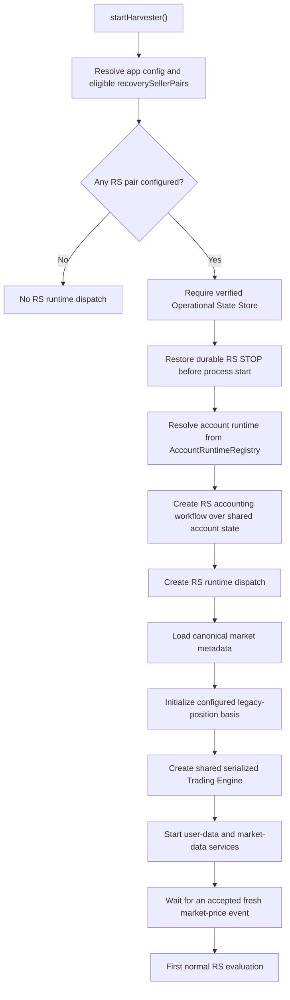
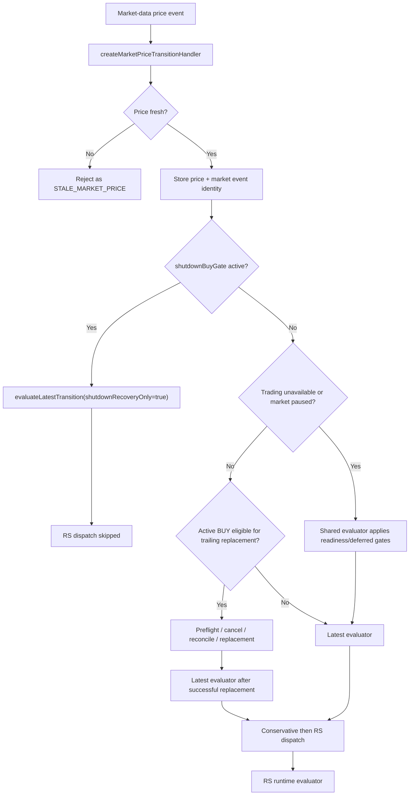
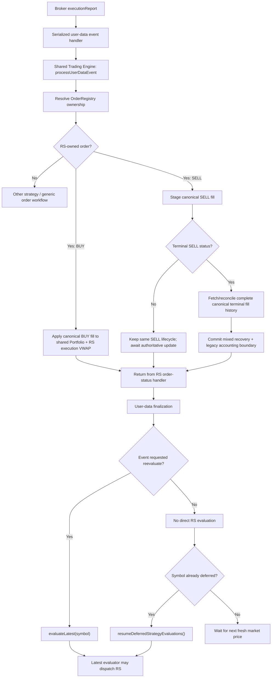
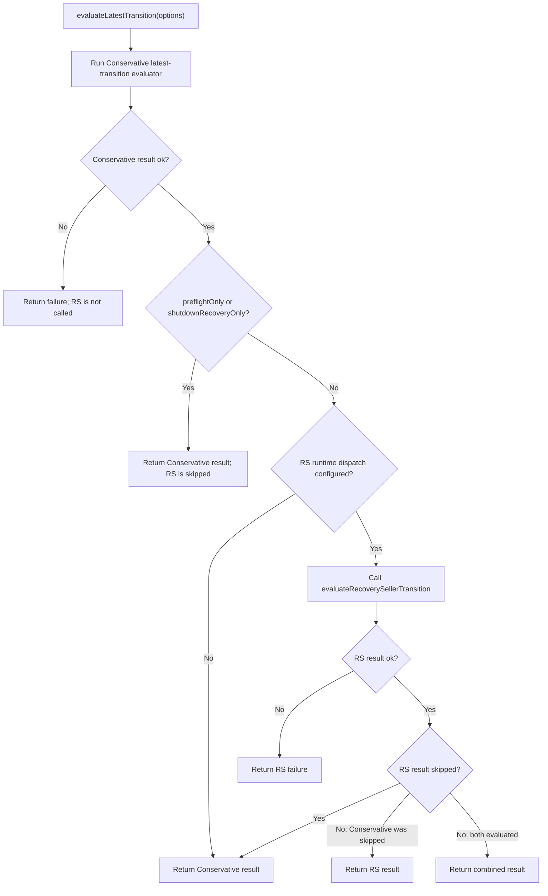
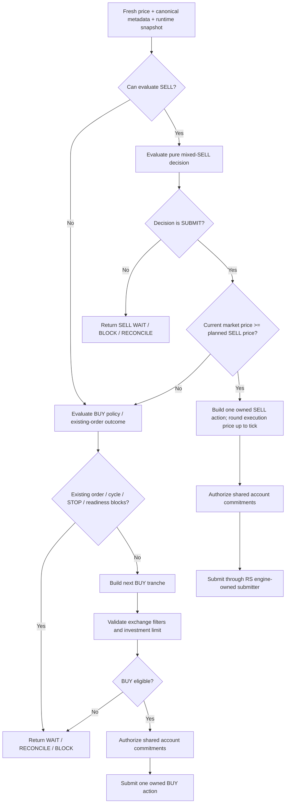
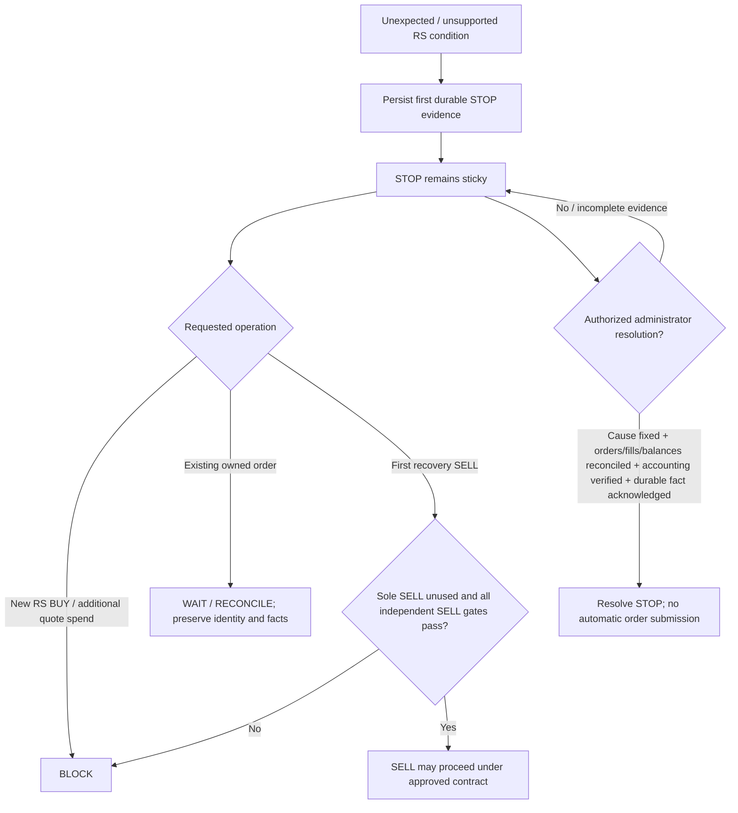

# Recovery Seller Runtime Flows and Source Audit

**Document type:** maintained implementation map and source-audit snapshot  
**Last verified:** 2026-11-25  
**Source baseline:** `develop` at `ebeaf346fbaa44ae75ba6fd9256bfdd1ba01d765`  
**Owner issue:** [#1841](https://github.com/45s/coinzilla/issues/1841)  
**Normative domain contract:** [Recovery Seller Domain Specification](./recovery-seller-domain-specification.md)

> This document answers **where RS starts, what invokes it, what it reads, and what it does next**. It is a source-navigation map, not a second policy authority. The diagrams describe the inspected implementation and explicitly flag places where it does not yet satisfy the owner-approved contract. Do not infer exchange authorization from runtime acceptance or these diagrams.

## 1. Runtime at a glance

Recovery Seller (RS) is not a separate polling loop or broker client. It is composed into Harvester's existing account-owned, serialized Trading Engine:

- RS uses the account's shared `Portfolio`, `OrderRegistry`, legacy-position state and update queue.
- RS evaluates through the shared `createLatestTransitionEvaluator` dispatch.
- RS order intents are authorized by the shared quote/base commitment allocator.
- RS orders are submitted through the engine-owned submitter and the normal broker port.
- RS BUY fills update the owned recovery Position; SELL fills are staged and reconciled as a complete terminal mixed-SELL boundary.
- The durable RS STOP workflow is restored before process start and is separate from the in-memory cycle snapshot.

Global configuration is enabled by default in `RS_RECOVERY_SELLER_CONFIG`; the resolved per-market map still controls whether a symbol is eligible and which `tradingEnvironment` it may use. The current configured LINEAUSDT route is TESTNET-only. This does **not** authorize a TESTNET or LIVE session.

Process restart/replay and authoritative third-asset commission valuation remain deferred.

## 2. Startup is composition, not the first strategy decision

The startup path restores safety state and constructs the RS runtime. It does not submit the first BUY or SELL merely because Harvester started.



Important startup boundaries:

1. If an RS route is configured, startup requires a verified Operational State Store. Failure to restore durable STOP state prevents process start.
2. `createRecoverySellerAccountingWorkflow` is created with the account runtime's shared state; it is not an isolated Portfolio or OrderRegistry.
3. `createRecoverySellerRuntimeDispatch` composes the runtime evaluator, account-wide action authorizer and engine-owned submitter.
4. Canonical market metadata is loaded before legacy-position initialization and engine activation.
5. Legacy configuration establishes an operator-authorized historical basis. It does not prove wallet custody or sellable quantity; current Spot balances and reservations are checked again during planning/authorization.
6. The current runtime does not restore an RS cycle from a process-restart/replay contract. That work remains explicitly deferred.

Primary source: [start-harvester.js](../../src/bootstrap/start-harvester.js), [create-recovery-seller-runtime-dispatch.js](../../src/bootstrap/create-recovery-seller-runtime-dispatch.js), [create-recovery-seller-accounting-workflow.js](../../src/use-cases/create-recovery-seller-accounting-workflow.js).

## 3. Actual entry points and event triggers

### 3.1 Trigger matrix

| Entry point | What it does for RS | Does it immediately evaluate RS? |
|---|---|---|
| Accepted fresh market-price event | Stores the fresh price and calls the shared latest-transition evaluator | **Yes.** This is the normal recurring decision trigger. |
| RS BUY execution report / fill | Validates registered RS ownership and applies the canonical BUY fill to the recovery Position and BUY execution VWAP | **No direct reevaluation.** The RS order handler does not set the user-data `reevaluate` flag. |
| RS SELL execution report / fill | Records/stages the canonical SELL fill; a terminal SELL causes complete order-fill-history reconciliation and mixed accounting | **No direct reevaluation.** The terminal event completes accounting/reconciliation, not a new RS decision. |
| User-data event that explicitly requests reevaluation | The user-data handler calls `tradingEngine.evaluateLatest({ symbol })` | **Yes, if the event result sets `reevaluate: true`.** The RS-owned order-status path inspected here does not set it. |
| Deferred strategy evaluation | User-data finalization resumes symbols already in the deferred-evaluation set when readiness returns | **Conditionally.** Only previously deferred symbols are resumed. |
| Fresh market-book event | Stores the fresh book; if the symbol is already deferred and not paused, calls the latest-transition evaluator | **Conditionally.** A book update alone does not evaluate every RS market. |
| Trailing-BUY replacement completion | After cancellation/reconciliation and readiness checks, the engine calls the latest-transition evaluator again | **Yes**, unless stopping/readiness gates prevent it. The preflight-only pass itself skips RS. |
| Preflight-only evaluation | Validates a Conservative replacement candidate | **No.** `createLatestTransitionEvaluator` skips RS for `preflightOnly`. |
| Shutdown-recovery-only evaluation | Runs the Conservative shutdown-recovery path | **No.** `createLatestTransitionEvaluator` skips RS for `shutdownRecoveryOnly`. |
| Timer / periodic poll | No RS-specific recurring timer is wired into the inspected dispatch path | **No.** The fresh-price waiter has a timeout for waiting on data; it is not an RS polling loop. |

### 3.2 Normal market-price entry



The trailing-BUY path is not a separate RS engine. If it performs a replacement, it returns to the latest-transition evaluator after cancellation/reconciliation; its `preflightOnly` validation pass does not dispatch RS.

### 3.3 User-data entry and the important non-trigger



**Do not draw an RS BUY-fill or SELL-fill arrow directly into a new BUY/SELL decision.** The inspected RS order-status handler returns the order/accounting result without `reevaluate: true`. The user-data handler may still resume an already-deferred symbol, but that is conditional and is not the same as every RS fill triggering a fresh decision.

Sources: [create-market-price-transition-handler.js](../../src/use-cases/create-market-price-transition-handler.js), [create-latest-transition-evaluator.js](../../src/use-cases/create-latest-transition-evaluator.js), [create-user-data-event-transition.js](../../src/use-cases/create-user-data-event-transition.js), [create-user-data-event-handler.js](../../src/bootstrap/user-data/create-user-data-event-handler.js), [order-event-workflow.js](../../src/use-cases/order-event-workflow.js).

## 4. Shared Trading Engine dispatch

The latest-transition evaluator runs the Conservative evaluator first, then RS:



A Conservative **skip** can still be an `ok` result, so an RS-only market can reach RS dispatch. A Conservative **failure** prevents RS dispatch for that evaluation. RS is not invoked by preflight-only or shutdown-recovery-only evaluation.

The dispatch supplies the current engine state, market readiness predicates, account snapshot, canonical RS market metadata, account-wide action authorizer and RS order submitter. A missing account-wide authorizer is a fail-closed condition and attempts to latch durable STOP.

Sources: [create-latest-transition-evaluator.js](../../src/use-cases/create-latest-transition-evaluator.js), [create-recovery-seller-runtime-dispatch.js](../../src/bootstrap/create-recovery-seller-runtime-dispatch.js).

## 5. Runtime input and snapshot schema

The runtime evaluator first requires:

- a fresh price in `state.prices` for the requested symbol;
- an eligible configured entry in `recoverySellerPairs`;
- canonical market metadata for the same symbol.

A missing/stale price or missing pair is a structured skip. Missing canonical metadata is an error.

The runtime snapshot is assembled from the shared account and RS accounting workflow:

| Field | Meaning / source |
|---|---|
| `cycleState` | Canonical RS cycle identity and lifecycle status, including `cycleId`, `positionId`, status and the sole SELL identity when submitted |
| `recoveryPosition` | Actual Portfolio Position snapshot: `positionId`, base `quantity`, quote `spent`; absent before the first BUY fill |
| `planInput` | Recovery quantity/cost basis, configured legacy slice, remaining legacy quantity, verified unreserved Spot legacy quantity, legacy average cost and optional third-asset fee quote value |
| `cumulativeNetSellProceeds` | Currently `"0"` in the snapshot; the cycle permits one SELL and SELL proceeds are staged until terminal reconciliation |
| `pendingBuyCommitment` | Quote commitment of active RS BUY orders in the cycle |
| `activeOrders` | Active orders for this RS market resolved through the shared OrderRegistry and ownership |
| `stopState` | Durable RS STOP snapshot |
| `strategyStopped` | Current implementation combines process stopping and durable RS STOP into this flag |
| `marketPaused` | Market pause state from in-memory, durable and operator pause sets |
| `reconciliationComplete` | Requires no blocking open order, fresh price, and no account reconciliation, safety-halt or accounting-failure flag |
| `lastBuyPrice` | Completed RS BUY execution VWAP for the current cycle |

The plan-input fields are deliberately not equivalent to wallet balances:

- `configuredLegacyQuantity` is the configured per-cycle legacy slice (`pairConfig.sellQuantity`).
- `legacyRemainingQuantity` is the remaining operator-authorized legacy amount.
- `verifiedUnreservedLegacyQuantity` is derived from the canonical account snapshot after tracked Portfolio quantities and reservations are deducted.
- The SELL planner may use only the amount supported by all three limits.

### Illustrative schema (field names are source-backed; this is not an exported TypeScript interface)

```ts
type LifecycleOutcome = "SUBMIT" | "WAIT" | "BLOCK" | "RECONCILE";

type RecoverySellerOwnership = {
  strategyId: "RECOVERY_SELLER";
  purpose: "RECOVERY_BUY" | "RECOVERY_SELL";
  positionId: string;
  cycleId: string;
};

type RecoverySellerCycleState = {
  cycleId: string;
  positionId: string;
  status:
    | "ACCUMULATING"
    | "SELL_SUBMITTED"
    | "RECONCILIATION_REQUIRED"
    | "CLOSED"
    | "UNRESOLVED";
  sellOrderIdentity: {
    clientOrderId: string;
    brokerOrderId?: string;
  } | null;
  terminalOrderStatus: "FILLED" | "CANCELED" | "REJECTED" | "EXPIRED" | null;
  terminalReconciled: boolean;
  profitabilityEligible: boolean | null;
};

type RecoverySellerPositionSnapshot = {
  positionId: string;
  quantity: string;
  spent: string;
};

type RecoverySellerPlanInput = {
  recoveryQuantity: string;
  configuredLegacyQuantity: string;
  legacyRemainingQuantity: string;
  verifiedUnreservedLegacyQuantity: string;
  recoveryCostBasis: string;
  legacyAverageCost: string;
  thirdAssetFeeQuoteValue?: string;
};

type RecoverySellerRuntimeSnapshot = {
  cycleState: RecoverySellerCycleState;
  recoveryPosition?: RecoverySellerPositionSnapshot;
  planInput: RecoverySellerPlanInput;
  cumulativeNetSellProceeds: string;
  pendingBuyCommitment: string;
  activeOrders: Array<{
    clientOrderId: string;
    brokerOrderId?: string;
    market: object;
    side: "BUY" | "SELL";
    status: string;
    originalQuantity: object;
    executedQuantity: object;
    limitPrice: object;
    ownership?: RecoverySellerOwnership;
  }>;
  stopState: { status: "CLEAR" | "STOPPED"; decision?: object | null };
  strategyStopped: boolean;
  marketPaused: boolean;
  reconciliationComplete: boolean;
  lastBuyPrice?: string;
};
```

Lifecycle decisions and order actions are separate concepts:

- A lifecycle decision is `SUBMIT`, `WAIT`, `BLOCK` or `RECONCILE`.
- `WAIT` requires the known `clientOrderId` and `brokerOrderId`.
- `RECONCILE` preserves the original `clientOrderId`; the broker ID is included when known.
- A submitted action carries side-specific purpose plus `strategyId`, `positionId` and `cycleId`. BUY uses `RECOVERY_BUY`; SELL uses `RECOVERY_SELL`.
- The shared OrderRegistry stores ownership; a symbol or side alone is not sufficient to attribute an order to RS.

Sources: [create-recovery-seller-runtime-evaluator.js](../../src/use-cases/create-recovery-seller-runtime-evaluator.js), [create-recovery-seller-accounting-workflow.js](../../src/use-cases/create-recovery-seller-accounting-workflow.js), [recovery-seller-order-callbacks.js](../../src/use-cases/recovery-seller-order-callbacks.js), [cycle-state.js](../../src/domain/strategies/recovery-seller/cycle-state.js).

## 6. RS decision policy: SELL first, then BUY when appropriate



### 6.1 SELL eligibility and trigger

The current evaluator considers SELL only when all these conditions hold:

- no active RS order exists for the market;
- the cycle is `ACCUMULATING`;
- the current implementation's STOP state is clear;
- the process is not stopping;
- the market is not paused;
- reconciliation is complete;
- the recovery Position has positive quantity.

The pure SELL policy then plans one mixed SELL. If its decision is `SUBMIT`, the runtime submits only when the current market price is at or above the planned minimum price. The execution price is rounded **up** to the canonical price tick and must not fall below the planned profitability target.

If the SELL policy returns a non-SUBMIT lifecycle decision, that decision is returned; the evaluator does not fall through to BUY. If the SELL policy says SUBMIT but the current price is still below the planned price, the runtime falls through to the BUY policy.

### 6.2 Mixed SELL economics

The planner's legacy slice is bounded by:

```text
legacySellQuantity =
  min(configured sellQuantity,
      remaining authorized legacy quantity,
      verified unreserved Spot legacy quantity)
```

The planner then:

1. Adds actual recovery Position quantity to the eligible legacy slice.
2. Accounts for base-asset fee gross-up and quantity-step precision.
3. Allocates gross SELL quantity and base commission between recovery and legacy inventory without exceeding either allocation.
4. Calculates separate recovery, legacy and combined-cycle cost/proceeds targets.
5. Uses the highest required total-net-proceeds target.
6. Grosses up quote fees and an explicitly valued third-asset fee.
7. Divides by SELL quantity and rounds the minimum price **up** to the price tick.

Post-fill profitability is recalculated from canonical fills and actual commissions, not from the planning fee assumptions:

- recovery allocation must earn at least `minProfit`;
- any legacy allocation must not realize a loss against its fixed historical cost basis;
- combined recovery + legacy cycle must earn at least `minProfit`.

All applicable gates must pass. Third-asset commission valuation has no approved authoritative runtime source yet; an unknown/unvalued fee must not be treated as zero.

### 6.3 BUY cadence

When no eligible SELL is submitted, the BUY policy:

- uses the current market price as the initial reference when no recovery Position exists;
- requires completed BUY execution VWAP for a later tranche;
- reuses the Conservative initial-buy-price helper with `priceStepPercent`;
- rounds configured `orderQuantity` down to the exchange quantity step;
- checks min/max quantity, min/max notional, min/max price and the optional investment limit;
- refuses duplicate or unowned active orders and respects cycle, pause, STOP and reconciliation state.

The BUY policy creates an intent only. Shared account quote/base balances and concurrent strategy reservations are authorized by the Trading Engine allocator.

Sources: [create-recovery-seller-transition-evaluator.js](../../src/use-cases/create-recovery-seller-transition-evaluator.js), [evaluate-buy-decision.js](../../src/domain/strategies/recovery-seller/evaluate-buy-decision.js), [evaluate-sell-decision.js](../../src/domain/strategies/recovery-seller/evaluate-sell-decision.js), [calculate-sell-plan.js](../../src/domain/strategies/recovery-seller/calculate-sell-plan.js), [calculate-profitability.js](../../src/domain/strategies/recovery-seller/calculate-profitability.js).

## 7. Shared account authorization and order submission

RS does not reserve quote/base funds independently. Before a new action reaches the broker, the RS authorizer uses the shared account allocator and current ownership/Portfolio state.

```mermaid
sequenceDiagram
    participant Policy as RS policy
    participant Auth as RS action authorizer
    participant Alloc as Shared quote/base allocator
    participant Submit as RS order submitter
    participant Store as Operational State Store
    participant Registry as Shared OrderRegistry
    participant Broker

    Policy->>Auth: one BUY or SELL action + snapshot
    Auth->>Alloc: account balances, Portfolio, active orders, RS commitments
    Alloc-->>Auth: exactly one executable action or deferred/blocked result
    alt exactly one executable action, no deferred action
        Auth-->>Submit: authorized lifecycle decision + action
        Submit->>Submit: validate side, purpose, Position and cycle ownership
        alt SELL
            Submit->>Store: persist durable submission intent
            Submit->>Registry: durably reserve the cycle's sole SELL
        end
        Submit->>Registry: register pending order with RS ownership
        Submit->>Broker: submit through shared broker port
        alt acknowledged
            Broker-->>Submit: canonical acknowledged order
            Submit->>Registry: attach brokerOrderId
        else unknown / deferred / unsafe failure
            Submit->>Store: latch durable STOP with original order identity
        end
    else exactly one deferred action
        Auth-->>Policy: deferred / skipped; no broker call
    else allocation error or ambiguous result
        Auth->>Store: latch durable RS STOP
        Auth-->>Policy: no submission
    end
```

The account authorizer includes the recovery Position quantity and verified unreserved legacy quantity in base allocation, computes the outstanding recovery amount from cost basis less cumulative net proceeds, and passes the action through `allocateStrategyOrderCommitments`. Exactly one executable action with no deferred action is required to proceed. Exactly one deferred action returns a skip/defer result without broker submission; allocation errors or ambiguous/inconsistent decisions attempt to latch durable STOP.

The submitter validates:

- `side=BUY` with `purpose=RECOVERY_BUY`, or `side=SELL` with `purpose=RECOVERY_SELL`;
- `strategyId=RECOVERY_SELLER`;
- non-empty `positionId` and `cycleId`.

SELL has an additional ordering invariant: durable submission intent is recorded **before** the sole-SELL cycle reservation; the reservation must be durably acknowledged before the pending order is registered and broker I/O proceeds. Unknown/deferred SELL submission and SELL submission failure latch STOP. The shared submission gate still enforces trading readiness, account blockers, open-order ownership, market pause, market-book/post-only constraints and the other shared safety rules.

A generic account-scoped safety blocker continues to block every order side. The RS-specific STOP contract below must not be implemented by weakening that generic account blocker.

Sources: [create-recovery-seller-action-authorizer.js](../../src/use-cases/create-recovery-seller-action-authorizer.js), [strategy-order-commitments.js](../../src/use-cases/strategy-order-commitments.js), [create-recovery-seller-order-submitter.js](../../src/use-cases/create-recovery-seller-order-submitter.js), [create-submission-gate.js](../../src/use-cases/create-submission-gate.js).

## 8. Fill and terminal SELL reconciliation

```mermaid
sequenceDiagram
    participant Stream as Broker user-data stream
    participant Engine as Shared order-event workflow
    participant Registry as OrderRegistry
    participant Fill as Canonical fill recorder
    participant History as Broker fill history
    participant RS as RS accounting workflow
    participant Store as Operational State Store

    Stream->>Engine: executionReport / canonical fill
    Engine->>Registry: resolve order + RS ownership
    Engine->>Fill: deduplicate and stage canonical fill
    alt RS BUY fill
        Engine->>RS: applyBuyFill(fill)
        RS->>RS: apply to shared Portfolio + update BUY execution VWAP
    else RS SELL fill
        Note over Engine,RS: Streamed SELL fills are staged; mixed accounting waits for terminal reconciliation.
    end
    Stream->>Engine: terminal SELL order update
    Engine->>History: fetch complete canonical fill history for original broker order
    History-->>Engine: canonical fill set
    Engine->>RS: reconcileTerminalMixedSell(order, canonicalFills)
    RS->>RS: validate identity, allocations, commissions and profitability
    RS->>RS: atomically prepare recovery + legacy accounting projections
    RS->>Store: append durable mixed-SELL reconciled fact
    Store-->>RS: durable acknowledgement
    RS->>RS: publish Portfolio/legacy/registry/cycle state and release reservation
    RS-->>Engine: reconciled accounting result
    Engine->>Registry: mark terminal order reconciliation complete
```

Safety boundaries:

- A BUY fill must match the registered RS-owned BUY order, market, broker identity, Position and cycle. The fill is applied to the shared Portfolio and contributes to the cycle's completed BUY VWAP.
- SELL stream fills are staged in the canonical fill recorder. They are not treated as final mixed recovery/legacy accounting one fill at a time.
- A terminal SELL requires the complete canonical fill history. The workflow allocates actual fills and commissions between recovery and legacy inventory, prepares both projections, persists the durable reconciliation fact, then publishes the state and releases the sole-SELL reservation.
- Missing history, mismatched identity, failed accounting commit or missing durable acknowledgement fails closed; the order-event workflow pauses and attempts to latch durable STOP.
- The durable fact and actual fill set are the replay boundary for exact-once accounting; a stream event alone is not proof that the whole terminal order has been reconciled.

Sources: [order-event-workflow.js](../../src/use-cases/order-event-workflow.js), [create-user-data-event-transition.js](../../src/use-cases/create-user-data-event-transition.js), [create-recovery-seller-accounting-workflow.js](../../src/use-cases/create-recovery-seller-accounting-workflow.js), [recovery-seller-order-callbacks.js](../../src/use-cases/recovery-seller-order-callbacks.js).

## 9. Recovery-cycle state machine and terminal outcomes

```mermaid
stateDiagram-v2
    [*] --> ACCUMULATING
    ACCUMULATING --> ACCUMULATING: sequential BUY tranche after prior BUY is terminal and reconciled
    ACCUMULATING --> SELL_SUBMITTED: reserve the sole SELL before broker I/O
    SELL_SUBMITTED --> SELL_SUBMITTED: OPEN / PARTIALLY_FILLED; same order identity
    SELL_SUBMITTED --> RECONCILIATION_REQUIRED: unknown submission or acknowledgement
    RECONCILIATION_REQUIRED --> RECONCILIATION_REQUIRED: reconcile original clientOrderId; no blind retry
    SELL_SUBMITTED --> CLOSED: FILLED + complete reconciliation + every profitability gate passes
    SELL_SUBMITTED --> UNRESOLVED: CANCELED / REJECTED / EXPIRED
    SELL_SUBMITTED --> UNRESOLVED: FILLED but profitability gate fails
    CLOSED --> [*]
    UNRESOLVED --> [*]: blocked pending approved recovery policy
```



The domain state factory also defines `RECONCILIATION_REQUIRED` and `reconcileRecoverySellerCycleSell`; the latter preserves terminal status, reconciliation state and profitability eligibility in the canonical cycle-state shape. The current application workflow reconstructs an active UNKNOWN order as `SELL_SUBMITTED` while returning a `RECONCILE` decision; it does not publish the domain's `RECONCILIATION_REQUIRED` state for that path. Its terminal outcome projection also stores `sellOrderClientId`, `sellOrderBrokerOrderId`, `appliedFillIds` and `eligible` instead of canonical `sellOrderIdentity`, `terminalOrderStatus`, `terminalReconciled` and `profitabilityEligible` fields. The BUY policy validates the canonical cycle state, so this application/domain projection mismatch needs an application-level regression and correction.

The intended contract is:

| Terminal condition | Required cycle result | New SELL / BUY cycle |
|---|---|---|
| SELL remains OPEN / PARTIALLY_FILLED | Keep the same sole SELL identity and reservation; stage fills | No replacement or second SELL |
| SELL submission/acknowledgement is unknown | `RECONCILIATION_REQUIRED`; retain original identity/reservation and return `RECONCILE` | No blind retry or new action |
| Terminal `FILLED`, fully reconciled, all profitability gates pass | `CLOSED` | A distinct next cycle may be created |
| Terminal `FILLED`, profitability gate fails | `UNRESOLVED` plus durable global STOP for the adverse result | No second SELL or next BUY cycle |
| Terminal `CANCELED`, `REJECTED` or `EXPIRED`, including partial execution | `UNRESOLVED` after complete fill reconciliation | No second SELL or next BUY cycle |

### 9.1 Confirmed implementation defect

At the audited source baseline, `publishTerminalMixedSellAccounting` chooses the cycle status using only `profitability.eligible`:

```js
status: eligible ? "CLOSED" : "UNRESOLVED"
```

It does not also require `terminalRegisteredOrder.status === "FILLED"`. Therefore a terminal non-FILLED SELL could be marked `CLOSED` if its partial fills happen to pass the profitability calculation. Conversely, a FILLED but under-target SELL becomes `UNRESOLVED`, but the successful accounting result is returned without latching the durable global STOP required for the adverse profitability outcome.

The order-event workflow latches STOP when terminal mixed-SELL reconciliation is unavailable or fails; it does not inspect a successful result's `profitability.eligible` flag to latch STOP. The accounting workflow tests inspected cover FILLED success and FILLED ineligible accounting, but do not provide an application-level terminal CANCELED/REJECTED/EXPIRED regression for this branch.

Tracked in [#1842](https://github.com/45s/coinzilla/issues/1842). Do not treat the intended state diagram above as proof that the current application path enforces it.

## 10. STOP: approved contract versus current implementation

The owner-approved decision is recorded in the 2026-11-24 discussion on [RS issue #1780](https://github.com/45s/coinzilla/issues/1780). The contract is an **investment-spend gate**, not a blanket ban on recovering already-owned inventory:

- STOP blocks additional RS BUY spending.
- Existing-order WAIT/RECONCILE and confirmed-fill accounting continue.
- An otherwise-valid **first** recovery SELL may proceed only if the cycle has not used its sole SELL lifecycle and every independent safety, custody, ownership, exchange-filter and profitability gate passes.
- STOP does not authorize a second, continuation, replacement or retry SELL.
- An authorized administrator may resolve STOP only after the cause is fixed, authoritative order/fill/balance reconciliation is complete, Portfolio/legacy/reservation accounting is verified and the durable resolution fact is acknowledged.
- Automatic clear, self-resume and implicit resume are forbidden.



### 10.1 Current implementation divergence

The inspected implementation still behaves more restrictively than that approved contract:

1. `getRecoverySellerRuntimeSnapshot` maps durable STOPPED state into `strategyStopped`.
2. `createRecoverySellerTransitionEvaluator.canEvaluateSell` requires STOP to be clear and `strategyStopped === false`; the SELL transition also returns early when STOP is active. This prevents an otherwise-valid first recovery SELL.
3. `createRecoverySellerStopWorkflow` persists RS STOP as an account-scoped safety blocker and activates the shared account admission blocker. The shared submission gate correctly treats a generic account-scoped blocker as a block on every order side, so the RS STOP currently blocks SELL as well as BUY.
4. The stop workflow has an evidence-backed internal `resolve` operation, but the operator facade exposes read-only STOP status; the authorized administrator command is not wired through that facade.
5. The scenario matrix still needs application-level proof that existing UNKNOWN orders continue to reconcile while STOP is active.

Do **not** weaken the generic account-scoped safety blocker to implement the RS exception. RS STOP needs a separate strategy-purpose-aware admission path; unrelated account blockers must continue to block all order sides and all strategies.

Tracked in [#1843](https://github.com/45s/coinzilla/issues/1843). The current develop specification still contains older STOP wording; the owner-approved text is present in the working changes for [PR #1823](https://github.com/45s/coinzilla/pull/1823), which is open and unmerged at this audit snapshot.

Sources: [create-recovery-seller-runtime-evaluator.js](../../src/use-cases/create-recovery-seller-runtime-evaluator.js), [create-recovery-seller-transition-evaluator.js](../../src/use-cases/create-recovery-seller-transition-evaluator.js), [create-recovery-seller-stop-workflow.js](../../src/use-cases/create-recovery-seller-stop-workflow.js), [stop-decision.js](../../src/domain/strategies/recovery-seller/stop-decision.js), [resolve-recovery-seller-stop.js](../../src/use-cases/resolve-recovery-seller-stop.js), [create-submission-gate.js](../../src/use-cases/create-submission-gate.js).

## 11. Source map

| Responsibility | Source |
|---|---|
| Process startup, durable STOP restore, runtime composition, legacy initialization | [start-harvester.js](../../src/bootstrap/start-harvester.js) |
| RS dispatch factory | [create-recovery-seller-runtime-dispatch.js](../../src/bootstrap/create-recovery-seller-runtime-dispatch.js) |
| Fresh-price acceptance and normal market trigger | [create-market-price-transition-handler.js](../../src/use-cases/create-market-price-transition-handler.js) |
| Conservative-first / RS-second shared dispatch | [create-latest-transition-evaluator.js](../../src/use-cases/create-latest-transition-evaluator.js) |
| Fresh price, pair config, metadata and runtime readiness snapshot | [create-recovery-seller-runtime-evaluator.js](../../src/use-cases/create-recovery-seller-runtime-evaluator.js) |
| SELL-first / BUY-fallback composition | [create-recovery-seller-transition-evaluator.js](../../src/use-cases/create-recovery-seller-transition-evaluator.js) |
| BUY policy | [evaluate-buy-decision.js](../../src/domain/strategies/recovery-seller/evaluate-buy-decision.js) |
| SELL policy and order-type/fee-role selection | [evaluate-sell-decision.js](../../src/domain/strategies/recovery-seller/evaluate-sell-decision.js) |
| Mixed SELL quantity, allocation, fee and minimum-price planning | [calculate-sell-plan.js](../../src/domain/strategies/recovery-seller/calculate-sell-plan.js) |
| Actual recovery / legacy / combined profitability gates | [calculate-profitability.js](../../src/domain/strategies/recovery-seller/calculate-profitability.js) |
| Shared account quote/base authorization | [create-recovery-seller-action-authorizer.js](../../src/use-cases/create-recovery-seller-action-authorizer.js) |
| Durable submission intent, sole-SELL reservation and broker submission | [create-recovery-seller-order-submitter.js](../../src/use-cases/create-recovery-seller-order-submitter.js) |
| Ownership callbacks and pending-order registration | [recovery-seller-order-callbacks.js](../../src/use-cases/recovery-seller-order-callbacks.js) |
| Terminal order fill-history reconciliation and RS STOP on reconciliation failure | [order-event-workflow.js](../../src/use-cases/order-event-workflow.js) |
| Shared RS Portfolio/legacy/cycle accounting | [create-recovery-seller-accounting-workflow.js](../../src/use-cases/create-recovery-seller-accounting-workflow.js) |
| Durable STOP restore/latch and internal resolver | [create-recovery-seller-stop-workflow.js](../../src/use-cases/create-recovery-seller-stop-workflow.js), [resolve-recovery-seller-stop.js](../../src/use-cases/resolve-recovery-seller-stop.js) |
| Final shared order admission gate | [create-submission-gate.js](../../src/use-cases/create-submission-gate.js) |
| Global RS enabled flag | [rs-recovery-seller.js](../../config/strategies/rs-recovery-seller.js) |
| Per-market RS route map | [rs-recovery-seller.js](../../rs-recovery-seller.js) |

## 12. Audit conclusions and evidence limits

### Confirmed

- RS is composed into the shared serialized Trading Engine; it is not a standalone timer-driven loop.
- The normal decision trigger is an accepted fresh market-price event.
- RS-owned fill/order events update accounting and reconcile terminal orders; they do not directly request a new RS decision in the inspected handler.
- The shared evaluator runs Conservative first and RS second, with explicit preflight and shutdown exclusions.
- BUY and SELL intents carry RS strategy, Position, cycle and purpose ownership.
- The account-wide allocator is the quote/base commitment boundary.
- SELL planning uses actual recovery Position quantity plus only verified unreserved legacy Spot quantity.
- SELL fills are reconciled as a complete terminal mixed-SELL accounting boundary.
- The terminal cycle-close and STOP divergences described above are present in the inspected source.

### Follow-up implementation issues

- [#1842](https://github.com/45s/coinzilla/issues/1842) — require terminal FILLED status for cycle closure and latch STOP for FILLED under-target SELL outcomes.
- [#1843](https://github.com/45s/coinzilla/issues/1843) — implement owner-approved investment-only STOP behavior and authorized operator resolution.
- [#1780](https://github.com/45s/coinzilla/issues/1780) remains the separate from-scratch RS scenario-coverage initiative. Its consolidated [PR #1823](https://github.com/45s/coinzilla/pull/1823) is open/unmerged at this snapshot; branch-only scenario mappings are not merged or VERIFIED evidence.
- The former workflow-to-default-SELL-evaluator defect [#1809](https://github.com/45s/coinzilla/issues/1809) was fixed by merged [PR #1815](https://github.com/45s/coinzilla/pull/1815); #1809 was closed after confirming all six applicable workflows passed on the exact PR head.

### Explicitly deferred / not proven here

- Process restart/replay of RS cycle state and accounting.
- An authoritative execution-time quote valuation source for third-asset commissions.
- Full end-to-end scenario coverage for every RS-001…RS-010 boundary.
- Any TESTNET or LIVE exchange session, broker write, order submission or exchange-state mutation.

### Audit method and limits

This was a source trace of the startup composition, shared evaluator, market-price handler, user-data/order-event path, RS policy, shared allocator, submitter, accounting workflow, STOP workflow and the relevant existing workflow tests. The exact source baseline is recorded at the top of this document.

This documentation task did not modify production source or tests, did not run a broker, and did not perform exchange operations. Existing tests were inspected as evidence of covered branches; no claim is made that the complete RS scenario matrix is verified. Run the repository's Markdown/style/anchor checks for this documentation change. Production behavior fixes belong in #1842 and #1843 and must use RED → GREEN tests.
