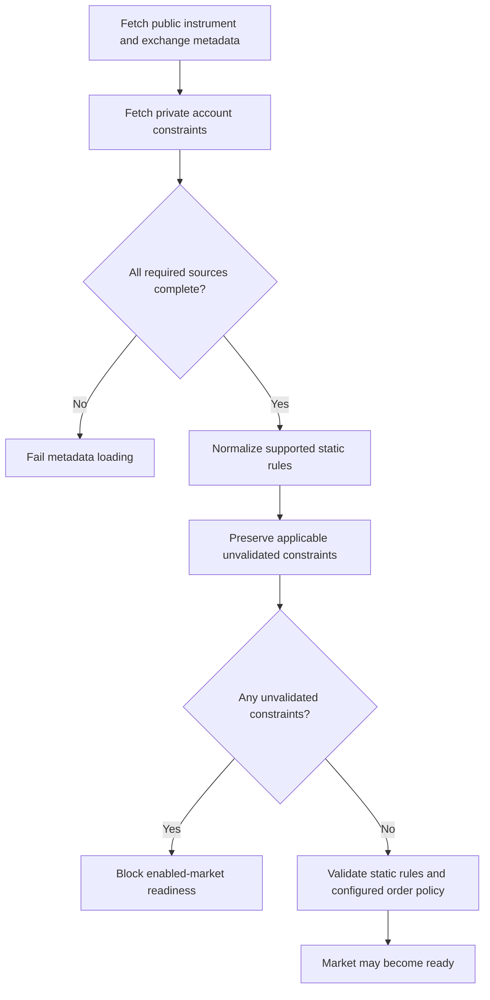

# Exchange trading constraints

## Purpose

Harvester's strategy and domain logic must not depend on Binance filter names or wire payloads. Exchange adapters translate venue metadata into canonical market facts and explicitly report constraints that the current domain cannot validate.

This document describes the current Spot LIMIT / LIMIT_MAKER boundary. It does not claim support for other exchanges or for MARKET, iceberg, algorithmic, trailing-stop, or order-list orders.

## Safety contract

1. Static rules that Harvester understands are normalized into canonical `Market` and `TradingRules` entities. Decimal values remain exact strings.
2. An adapter returns `unvalidatedConstraints`, an immutable array of exchange-neutral descriptors. Each descriptor has:
   - `type`: canonical constraint category;
   - `scope`: `SYMBOL`, `EXCHANGE`, or `ACCOUNT`;
   - `sourceFilterType`: adapter diagnostic identifying the source rule.
3. The domain readiness gate rejects an enabled market if this array is non-empty. Unknown future filters are therefore fail-closed, not silently ignored.
4. Filters explicitly irrelevant to the currently supported order types may be excluded by the adapter. The exclusion list must be justified by the actual order types Harvester can submit and covered by adapter tests.
5. An absent filter is not the same as an active but unvalidated filter. An empty array means the adapter inspected all required metadata sources and found no applicable unvalidated constraints.
6. If an authoritative metadata source cannot be retrieved or is malformed, the adapter returns failure. It must not return apparently complete metadata.

## Current Binance mapping

The Binance adapter reads public `exchangeInfo` and authenticated `myFilters` for each requested symbol. `myFilters` is symbol-specific and returns the account-relevant symbol, exchange and asset filter collections; it may repeat ordinary static filters already present in `exchangeInfo`, which are not treated as unknown constraints.

| Binance source | Canonical blocker | Scope | Why trading is blocked |
|---|---|---|---|
| `PERCENT_PRICE` | `DYNAMIC_PRICE_BAND` | Symbol | Requires Binance's current reference-price semantics and weighted-average/reference-price data |
| `PERCENT_PRICE_BY_SIDE` | `DYNAMIC_PRICE_BAND` | Symbol | BUY and SELL have separate price bands |
| `MAX_POSITION` | `BASE_ASSET_POSITION_LIMIT` | Account | Requires free + locked base balance and open BUY quantity |
| `MAX_NUM_ORDERS` | `OPEN_ORDER_COUNT_PER_MARKET` | Account | Requires authoritative current open-order count |
| `EXCHANGE_MAX_NUM_ORDERS` | `OPEN_ORDER_COUNT_EXCHANGE_WIDE` | Exchange | Requires authoritative exchange-wide open-order count |
| `MAX_ASSET` | `ASSET_ORDER_LIMIT` | Account | Applies to a base-asset quantity or quote-asset notional per order |
| Any unrecognized active filter | `UNMODELED_EXCHANGE_CONSTRAINT` | Its source scope | Applicability and enforcement are unknown |

The current adapter does not guess that the last traded price is equivalent to Binance's reference price. It also does not assume Harvester's own open-order registry is the complete account-wide order count.

### Explicitly excluded filter families

The current Conservative execution path submits ordinary `LIMIT` or `LIMIT_MAKER` orders only. Therefore, the adapter may exclude filters that apply exclusively to unsupported order types or features, such as MARKET lot-size rules, algorithmic-order counts, iceberg rules, trailing-delta rules, order-list counts, and order-amend limits. If Harvester adds one of those order types or features, its exclusion must be revisited before enabling it.

## Current behavior and limitations

- The eight static rule types already represented by `TradingRules` continue to be validated before strategy activation and before order submission.
- The adapter now preserves dynamic, account-level, exchange-wide, and unknown applicable filters.
- The enabled-market readiness gate blocks when any such constraint remains unvalidated. This is intentionally conservative; it can prevent startup even when the strategy's next action would happen to be a SELL.
- Dynamic price-band evaluation is **not implemented** in this change. Correct implementation requires the venue-defined reference price, source timestamp/freshness, averaging-window semantics, and side-specific multipliers.
- A definite Binance `-1013` response whose message begins `Filter failure:` is normalized by the adapter to the venue-neutral `DEFINITE_EXCHANGE_FILTER_REJECTED` signal. Harvester removes only that definitely rejected `PENDING` order and defers reevaluation; it does not create an `UNKNOWN` order or retain a phantom reservation. An explicitly `outcomeUnknown` error is never normalized this way and remains subject to the existing UNKNOWN reconciliation path.
- Position, asset-order and order-count constraints are **not evaluated** in this change. They remain explicit blockers until authoritative account/order facts and deterministic validation are available.
- Account filters are loaded through authenticated Binance `myFilters` with the requested symbol. If that call fails or its required arrays are missing, market metadata loading fails closed. Repeated static filters in its symbol-filter collection are ignored because their canonical static equivalents are already normalized from `exchangeInfo`.
- This is a Binance implementation of a venue-neutral contract. No other exchange adapter is added by this change.

## Adding another exchange later

A future adapter must:
1. fetch all authoritative public instrument/exchange constraints and private account constraints needed for the supported order types;
2. map supported static rules to the shared canonical entities;
3. emit immutable `unvalidatedConstraints` for every applicable rule not yet evaluated by domain logic;
4. explicitly document filters excluded because Harvester does not support the associated order type or feature;
5. add offline fixtures for complete, missing, malformed, dynamic, account-scoped, and newly introduced metadata;
6. prove that incomplete metadata blocks readiness and never silently becomes an empty constraint list.

Do not add venue-specific filter names to strategy or domain code. The `sourceFilterType` field is diagnostic evidence only; decisions use the canonical `type` and scope.

## Validation flow

The prose safety contract above is authoritative. The diagram summarizes the metadata-to-readiness boundary.

## Official Binance references

- [Spot symbol, exchange and asset filters](https://github.com/binance/binance-spot-api-docs/blob/master/filters.md) — definitions and applicability of the public filters.
- [Spot WebSocket API: Query Relevant Filters (`myFilters`)](https://developers.binance.com/en/docs/catalog/core-trading-spot-trading/api/ws-api/account) — authenticated, symbol-specific account filter source, including `MAX_ASSET`.
