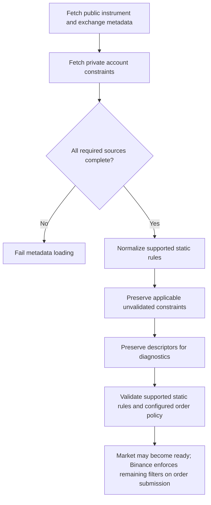

# Exchange trading constraints

## Purpose

Harvester's strategy and domain logic must not depend on Binance filter names or wire payloads. Exchange adapters translate venue metadata into canonical market facts and explicitly report constraints that the current domain cannot validate.

This document describes the current Spot LIMIT / LIMIT_MAKER boundary. It does not claim support for other exchanges or for MARKET, iceberg, algorithmic, trailing-stop, or order-list orders.

## Safety contract

1. Static rules that Harvester understands are normalized into canonical `Market` and `TradingRules` entities. Decimal values remain exact strings.
2. An adapter returns `unvalidatedConstraints`, an immutable array of exchange-neutral descriptors. Each descriptor has:
   - `type`: canonical constraint category;
   - `scope`: `SYMBOL`, `EXCHANGE`, or `ACCOUNT`;
   - `sourceFilterType`: adapter diagnostic identifying the source rule.
3. The domain readiness gate preserves this array for diagnostics but does not block startup solely because it is non-empty. Harvester validates the supported static rules; Binance remains authoritative for additional constraints and may reject an order that violates them.
4. Filters explicitly irrelevant to the currently supported order types may be excluded by the adapter. The exclusion list must be justified by the actual order types Harvester can submit and covered by adapter tests.
5. An absent filter is not the same as an active but unvalidated filter. An empty array means the adapter inspected all required metadata sources and found no applicable unvalidated constraints.
6. If an authoritative metadata source cannot be retrieved or is malformed, the adapter returns failure. It must not return apparently complete metadata.

## Current Binance mapping

The Binance adapter reads public `exchangeInfo` and authenticated `myFilters` for each requested symbol. `myFilters` is symbol-specific and returns the account-relevant symbol, exchange and asset filter collections; it may repeat ordinary static filters already present in `exchangeInfo`, which are not treated as unknown constraints.

| Binance source | Canonical blocker | Scope | Why trading is blocked |
|---|---|---|---|
| `PERCENT_PRICE` | `DYNAMIC_PRICE_BAND` | Symbol | Requires Binance's current reference-price semantics and weighted-average/reference-price data |
| `PERCENT_PRICE_BY_SIDE` | `DYNAMIC_PRICE_BAND` | Symbol | BUY and SELL have separate price bands |
| `MAX_POSITION` | `BASE_ASSET_POSITION_LIMIT` | Account | Requires free + locked base balance and open BUY quantity |
| `MAX_NUM_ORDERS` | `OPEN_ORDER_COUNT_PER_MARKET` | Account | Requires authoritative current open-order count |
| `EXCHANGE_MAX_NUM_ORDERS` | `OPEN_ORDER_COUNT_EXCHANGE_WIDE` | Exchange | Requires authoritative exchange-wide open-order count |
| `MAX_ASSET` | `ASSET_ORDER_LIMIT` | Account | Applies to a base-asset quantity or quote-asset notional per order |
| Any unrecognized active filter | `UNMODELED_EXCHANGE_CONSTRAINT` | Its source scope | Applicability and enforcement are unknown |

The current adapter does not guess that the last traded price is equivalent to Binance's reference price. It also does not assume Harvester's own open-order registry is the complete account-wide order count.

### Explicitly excluded filter families

The current Conservative execution path submits ordinary `LIMIT` or `LIMIT_MAKER` orders only. Therefore, the adapter may exclude filters that apply exclusively to unsupported order types or features, such as MARKET lot-size rules, algorithmic-order counts, iceberg rules, trailing-delta rules, order-list counts, and order-amend limits. If Harvester adds one of those order types or features, its exclusion must be revisited before enabling it.

## Current behavior and limitations

- The eight static rule types already represented by `TradingRules` continue to be validated before strategy activation and before order submission.
- The adapter now preserves dynamic, account-level, exchange-wide, and unknown applicable filters.
- Enabled-market readiness does not block solely on these unvalidated descriptors. It retains them in the validated market metadata and TRACE diagnostics so the operator can identify filters that Harvester does not yet evaluate.
- Dynamic price-band evaluation is **not implemented**. Binance is the final price-band authority and can reject an out-of-band order. Harvester reports a definite filter rejection as `DEFINITE_EXCHANGE_FILTER_REJECTED`; it does not misclassify it as an ambiguous submission or keep a phantom PENDING order.
- A definite Binance `-1013` response whose message begins `Filter failure:` is normalized by the adapter to the venue-neutral `DEFINITE_EXCHANGE_FILTER_REJECTED` signal. Harvester removes only that definitely rejected `PENDING` order and defers reevaluation; it does not create an `UNKNOWN` order or retain a phantom reservation. An explicitly `outcomeUnknown` error is never normalized this way and remains subject to the existing UNKNOWN reconciliation path.
- Position, asset-order and order-count constraints are **not evaluated locally**. Binance enforces these limits and may reject an order when an account, asset, symbol, or exchange-wide limit is reached. A definite rejection is surfaced as a rejection; it is not proof that the order was accepted or left in an UNKNOWN state.
- Account filters are loaded through authenticated Binance `myFilters` with the requested symbol. If that call fails or its required arrays are missing, market metadata loading fails closed. Repeated static filters in its symbol-filter collection are ignored because their canonical static equivalents are already normalized from `exchangeInfo`.
- Binance documents `myFilters` at IP request weight 40. The broker currently refreshes it with each symbol metadata fetch rather than serving account constraints from an unbounded cache. Monitor request-weight usage if metadata refresh frequency grows; any future cache must define a bounded TTL, invalidation rules, and fail-closed behavior after expiry.
- This is a Binance implementation of a venue-neutral contract. No other exchange adapter is added by this change.

## Why unvalidated filters are preserved instead of blocking readiness

“Do not block” does **not** mean “assume valid”, “drop the filter”, or “skip Binance enforcement”. It separates checks Harvester can prove locally from constraints whose authoritative inputs or semantics it does not own:

- **Dynamic price bands** (`PERCENT_PRICE`, `PERCENT_PRICE_BY_SIDE`) depend on Binance reference-price/weighted-average semantics and side-specific multipliers. A last-trade ticker is not a safe substitute.
- **Order-count constraints** (`MAX_NUM_ORDERS`, `EXCHANGE_MAX_NUM_ORDERS`) depend on current symbol- or exchange-wide open-order counts, not merely Harvester's local order registry.
- **Position and asset limits** (`MAX_POSITION`, `MAX_ASSET`) depend on current account balances, locked assets, and venue-defined asset/order calculations.
- **Unknown active filters** have unknown applicability and must remain visible rather than being silently discarded.

These constraints are retained as immutable `unvalidatedConstraints` diagnostics (`type`, `scope`, `sourceFilterType`). They are not claimed to have passed local validation. Binance evaluates them when an order is submitted and can definitively reject an order. A definite filter rejection is handled as `DEFINITE_EXCHANGE_FILTER_REJECTED`; it must not become an ambiguous/UNKNOWN order or a phantom reservation. This avoids a false safety claim while also avoiding a blanket startup/configuration outage for constraints the application cannot independently evaluate. Supported static price/quantity/notional rules, required metadata completeness, and supported order types remain locally validated and fail closed.

The credential-free `pnpm run config:symbol` generator reads public `exchangeInfo` and ticker data only. It cannot query authenticated `myFilters`, so account-specific constraints are checked by Harvester during authenticated startup. The command updates only `token-specification.json`; its preview shows the derived per-market precision and retains public unvalidated-filter diagnostics. It does not create strategy pairs or persist exchange filters. See the [generator instructions](../README.md#generate-or-refresh-market-metadata).

## Adding another exchange later

A future adapter must:

1. fetch all authoritative public instrument/exchange constraints and private account constraints needed for the supported order types;
2. map supported static rules to the shared canonical entities;
3. emit immutable `unvalidatedConstraints` for every applicable rule not yet evaluated by domain logic so operators can diagnose venue-enforced constraints;
4. explicitly document filters excluded because Harvester does not support the associated order type or feature;
5. add offline fixtures for complete, missing, malformed, dynamic, account-scoped, and newly introduced metadata;
6. prove that incomplete or malformed metadata still fails loading and never silently becomes an empty constraint list; separately prove that a complete metadata response with unsupported descriptors does not block readiness.

Do not add venue-specific filter names to strategy or domain code. The `sourceFilterType` field is diagnostic evidence only; decisions use the canonical `type` and scope.

## Validation flow

The prose safety contract above is authoritative. The diagram summarizes the metadata-to-readiness boundary.

## Official Binance references

- [Spot symbol, exchange and asset filters](https://github.com/binance/binance-spot-api-docs/blob/master/filters.md) — definitions and applicability of the public filters.
- [Spot WebSocket API: Query Relevant Filters (`myFilters`)](https://developers.binance.com/en/docs/catalog/core-trading-spot-trading/api/ws-api/account) — authenticated, symbol-specific account filter source, including `MAX_ASSET`.

## Unsupported-filter diagnostics and exchange enforcement

Market metadata bootstrap emits the normalized unsupported-filter inventory at TRACE, including each canonical descriptor (`type`, `scope`, and `sourceFilterType`). These descriptors are diagnostic evidence, not startup blockers. Inspect the current process session under `logs/sessions/<session-id>/trace.log` or cumulative `logs/trace.log` when investigating a venue rejection.

Harvester continues to validate the supported static rules locally. For additional constraints that it does not evaluate, Binance is authoritative at order submission. A definite Binance filter rejection is surfaced as `DEFINITE_EXCHANGE_FILTER_REJECTED`; Harvester removes only the definitely rejected PENDING order and does not mark it UNKNOWN. Transport failures or explicitly unknown outcomes remain on the existing reconciliation path. If a venue rejection exposes a missing local rule that can be evaluated reliably, add that evaluator and regression coverage in a follow-up.
