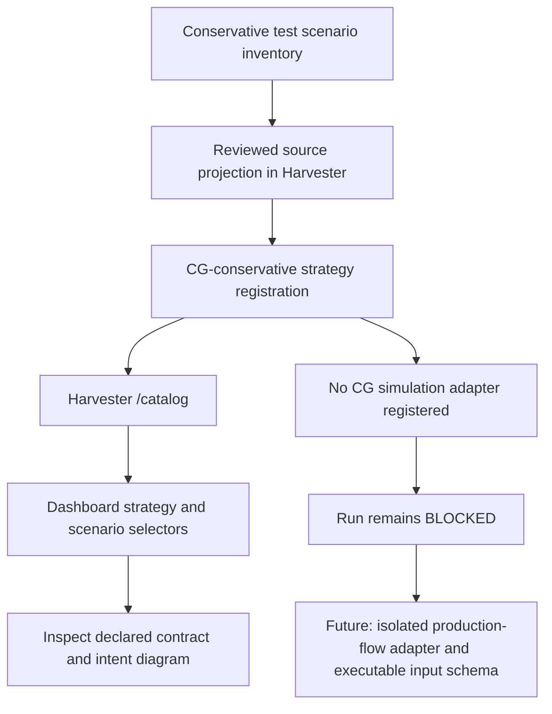
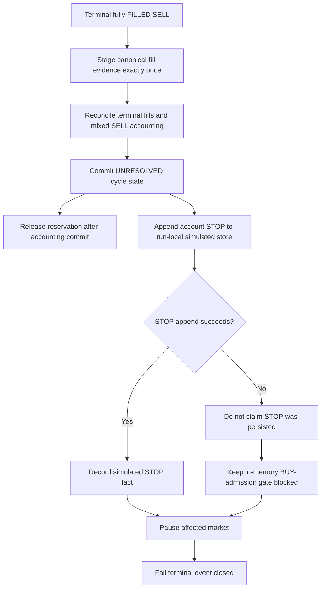

# Harvester Strategy Scenario Runner

**Tracking:** Dashboard Issue #1836 / PR #1837.

## Conservative strategy inspection catalogue — issue #2007

The Harvester catalogue exposes the eighteen existing Conservative domain scenario definitions under the strategy ID `CG-conservative`. The ID is deliberately distinct from the future `GC-aggressive` strategy. The Dashboard receives their declared preconditions, initial states, ordered input-event descriptions, expected states/orders/accounting/side effects, invariants, requirements, source links and current test-mapping status.

These are **inspection records**, not executable Dashboard run scripts. Their existing `TEST-MAPPED` status denotes a linked domain test, not verified coverage or a run performed by the Scenario Runner. Every CG entry is therefore published with `executionStatus: BLOCKED` and `executable: false`; no CG process worker or broker adapter is registered. A scenario can become runnable only after a fixed simulation-only worker reuses the actual Conservative production flow and provides an executable input schema, with isolation and trace/assertion evidence verified independently.

The production Harvester catalogue owns a safe source projection; it does not import the test-only registry or test helpers. The projection applies the same declarative defaults as the test-only scenario factory so omitted optional arrays/objects remain visible as empty values, and preserves every declared `relatedExistingTests` cross-reference (including restart and safety evidence). A regression test compares all eighteen projected scenario IDs, names, metadata, test cross-references and coverage classifications against the normalized test inventory. The local API composition builds separate Recovery Seller and `CG-conservative` registrations. Only RS has a registered worker adapter; CG remains blocked and cannot be dispatched through the RS worker. Strategy registration remains generic so a later `GC-aggressive` integration does not require a second RS/CG-specific host path.

The diagram distinguishes metadata discovery from execution. Dashboard intent diagrams show only declared event order and expected outcomes; they are not execution traces and do not infer decision branches. RS submission, history, trace, cancellation and replay remain unchanged.

The Runner is strategy-neutral application orchestration. Strategy adapters bind declared scenarios to strategy-owned production operations. The Runner core does not contain strategy rules.

## Architecture and isolation

- The host accepts run requests and manages lifecycle/result/history.
- A strategy adapter identifies scenario execution and invokes the production flow.
- Process adapters use a separate Node child process and IPC; the child receives run inputs only and a deliberately minimal environment rather than inherited Harvester credentials/configuration.
- The worker dispatcher must fail closed when no strategy-specific adapter is registered. It must never fallback to live broker, runtime state or production persistence.
- Run inputs/results are structured-cloned at boundaries to avoid cross-run mutation.
- A host-side timeout and cancellation policy bounds worker execution. Process termination uses SIGTERM followed by bounded SIGKILL fallback.
- REST is authoritative; WebSocket is notification-only. The Dashboard must never execute production trading logic.
- Only simulation-specific ports (broker, market/event source, clock and persistence) can be injected into worker composition. Production domain/application operations must be reused, not copied.

## Current implementation checkpoint

**Current state — 2026-11-27; this checkpoint supersedes older status notes below.**

- `RS-004-011` remains a preliminary helper-only mapping. PR #1852 remains a test-coverage registry, not the production registry.
- The production RS registry is in `src/infrastructure/scenario-runner/rs-scenario-adapter.js` and exposes twelve PARTIAL runtime scenarios: authorized SELL submission, rejected SELL with STOP handling, SELL-intent persistence failure, acknowledged-outcome persistence failure, combined outcome/STOP persistence failure, ambiguous broker-placement exception, sole-SELL reservation callback failure, profitable partial CANCELED SELL reconciliation, under-target fully FILLED SELL reconciliation, terminal-reconciliation persistence failure, STOP-persistence failure, and STOP buy-only admission. PR #1887 added three terminal/STOP cases; PR #1913 added six infrastructure-failure cases. All runtime scenarios use simulated infrastructure.
- These scenarios reuse production runtime evaluation, authorization, order submission, STOP workflow and accounting. They use a run-local simulated broker and in-memory operational store. They are simulation-executable only when the API explicitly enables the verified Linux Bubblewrap process adapter; they are not production-accepted and do not prove durable production state.
- The trading-history API registers the RS process adapter only when `HARVESTER_SCENARIO_SANDBOX=linux-bubblewrap` is explicitly enabled. The Linux launcher verifies root-owned Bubblewrap/prlimit/shell/Node binaries, namespace and seccomp capabilities, and delegated cgroup v2 memory/cpu/pids controllers. Each run receives a cgroup hard memory limit (256 MiB), no swap, one-CPU quota and 64 process/thread limit; the trusted shell moves itself into the cgroup before execing the sandbox chain. The worker gets a read-only runtime allowlist, network/PID/user/IPC/UTS namespaces, seccomp network/child-process denial and bounded IPC. The filter allows Bubblewrap's initial `execve` to start Node; `fork`/`vfork` and non-thread `clone` child creation remain denied, and `execveat` is denied. The verified Node installation directory is bound read-only at its canonical host path when outside `/usr`; the executable and parent directories are root-owned and non-writable. Unsupported or unverified hosts remain unavailable. Test-only simulated attestation is not an OS sandbox.
- Exact replay now checks declared and checked-out commit identity, clean source tree, dependency lock, scenario registry, original input digest and runtime identity. A trusted build-artifact attestation is unavailable, so exact replay is refused with explicit missing-provenance diagnostics.
- Terminal accounting publishes the canonical cycle state. Profitable partial CANCELED/EXPIRED and adverse under-target FILLED SELL outcomes remain `UNRESOLVED`; the FILLED scenario stages canonical fill evidence exactly once, commits mixed-SELL accounting, and then exercises the account STOP workflow. STOP persistence is verified only against the run-local in-memory operational store, not production durability. Canonical orders prohibit non-zero execution on REJECTED orders; zero-fill REJECTED accounting remains fail-closed.
- Remaining: runner-specific retry/idempotency behavior beyond existing production duplicate-fill and exact-replay regressions; production operational-state persistence; trusted build-artifact provenance and exact replay; and adversarial real-host isolation acceptance. The production RS adapter/catalogue and Linux launcher are composed, but the sandbox E2E has not yet passed on the required trusted delegated-cgroup runner. Do not promote scenario acceptance from PARTIAL until these gates are independently verified.

## Cancellation completion invariant

On the first active-run cancellation request, the runner immediately sends the adapter's AbortSignal and moves the run to `Cancelling`. It remains non-terminal until the adapter's execution promise settles; the runner must not release its concurrency slot or resolve run waiters merely because the abort signal was sent. The adapter owns cooperative stop and bounded worker termination; its `cancel` operation is mandatory so timeout handling can await cleanup before recording `Timed out`. Repeated cancellation requests are idempotent.

## Worker lifecycle regression hardening

The generic runner does not publish `Cancelled` until the strategy adapter's execution promise settles after its worker has stopped. Adapter cancellation is part of the required strategy-adapter contract; timeout handling waits for adapter cleanup before recording its terminal status. Repeated cancellation requests remain idempotent.

When a cancellation request remains active until the execution deadline, the host invokes the adapter's bounded cancellation operation and waits for it before finalizing the run. The terminal result remains `Cancelled`; it must not be mislabeled `Timed out` merely because forced cleanup was needed.

A worker result message is not itself proof that the child process has exited. The process adapter waits for child termination before resolving execution, and termination is shared/idempotent across abort, timeout and result handling so the host cannot release a worker slot while a child is still alive.

The process-adapter regression uses a worker that deliberately remains alive for a short period after sending its result. The adapter must not resolve the run until the child emits `close`; a result IPC message alone is insufficient.

The lifecycle regression tests pin two required contracts: cancellation remains non-terminal until cleanup completes, and a worker result message cannot complete a run before the worker process exits. Both regressions were observed failing in the test-only checkpoint before the implementation changes.
The delayed-exit fixture registers its SIGTERM handler before sending the result IPC message, making the process-shutdown regression deterministic rather than dependent on signal-registration timing.
The delayed-exit regression gives the adapter a 1,000 ms termination grace while the fixture exits after 500 ms, proving graceful cleanup rather than exercising the forced-kill fallback.

RS-004-011 remains a provisional helper-only candidate. The production runtime dispatch integration is exercised by a test-only fixture with a fixture ID; it is not RS-004-012 or a public scenario. It composes the production runtime dispatch, accounting workflow, account-wide authorizer and order submitter, replacing the broker and operational-state store with run-local simulation ports. The fixture does not establish process isolation or public execution readiness.

## RS helper scaffold is not executable

RS-004-011 invokes only `calculateRecoverySellerProfitability` and remains a provisional `PRELIMINARY` candidate. PR #1852's RS test-coverage registry is merged, but remains test-only and is not the production runtime catalogue. The deterministic ZRO fixture is test-only and invokes the production application/runtime path with simulated infrastructure; it is not a catalogue scenario and has no RS-004-012 identity. The worker-only registry contains a helper-level RS dispatch, but the public host has no executable RS adapter registration because no launcher provides the required OS-level filesystem/network/process/resource isolation attestation. The test fixture explicitly sets `thirdAssetFeeQuoteValue: "0"`; this is not an instruction to default the configured LINEA pair's missing fee valuation to zero. The adapter must continue to reuse production use cases and must not copy or approximate strategy behavior.
The host-level catalog regression ensures the preliminary helper is marked non-executable and that submissions are blocked before a full production-flow adapter is registered. This is a contract/test correction; it does not change production trading behavior.

## Capacity and bounded-history behavior

A submission rejected because the run queue is full is retained as a terminal `Blocked` run record. Its returned run ID remains queryable through run detail and history, so the API never returns an apparently accepted identity that immediately resolves to 404.

When the bounded history is full and every retained record is still active, the runner rejects the new submission with HTTP `429` / `SCENARIO_RUNNER_CAPACITY_REACHED`. It does not manufacture an unpersisted run record or exceed the configured history bound. The caller can retry after an active execution reaches a terminal state.

## Scenario-level execution gate

The host derives the public `executable` flag from both the strategy-owned scenario mapping and the presence of a matching registered strategy adapter. The runner independently checks that host policy before starting an adapter. Registering an RS adapter alone cannot execute a preliminary, blocked, unknown or unmapped scenario ID. A blocked submission remains a queryable `Blocked` run record. This gate is intentionally separate from OS-level process isolation; it does not certify the worker as a security sandbox.

## Server-owned scenario input validation

The host exposes a scenario as executable only when its source mapping, matching registered strategy adapter and input schema are all valid. The runner invokes the host's schema validator before creating an accepted run or calling an adapter. Invalid JSON-object shape, missing required fields, unknown fields when additional properties are disabled, field types and string patterns are rejected with HTTP `400` / `SCENARIO_RUNNER_INPUT_INVALID`. Dashboard validation is a convenience; the server-owned catalog and validator remain authoritative for direct API callers.

## Worker lifecycle implementation-quality follow-up

The process adapter separates promise settlement, abort-aware cleanup, worker error/message/exit listeners and process orchestration into small single-purpose helpers. The refactor preserves the existing contract: cancellation and result handling await worker termination, a result IPC message alone does not release the worker slot, and the host continues to require a trusted sandbox launcher. Scenario input validation is split into shape, additional-property, required-field and field-value checks; it remains framework-independent and uses exact decimal comparison.

The follow-up strict-lint correction extracts schema-input error collection into independent pure helpers. It preserves the accepted input contract and error messages; no scenario execution or trading behavior changes.

The strict changed-file follow-up also formats multi-field helper arguments explicitly and uses named worker-abort/cleanup functions. These changes are lint-only; validation and cancellation semantics are unchanged.

## Execution capability gate and isolation attestation

The host marks a scenario executable only when its source mapping and schema are valid and its matching adapter declares `executionMode: "simulation-only"` plus `osSandboxVerified: true`. The process adapter reports OS isolation as verified only when its injected launcher supplies an attestation matching the required profile. The current production composition supplies no such launcher; therefore the host registers no executable RS adapter. A Node child process, minimal environment, IPC restrictions or test-double launcher is not evidence of OS-level network/filesystem/process/resource isolation.

## Evidence redaction and cleanup failure behavior

Harvester recursively redacts sensitive object keys and credential material embedded in strings before exposing run inputs, outputs or diagnostics. The raw validated input is kept in a non-enumerable internal field only until execution starts, passed to the adapter, then discarded; snapshots never expose that field. Dashboard debug-package redaction is a second defensive layer. Adapter promise rejections are converted to structured failure results. If cancellation/timeout cleanup is rejected or explicitly unconfirmed, the run remains visibly timed out/failed, its worker slot is retained, and runner shutdown rejects instead of claiming cleanup succeeded. The HTTP API server still closes in a `finally` path.

## Strategy registration boundary — 2026-11-25

The host catalog is built from explicit `strategyRegistrations` entries (`strategyId`, display name and scenario definitions) and matches each entry to exactly one strategy adapter by ID. Catalog validation, schema gating, execution authorization and run submission are strategy-neutral; the host no longer hardcodes Recovery Seller as its only strategy. The default local composition supplies the provisional RS catalogue as one registration. Additional strategy families can be registered without changing host orchestration. Duplicate strategy registrations and multiple adapters for one strategy fail configuration rather than selecting an arbitrary entry.

The worker dispatcher is strategy-neutral and resolves registrations from an explicit worker adapter registry. The RS registration module and production adapter remain strategy-specific infrastructure adapters; they are not part of the generic host or runner domain/application core. No new strategy is enabled by this registration capability, and the RS catalog remains preliminary/non-executable until the OS-level isolation and full production-flow gates are satisfied.

## Loopback browser-origin and worker-path hardening — 2026-11-25

The unauthenticated local Scenario Runner API rejects every request carrying an `Origin` header unless it exactly matches the Dashboard's two approved loopback origins (`http://127.0.0.1:4200` or `http://localhost:4200`). Origin-less local non-browser clients remain supported. This is enforced before route dispatch, including preflight and run submission; CORS response headers alone are not treated as CSRF protection.

The process adapter canonicalizes the configured worker path with filesystem realpath resolution and requires it to be a regular file inside the adapter's own worker directory. This rejects traversal, directories, nonexistent paths and symlinks that resolve outside the allowlisted directory. It does not replace the required trusted OS sandbox launcher; the host continues to fail closed while OS isolation is unverified.

The worker-path check also requires the canonical target to be a regular `.js` file; a directory with a `.js` suffix is not accepted.

## API boundary decomposition — 2026-11-25

The Scenario Runner request handler validates browser Origin before any route handling, then delegates route dispatch and request-error conversion to a separate helper. The CSRF boundary is explicit and the request entrypoint remains within the repository's strict complexity/function-size policy without weakening the origin check.

## Registration validation decomposition — 2026-11-25

Strategy and scenario registration validation is split into dedicated shape and uniqueness checks. This preserves fail-closed rejection of malformed/duplicate registry entries while keeping each function within the repository's strict complexity limit. The host snapshot immutability and adapter-capability regressions are separated into focused tests that remain within the strict test-function size limit.

## Adapter-level fail-closed enforcement — 2026-11-25

The process adapter enforces its own OS-attestation gate at the start of `execute`, before spawning a child. The host catalog also checks the attestation, but callers cannot bypass the isolation requirement by invoking the adapter directly. Process-lifecycle unit tests use an explicitly named simulated launcher attestation to exercise IPC and termination contracts; this is a test double only and is not evidence that an actual OS sandbox launcher exists or that production execution is enabled.

## Cooperative cancellation and cleanup confirmation

The parent sends a typed `cancel` IPC message first and waits for the bounded cooperative grace period. The worker message handler aborts the active run's `AbortController`; strategy adapters receive that signal and must honor it. If the worker does not close, the parent escalates to SIGTERM and then SIGKILL, each with a bounded grace period. A failed kill or missing close confirmation rejects cleanup and retains the child registration so the operator can retry; it is never reported as successful cleanup. The adapter itself remains unavailable unless the OS sandbox attestation is verified. Once the caller's AbortSignal has fired, the parent ignores any late worker result and lets the cancellation path own final settlement and cleanup reporting.

## Strict lint boundary correction — 2026-11-25

Worker dispatch and message-handler contracts use one object argument, consistent with the repository's one-parameter function policy. Termination controller orchestration and forced-kill escalation are separate helpers; cleanup behavior and escalation order are unchanged.

## One-argument worker contracts — 2026-11-25

Worker dispatch receives a single request object containing both the run request and AbortSignal. This keeps worker boundaries consistent with the repository's one-parameter function rule while preserving cancellation propagation.

The worker message handler returns a completion promise for each message; the process event listener may ignore it, while deterministic unit tests can await dispatch, cancellation and disconnect settlement.

The worker spawn/profile construction is isolated from the execution lifecycle so the executor remains within the strict function-size policy; the verified attestation gate remains mandatory before this helper is called.

The application-level unconfirmed-cleanup regression uses unique run IDs so its second submission reaches the retained-capacity gate rather than the independent duplicate-run-ID guard.

## Retained execution capacity and cleanup retry — 2026-11-25

A terminal-looking FAILED/TIMED_OUT record does not release capacity while its worker termination is unconfirmed. History pruning skips records whose execution slot remains registered. The operator cancel endpoint can retry cleanup; capacity is released only after the adapter returns an explicit `true`. Shutdown also fails closed while any worker remains unconfirmed.

Cleanup retry is exposed through the existing cancel command for a terminal run whose worker cleanup remains unconfirmed. The API awaits that retry and returns acceptance only after the adapter explicitly confirms termination.

## Explicit cleanup confirmation contract — 2026-11-26

The application runner treats worker cleanup as confirmed only when the adapter's `cancel()` operation returns the literal boolean `true`. A successful cancellation test double must return `true` after simulating termination; an omitted/undefined, false, or rejected result is not proof of cleanup. Unconfirmed cleanup retains the execution slot and run record until an explicit successful retry, and shutdown remains fail-closed.

## Strategy-neutral worker dispatch — 2026-11-26

The worker dispatcher validates the typed execution envelope and resolves a strategy adapter from an explicit registry. It contains no strategy-specific ID branches; the worker composition module owns the current RS registration. Duplicate/malformed registrations, blank run/strategy/scenario identities and unknown strategy IDs fail closed before execution; the active AbortSignal is passed unchanged to the selected adapter. The dispatcher contract has focused registry/validation/cancellation tests; the message-handler cancellation test injects a registered dispatcher rather than depending on a global RS-specific function. Both suites are included in the configured Harvester targeted test suite. This composition change does not make the preliminary RS profitability helper an executable full-flow scenario.

## Worker startup and truthful lifecycle state — 2026-11-26

The process worker uses a two-stage IPC handshake. It emits `ready` only after its trusted adapter graph is loaded, Node-level guards are installed, the dispatcher is constructed and its IPC message handler is registered. The parent sends the execution request only after this bootstrap acknowledgement. The worker then emits `started` after receiving the request and immediately before dispatching the strategy adapter. Only this second acknowledgement invokes the adapter's `onStarted` callback and transitions the run from `Starting` to `Running`.

A result before `ready` or `started`, a mismatched start identity, or a worker exit before a result fails closed. Cancellation is rechecked before dispatch; a worker created during a cancellation race never receives an execute request. Trusted production adapter modules load before module guards are installed; guards are active before the worker accepts scenario work. The resolver permits Node-internal parent modules to load their own required built-ins while continuing to block forbidden imports initiated by worker application code.

All host-level strategy adapters, including non-process test adapters, must obey the same readiness contract. Adapter fixtures signal `onStarted` only when their simulated worker has accepted the execution request; a completed promise without that signal is a failed execution, not a successful run.

The runner captures the original validated execution input before deleting its private handoff reference. Public run snapshots retain the recursively redacted input; only the adapter receives the isolated execution copy. Startup-state refactoring must preserve this separation.

## REST error classification — 2026-11-26

The Scenario Runner REST boundary preserves explicit client validation and capacity statuses. Unexpected runner or infrastructure exceptions are logged server-side and returned as HTTP 500 with a stable internal-error code and a generic message; implementation details and internal paths are not exposed to browser callers.

The HTTP adapter assigns malformed submission identity errors an explicit 400/code contract. Unexpected exceptions are logged with stable component/error metadata, while their raw message and internal paths remain server-side and are not copied into response bodies or structured log fields.

The readiness-failure transition is a named application helper so the lifecycle path stays within the repository's strict function-length limit. API response selection is likewise handled by a dedicated error-message resolver rather than nested conditional expressions.

Terminal execution outcome mapping is kept separate from timeout/cleanup coordination: ordinary completion, cancellation, adapter errors, invalid results and missing readiness each have an explicit status transition, while timeout and unconfirmed-cleanup handling retain their dedicated paths.

The process adapter rechecks cancellation immediately after registering worker lifecycle handlers. If cancellation races the synchronous launcher call, it waits for cleanup and never sends the scenario execution message to the newly created worker.

After installing abort handling, the adapter checks the signal again before readiness notification or dispatch. This closes the race where cancellation occurs inside the trusted launcher's synchronous spawn call: the worker receives cooperative cancellation and is never sent an execute request.

Worker startup preconditions and readiness notification are named helpers: the execution path rejects unverified isolation before spawning, and the post-spawn readiness helper rechecks cancellation before any execute message is sent.

## Original-revision replay — initial implementation boundary

Every run record carries the full source commit SHA supplied by the Harvester composition root, plus an optional `replayOfRunId`. The runner exposes replay only for terminal runs and reuses the original recorded input snapshot. Replay is allowed only when both the original and active runtime source revisions are known and identical. Unknown, unavailable, or mismatched revisions produce a queryable `Blocked` run with an explicit diagnostic; the runner never silently substitutes current code. A blocked/non-executed original cannot be replayed.

The current implementation deliberately does not perform arbitrary Git checkout or load historical code into a running Harvester process. Run history remains in-memory as approved for this MVP, so this first replay capability is same-process and same-revision only. The runtime composition root must supply a trusted full Git SHA; absent provenance disables replay rather than weakening the guarantee. Cross-process historical replay and source artifact retention remain future work.

## Replay REST command

`POST /api/v1/scenario-runner/runs/{runId}/replay` requests an original-revision replay. Harvester validates that the original run is terminal and that its full source SHA matches the active runtime source SHA, then submits the original recorded input snapshot through the normal validation/execution pipeline. A successful accepted replay returns `202` with a new run record linked by `replayOfRunId`; a provenance/safety block returns `409` with the authoritative `Blocked` record and diagnostic. Missing original runs return `404`. If replay is not composed, the API returns `503`; it never falls back to current scenario defaults or current code without matching provenance.

### Runtime source revision injection

The Harvester API composition root reads the non-secret build metadata variable `COINZILLA_SOURCE_REVISION`. Only a full 40- or 64-character hexadecimal Git commit SHA is accepted; malformed or absent metadata is treated as unknown and disables replay. Release/build automation should set this variable to the exact source commit used to produce the running artifact. The runner does not infer a branch name or moving tag as a revision.

The Dashboard exposes the replay command only for terminal, previously executed runs. The UI displays the original source SHA and the `replayOfRunId` relationship; a blocked replay remains visible with its server-provided reason.

When `COINZILLA_SOURCE_REVISION` is absent, Harvester attempts to resolve `HEAD` from the repository's own Git metadata and accepts it only when the worktree is clean. If Git metadata is unavailable, the checkout is dirty, or the supplied build SHA is malformed, the revision is unknown and replay remains blocked. This prevents a dirty local working tree from being misrepresented as the code identified by its HEAD commit.

## Worker-level isolation acceptance slice

The worker loads its trusted strategy adapter graph first, then installs explicit Node API guards before accepting or dispatching scenario work. CommonJS and synchronous ESM resolution hooks deny child-process, worker-thread, inspector, VM and network modules when initiated by worker application code; Node-internal modules retain only their own internal loading path. Global network entry points are blocked; filesystem mutation methods (including `fs/promises` and writable file handles) are blocked; and the launcher passes only an allowlisted environment rather than inheriting Harvester credentials. The process-adapter acceptance test exercises these controls in a real child worker and verifies that a secret environment variable is not inherited and no write is performed.

This is **Node/application-level defense in depth**, not an OS security boundary. It does not prove that arbitrary native code, runtime escapes, direct syscalls, filesystem reads, or all network paths are contained. The worker remains non-executable unless the trusted launcher independently supplies the required OS-level attestation. Production OS sandboxing and adversarial host-boundary tests remain required.

## Host-to-worker simulation acceptance slice — 2026-11-26

`scenario-runner-process-acceptance.test.js` constructs the actual host and process adapter with a test-only scenario registration and a simulated launcher attestation. The child worker is a test-only bootstrap kept inside the adapter's allowlisted worker directory; it imports the existing ZRO runtime-dispatch fixture, which composes production runtime dispatch/accounting/authorization/submission with run-local simulated broker and operational-state ports. The test asserts the `Starting → Running → Completed` lifecycle order and the production-dispatch/simulated-broker trace. It is included in the configured Harvester targeted suite. Its test-only bootstrap is `src/infrastructure/scenario-runner/scenario-worker-runtime-acceptance-fixture.js`, which imports `test/scenarios/recovery-seller/rs-runtime-worker-fixture.js`; neither file is registered in the production worker catalogue.

This proves the host-to-process simulation composition for the test fixture only. The attestation is simulated and does not apply or prove an OS sandbox. The worker bootstrap and ZRO fixture are not registered in the production worker catalogue or public scenario registry; this is not the full production RS adapter. The production host remains fail-closed pending the independent RS lifecycle correction in issue #1842, end-to-end adversarial OS-isolation acceptance on a delegated Linux runner, and trusted build-artifact provenance.

## Recovery Seller terminal cycle-state correction — 2026-11-26

Terminal mixed-SELL accounting now publishes the canonical domain cycle state through
`reconcileRecoverySellerCycleSell`, rather than constructing an application-only status object.
The published state retains `sellOrderIdentity`, `terminalOrderStatus`,
`terminalReconciled` and `profitabilityEligible`. A non-FILLED terminal SELL remains
`UNRESOLVED` regardless of positive partial-fill profitability. A FILLED terminal SELL
whose realized profitability is ineligible must durably latch the global Recovery Seller
STOP in the order-event workflow before the transition returns success. Regression tests
cover these cases; focused test execution is still pending.

This correction does not complete the production scenario adapter or establish OS-level
worker isolation. Those remain separate fail-closed gates.

## Production Recovery Seller scenario registry — 2026-11-26

The RS worker adapter and host catalogue now share the production adapter module's
scenario definitions. The registry includes a preliminary helper-only profitability
mapping and a PARTIAL application-level runtime scenario that invokes
`createRecoverySellerRuntimeDispatch`, production accounting, authorization, STOP
workflow and order submission through run-local simulated infrastructure. The runtime
scenario is discoverable and schema-validated but remains non-executable because user-data
event handling, partial-fill/terminal reconciliation, rejection/failure outcomes and
adverse-profitability STOP scenarios are not yet composed. The process acceptance test
uses a test-only registration override and simulated launcher attestation to exercise
the production worker/bootstrap path; it does not establish production readiness or OS
containment.

The runtime scenario registry now includes three deterministic application-level
cases: authorized SELL submission, rejected SELL submission with a durable STOP latch,
and a profitable partial CANCELED SELL. The partial-terminal case uses the full production
`makeOrderEventWorkflow.processUserDataEventTransition` path to apply the terminal order
update, stage the canonical SELL fill, reconcile complete terminal fill history, and
invoke the production mixed-SELL accounting workflow. It asserts that the cycle remains `UNRESOLVED`, terminal
reconciliation is committed, profitability is preserved, and the sole-SELL reservation
is released. Broker, fill-history, STOP persistence and clock inputs remain run-local
simulation boundaries; this does not establish live exchange integration or OS-level
process isolation.

The runtime fixture is no longer bound to a hard-coded strategy configuration or market
rules. Its validated scalar inputs are resolved through the production
`resolveHarvesterOptions` pipeline with a TESTNET-only execution route. Scenario-supplied
market increments and minimums are materialized as canonical `TradingRules`; the default
ZROUSDT values are only the catalog's deterministic example. A regression runs the same
production dispatch with ADAUSDT and overridden strategy/market values to prove that
symbol, configuration and market metadata are carried through the runtime.

A zero-fill terminal `REJECTED` SELL is also reconciled as `UNRESOLVED`: the
terminal order and cycle boundary are committed, the reservation is released,
and no Portfolio/legacy fill mutation or cycle completion is claimed. Duplicate
replay of that zero-fill terminal boundary is idempotent.

## Exact replay provenance gate — 2026-11-26

A matching commit SHA alone is not sufficient for exact replay. Each run now records an
immutable digest of its original input and scenario identity plus a provenance snapshot
covering source commit/tree, clean-checkout state, dependency lock, build artifact,
runtime identity and scenario registry. Replay is allowed only when the original and
active provenance are complete and identical. Missing build attestation, dirty source,
unknown tree/dependencies or a changed runtime/registry blocks replay with explicit
missing-provenance diagnostics. The original unredacted input snapshot is retained
internally for replay; exported run evidence remains redacted.

## Application composition and fail-closed process registration — 2026-11-26

The trading-history API now constructs the Recovery Seller process adapter and passes
it to the production Scenario Runner host. The adapter has no launcher configured in
the current environment, so its OS-sandbox attestation is false and the host keeps the
partial RS runtime scenario non-executable. This makes the production registry visible
through the real API composition boundary without silently falling back to an in-process
or worker-only sandbox. A test-only launcher may exercise the worker protocol, but it
does not change production readiness.

## Under-target FILLED SELL runtime scenario — implementation in PR #1887

The following flow describes the simulated application-level acceptance path only. Canonical accounting must commit before terminal reservation release; STOP persistence failure must never be reported as durable success.

The runtime catalogue now includes `RS-RUNTIME-SELL-FILLED-UNDER-TARGET-001`. It submits through the production RS dispatch/authorizer/submitter, then drives a fully FILLED canonical SELL through `processUserDataEventTransition`, terminal-fill reconciliation and mixed-SELL accounting. The deterministic run-local fixture supplies a synthetic adversarial quote-asset commission derived from the seeded recovery and legacy cost basis; it is not an exchange fee schedule. The expected outcome is a completely reconciled canonical fill staged exactly once, an UNRESOLVED cycle retaining the failed profitability result, a run-local simulated account-wide STOP fact, an affected-market pause with reason `RS_TERMINAL_SELL_PROFITABILITY_STOP`, a failed terminal event and a released terminal-order reservation. STOP append success/failure is tested only against the in-memory simulation store and does not establish production durability. Because the terminal event fails closed, it is not marked as a successfully completed event transition; the committed cycle state remains the authority for the completed accounting boundary.

This proves the adverse FILLED runtime path only against simulated broker and in-memory operational-state ports. It does not prove durable production STOP persistence, live exchange behavior or OS isolation. The scenario remains PARTIAL/non-executable until trusted OS-level isolation and attestation are verified; general infrastructure-failure scenarios remain outstanding.

## STOP persistence failure runtime scenario — implementation in PR #1887

The runtime catalogue now includes `RS-RUNTIME-SELL-STOP-PERSISTENCE-FAILURE-001`. It reuses the under-target fully FILLED SELL path and injects failure only when the run-local operational-state store receives the account STOP fact. The production order-event workflow surfaces that durable STOP could not be confirmed, pauses the affected market and fails the terminal event closed. The canonical mixed-SELL accounting boundary remains committed, so the UNRESOLVED cycle is terminally reconciled and its reservation is released. The STOP workflow's in-memory account-admission gate remains active, and a follow-up production runtime dispatch submits no new order. The scenario explicitly reports that no account STOP fact was persisted; it never presents a failed persistence attempt as durable success. This is a simulated adapter-failure test, not proof of a production storage adapter.

## SELL intent persistence failure runtime scenario — implementation in PR #1913

The runtime catalogue includes `RS-RUNTIME-SELL-INTENT-PERSISTENCE-FAILURE-001`. The run-local operational-state store rejects the canonical `ORDER_SUBMISSION_INTENT` append before the broker side effect. The production submitter must surface the failure, latch the run-local account STOP, retain BUY-admission blocking, and fail closed. The scenario asserts that the simulated broker was never called, no acknowledged order exists, and no sole-SELL cycle reservation was created because the durable intent precondition did not succeed. This is a simulated persistence-adapter failure; it does not establish production store durability or OS isolation. The scenario remains PARTIAL/non-executable.

## SELL outcome persistence failure runtime scenario — implementation in PR #1913

The runtime catalogue includes `RS-RUNTIME-SELL-OUTCOME-PERSISTENCE-FAILURE-001`. The run-local store accepts the canonical `ORDER_SUBMISSION_INTENT`, then rejects `ORDER_SUBMISSION_OUTCOME` after the simulated broker acknowledges the SELL. The production submitter must not report the submission as confirmed, must latch the run-local account STOP, and must retain the sole-SELL reservation while the broker outcome is unresolved. Assertions prove the broker was called exactly once, the intent fact exists, the failed outcome fact is absent, and BUY admission remains blocked. This is a simulated persistence-adapter failure, not production durability or live-broker evidence; the scenario remains PARTIAL/non-executable.

## Combined submission-outcome and STOP persistence failure — implementation in PR #1913

The runtime catalogue includes `RS-RUNTIME-SELL-OUTCOME-AND-STOP-PERSISTENCE-FAILURE-001`. It records the SELL intent, receives one simulated broker acknowledgement, then injects failures for both the submission-outcome append and the account STOP append. The scenario asserts neither failed fact is presented as durable, the sole-SELL reservation remains retained, and the in-memory account admission latch still blocks BUYs despite failed STOP persistence. This is a deterministic simulation of a double infrastructure fault; it does not prove production storage durability or live-broker safety. The scenario remains PARTIAL/non-executable.

## Sole-SELL reservation callback failure runtime scenario — implementation in PR #1913

The runtime catalogue includes `RS-RUNTIME-SELL-RESERVATION-FAILURE-001`. The production submitter first records the durable SELL intent, then receives a simulated failure from the sole-SELL reservation callback. It must not invoke the broker or leave a cycle reservation, and it latches account STOP so BUY admission remains blocked. This is a callback-failure simulation, not production reservation-store durability proof; the scenario remains PARTIAL/non-executable.

## Broker placement exception runtime scenario — implementation in PR #1913

The runtime catalogue includes `RS-RUNTIME-SELL-BROKER-EXCEPTION-001`. The run-local simulated broker throws after the production submitter has durably recorded the SELL intent and invoked the broker port once. The production submission handler classifies the result as `UNKNOWN`, persists that outcome, latches account STOP and retains the sole-SELL reservation pending reconciliation. The regression asserts no successful submission is reported and account BUY admission remains blocked. This covers an ambiguous transport failure without retrying a possibly accepted order; it is simulation-only and remains PARTIAL/non-executable.

## STOP buy-only admission runtime scenario — implementation in PR #1887

The runtime catalogue includes `RS-RUNTIME-STOP-BLOCK-BUY-ALLOW-SELL-001`. It latches STOP, first evaluates the market below the profitable SELL target and verifies that no new BUY is submitted, then evaluates the same accumulating cycle at an eligible SELL price and verifies that the first recovery SELL is still submitted. The STOP remains latched and account admission remains blocked for additional BUY spending. This preserves the owner-resolved RS-009 contract: STOP is not a blanket shutdown of eligible recovery SELLs or reconciliation.

## Linux sandbox and delegated cgroup implementation — 2026-11-27

The API's production composition now has an explicit Linux Bubblewrap/prlimit launcher behind `HARVESTER_SCENARIO_SANDBOX=linux-bubblewrap`. It verifies trusted system executable ownership/permissions and SHA-256 identities, checks Bubblewrap seccomp/fd-preservation support, probes user/network/PID/IPC/UTS namespaces, and requires delegated cgroup v2 `memory`, `cpu`, and `pids` controllers.

Each scenario gets a dedicated cgroup: `memory.max=268435456`, `memory.swap.max=0`, `cpu.max=100000 100000`, `pids.max=64`, and `memory.oom.group=1`. A root-owned shell writes its own PID to `cgroup.procs` before execing prlimit/Bubblewrap so the worker and namespace descendants inherit the resource boundary before Node worker code runs. RLIMIT_AS is 8 GiB to accommodate Node/V8 virtual address reservation; the actual 256 MiB memory cap is enforced by cgroup. Worker IPC fd 3 is preserved through the exec chain and Node channel environment is explicit.

This is implementation, not final acceptance. The GitHub-hosted CI runner lacks delegated cgroup controllers, so default tests use deterministic test doubles and the production API remains unavailable unless the host passes the real capability probe. End-to-end adversarial filesystem/network/process/resource containment must be executed on a trusted delegated Linux runner before any production-catalogue promotion. Build provenance/replay and production operational-state persistence remain separate gates.

## Real Linux sandbox acceptance harness — 2026-11-27

Added `linux-sandbox-e2e.test.js` and a manual `Harvester Scenario Runner Linux Sandbox E2E` workflow. The workflow is restricted to manual dispatch on a self-hosted Linux runner; configure a dedicated trusted runner for this acceptance task; it runs only when manually dispatched and uses no credentials or exchange access. The test launches the real Bubblewrap/prlimit/cgroup worker and checks distinct user/network/PID/IPC/UTS namespaces, mapped root UID, secret-environment omission, read-only source mounts, failed outbound network connection, denied child-process creation, and exact per-run cgroup memory/swap/CPU/pids settings. The test is skipped in ordinary CI because GitHub-hosted runners do not provide the required delegated cgroup v2 controllers. The acceptance gate remains open until this workflow passes on a trusted delegated runner.

## Production RS process-adapter E2E — 2026-11-27

The opt-in Linux sandbox acceptance test also constructs the production `createProcessScenarioAdapter`, requires its OS attestation, and executes `RS-RUNTIME-SELL-SUBMISSION-001` through the registered RS worker adapter. It asserts the production runtime evaluator passes, the process adapter remains `simulation-only`, exactly one simulated broker submission occurs, and run-local SELL intent/outcome facts are produced. No exchange client, credentials, live account state or production persistence are provided to this worker.

## Cgroup setup failure cleanup — implemented follow-up

The Linux launcher now constructs all resource arguments inside the guarded cgroup lifecycle. Any setup failure after cgroup creation—including worker-path validation, argument construction, spawn, or seccomp IPC setup—attempts child termination and cgroup cleanup. If cleanup cannot be confirmed, an aggregate error retains the original setup failure and the cleanup failure; the cleanup failure is the cause, and the setup failure remains in the aggregate errors list.

Per-run cgroup cleanup is idempotent after confirmed removal. A failed `cgroup.kill` or directory removal is no longer silently discarded: removal failure propagates with diagnostic context. The launcher attaches a cleanup function to its child; the process adapter verifies cleanup before resolving a scenario. A cleanup failure rejects the run and retains the child/run slot, and cancellation retries cleanup until removal is confirmed. If setup fails after spawn and cgroup cleanup also fails, the launcher attaches the spawned child (or a cleanup-only handle when no child exists) to the aggregate error. The process adapter registers that handle even when the launcher throws before returning, so cancellation can retry rather than orphaning the cgroup. Worker execution-promise construction is separated from spawn/registration so setup exceptions are retained before the adapter rejects; the cleanup handle is registered before any execution promise is created.

The regressions in `create-linux-bubblewrap-sandbox-launcher.test.js` and `create-process-scenario-adapter.test.js` cover setup cleanup, cleanup failure propagation, result rejection, retained-slot retry, and retention after post-spawn seccomp/IPC setup failure. The cleanup implementation and documentation are committed through exact PR head `32fbdfb90bfde1bdcd265b047f55fa29a1ae5f7b`. All six required workflows passed on that exact head: Harvester Targeted Tests, Unit Tests, Test Coverage, Repository Quality (including strict changed-file ESLint, workspace quality, syntax and actionlint), Dependency Audit, and External Documentation Links. This is implementation/CI evidence, not trusted OS-boundary acceptance; the manual delegated-cgroup E2E remains a separate gate.

## Windows local simulation worker — 2026-11-27

On Windows, `startTradingHistoryApi` now composes a dedicated Node child-process worker by default. It does not require `HARVESTER_SCENARIO_SANDBOX`, WSL2, Bubblewrap, cgroups or a separate server. The launcher is created by `createNodeGuardedSimulationLauncher`; the process adapter recognizes that factory-created launcher as a guarded simulation boundary while keeping `osSandboxVerified` false. The host accepts either a verified OS sandbox or this guarded simulation boundary for local scenario execution.

The Windows worker is a functional-development boundary for repository-owned scenario adapters and simulated dependencies. Its Node API guards deny selected module/network APIs and filesystem mutations, but they are not equivalent to OS isolation: they do not enforce OS-level memory/CPU/network/filesystem limits and must not be treated as a safe runtime for arbitrary user-supplied JavaScript. It must remain connected only to the fixed worker adapter registry and simulation-only ports. The Linux Bubblewrap/prlimit/cgroup path remains an optional additional OS-hardening layer. This distinction does not promote PARTIAL scenarios to production acceptance and does not authorize exact replay; trusted artifact verification remains a separate fail-closed gate.

A Windows-specific CI job runs the Harvester local API composition integration tests on `windows-latest`; do not claim Windows acceptance until that job passes on the exact PR head.

The trusted Linux sandbox E2E workflow is intentionally manual-dispatch only and is not part of pull-request CI. A missing or queued self-hosted Linux runner therefore cannot block ordinary development or merge checks for the Windows local simulation path. Run it only when separately validating the optional Linux OS-isolation layer.

## Current local functional acceptance — 2026-11-27 (supersedes older non-executable host snapshots)

The Windows API composition runs the fixed RS runtime worker in a dedicated Node child process by default, with a minimal environment and the existing module/network/filesystem mutation guards. The host records this as a guarded simulation boundary and keeps `osSandboxVerified: false`; do not describe it as an OS sandbox. All twelve current RS runtime scenarios are exposed for local Windows simulation through simulated infrastructure. A Windows CI job passed the actual local Harvester HTTP test on code checkpoint `14f36a075ed4320b9f6f5fadb8b302db58c7651f`, submitting all twelve scenarios and checking completed results, assertions and traces. The Dashboard HTTP gateway now has focused tests for catalogue, submit, history, status, cancel and replay routes; Dashboard application tests cover event refresh, history, trace graph, cancellation and debug-package behavior. These tests establish local functional integration only. Production acceptance remains PARTIAL, exact replay remains fail-closed, and the optional Linux OS-hardening workflow is manual-dispatch only.
