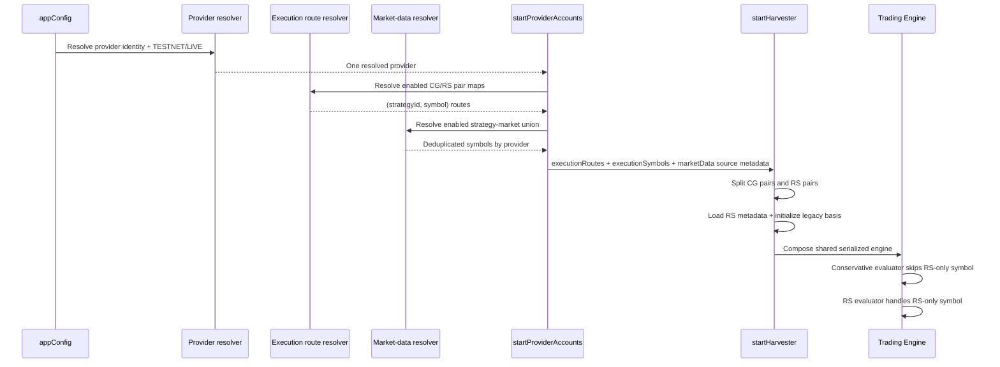

# Harvester multi-provider execution routing

**Status:** Complete and merged in [PR #1455](https://github.com/45s/coinzilla/pull/1455), merge commit `fdc951468648efa1fa17c93dd8c3f6ea78a23d84`. The exact feature head `11d084dfafeefaad880a54f1ae9bd7de6ff43df8` passed required workspace tests and coverage, Harvester targeted tests, full/strict ESLint, syntax, actionlint, repository policy, maintained Markdown/anchor, dependency audit, Utils tests and External Documentation Links. Execution routes are explicit per `(strategyId, symbol)` and independent from market-data source routes; orders remain pinned to their originating provider/account. The production adapter-factory map still registers Binance only, so this completed routing foundation does not enable Bitunix or another exchange. No live or TESTNET exchange operations were performed.

## Ownership model

Harvester owns provider-instance configuration, strategy-to-account association, execution routing, market-data routing, account readiness, and runtime lifecycle. `@coinzilla/brokers` owns the structural Broker API and provider-specific capability evidence; all providers use the single shared `BrokerCapabilities` value contract from `@coinzilla/entities`.

Each configured provider instance represents one immutable provider/account/environment identity. A separate Harvester runtime owns that account's Portfolio, OrderRegistry, balances, market metadata, user-data stream, strategy engine, and shutdown lifecycle. The runtime receives only the strategy markets explicitly assigned to its execution provider.

## Independent routing tables

```js
executionRouting: {
  routes: [
    { strategyId: "CG_coinGrabber", symbol: "BTCUSDT", providerInstanceId: "binance-testnet-secondary" },
    { strategyId: "CG_coinGrabber", symbol: "ETHUSDT", providerInstanceId: "binance-testnet-primary" },
  ],
}
```

```js
marketDataRouting: {
  routes: [
    { symbol: "BTCUSDT", providerInstanceId: "binance-testnet-primary" },
    { symbol: "ETHUSDT", providerInstanceId: "binance-testnet-secondary" },
  ],
}
```

The example deliberately routes BTC execution to the secondary account while sourcing its market data from the primary account, and routes ETH execution to the primary account while sourcing its market data from the secondary account.

A single execution account may own multiple symbols whose market-data sources differ. The per-symbol `marketDataProviderIdentities` map is authoritative; the legacy singular `marketDataProviderInstanceId` is populated only when all assigned symbols share one source and is `null` for mixed-source accounts. A `null` singular value is not permission to fall back to the execution provider.

Every enabled executable strategy/market must have one execution route and one market-data route. Every configured provider instance must own at least one execution route; data-only provider instances are explicitly unsupported in this runtime. Duplicate, missing, disabled-market, unsupported-strategy, unknown-provider, and environment-incompatible routes fail closed. A strategy/market cannot be routed to multiple accounts. Market-data and execution routing are not interchangeable.

## Strategy route identity at the runtime boundary

Execution routing is defined per `(strategyId, symbol)`. The provider's market-data subscription list is a separate, deduplicated set of symbols and must not replace the strategy route records. When multiple strategies share a market, the runtime startup contract must retain both strategy identities even though the provider subscribes to that symbol once. Merged [PR #1696](https://github.com/45s/coinzilla/pull/1696) preserves these records through provider startup and completes the offline RS-only startup proof. Enabled RS routes are supported by the shared runtime and RS is enabled by default. Each market's `enabled` and `tradingEnvironment` fields determine route eligibility; configuration does not start the process or authorize an exchange session.

## Strategy route identity at provider startup

The provider-account startup input carries the immutable `executionRoutes` array separately from the deduplicated `executionSymbols` list. The same-market regression verifies that CG and RS both reach the provider boundary while only one market subscription is requested. PR #1515 completed production RS policy/order lifecycle, terminal mixed-SELL integration, shared reservations and offline lifecycle proof. PR #1696 completed legacy single-provider routing and RS-only startup. RS is enabled by default; per-market `enabled` and `tradingEnvironment` fields control eligibility. Route metadata does not start the process or authorize an exchange session.

## Strategy route identity through runtime metadata

Provider startup receives and returns immutable strategy-owned `executionRoutes` separately from deduplicated `executionSymbols`; multi-account metadata preserves each provider's assignments. PR #1515 completed RS policy/lifecycle evaluation and order/fill management through the shared engine. PR #1696 completed legacy single-provider route inference and RS-only startup. RS is enabled by default.

## Account and provider failure policy

Provider identity is immutable and includes provider instance, provider type, account identity, and LIVE/TESTNET environment. All configured providers are required by default. An explicitly optional provider may fail account connection or its deferred market-data startup without terminating unrelated healthy accounts; its execution route is marked unavailable and no other provider is substituted. Partial subscriptions are stopped; if cleanup is unconfirmed, the account lock remains held for safe retry/shutdown. A required-provider failure rolls back every account that already started. If a route depends on an unavailable market-data source, it fails closed rather than selecting another source.

No order is retried or redirected after an uncertain mutation outcome. A market-data source failure never changes the execution destination. UNKNOWN capability is not support for a safety-critical operation.

## Capability and Bitunix boundary

Before connecting a provider, Harvester verifies the canonical Broker capability declaration for every operation required by the account and its market-data routes. Only SUPPORTED satisfies a required capability; UNSUPPORTED and UNKNOWN block startup.

The production provider-factory map currently registers Binance only. Bitunix Spot is not a configured Harvester provider while issue #1185 remains open. Do not introduce a partial observer-only runtime or route Bitunix around the standard provider contract. Once #1185 is resolved, Bitunix must enter through the complete provider-instance, BrokerPort, capability, account-lifecycle, and routing integration.

## Backward compatibility

When brokers.instances, executionRouting, and marketDataRouting are absent, the single-provider Binance compatibility path infers execution routes for every enabled executable strategy from that strategy's own pair map. The market-data subscription set is the deduplicated union of enabled markets from those strategies. This includes RS-only configurations and does not require enabling or adding a Conservative route for the same symbol. A market is inferred only when its configured trading environment is compatible with the sole provider; there is no cross-environment fallback. Multi-provider mode still requires explicit execution and market-data routing tables; there is no first-connected-broker fallback.

## Deferred boundaries

Process-restart restoration remains disabled under issue #654. RS-4/RS-5 offline runtime acceptance and the PR #1696 routing/startup acceptance are complete, but `RS_RECOVERY_SELLER_CONFIG.enabled` is true by default; LINEAUSDT remains TESTNET-only through its pair-level `tradingEnvironment`. The controlled TESTNET runbook remains CLOSED / PAUSED; no live or TESTNET order mutations are authorized by engineering verification.

## Recovery Seller account routes

Provider routing preserves the `{ strategyId, symbol }` owner while market and user-data subscriptions are deduplicated by symbol. A provider account with CG routes may also receive explicitly configured RS routes; the effective runtime keeps CG and RS pair maps separate and builds a union market map for canonical exchange metadata and subscriptions.

RS routes are rejected unless `strategies.RS_recoverySeller.enabled` is true and every routed market is enabled for the selected `TRADING_MODE`. RS markets require an explicit positive per-market `investment` budget and an operator-declared legacy `invested` basis, original `quantity`, and per-cycle `sellQuantity`. An RS-only provider account must be supported without synthesizing a CG execution route: its enabled RS pair map supplies its execution routes and contributes to the market-data union. The account startup retains an empty Conservative pair map while preserving the RS pair map. The bootstrap regression starts a real in-process Harvester runtime with an initialized temporary Operational State Store and proves that LINEAUSDT is subscribed without a Conservative execution route. The shared durable configuration baseline fingerprints all configured strategy maps as one Harvester process configuration, and the runtime enabled-market set is the union of the selected strategy markets. This lets an RS-only provider account retain durable process-start evidence without fabricating a Conservative route. In multi-provider mode, RS execution and its market-data symbol still require explicit routes. This compatibility does not enable RS by default or authorize TESTNET/LIVE exchange operations.

At startup, canonical exchange metadata is loaded before the RS legacy basis is initialized in the provider-account state. The RS pair is validated against its own order quantity, investment, precision, and order-type requirements even when CG owns the same market. The declared legacy quantity is not treated as available inventory: the account snapshot and shared reservation accounting must independently prove unreserved Spot custody before an RS SELL can be authorized. RS is enabled by default.

## Legacy single-provider route resolution and RS-only account startup

The legacy path is selected only when both explicit routing tables are absent and exactly one provider instance has already been resolved. Its provider identity and environment come from the existing provider resolver (`TRADING_MODE` for the legacy Binance descriptor); route inference never selects an endpoint or provider by strategy.

The strategy-owned route output and symbol-level subscription output are intentionally different:

```ts
type ExecutionRoute = Readonly<{
  strategyId: "CG_coinGrabber" | "RS_recoverySeller";
  symbol: string;
}>;

type ExecutionRoutesByProvider = ReadonlyMap<string, readonly ExecutionRoute[]>;
type SymbolsByProvider = ReadonlyMap<string, readonly string[]>;
```

- Execution route records preserve one owner per `(strategyId, symbol)`. The symbol resolver deduplicates symbols only after ownership has been resolved; the market-data regression verifies that a symbol shared by CG and RS produces exactly one subscription per provider.
- In legacy single-provider mode, enabled CG and enabled RS pairs are read from their separate pair maps and assigned to the one already-resolved provider only when their `tradingEnvironment` is `both` or matches that provider.
- The market-data symbol set is the union of enabled, environment-compatible markets across enabled strategies, deduplicated by symbol. Disabled pairs remain visible to explicit-route validation so an explicit route to a disabled market fails with the correct reason, but they are never subscribed.
- In explicit multi-provider mode, every enabled strategy-market requires an explicit execution route and every enabled market requires an explicit market-data source. There is no inferred provider, first-provider fallback, or cross-environment fallback.
- An RS-only provider account has an empty Conservative execution-pair map and a non-empty RS pair map. The Conservative evaluator skips a symbol with no Conservative pair; the shared transition evaluator then invokes the RS transition evaluator for that symbol. The RS market is not added to Conservative configuration.
- Durable configuration baseline identity is process-wide (`strategyName: "Harvester"`): its fingerprint includes every effective configured strategy and its enabled-market list is the union of their enabled pair maps. This preserves process-start/baseline matching when one provider account owns only RS markets.



Explicit route validation failures (disabled strategy/market, missing route, duplicate owner, unknown provider, or environment mismatch) stop startup before provider connections. A market-data source failure does not change the execution destination.
