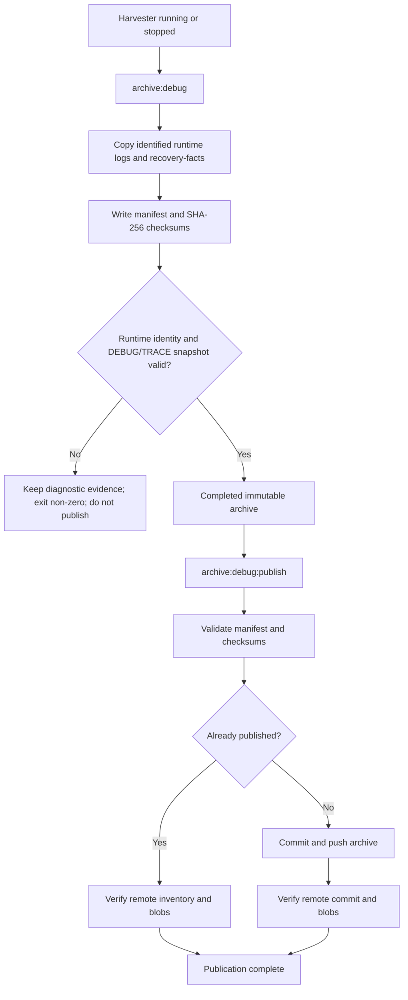

# Harvester local DEV reset and evidence archive

This runbook covers the local TESTNET development workflow. The debug archive collector is read-only and can preserve existing LIVE session evidence, but it does not authorize LIVE trading or exchange operations.

## Required environment

- Debug archive collection is read-only and does not require `TRADING_MODE`; it infers testnet/live mode from the exact matched process identity.
- `HARVESTER_ARCHIVE_REMOTE=https://github.com/45s/coinzilla-archive.git` and Git access are required for `archive:push` and `archive:debug:publish`, not for local debug collection.
- Run commands from `apps/harvester`.

`archive:push` validates and publishes the full development archive. `archive:debug` collects a lightweight testnet/live runtime snapshot and may run while Harvester is active; it reads the process lock only to verify active-runtime ownership and never stops Harvester, reclaims/deletes a lock, or mutates trading state. `archive:debug:publish` publishes an already-collected immutable snapshot and does not inspect the running process.

## Start and stop a DEV session

Start using the existing command:

```bash
pnpm run dev
```

The DEV runner itself requires `TRADING_MODE=testnet`. It creates the missing `logs/cumulative/` and process-session directories, records a non-secret `process-identity.json` marker with the TESTNET environment and Git provenance, and writes `process-completed.json` only after the child exits and log streams close.

Stop Harvester normally and wait for the runner to return to the shell. Do not kill the runner or delete process locks manually. An interrupted session without a valid completion marker is not eligible for archiving.

## Publish the DEV evidence archive

Run this after Harvester has stopped:

```bash
pnpm run archive:push
```

The command creates a uniquely named local snapshot in the ignored `archive-output/` directory, requires the selected completed TESTNET log session and latest recovery-facts checkpoint to have the same runtime session ID, verifies its inventory and SHA-256 checksums, publishes to the private archive repository, and verifies the remote commit and each file blob. If publication fails, the local snapshot remains for inspection/retry and source folders remain unchanged.

Each archive contains:

- `logs/sessions/`: only the newest completed TESTNET session with a valid process identity; its files are gzip-compressed.
- `logs/cumulative/`: the final 5% of structured records belonging to that selected TESTNET runtime session. Shared `terminal.log` is deliberately excluded because it has no reliable per-record environment marker; the selected session's complete terminal log is included in the compressed session directory.
- `data/`: all regular files and directories except `data/production/`. The configured `HARVESTER_DATABASE_DIRECTORY` override is honored; only non-production entries are copied.
- `recovery-facts/`: the complete Operational State Store, including facts and manifest streams.
- `data_commit_hash` and `manifest.json`: the latest committed recovery-facts checkpoint identity, file inventory, byte sizes, and SHA-256 checksums.

LIVE production database files and sidecars are never copied. Unclassified top-level entries under `logs/` cause the archive to fail closed. Symbolic links and unsupported filesystem entries are rejected.

The snapshot is a raw folder copy, not a transactional SQLite backup. Stop Harvester before archiving so SQLite files and recovery facts are quiescent.

## Collect and publish a lightweight debug archive

Debug archive collection and publication are separate commands with different safety boundaries.

### 1. Collect a local snapshot while Harvester is running or stopped

Run this directly; do not stop Harvester just to collect debug evidence:

```bash
pnpm run archive:debug
```

Collection does not require `TRADING_MODE`. It reads testnet/live session identities and the Operational State Store, rejects symlinks and unsupported filesystem entries, and writes a uniquely named local archive directory. If Harvester is running, the collector verifies the live PID/host/start-time from the process lock against the session's process identity and durable `PROCESS_STARTED` fact. For legacy session identity records that omit `processId`, the collector may use the durable process-start PID only when the session runtime ID and original `startedAt` exactly match that fact; an explicit invalid or conflicting session PID is never replaced. The lock is read-only: collection never stops the process, reclaims/deletes the lock, or waits for shutdown, and it rechecks both process-lock namespaces, including each lock token, after copying. Append-only files are copied only through the byte length observed at the snapshot boundary; source replacement, truncation, or mutation of the captured prefix fails closed. The copied recovery-facts checkpoint is validated inside the archive. The command does not contact GitHub or publish anything.

A publishable collection requires one unique process identity whose immutable runtime ID and exact `startedAt` match the archived committed recovery-facts `PROCESS_STARTED` identity, plus non-empty DEBUG (`harvester.log`) and TRACE (`trace.log`) streams. A normally completed process requires matching process-completion and logger-flush records with both streams marked complete. A running process requires a live same-host paired process lock whose PID and start time match the session identity and durable process identity; the archive records `completionStatus=active` and adds `active-process-snapshot.json`. A stopped process with both legacy completion records absent may be archived as `completionStatus=stopped-unconfirmed` only when its exact durable PID is no longer alive, no Harvester process-lock owner is active, the runtime ID and original start timestamp match, and both matching streams are byte-stable during copying. The `stopped-process-snapshot.json` marker explicitly records that process exit reason and logger flush are unconfirmed; it never labels the session cleanly completed. A malformed, conflicting, or only partially present completion record remains an integrity failure. Every rotated generation is included; already-compressed `.gz` inputs are copied byte-for-byte, and uncompressed inputs are gzip-compressed. Original filenames, source paths, rotation generation, source/archive sizes and SHA-256 values are recorded per stream. Rotated files are ordered oldest-first, with the current file last. If multiple source names normalize to the same `.gz` archive path, collection fails closed instead of overwriting evidence.

If identity is missing/ambiguous, either stream is missing/empty, completion is absent/incomplete without a verified active or stopped-process snapshot, the active lock changes during copying, or any stream belongs to another runtime, the collector retains a local diagnostic archive with `evidenceIntegrity.validForPublication=false`, prints the expected runtime, discovered owners and paths, and exits non-zero. That directory is not a completed archive and must not be published. A warning is not an acceptable substitute for the non-zero failure.

### 2. Publish an existing verified snapshot

```bash
pnpm run archive:debug:publish
```

The publisher selects the latest valid completed archive. To publish a specific archive instead:

```bash
pnpm run archive:debug:publish -- --archive ./archive-output/<archive-directory>
```

Publication validates the version-2 manifest, the latest committed recovery-facts checkpoint and its unique `PROCESS_STARTED` identity, exact runtime, PID, and paired-lock correlation, both non-empty log-stream inventories, matching completion metadata, an active snapshot marker, or a stopped-unconfirmed snapshot marker with exact PID/start-time identity and explicit missing-completion limitations, exact file inventory, sizes, SHA-256 checksums and gzip readability before contacting the configured private destination. It rejects `missing`, `mismatched`, `incomplete`, `unverifiable` and ambiguous evidence. It copies the completed archive into a private temporary snapshot, validates that copy again, and publishes only the verified temporary copy to `https://github.com/45s/coinzilla-archive`. The temporary copy is removed after the attempt; the original archive is never changed. Publication then verifies the remote commit and every published file blob.

**Publication does not inspect the Harvester process, read or remove process locks, require `TRADING_MODE`, stop trading, access live operational directories, collect additional evidence, or modify the source archive.** It can therefore be retried while Harvester is actively trading. A retry of an already-published archive verifies the existing remote contents and does not create a duplicate archive.

Collection and publication flow:



The debug archive retains the existing timestamp/ID naming convention with the `_debug` suffix. Version-2 manifests distinguish `matched`, `missing`, `mismatched`, `incomplete` and `unverifiable` evidence. A `stopped-unconfirmed` session is publishable only through its separate post-exit snapshot marker; it does not assert successful shutdown or a completed logger flush. Other identified testnet/live sessions may be retained only as separately identified independent evidence; they are never used to satisfy the trading runtime DEBUG/TRACE streams. Only `matched` evidence is publishable. A live-process snapshot is publishable only when its active lock, process identity, durable runtime identity, and snapshot marker all agree. Older version-1 debug archives do not carry the required per-stream ownership/completeness proof and are rejected by the publisher; do not relabel or hand-edit them to bypass validation. The archive contains only:

- `logs/sessions/`: identified testnet/live session evidence, with DEBUG/TRACE rotation and compression provenance; unrelated runtimes remain in separate session directories.
- `recovery-facts/`: complete Operational State Store facts and manifest.
- `data_commit_hash` and `manifest.json`: checkpoint identity, file inventory, sizes, and SHA-256 checksums.

It excludes all of `data/` (databases and backups) and all of `logs/cumulative/`. The regular `archive:push` workflow is unchanged.

## Reset only local Operational State history

Archive first if you need to preserve the current session's evidence. Then ensure Harvester is stopped and run:

```bash
pnpm run operational-state:reset:dev -- --confirm
```

The command requires `TRADING_MODE=testnet`, the explicit `--confirm` argument, and an empty Harvester process-lock directory. Any lock file causes a refusal; the reset command never removes process locks.

It resolves the target using the same `OPERATIONAL_STATE_DIRECTORY` configuration as startup and only accepts a real directory whose final name is `recovery-facts`. It removes that directory only.

**The reset does not delete or modify:**

- `data/` or either SQLite database (TESTNET or LIVE).
- `logs/` or any Journal session.
- `archive-output/` or any published archive.
- Exchange balances, open orders, or account history.

On the next startup, the existing Operational State Store bootstrap initializes a fresh empty ledger because the directory is absent. It does not restore Portfolio, RecoveryLedger, or OrderRegistry from Journal/logs/database history. Process-restart restoration remains disabled. Exchange account history synchronization and startup open-order checks remain separate startup behavior; old exchange orders are not adopted or canceled by this reset.

If the target is already absent, the command refuses the missing path; it never silently treats a bad path as a successful reset. It also rejects symlink targets, invalid paths, non-TESTNET mode, missing confirmation, and any process lock.

## Directory creation

Normal startup creates missing runtime directories:

- `logs/cumulative/` and the current `logs/sessions/<session>/` through `configureHarvesterLogging`.
- `data/testnet/` and `data/production/` through the database isolation resolver, independent of `NODE_ENV`. The selected database file still depends only on validated `TRADING_MODE`.

The database path override remains an absolute local-filesystem base directory; production deployments should use a persistent local volume.
