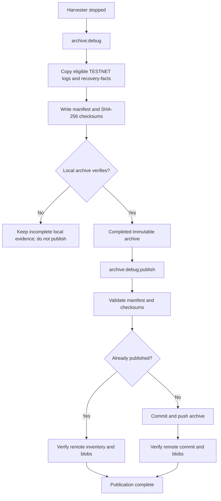

# Harvester local DEV reset and evidence archive

This runbook covers the local TESTNET development workflow only. It does not authorize LIVE trading or exchange operations.

## Required environment

- `TRADING_MODE=testnet` in `.env.development`.
- `TRADING_MODE=testnet` is required for collection.
- `HARVESTER_ARCHIVE_REMOTE=https://github.com/45s/coinzilla-archive.git` and Git access are required only for publication.
- Run commands from `apps/harvester`.

The archive command rejects LIVE or unspecified `TRADING_MODE`, validates the private destination, and refuses to run while any Harvester process lock exists.

## Start and stop a DEV session

Start using the existing command:

```bash
pnpm run dev
```

The DEV runner itself requires `TRADING_MODE=testnet`. It creates the missing `logs/cumulative/` and process-session directories, records a non-secret `process-identity.json` marker with the TESTNET environment and Git provenance, and writes `process-completed.json` only after the child exits and log streams close.

Stop Harvester normally and wait for the runner to return to the shell. Do not kill the runner or delete process locks manually. An interrupted session without a valid completion marker is not eligible for archiving.

## Publish the DEV evidence archive

Run this after Harvester has stopped:

```bash
pnpm run archive:push
```

The command creates a uniquely named local snapshot in the ignored `archive-output/` directory, requires the selected completed TESTNET log session and latest recovery-facts checkpoint to have the same runtime session ID, verifies its inventory and SHA-256 checksums, publishes to the private archive repository, and verifies the remote commit and each file blob. If publication fails, the local snapshot remains for inspection/retry and source folders remain unchanged.

Each archive contains:

- `logs/sessions/`: only the newest completed TESTNET session with a valid process identity; its files are gzip-compressed.
- `logs/cumulative/`: the final 5% of structured records belonging to that selected TESTNET runtime session. Shared `terminal.log` is deliberately excluded because it has no reliable per-record environment marker; the selected session's complete terminal log is included in the compressed session directory.
- `data/`: all regular files and directories except `data/production/`. The configured `HARVESTER_DATABASE_DIRECTORY` override is honored; only non-production entries are copied.
- `recovery-facts/`: the complete Operational State Store, including facts and manifest streams.
- `data_commit_hash` and `manifest.json`: the latest committed recovery-facts checkpoint identity, file inventory, byte sizes, and SHA-256 checksums.

LIVE production database files and sidecars are never copied. Unclassified top-level entries under `logs/` cause the archive to fail closed. Symbolic links and unsupported filesystem entries are rejected.

The snapshot is a raw folder copy, not a transactional SQLite backup. Stop Harvester before archiving so SQLite files and recovery facts are quiescent.

## Collect and publish a lightweight debug archive

Debug archive collection and publication are separate commands with different safety boundaries.

### 1. Collect a completed local snapshot

Run this only after Harvester has stopped:

```bash
pnpm run archive:debug
```

Collection requires `TRADING_MODE=testnet` and refuses an active Harvester process lock. It reads the TESTNET session evidence and Operational State Store, rejects symlinks and unsupported filesystem entries, preserves the recovery-facts integrity checks, and creates a uniquely named completed snapshot in the ignored `archive-output/` directory. The command does not contact GitHub or publish anything.

A collection is complete only after `manifest.json` and all SHA-256 checksums have been written and verified. An interrupted/incomplete directory is not eligible for publication.

### 2. Publish an existing completed snapshot

```bash
pnpm run archive:debug:publish
```

The publisher selects the latest valid completed archive. To publish a specific archive instead:

```bash
pnpm run archive:debug:publish -- --archive ./archive-output/<archive-directory>
```

Publication validates the manifest, exact file inventory, sizes and SHA-256 checksums before contacting the configured private destination. It publishes only the selected archive directory to `https://github.com/45s/coinzilla-archive`, then verifies the remote commit and every published file blob.

**Publication does not inspect the Harvester process, read or remove process locks, require `TRADING_MODE`, stop trading, access live operational directories, collect additional evidence, or modify the source archive.** It can therefore be retried while Harvester is actively trading. A retry of an already-published archive verifies the existing remote contents and does not create a duplicate archive.

Collection and publication flow:



The debug archive retains the existing timestamp/ID naming convention with the `_debug` suffix. Its manifest preserves the log-session and recovery-facts identities independently; a mismatch is explicitly reported and must not be interpreted as proof that the sources belong to one runtime. The archive contains only:

- `logs/sessions/`: identified TESTNET session evidence, gzip-compressed.
- `recovery-facts/`: complete Operational State Store facts and manifest.
- `data_commit_hash` and `manifest.json`: checkpoint identity, file inventory, sizes, and SHA-256 checksums.

It excludes all of `data/` (databases and backups) and all of `logs/cumulative/`. The regular `archive:push` workflow is unchanged.

## Reset only local Operational State history

Archive first if you need to preserve the current session's evidence. Then ensure Harvester is stopped and run:

```bash
pnpm run operational-state:reset:dev -- --confirm
```

The command requires `TRADING_MODE=testnet`, the explicit `--confirm` argument, and an empty Harvester process-lock directory. Any lock file causes a refusal; the reset command never removes process locks.

It resolves the target using the same `OPERATIONAL_STATE_DIRECTORY` configuration as startup and only accepts a real directory whose final name is `recovery-facts`. It removes that directory only.

**The reset does not delete or modify:**

- `data/` or either SQLite database (TESTNET or LIVE).
- `logs/` or any Journal session.
- `archive-output/` or any published archive.
- Exchange balances, open orders, or account history.

On the next startup, the existing Operational State Store bootstrap initializes a fresh empty ledger because the directory is absent. It does not restore Portfolio, RecoveryLedger, or OrderRegistry from Journal/logs/database history. Process-restart restoration remains disabled. Exchange account history synchronization and startup open-order checks remain separate startup behavior; old exchange orders are not adopted or canceled by this reset.

If the target is already absent, the command refuses the missing path; it never silently treats a bad path as a successful reset. It also rejects symlink targets, invalid paths, non-TESTNET mode, missing confirmation, and any process lock.

## Directory creation

Normal startup creates missing runtime directories:

- `logs/cumulative/` and the current `logs/sessions/<session>/` through `configureHarvesterLogging`.
- `data/testnet/` and `data/production/` through the database isolation resolver, independent of `NODE_ENV`. The selected database file still depends only on validated `TRADING_MODE`.

The database path override remains an absolute local-filesystem base directory; production deployments should use a persistent local volume.
