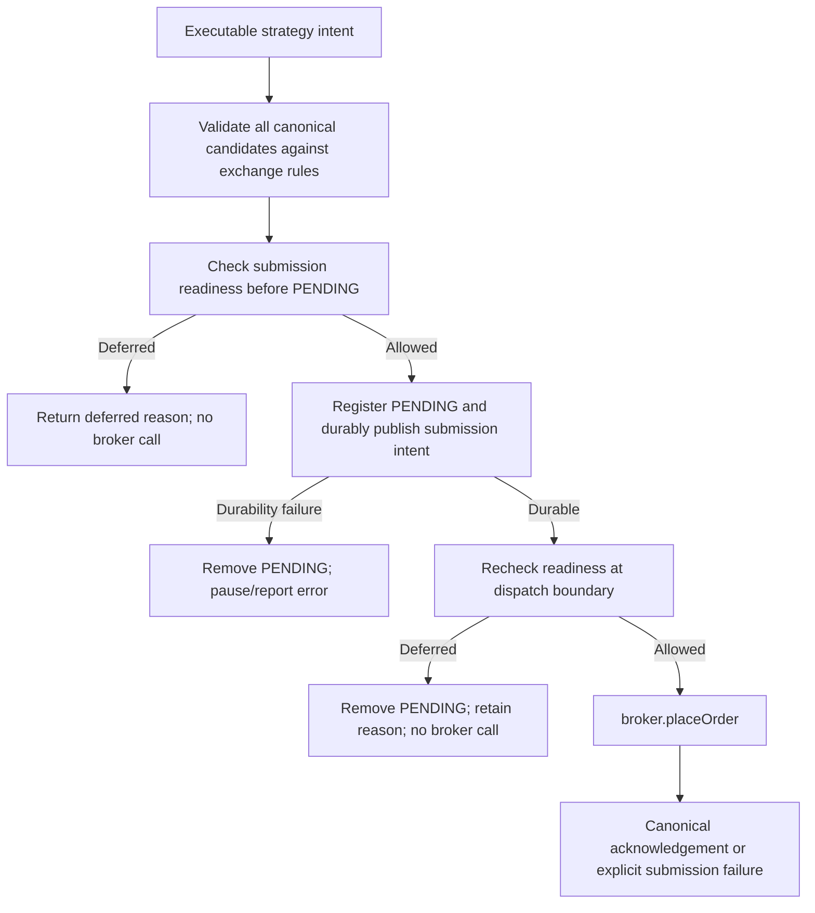

# Submission deferrals and missing-order diagnostics

This runbook explains why a Conservative strategy decision can be executable while no broker order is created. It is the operational reference for diagnosing a missing order when a market evaluation appears successful. The [Conservative Domain Specification](../domain/CONSERVATIVE_DOMAIN_SPECIFICATION.md) remains the sole authority for strategy and order-safety policy; this runbook documents the application submission gate, its diagnostics, and safe investigation steps.

Related incident: [issue #1025](https://github.com/45s/coinzilla/issues/1025). Implementation and regression coverage: [PR #1026](https://github.com/45s/coinzilla/pull/1026).

## Incident context and evidence boundary

Issue #1025 reported that ZROFDUSD repeatedly produced an executable BUY `LIMIT_MAKER` intent for 5 ZRO at 1.576. The allocator approved the intent, but the observed submission result was `ok: true` with `submittedOrders: []`, and no active order appeared.

The affected runtime was reported as commit `73cab82d0bdbd3998f6d1ed65783e0aaf1f536be`. At that commit, the two affected use-case files match the source versions reviewed for this fix:

- `src/use-cases/conservative-trading-engine.js`, blob `aa1fb96f794c46e5b5899515934ce139dd5ec646`.
- `src/use-cases/execute-strategy-decision.js`, blob `7126fdb2f80540f71da8f92d909517d6f5fc4129`.

Source inspection confirms that a failed `canSubmit()` gate was converted into a successful deferred result, without calling `broker.placeOrder()`. The old engine log did not include the deferral flag or cause.

**What is not established:** the historical runtime evidence supplied for the incident does not contain the exact book snapshot, best ask, or freshness state at each failed evaluation. It is therefore not possible to conclude whether the particular 1.576 BUY was blocked by an unavailable/stale book or because it would have crossed the ask. Do not turn either explanation into a historical fact.

## The key distinction: decision, deferral, acknowledgement

These are separate stages:

1. The allocator and strategy produce an executable order intent. This says the decision is internally executable; it does not authorize exchange submission by itself.
2. The submission-readiness gate may defer the intent before broker I/O.
3. Only after the readiness checks pass does Harvester call `broker.placeOrder({ order })`.
4. `submittedOrders` contains canonical broker-acknowledged orders. An acknowledgement is not a fill.

Consequently, `ok: true` means the use case returned without an execution error. It does **not** mean an order was sent or accepted by the exchange. A successful deferral is represented by `data.deferred: true`. For a fully deferred single-order decision, `data.submittedOrders` is empty and no broker order exists.

For a multi-action decision, earlier actions may already have been acknowledged before a later action is deferred. In that case, the result can contain both `deferred: true` and a non-empty `submittedOrders` array. Inspect the complete array and active-order state; do not assume deferral means that every action in the decision was skipped.

## Submission gate and stable reasons

The Conservative engine's `canSubmit({ order, purpose })` callback returns a structured decision. The purpose is application-only metadata; only an explicitly marked `RECOVERY_SELL` receives the volatility-specific exception.

- Allowed: `{ allowed: true }`.
- Deferred: `{ allowed: false, reason, details }`.

The reason is a stable diagnostic identifier. Details are safe context, not a promise that every field is present.

| Reason | Exact guard condition | Safe interpretation |
| --- | --- | --- |
| `MARKET_PAUSED` | The symbol is in the engine's safety-paused set. | The pair is paused; do not retry by bypassing the pause. Investigate the pause cause and its recovery path. |
| `OPERATOR_MARKET_PAUSED` | The symbol is operator-paused and the candidate is a BUY. | New BUYs are suppressed by operator control; existing orders and recovery SELL lifecycle remain governed by the operator-control contract. |
| `UNOWNED_OPEN_ORDERS_PRESENT` | Account-wide reconciliation reports open orders for the symbol that Harvester does not own. | Strategy submission is blocked to avoid interacting with external orders. Resolve ownership through the established reconciliation process; never adopt or cancel an external order by guess. |
| `TRADING_DISABLED` | `canTrade({ symbol })` is false at the submission gate. | Trading is not currently permitted/ready for this symbol. Inspect the engine readiness and stream/subscription state. |
| `MARKET_PRICE_UNAVAILABLE` | No cached market-price event exists for the symbol at the gate. | Wait for a valid price event; do not fabricate a price. |
| `MARKET_PRICE_STALE` | The cached market-price event fails the configured freshness check. | Wait for a fresh market-price event. |
| `VOLATILITY_DATA_UNAVAILABLE` | Volatility protection is enabled for the symbol but its candle history/snapshot is not ready or could not be read. | Keep ordinary strategy actions blocked until valid, fresh volatility data is available. |
| `VOLATILITY_PROTECTION_ACTIVE` | The per-market protection state is not NORMAL or the latest ratio is at/above the protection threshold. | Keep ordinary strategy actions blocked; only an explicitly marked `RECOVERY_SELL` may pass this volatility-specific gate. |
| `MARKET_BOOK_UNAVAILABLE` | The order is `LIMIT_MAKER` and no same-symbol book ticker is cached. | No safe post-only crossing decision can be made; broker I/O is withheld. |
| `MARKET_BOOK_STALE` | The order is `LIMIT_MAKER` and its cached same-symbol book fails the freshness check. | Wait for a fresh book ticker; stale quotes must not authorize a maker order. |
| `POST_ONLY_WOULD_CROSS` | The `LIMIT_MAKER` price would execute immediately against the opposite best quote. | The intent is not safe as post-only at this book. Preserve the guard; wait for a new market evaluation or a newly calculated safe price. |

For `POST_ONLY_WOULD_CROSS`, details include the symbol, side, limit price, best bid, best ask and book timestamp. Volatility deferrals include the current protection mode and latest ratio when available. Price and quantity values remain exact decimal strings where provided by the source.

The generic execution use case also supports legacy boolean gate callbacks. A legacy `false` is reported as `SUBMISSION_NOT_ALLOWED`; it does not identify the underlying cause. The Conservative engine uses structured results. A malformed structured result, or a deferred result without a non-empty reason, is an error rather than a silent deferral.

### Similar-looking pre-evaluation skips are different

Not every skipped evaluation reaches the submission gate. `evaluateLatestTransition()` can stop before strategy evaluation with results such as:

- `PAIR_PAUSED`
- `UNOWNED_OPEN_ORDER`
- `TRADING_NOT_READY`
- `NO_MARKET_PRICE`
- `STALE_MARKET_PRICE`

These are evaluation-level skips, not the structured submission-gate reasons above. The distinction matters: an executable strategy decision followed by `deferred: true` reached the submission path; a `skipped: true` result may not have produced an executable intent at all.

## Submission lifecycle and safety boundary

The execution use case checks readiness at more than one point because market state can change while the order is being prepared:

1. The execution use case constructs and validates every canonical order candidate against the current exchange trading rules before submitting any action.
2. Immediately before local PENDING registration, it checks the submission gate. If the gate defers the intent, no PENDING order is registered and no broker call occurs.
3. Harvester registers a local PENDING canonical order and durably publishes `order.submission_requested`. The durable-intent barrier must succeed before broker I/O.
4. After that asynchronous registration/persistence step, the execution use case checks the gate again. If readiness changed, the deferred callback removes the local PENDING order and preserves the reason/details. Failure to remove it is an error. The broker is not called.
5. Only if both gate checks pass does the use case call `broker.placeOrder({ order })`.

The trailing-BUY replacement workflow also uses the executor's separate `.validate()` preflight before canceling the existing BUY. That preflight does not register PENDING or call the broker; after confirmed cancellation, the rebuilt replacement order goes through the normal two-gate submission sequence above.

The post-registration check is important: the book or price may become stale, a pair may be paused, or another safety condition may change while the durable intent is being written. The gate is intentionally repeated at the final broker boundary.

**LIMIT_MAKER invariant:** missing or stale book data and a crossing price fail closed. Never weaken the gate, submit a crossing maker order as a fallback, or reinterpret a post-only rejection as a fill. The separate broker response path for a definite exchange post-only rejection is not the same as a local `POST_ONLY_WOULD_CROSS` deferral: the former is a broker response after an attempted call; the latter prevents the call.

## Where to find the diagnostics

The Conservative engine emits a DEBUG record named `Harvester Conservative submission result`. On the fixed implementation, inspect these fields together:

- `evaluationId` and `symbol` — correlate the result to the evaluation and market.
- `ok` — whether the use case returned without an error.
- `deferred` — whether submission was intentionally withheld.
- `deferralReason` and `deferralDetails` — why it was withheld and the available market context.
- `submittedOrders` — canonical acknowledged orders returned by the broker path.
- `errors` — execution/validation failures, if any.
- `activeOrdersAfter` — engine-owned active orders after the transition.

A useful first-pass interpretation:

| Log/result | Meaning |
| --- | --- |
| `ok: true`, `deferred: true`, empty `submittedOrders` | A submission gate intentionally withheld the broker call. Read `deferralReason`. |
| `ok: true`, `deferred: false`, non-empty `submittedOrders` | At least one broker acknowledgement was returned. This is not proof of a fill. |
| `ok: false` or non-empty `errors` | An execution/validation failure occurred; inspect the typed error and lifecycle state. |
| `skipped: true` without `deferred: true` | Evaluation stopped before the submission gate; inspect the skip reason. |

On the fixed code, the engine's outer result preserves `deferred: true`, `reason`, and `deferralDetails`. The lower-level execution use case uses `details` in its data result; the engine maps that to `deferralDetails` for the market-evaluation result and log.

Older runtime commits, including the issue's reported baseline, do not emit these structured reason fields. Do not expect the new fields in historical logs generated before the fix.

## Safe diagnostic procedure

1. Find the `Harvester Conservative submission result` record for the symbol and evaluation ID.
2. Check `deferred`, `deferralReason`, `deferralDetails`, `submittedOrders`, `errors`, and `activeOrdersAfter` as one record.
3. If the reason concerns price or book freshness/availability, compare the event timestamps with the configured freshness policy and confirm that a new valid market-data event is received.
4. If the reason is `POST_ONLY_WOULD_CROSS`, compare the exact limit price with the recorded opposite best quote. Keep the order blocked until a new safe evaluation occurs.
5. If the reason is `MARKET_PAUSED`, inspect the original pause reason and use the documented reconciliation/recovery path. Do not clear the pause solely to make the order submit.
6. If the reason is `UNOWNED_OPEN_ORDERS_PRESENT`, preserve external orders and reconcile ownership from authoritative account-wide snapshots.
7. If `deferred` is false but the order is absent, inspect broker failure/acknowledgement handling, the order registry, and subsequent user-data events. Do not infer that a broker acknowledgement means a fill.
8. Preserve the complete structured log and related market-data records with the incident evidence. Do not place a manual replacement order as a diagnostic.

Deferred evaluations are retained by symbol. A fresh book update can trigger reevaluation when the symbol is deferred and not paused; the engine also exposes `resumeDeferredEvaluations()` for its owning orchestration. A deferred result is not a promise of automatic retry at an arbitrary interval. Re-evaluation must pass the same safety checks again.

## Regression coverage and source references

The regression tests in `apps/harvester/test/use-cases/conservative-trading-engine.test.js` cover:

- Structured deferral reason/details propagation and zero broker calls across every stable gate-reason category.
- A gate changing after PENDING registration, including local PENDING cleanup and zero broker calls.
- Missing and stale book data, stale price data, unavailable volatility history, and active volatility protection.
- A crossing `LIMIT_MAKER` intent remaining deferred with no broker call.
- Preservation of earlier acknowledged orders when a later action in a multi-action decision is deferred.
- Existing readiness skip/resume behavior.

Implementation references:

- [Conservative Trading Engine](../../src/use-cases/conservative-trading-engine.js)
- [Strategy decision execution](../../src/use-cases/execute-strategy-decision.js)
- [Strategy decision execution tests](../../src/use-cases/execute-strategy-decision.test.js)
- [Market-data subscriptions](../../src/bootstrap/subscriptions/subscribe-to-market-data.js)
- [Conservative Domain Specification](../domain/CONSERVATIVE_DOMAIN_SPECIFICATION.md)
- [Broker–Harvester trading flow](../architecture/BROKER_HARVESTER_TRADING_FLOW_TEXT.md)

## Verification record

- Reported runtime baseline: `73cab82d0bdbd3998f6d1ed65783e0aaf1f536be`.
- Fix PR: [#1026](https://github.com/45s/coinzilla/pull/1026).
- At PR head `ec18fd48604f7e7ef89dec1098554829f12086e7`, Harvester targeted tests, Harvester unit tests, JavaScript syntax, dependency audit, Utils unit tests, and the six repository workflows reported success. The Harvester coverage execution succeeded; its threshold-enforcement step is skipped by the existing workflow configuration.
- No Binance TESTNET or LIVE order was placed as part of the investigation or fix.

This verification record describes the PR head above. Re-check the current PR head and CI before treating the fix as merged or deployed.
