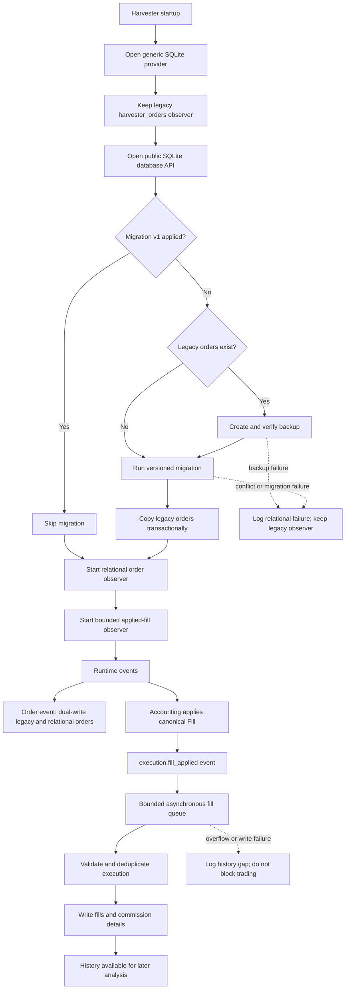

# Harvester ordinary persistence

## Trading-session history input boundary

The createTradingSession use case is the application boundary for creating the ordinary process-session history record. It validates and canonicalizes buildProvenance through the application-owned mapTradingSessionInput mapper before the domain record is sent to the repository port.

The mapper accepts only the bounded provenance contract: application/version/process identity and the allowlisted Git source fields. It canonicalizes Git SHAs, validates canonical UTC commit timestamps and metadata-source states, and drops unknown or secret-bearing properties such as API keys and free-form commit messages. The domain factory remains responsible for session identity, configured markets and lifecycle invariants; it receives provenance that has already crossed the application validation boundary.

The repository record remains schema version 1 with the same buildProvenance field shape. This responsibility move requires no database migration and does not change the observer's best-effort history role or trading-readiness authority. The application mapper unit tests and use-case persistence-port tests cover normalization, unavailable Git metadata, malformed input rejection before writes, and secret-field exclusion.


## Session-scoped runtime errors (#1650) — COMPLETE

Merged [PR #1650](https://github.com/45s/coinzilla/pull/1650) adds the versioned Harvester-owned `runtime_errors` table, bounded pre-database ERROR buffering, a non-blocking structured error observer, allowlisted/redacted searchable fields, and a shutdown drain before SQLite closes. Rows are correlated by the existing `runtime_session_id`; this does not add a `sessions` table or make diagnostics trading/recovery authority. The complete stack/cause record remains in the session DEBUG/TRACE JSONL logs. The history-sync hardening in [PR #1659](https://github.com/45s/coinzilla/pull/1659) supplies record-level history diagnostics to this projection.

**Phase 1/2:** [#1554 — Relational trading history and live fill persistence](https://github.com/45s/coinzilla/issues/1554), completed in merged [PR #1555](https://github.com/45s/coinzilla/pull/1555).

**Phase 3 — COMPLETE:** [#1556 — Binance startup order and trade-history synchronization](https://github.com/45s/coinzilla/issues/1556) was delivered in merged [PR #1557](https://github.com/45s/coinzilla/pull/1557), merge commit `c2b0eba34ea2778be8d70212fd5e2e3144067aa5`. The implementation performs read-only, paginated Binance order/trade-history synchronization for each configured execution market before trading-engine activation. Its backwards-compatible broker pagination contract was delivered in merged [#1558](https://github.com/45s/coinzilla/issues/1558) / [PR #1559](https://github.com/45s/coinzilla/pull/1559), merge commit `b06f034daecbd2b6dee9ad68b8426ca3bab106cb`.

**Parent workstream:** [#1327 — Provider-neutral DB API and Harvester persistence integration](https://github.com/45s/coinzilla/issues/1327)

**Existing order-history projection:** [PR #1469](https://github.com/45s/coinzilla/pull/1469).

**Forward plan:** [Trading-history persistence roadmap](./trading-history-roadmap.md) tracks follow-on strategy-cycle attribution, analytics and remaining operational hardening. Phases 1–3 are implemented; routine relational-history backups and restore checks are delivered in [PR #1567](https://github.com/45s/coinzilla/pull/1567). This README remains the current implementation and safety-boundary reference.

**Relational implementation:** Phases 1/2 are complete in merged [PR #1555](https://github.com/45s/coinzilla/pull/1555); Phase 3 is complete in merged [PR #1557](https://github.com/45s/coinzilla/pull/1557). The merged implementation and its documented coverage limitations are described below.

## Relational history startup failure diagnostics — issue #1854

Harvester prepares the legacy order-history store and the relational `orders`/`fills` projection during startup. If relational migration/setup fails, the current compatibility behavior retains legacy order history but leaves `relationalDatabase` unavailable. In that degraded state, exchange-history synchronization and the local trading-history API are skipped; this is not a successful relational-history startup and must not be mistaken for an empty history result.

The relational preparation failure is logged once at its owning fallback boundary. The diagnostic includes the original error object (so the logger can retain its cause/stack), concrete error message, stable error code/name, and the typed error's safe scalar context/stage when present. A SQLite migration error may identify a failed constraint or migration operation. Do not copy secrets, raw environment dumps, database contents, or private account data into an issue.

**Operator response:**

1. Keep the Harvester process and existing database intact; do not delete, reset, or replace the SQLite file to make startup pass.
2. Record the exact persistence error code, message, stage/context, and cause from the session logs. Preserve the reported migration backup filenames where present, but do not overwrite the original database.
3. Treat relational history and the trading-history API as unavailable until a healthy relational database is confirmed. The legacy order-history fallback does not provide the relational orders/fills API.
4. Follow the [Trading-history API local run instructions](../api/trading-history-api.md#start-locally); the API defaults to loopback port 4201 and versioned `/api/v1/trading/*` routes, not port 3000 or `/api/trading-history`.
5. If a migration reports duplicate or contradictory exchange identities, preserve the fail-closed behavior. Do not merge, rewrite, or delete order/fill rows without a separately verified reconciliation plan and backup.

The exact cause of an individual startup failure must be established from that run's original diagnostic; a synthetic duplicate-identity migration failure is not proof that another database failed for the same reason.

## 0. Export the complete SQLite database as JSON

Use the read-only maintenance command when you need to inspect every stored record outside the database viewer.

From the repository root in Bash:

```bash
pnpm run db:export testnet
pnpm run db:export live
```

Pass exactly one environment argument: `testnet` or `live`. The command uses Harvester's existing database-path resolver, including the optional `HARVESTER_DATABASE_DIRECTORY` override. It never infers the environment from `NODE_ENV` or silently defaults to either database.

The output is written beside the selected database as `database-dump.json`:

- TESTNET: `apps/harvester/data/testnet/database-dump.json`
- LIVE: `apps/harvester/data/production/database-dump.json`

The JSON shape is:

```json
{
  "database": {
    "db_records": [
      { "record_kind": "example", "id": "record-1", "data": {} }
    ],
    "fills": [],
    "orders": []
  }
}
```

Every non-internal SQLite table is included. Each table is an array so rows are never overwritten by duplicate or composite identifiers. Every row includes all its columns. Empty tables are included as empty arrays. SQLite BLOB values are represented as an object with `encoding: "base64"` and `data`; integer values outside JavaScript's safe range are serialized as decimal strings.

If the argument is missing or is not exactly `testnet` or `live`, the command prints its usage and exits without opening a database. A missing source file also fails without creating a database. The source is opened read-only; the export performs no exchange calls and does not change trading behavior. The JSON dump may contain account and trading history, so keep it private and do not commit it.

The command prints the current Git commit (short hash) as `Exporter commit` before the table counts, so each dump log identifies the exact repository revision running the exporter. If Git metadata is unavailable, the log prints `unavailable`. The command requires the repository's Node.js 24+ runtime and adds no dependency.

## 1. Separate orders, fills, and strategy cycles

An **order** is an exchange instruction with a lifecycle. It may be partially executed, fully executed, cancelled, rejected, or remain open.

A **fill** is one actual exchange execution. One order can produce zero, one, or many fills. The fill ledger must never be reconstructed from an order's cumulative executed quantity.

A **strategy cycle** is a future business-level grouping of one or more orders and fills. It is not an exchange order or execution, and its full lifecycle is not implemented by this task. Order strategy/position/purpose/optional cycle attribution is populated only from verified OrderRegistry ownership on live order lifecycle events. Legacy, exchange-history-only, external, and unknown ownership remains SQL `NULL`; an optional verified `cycleId` projection does not implement the strategy-cycle lifecycle.

### Physical tables

| Table | Meaning | Important identity |
| --- | --- | --- |
| `orders` | One row per canonical exchange order | Market-scoped exchange identity: `(environment, provider_instance_id, provider_type, account_id, market_id, exchange_order_id)`; client identity is provisional only when the exchange ID is absent |
| `fills` | One row per actual applied exchange execution | `(provider_type, provider_instance_id, account_id, environment, market_id, exchange_trade_id)` |
| `fill_commissions` | One row per commission asset charged on a fill | `(fill_id, ordinal)` |
| `history_sync_cursors` | Last fully persisted order/trade IDs per environment, provider instance/type, account, and configured symbol | `(environment, provider_instance_id, provider_type, account_id, symbol)` |

The canonical order ID uses the exchange broker order ID scoped by environment, provider instance/type, account and market whenever that ID is available. Binance order IDs are market-scoped, so market ID is part of the identity. clientOrderId remains a correlation and integrity-check attribute, not a permanent order identity: Binance permits reuse only after the previous order is FILLED, not merely any terminal status. Records without an exchange ID use a provisional client identity scoped by environment/provider instance/type/account/market and creation timestamp when available. A pending snapshot may omit this optional timestamp; if both snapshots provide it, the values must agree. Promotion to an exchange-backed identity requires both timestamps and exact equality. The exchange's newClientOrderId is described as unique among open orders, but its cross-symbol scope is not specified; do not assume account-wide uniqueness or merge pending records across markets. Promotion requires the same market and creation timestamp; ambiguous pending matches fail closed. Migration v5 preserves existing row IDs while removing the permanent client-ID uniqueness constraint and adding a market-scoped unique index for exchange-identified orders plus a market-scoped partial unique index for still-pending client identities. Pending-to-acknowledged promotion requires an exact provider/account/environment/market/client ID match and matching creation timestamp.

The canonical `Fill.id` is `market.id:tradeId`; it is not globally unique. The relational fill primary key is a JSON-encoded tuple containing environment, provider instance/type, account, market ID, and provider execution ID. The original canonical fill ID is retained separately as `canonical_fill_id`.

`ingestion_source` and `last_ingestion_source` distinguish `live_event`, `exchange_history`, and (for migrated orders) `legacy_migration`. The older `source_kind` columns remain compatible with the Phase 1/2 event-projection contract; the separate ingestion fields record whether the row was observed from a live event or an exchange-history scan.

A fill's `order_id` is a nullable foreign key to `orders.id`. Fill records require an exchange order ID and link only by exact provider/account/environment/market/exchange-order identity; clientOrderId is validated when supplied, never used to choose among orders. A reused clientOrderId can therefore belong to multiple distinct exchange orders without cross-linking their fills. A fill can be persisted before its order projection is visible; it remains unlinked until a later order write establishes the exact exchange-order relationship. A fill without an exchange order ID fails validation rather than receiving client-only attribution. Strategy, position, and cycle attribution are copied only from that verified relationship. Missing ownership remains SQL `NULL`, never a fabricated identifier. Live `order.submitted`, `order.updated`, `order.cancelled`, and `order.cancel_failed` publishers resolve ownership from the current OrderRegistry record using the exact client-order, broker-order, and market identities, then pass the allowlisted ownership DTO to the existing order-history observer. The relational order row stores strategy, position, purpose, and optional cycle facts; a previously persisted fill inherits strategy, position, and cycle only when the later order write establishes the verified exchange-order link.

## 2. Exact financial and timestamp semantics

- Financial values are stored as SQLite `TEXT` decimal strings. Input is validated using the canonical decimal contract; comparisons use exact decimal utilities, never JavaScript floating-point arithmetic or raw string equality.
- `orders.original_quantity`, `executed_quantity`, `remaining_quantity`, `cumulative_quote_quantity`, and `limit_price` preserve their supplied decimal strings. Numerically equivalent representations (for example, different trailing-zero precision) are treated as equal, and an existing representation is retained to avoid formatting churn. A genuinely different numeric value remains an integrity conflict. Optional facts remain `NULL`.
- Fill execution price/quantity/quote-quantity and commission amount/quote-valuation duplicates are compared by exact numeric value rather than raw text. Formatting-only differences are idempotent, the first stored representation is retained, and genuinely different numeric facts remain integrity conflicts.
- `orders.average_execution_price` remains `NULL` unless the canonical order contract later supplies an actual average. It is not inferred from cumulative totals.
- `fills.execution_price`, `executed_base_quantity`, and `executed_quote_quantity` preserve the canonical fill values exactly.
- Each actual commission is stored with its exact amount, asset ID/code, and optional exchange-supplied quote valuation in `fill_commissions`. Binance `myTrades` provides commission amount and asset but no quote valuation; those quote-value columns remain `NULL` unless the canonical fill supplies an actual valuation. Configured fee rates and current market prices are never used to estimate missing commissions.
- Missing financial data is `NULL` or explicitly represented by the canonical commission status; it is never silently replaced with zero.
- All physical timestamp columns use canonical UTC ISO-8601 strings with millisecond precision. Exchange creation/update/execution timestamps remain separate from local first/last observation or ingestion timestamps. A missing exchange timestamp remains `NULL`.

## 3. Migration of existing `harvester_orders` history

The existing collection is stored in the generic `db_records` table. It remains available and continues to be written by the PR #1469 observer while relational history is introduced.

Harvester owns the physical schema and versioned migrations in `src/infrastructure/persistence/relational-migrations.js`. It uses the public `createSqliteDatabase` API from `@coinzilla/db`; it does not import `node:sqlite` or change `packages/db`.

Migration version 1:

1. Runs only after the generic provider has opened the environment-specific database.
2. If legacy order records exist and version 1 is not applied, creates a pre-migration backup at `harvester.db.pre-relational-v1.<sha256>.backup`.
3. Names the backup by a SHA-256 checksum of the exact ordered legacy record IDs and JSON payloads, reuses an existing backup only after re-verifying it, and verifies the backup with SQLite integrity checking.
4. Creates the physical tables, indexes, uniqueness constraints, and foreign keys inside the versioned migration transaction.
5. Validates and copies each legacy order row, preserving its ID, provider/account/environment identity, exact decimals, lifecycle facts, ownership when present, source-event provenance, and migration provenance.
6. Verifies that the source checksum is unchanged and that every source row was copied before observers start. It leaves every original `db_records` / `harvester_orders` record untouched and creates no fill rows from cumulative order quantities.

The migration runner records the version and checksum in `schema_migrations`. A failed migration rolls back its DDL and inserts as one transaction. A retry can run the unapplied migration again. Repeated execution after success is a no-op.

A conflicting identity, invalid record, or incompatible schema fails visibly. The migration does not discard or rewrite source history. Relational observers are not activated on that failed startup attempt; the legacy collection observer remains active and the failure is logged. The verified backup is retained.

Migration v5 rebuilds the relational orders/fills/commission tables in one SQLite transaction to remove the permanent clientOrderId uniqueness constraint. It copies every column and primary key, recreates the existing indexes, adds a market-scoped unique exchange-order index and a partial unique index for pending client identities, then verifies foreign-key integrity. Before rebuilding a populated v4 database, Harvester creates a SQLite backup and verifies its integrity plus SHA-256 of all order, fill and commission rows. A duplicate market-scoped exchange order identity, a semantically mismatched existing fill-to-order reference (provider, account, environment, market, exchange order ID, or supplied clientOrderId), or a failed foreign-key check aborts and rolls back the migration; there is no automatic data repair or row deletion. Existing foreign-key validity alone is insufficient: every non-null fill order_id must still identify the same exchange order after the identity change. A failed v5 migration retains the verified pre-v5 backup and leaves the v4 tables and their rows intact; the legacy order-history observer remains available while relational preparation is rejected.

### Backup and rollback

The backup is environment-specific and sits beside that environment's database:

- TESTNET: `data/testnet/harvester.db` and `data/testnet/harvester.db.pre-relational-v1.<sha256>.backup`
- LIVE: `data/production/harvester.db` and `data/production/harvester.db.pre-relational-v1.<sha256>.backup`

The configured `HARVESTER_DATABASE_DIRECTORY` changes the base directory, not the TESTNET/production separation.

For rollback, stop every Harvester process using the affected environment database. Keep both the current file and backup. Use the public `restoreSqliteDatabase` API to restore the backup to a new staging filename (the API intentionally does not overwrite an existing destination). Open the staged file with `createSqliteDatabase`, verify `PRAGMA integrity_check` and the legacy-record checksum, then perform a controlled filesystem replacement while the application is stopped. Keep the failed post-migration file for investigation. Never restore over an open database.

## 4. Observer compatibility and live fill capture

The PR #1469 `harvester_orders` collection observer remains active. A second bounded observer writes the same canonical order-history records to the relational `orders` table. This dual-write period avoids a destructive cutover and keeps the old source collection available.

Phase 2 adds a separate bounded observer for `execution.fill_applied`. This event is emitted only after the accounting workflow has successfully applied a canonical `Fill`. The canonical market ID is recovered from the verified `Fill.id` contract (`market.id:tradeId`) using the exact trade-ID suffix; no provider-specific symbol parsing or invented market metadata is used.

The observer enqueues work and returns immediately to EventBus delivery. A serialized queue (default maximum 1,000 pending writes) performs SQLite work separately. It does not add database I/O to broker submission, user-data processing, fill application, accounting, Journal, trading-readiness, or strategy decision paths.

- An identical execution identity with numerically equivalent immutable execution and commission facts is idempotent, even when decimal formatting differs. The existing row and original decimal representations remain; last-observation provenance may advance.
- The same scoped execution identity with conflicting price, quantity, order, market, side, commission, or timestamp facts is an integrity error and is logged as a history gap.
- Queue overflow and database failures are observable diagnostics; they never block or reverse a successful accounting result.
- Actual exchange trade IDs remain scoped by provider type/instance, account, environment, and market.

### Order-history observer failure diagnostics

The best-effort order-history observer reports mapping, queue, write, and lifecycle failures without blocking EventBus delivery or changing Portfolio, RecoveryLedger, order ownership, readiness, or exchange state. Its structured diagnostic identifies `component` (`order-history-observer`), `operation`/`persistenceStage`, stable `errorCode`, `errorName`, and a bounded safe `field` when the domain validation error provides one.

Safe event context includes symbol, market ID, event ID/name/source/timestamp, provider instance/type, account, clientOrderId, and brokerOrderId. Integrity conflicts additionally report the bounded conflicting field, safely normalized existing/incoming primitive values, both broker order IDs, source identifiers, reconciliation decision, recoverability, and whether history coverage is incomplete. The field is restricted to an ASCII dotted identifier of at most 128 characters. Raw order payloads, database paths, credentials, and arbitrary exception messages are not included.

These fields improve diagnosis of future projection failures. Historical log entries that contain only the error code/name cannot be retroactively attributed to a field or event without additional preserved evidence.

## 5. Ownership and safety boundary

- Harvester owns trading-history schemas, migrations, repository ports/adapters, row mapping, and persistence lifecycle.
- `@coinzilla/db` owns generic database contracts, SQLite connection/transaction/migration/backup primitives, and provider adapters only.
- TESTNET and LIVE use separate database files; the relational schema does not combine environments.
- OrderRegistry remains authoritative for in-process order state and ownership.
- Journal remains the ordered lifecycle-evidence store. The relational projection is not a second event ledger.
- Harvester ADR-0001 remains authoritative and unchanged for its existing recovery-facts boundary.
- SQLite is a non-authoritative historical/reporting projection. It does not restore, adopt, replay, or authorize orders after restart.

## 6. Delivery phases and exclusions

| Phase | Scope | Status |
| --- | --- | --- |
| 1 | Physical `orders`, `fills`, commission detail, versioned migration, legacy-history verification/backup/rollback, repositories and deterministic tests | Complete — merged PR #1555 |
| 2 | Non-blocking persistence of canonical applied fills with exact facts and scoped deduplication | Complete — merged PR #1555 |
| 3 | Startup exchange order/trade-history API synchronization, pagination, reconciliation and recovery of executions that occurred while Harvester was offline | Complete — merged PR #1557 (`c2b0eba34ea2778be8d70212fd5e2e3144067aa5`); Binance configured markets only |
| 3a | Market-scoped exchange-order identity, safe v5 table rebuild/backup, and exact exchange-order fill linkage | In review — issue #1851 / PR #1849 |

Phase 3 performs read-only Binance order/trade-history scans for each runtime’s configured execution symbols. It paginates `getCanonicalOrderHistory({ symbol, orderId, includeFollowingOrders: true })` by exchange order ID and `getFills` by trade ID. The explicit `includeFollowingOrders` option is required because the default canonical order-history call intentionally preserves exact-order lookup semantics for existing reconciliation callers; [Brokers PR #1559](https://github.com/45s/coinzilla/pull/1559) adds the backwards-compatible pagination mode. The first scan for a provider/account/environment/symbol begins at ID zero; `history_sync_cursors` then stores the last fully persisted order and trade IDs independently, so subsequent startups resume after those pages. Cursor writes happen only after every record in the page is persisted; a crash or write failure before cursor advancement causes a safe idempotent page replay on the next startup. Each startup also rewinds the order scan to the oldest stored non-terminal order, if one exists, so an older open/partially-filled order is refreshed even after the forward cursor has passed it. The cursor itself remains monotonic. All canonical order observations, including unfilled orders, are persisted so a later execution can still be linked after the order cursor has advanced. Binance trade-history responses do not carry the Harvester client-order identity; fills first use the order page collected in the same scan, then fall back to a unique stored-order lookup scoped by provider, provider instance, account, environment, market ID, and exchange order ID. Ambiguous matches fail closed. Fills are then persisted with actual execution and commission facts. Exchange history never creates strategy/position/cycle ownership; existing verified ownership is preserved only when merging into an already-owned order record.

A failed scan is returned with structured partial diagnostics: attempted, order-complete, fill-complete, fully queried and failed markets; order/trade pages requested; observed and persisted record counts; and per-failure history type, stage, page cursor, 1-based record position, exchange order/trade IDs, conflicting field, bounded existing/incoming immutable values and sources, reconciliation decision, recoverability, coverage-incomplete status, and last successfully persisted identity. Page request counters increment before the broker call so transport failures are counted as attempted requests. Failures are isolated by configured market: a failed order scan skips that same market's fill scan, preserving the order-linkage prerequisite, but later markets are still attempted; a failed fill scan does not prevent later markets. The overall result remains unsuccessful and history remains incomplete if any market fails. The failed page cursor is not advanced, so partial writes replay idempotently on the next startup. The startup integration logs the aggregate failure without changing the existing trading-readiness or order-ownership authority. The existing `runtime_errors` projection stores only bounded, allowlisted and redacted fields; arbitrary provider failure messages, stacks, and unrestricted error graphs are excluded from relational details. Full stack/cause evidence remains in session JSONL logs.

The sync runs after market metadata initialization and before trading-engine activation. It performs no exchange writes. A failed scan is logged as incomplete history and does not reverse live accounting or change the existing order-ownership/readiness authority. Page exhaustion applies only to the configured symbols queried. It does not prove the historical market universe, include delisted/unconfigured symbols, or establish the exchange retention horizon; the result deliberately reports `complete: false`, `marketUniverseComplete: false`, and `retentionCoverageConfirmed: false`.

Explicit exclusions remain: account-wide/delisted-market completeness, account snapshots as a history source, strategy-cycle lifecycle, PnL/analytics, equity snapshots, drawdown, process-restart restoration/adoption, Journal replay, new providers, a `sessions` table, or a trading-authoritative error ledger. The separate `runtime_errors` table is diagnostic-only. No broker order mutation, TESTNET/LIVE trading activity, Journal semantics, ADR-0001, or `packages/db` changes are part of this phase.

## 7. Persistence lifecycle

The flow below is illustrative; source code and the contracts above remain authoritative.



## 8. Routine operational backups and restore verification

Routine backups are separate from migration version 1's one-time legacy-history safety backup. Use the [Harvester relational trading-history backup runbook](../operations/trading-history-backups.md) for the explicit TRADING_MODE commands, environment-isolated backup directories, online WAL-safe snapshots, manifest verification, bounded retention, permissions, host scheduling, and restore-check procedure.

The maintenance CLI is outside Harvester startup and trading paths. It never creates a missing source database, makes no exchange calls, and does not perform a production database cutover. The restore-check restores to a temporary candidate only. The backup remains a non-authoritative copy of the relational history projection; it does not back up Journal or authorize restart recovery.

## Historical design reference

[SQLite integration blueprint](./sqlite-integration-blueprint.md) is a source-verified design/audit snapshot from before PR #1469 and the relational trading-history work. Its target-layout statements and migration recommendations are historical context, not the current implementation contract.

## Trading-history query service

The versioned [Trading-history API v1](../api/trading-history-api.md) exposes the existing `orders`, `fills`, and `fill_commissions` tables through Harvester-owned application queries. It adds no schema or migration. Harvester starts the optional HTTP listener as part of its existing process lifecycle and composes the query repository over the already-open relational database connection selected by `TRADING_MODE`. It does not open a second SQLite connection; Harvester closes the listener before closing persistence.

The API does not change the best-effort persistence observers, trading lifecycle, order ownership, or database authority. Metadata counts describe the selected local database only; they do not establish exchange-history completeness. The API contract documents its versioned routes, exact-value semantics, authentication, and deployment boundary.
