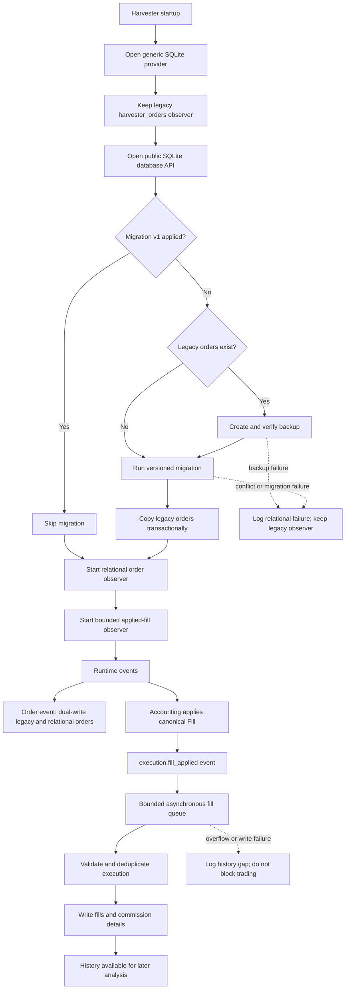

# Harvester ordinary persistence

**Phase 1/2:** [#1554 — Relational trading history and live fill persistence](https://github.com/45s/coinzilla/issues/1554), completed in merged [PR #1555](https://github.com/45s/coinzilla/pull/1555).

**Phase 3:** [#1556 — Binance startup order and trade-history synchronization](https://github.com/45s/coinzilla/issues/1556), implemented in open [PR #1557](https://github.com/45s/coinzilla/pull/1557).

**Parent workstream:** [#1327 — Provider-neutral DB API and Harvester persistence integration](https://github.com/45s/coinzilla/issues/1327)

**Existing order-history projection:** [PR #1469](https://github.com/45s/coinzilla/pull/1469).

**Relational implementation:** [PR #1555](https://github.com/45s/coinzilla/pull/1555) is merged. Phase 3 is under review in [PR #1557](https://github.com/45s/coinzilla/pull/1557); do not treat it as delivered until that PR is merged and its required checks pass.

## 1. Separate orders, fills, and strategy cycles

An **order** is an exchange instruction with a lifecycle. It may be partially executed, fully executed, cancelled, rejected, or remain open.

A **fill** is one actual exchange execution. One order can produce zero, one, or many fills. The fill ledger must never be reconstructed from an order's cumulative executed quantity.

A **strategy cycle** is a future business-level grouping of one or more orders and fills. It is not an exchange order or execution and is not implemented by this task. Strategy/cycle attribution remains nullable until a verified owner relationship is available.

### Physical tables

| Table | Meaning | Important identity |
| --- | --- | --- |
| `orders` | One row per canonical exchange order | Existing Harvester tuple: `(environment, provider_instance_id, provider_type, account_id, client_order_id)` |
| `fills` | One row per actual applied exchange execution | `(provider_type, provider_instance_id, account_id, environment, market_id, exchange_trade_id)` |
| `fill_commissions` | One row per commission asset charged on a fill | `(fill_id, ordinal)` |

The order primary key preserves the existing `harvester_orders` ID generated from the canonical identity tuple. Exchange order IDs have a non-unique provider/account/environment/market lookup index; provider-specific reuse semantics are not assumed.

The canonical `Fill.id` is `market.id:tradeId`; it is not globally unique. The relational fill primary key is a JSON-encoded tuple containing environment, provider instance/type, account, market ID, and provider execution ID. The original canonical fill ID is retained separately as `canonical_fill_id`.

`ingestion_source` and `last_ingestion_source` distinguish `live_event`, `exchange_history`, and (for migrated orders) `legacy_migration`. The older `source_kind` columns remain compatible with the Phase 1/2 event projection contract; ingestion path is recorded separately rather than mislabeling exchange history as a live event.

A fill's `order_id` is a nullable foreign key to `orders.id`. It is linked only through the canonical scoped client-order identity, with market and any available exchange-order facts checked for consistency. Exchange order IDs are retained but are not used alone to infer a relationship because provider reuse semantics vary. A fill can be persisted before its order projection is visible; a later order write links it when the client-order identity is present. Strategy, position, and cycle attribution are copied only from that verified relationship. Missing ownership remains SQL `NULL`, never a fabricated identifier.

## 2. Exact financial and timestamp semantics

- Financial values are stored as SQLite `TEXT` decimal strings. Input is validated using the canonical decimal contract; comparisons use decimal utilities, never JavaScript floating-point arithmetic.
- `orders.original_quantity`, `executed_quantity`, `remaining_quantity`, `cumulative_quote_quantity`, and `limit_price` preserve their supplied decimal strings. Optional facts remain `NULL`.
- `orders.average_execution_price` remains `NULL` unless the canonical order contract later supplies an actual average. It is not inferred from cumulative totals.
- `fills.execution_price`, `executed_base_quantity`, and `executed_quote_quantity` preserve the canonical fill values exactly.
- Each actual commission is stored with its exact amount, asset ID/code, and optional historical quote valuation in `fill_commissions`. Configured fee rates are never used to estimate missing commissions.
- Missing financial data is `NULL` or explicitly represented by the canonical commission status; it is never silently replaced with zero.
- All physical timestamp columns use canonical UTC ISO-8601 strings with millisecond precision. Exchange creation/update/execution timestamps remain separate from local first/last observation or ingestion timestamps. A missing exchange timestamp remains `NULL`.

## 3. Migration of existing `harvester_orders` history

The existing collection is stored in the generic `db_records` table. It remains available and continues to be written by the PR #1469 observer while relational history is introduced.

Harvester owns the physical schema and versioned migrations in `src/infrastructure/persistence/relational-migrations.js`. It uses the public `createSqliteDatabase` API from `@coinzilla/db`; it does not import `node:sqlite` or change `packages/db`.

Migration version 1:

1. Runs only after the generic provider has opened the environment-specific database.
2. If legacy order records exist and version 1 is not applied, creates a pre-migration backup at `harvester.db.pre-relational-v1.<sha256>.backup`.
3. Names the backup by a SHA-256 checksum of the exact ordered legacy record IDs and JSON payloads, reuses an existing backup only after re-verifying it, and verifies the backup with SQLite integrity checking.
4. Creates the physical tables, indexes, uniqueness constraints, and foreign keys inside the versioned migration transaction.
5. Validates and copies each legacy order row, preserving its ID, provider/account/environment identity, exact decimals, lifecycle facts, ownership when present, source-event provenance, and migration provenance.
6. Verifies that the source checksum is unchanged and that every source row was copied before observers start. It leaves every original `db_records` / `harvester_orders` record untouched and creates no fill rows from cumulative order quantities.

The migration runner records the version and checksum in `schema_migrations`. A failed migration rolls back its DDL and inserts as one transaction. A retry can run the unapplied migration again. Repeated execution after success is a no-op.

A conflicting identity, invalid record, or incompatible schema fails visibly. The migration does not discard or rewrite source history. Relational observers are not activated on that failed startup attempt; the legacy collection observer remains active and the failure is logged. The verified backup is retained.

### Backup and rollback

The backup is environment-specific and sits beside that environment's database:

- TESTNET: `data/testnet/harvester.db` and `data/testnet/harvester.db.pre-relational-v1.<sha256>.backup`
- LIVE: `data/production/harvester.db` and `data/production/harvester.db.pre-relational-v1.<sha256>.backup`

The configured `HARVESTER_DATABASE_DIRECTORY` changes the base directory, not the TESTNET/production separation.

For rollback, stop every Harvester process using the affected environment database. Keep both the current file and backup. Use the public `restoreSqliteDatabase` API to restore the backup to a new staging filename (the API intentionally does not overwrite an existing destination). Open the staged file with `createSqliteDatabase`, verify `PRAGMA integrity_check` and the legacy-record checksum, then perform a controlled filesystem replacement while the application is stopped. Keep the failed post-migration file for investigation. Never restore over an open database.

## 4. Observer compatibility and live fill capture

The PR #1469 `harvester_orders` collection observer remains active. A second bounded observer writes the same canonical order-history records to the relational `orders` table. This dual-write period avoids a destructive cutover and keeps the old source collection available.

Phase 2 adds a separate bounded observer for `execution.fill_applied`. This event is emitted only after the accounting workflow has successfully applied a canonical `Fill`. The canonical market ID is recovered from the verified `Fill.id` contract (`market.id:tradeId`) using the exact trade-ID suffix; no provider-specific symbol parsing or invented market metadata is used.

The observer enqueues work and returns immediately to EventBus delivery. A serialized queue (default maximum 1,000 pending writes) performs SQLite work separately. It does not add database I/O to broker submission, user-data processing, fill application, accounting, Journal, trading-readiness, or strategy decision paths.

- An identical execution identity with identical immutable facts is idempotent. The existing row and commission facts remain; last-observation provenance may advance.
- The same scoped execution identity with conflicting price, quantity, order, market, side, commission, or timestamp facts is an integrity error and is logged as a history gap.
- Queue overflow and database failures are observable diagnostics; they never block or reverse a successful accounting result.
- Actual exchange trade IDs remain scoped by provider type/instance, account, environment, and market.

## 5. Ownership and safety boundary

- Harvester owns trading-history schemas, migrations, repository ports/adapters, row mapping, and persistence lifecycle.
- `@coinzilla/db` owns generic database contracts, SQLite connection/transaction/migration/backup primitives, and provider adapters only.
- TESTNET and LIVE use separate database files; the relational schema does not combine environments.
- OrderRegistry remains authoritative for in-process order state and ownership.
- Journal remains the ordered lifecycle-evidence store. The relational projection is not a second event ledger.
- Harvester ADR-0001 remains authoritative and unchanged for its existing recovery-facts boundary.
- SQLite is a non-authoritative historical/reporting projection. It does not restore, adopt, replay, or authorize orders after restart.

## 6. Delivery phases and exclusions

| Phase | Scope | Status |
| --- | --- | --- |
| 1 | Physical `orders`, `fills`, commission detail, versioned migration, legacy-history verification/backup/rollback, repositories and deterministic tests | Complete — merged PR #1555 |
| 2 | Non-blocking persistence of canonical applied fills with exact facts and scoped deduplication | Complete — merged PR #1555 |
| 3 | Startup exchange order/trade-history API synchronization, pagination, reconciliation and recovery of executions that occurred while Harvester was offline | In progress — #1556 / PR #1557; Binance configured markets only |

Phase 3 performs read-only Binance order/trade-history scans for each runtime’s configured execution symbols. It paginates `getCanonicalOrderHistory` by exchange order ID and `getFills` by trade ID, beginning at cursor zero on each startup; repeated scans rely on scoped relational idempotency rather than a separate cursor table. Canonical orders with positive executed quantity are persisted as historical order observations. Fills are matched to fetched orders only by the scoped `(market.id, brokerOrderId)` lookup within the same provider/account/environment scan, then persisted with actual execution and commission facts. No strategy/position/cycle ownership is inferred.

The sync runs after market metadata initialization and before trading-engine activation. It performs no exchange writes. A failed scan is logged as incomplete history and does not reverse live accounting or change the existing order-ownership/readiness authority. Page exhaustion applies only to the configured symbols queried. It does not prove the historical market universe, include delisted/unconfigured symbols, or establish the exchange retention horizon; the result deliberately reports `complete: false`, `marketUniverseComplete: false`, and `retentionCoverageConfirmed: false`.

Explicit exclusions remain: account-wide/delisted-market completeness, account snapshots as a history source, strategy-cycle lifecycle, PnL/analytics, equity snapshots, drawdown, process-restart restoration/adoption, Journal replay, new providers, and `sessions`/`errors` tables. No broker order mutation, TESTNET/LIVE trading activity, Journal semantics, ADR-0001, or `packages/db` changes are part of this phase.

## 7. Persistence lifecycle

The flow below is illustrative; source code and the contracts above remain authoritative.

## Historical design reference

[SQLite integration blueprint](./sqlite-integration-blueprint.md) is a source-verified design/audit snapshot from before PR #1469 and the relational trading-history work. Its target-layout statements and migration recommendations are historical context, not the current implementation contract.
