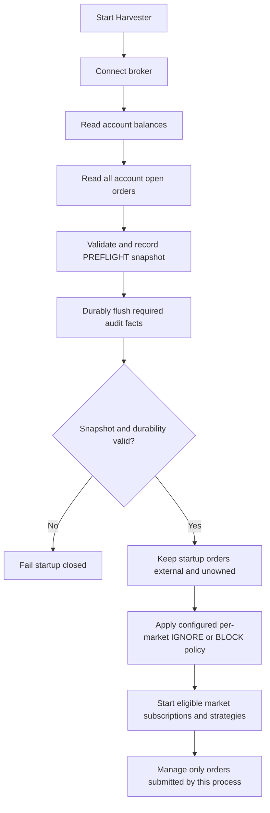

# Startup open-order boundary

**Tracking issue:** [#1157](https://github.com/45s/coinzilla/issues/1157)

**Decision:** [ADR-0004 — Startup open orders are external to the current process](../architecture/decisions/0004-startup-open-orders-are-external.md)

**Implementation:** completed and merged in [PR #1166](https://github.com/45s/coinzilla/pull/1166), merge commit `48af5b7670177697a8c1cbcb3bcb0d677cf662d2`. Tracking issue [#1157](https://github.com/45s/coinzilla/issues/1157) is closed.

## Goal

Make Harvester startup simple and predictable.

When Harvester starts, it reads the account's existing open orders, records the snapshot durably, treats every order in that snapshot as external to the new process, and then starts the configured strategies. It must not try to recover or manage those old orders.

The client-order-ID prefix must not change this rule. An old order with an `h-` ID is just as external to the new process as a manual order.

## The intended workflow

The diagram describes the target behavior. The source and tests remain authoritative. Snapshot retrieval, validation, and required durability are still startup safety requirements; only prior-process order adoption/recovery blocking is removed.

## Original source-level problem (before PR #1166)

The current implementation has two different paths for unmatched startup orders:

1. Manual-looking client IDs are classified as external. The strategy uses the pair's configured `externalOrdersPolicy`.
2. Harvester-looking client IDs are classified as unresolved prior-process Harvester orders. The Conservative engine blocks that market regardless of `externalOrdersPolicy`.

The relevant current code includes:

- `src/bootstrap/account/create-account-snapshot-manager.js`: `isHarvesterClientOrderId`, `unresolvedHarvesterOpenOrderSymbols`, `createOpenOrdersGuardState()`, and `hasUnresolvedHarvesterOpenOrdersForSymbol()`.
- `src/bootstrap/start-harvester.js`: injects the unresolved-order callback into the engine.
- `src/use-cases/conservative-trading-engine.js`: `hasBlockingOpenOrdersForSymbol()` treats unresolved prior-process Harvester orders as a blocker regardless of the pair policy.
- Existing tests explicitly preserve this unconditional blocker, but the startup integration test covers only a manual-looking external order.

This was the hidden behavior removed by PR #1166. Current source and tests on `develop` are authoritative for delivered behavior.

## Target contract

### Startup snapshot

- Query open orders account-wide, not only configured/enabled symbols.
- Keep the full snapshot and exact order identities in the existing account audit event / Journal record.
- Preserve the existing durable write/flush ordering before market subscriptions and before user-data readiness opens.
- If the query, response validation, snapshot mapping, or required durable write fails, keep startup fail-closed.
- Do not create a second snapshot mechanism or new recovery service.

### Ownership

- Every order returned by the startup snapshot is external to the current process.
- Never insert those orders into the current process's `OrderRegistry`.
- Never cancel, adopt, replace, reprice, or otherwise manage them.
- Do not infer ownership from `clientOrderId` prefixes or order shape.
- Only an order submitted and registered by this process enters its owned-order lifecycle.
- Keep existing current-process order reconciliation and shutdown behavior unchanged.

### Per-market policy

Use the existing pair setting for all unmatched startup orders:

| Policy | Required behavior |
| --- | --- |
| `EXTERNAL_ORDERS_POLICIES.IGNORE` | Existing orders do not suppress that market's subscriptions or strategy evaluation. |
| `EXTERNAL_ORDERS_POLICIES.BLOCK` | Preserve the existing same-market block; unrelated configured markets continue normally. |

Do not add a new setting. Do not silently change the configured policy or its defaults.

### Execution reports

A later user-data report for an order not registered by this process must not be attributed to a current-process order or fill. Preserve the existing external-execution/accounting-integrity safety behavior. This task is not permission to adopt an old order when it fills.

### Audit status versus readiness

The startup open-order event currently has audit fields such as `readiness: BLOCKED` and `blockReasons`. Those describe the ownership/audit classification; they are not the user-data readiness flag. Keep that distinction explicit in code comments/docs and tests. Do not let the audit label become an unconditional trading gate.

Avoid an unnecessary event-schema migration. If the implementation determines that the current audit label is actively misleading to consumers, propose the smallest backward-compatible correction and cover it with DTO/schema tests in the same PR.

## Scope

**In scope**

- Remove the special classification of Harvester-prefixed unmatched startup orders as unresolved.
- Remove `unresolvedHarvesterOpenOrderSymbols`, `hasUnresolvedHarvesterOpenOrdersForSymbol()`, its injection and the unconditional engine blocker, after checking every consumer.
- Route all unmatched startup orders through the existing external-order path.
- Preserve the account-wide snapshot and Journal/Operational State Store durability behavior.
- Add TDD regression tests and update the affected documentation and roadmap.
- Verify the exact PR head with GitHub Actions.

**Out of scope**

- Historical Journal replay or startup restoration of old `OrderRegistry` entries.
- Historical trade-history scans, fill reconstruction, or Portfolio/RecoveryLedger restoration.
- Changing Conservative economics, BUY cadence, recovery SELL lifecycle, shutdown handling, or current-process order ownership.
- Changing the external-order policy values or defaults.
- Broad refactoring of the snapshot manager, Trading Engine, or recovery coordinator.
- Weakening account snapshot validation, Journal barriers, user-data readiness, accounting-integrity handling, or current-process owned-order safety.
- Any TESTNET/LIVE order placement, cancellation, or other exchange write.

The retained offline recovery helpers and ADR-0001's broader durable-fact work are not to be wired into startup as part of this task. This plan only clarifies the startup open-order ownership boundary; any separate decision about historical Portfolio/fill restoration remains separate.

## TDD implementation sequence (completed by PR #1166)

1. **Preflight and call-graph audit**
   - Read all required root and Harvester agent instructions, engineering standards, task checklist, roadmap, Conservative specification, ADR-0001 and ADR-0004, Journal operations, architecture, BrokerPort contract, event/DTO contracts, and relevant runbooks.
   - Inspect the current source, every consumer of the unresolved-order callback, all related tests, configuration validation and actual configured pair policies.
   - Confirm the exact startup ordering and the current external-execution handling before editing.
2. **RED — account snapshot manager**
   - Add a regression fixture with a prior-process Harvester client ID (for example, `h-...`) in the startup open-order snapshot.
   - Assert it is recorded in the snapshot and classified as external, not unresolved.
   - Assert no old order is restored into the current registry.
3. **RED — engine policy**
   - Under `IGNORE`, prove the prior-process order does not block same-market market-data subscription or strategy evaluation.
   - Under `BLOCK`, prove only the configured same market is blocked and unrelated markets remain active.
   - Ensure tests emit a real market-price transition; a no-tick startup test is not sufficient evidence that strategy evaluation proceeds.
4. **RED — ownership and safety**
   - Prove no cancellation, replacement, adoption or repricing is attempted for startup orders.
   - Prove a later execution report for an unowned order is not attributed to a current-process owned order; preserve the existing external-execution safety path.
5. **GREEN**
   - Remove the smallest possible prefix-specific state/callback/gate and route all unmatched orders through the established external-order policy.
   - Preserve all snapshot validation and durability barriers.
6. **REFACTOR**
   - Remove dead imports/helpers and obsolete tests only after replacement coverage exists.
   - Search the entire Harvester source/tests/docs for stale unresolved-prior-process terminology.
7. **Documentation and verification**
   - Update this ADR, Journal Operations, architecture/indexes, Harvester roadmap, and root roadmap summary in the same implementation PR.
   - Run focused account-snapshot and Trading Engine tests, the Harvester package test/coverage scripts, and applicable workspace checks.
   - Inspect all required GitHub Actions checks on the exact final PR head SHA and ensure the branch is up to date with `develop`.
   - No exchange operations.

## Acceptance checklist — completed by PR #1166

- [x] Harvester-prefixed startup order is recorded and treated as external.
- [x] No startup order is restored/adopted into current `OrderRegistry`.
- [x] No startup order is cancelled/replaced/repriced.
- [x] `IGNORE` allows same-market subscriptions and strategy evaluation.
- [x] `BLOCK` blocks only the configured market; unrelated markets remain active.
- [x] External execution reports remain outside current-process order accounting and retain existing safety handling.
- [x] Snapshot data and identities are durably recorded before subscriptions.
- [x] Snapshot/read/validation/durability failures still fail closed.
- [x] Prefix-specific unresolved state/callback/gate has no remaining consumers.
- [x] Focused tests and required exact-head CI pass.
- [x] Living docs and roadmaps agree with source/tests.

## Historical autonomous implementation prompt

The prompt below was used as the implementation handoff for #1157. The work is complete in PR #1166; do not rerun it as an outstanding task. Retain it as historical evidence of the original execution requirements.

---

### Historical prompt: Implement startup open-order externalization (#1157)

Repository: `https://github.com/45s/coinzilla`

Tracking issue: `https://github.com/45s/coinzilla/issues/1157`

Canonical design: [ADR-0004](../architecture/decisions/0004-startup-open-orders-are-external.md)

Implementation plan: this document

Target branch: `develop`

**Mission:** Implement the accepted startup order contract in ADR-0004 and issue #1157. At startup, snapshot and durably record every account-wide open order, then treat every order in that snapshot as external to the current process. Do not recover, adopt, cancel, replace, reprice, or manage old orders. Apply the existing per-pair `EXTERNAL_ORDERS_POLICIES.IGNORE/BLOCK` uniformly, regardless of client-order-ID prefix. Current-process orders continue to use the existing ownership registry and lifecycle.

**Mandatory preflight — hard gate:**

Before editing, creating branches, or performing any other state-changing action:

1. Read root `AGENTS.md`, `ENGINEERING_STANDARDS.md`, `AI_AGENT_WORKFLOW.md`, `docs/engineering/TASK_WORKFLOWS.md`, `docs/engineering/AI_REFACTORING_AUDIT_STANDARD.md`, `docs/engineering/ESLINT_STANDARD.md`, `docs/engineering/MODULARITY_STANDARD.md`, `docs/engineering/SHARED_UTILITIES_POLICY.md`, `docs/DOCUMENTATION_GOVERNANCE.md`, and `docs/MARKDOWN_STYLE.md` in full.
2. Read `apps/harvester/AGENTS.md`, `apps/harvester/ROADMAP.md`, `apps/harvester/docs/TRADING_FIRST.md`, the Harvester documentation index, architecture documentation, the full Conservative domain specification, ADR-0001, ADR-0004, Journal Operations, Journal evidence contract, BrokerPort/adapter contract, account snapshot and open-order event/DTO contracts, external-order configuration documentation, and relevant runbooks in full. Follow applicable references recursively.
3. Inspect the current implementation, every caller/consumer, tests, configuration and effective ESLint rules. At minimum trace:
   - `src/bootstrap/account/create-account-snapshot-manager.js`
   - `src/bootstrap/start-harvester.js`
   - `src/use-cases/conservative-trading-engine.js`
   - account snapshot manager tests
   - startup integration tests
   - Conservative Trading Engine unit/integration tests
   - broker user-data event handling and external-execution safety paths
4. Confirm actual `IGNORE` and `BLOCK` semantics from source/tests. Do not rely on chat summaries or this plan as source evidence.
5. Before implementation, provide a concise readiness report: documents read, source/call graph reviewed, exact behavior to change, invariants to preserve, tests to add, and any genuine blocker. If a required document is inaccessible or requirements conflict, stop and report the exact issue.

**Execution requirements:**

- Work autonomously. Do not ask the user to approve routine implementation steps or repeat settled decisions.
- Start a short-lived feature/fix branch from the latest `develop`; synchronize before implementation and again before delivery. Resolve ordinary merge conflicts carefully; never force-push or rewrite history.
- The user personally reviews and merges. Open a PR targeting `develop`, leave it open and ready for review, and **do not merge it**.
- Follow strict TDD: add the regression test first, run it, inspect the expected RED failure, then implement the smallest change and prove GREEN. If local execution is unavailable, use the repository's documented GitHub Actions remote-TDD path; do not skip RED or invent test results.
- Keep changes focused on #1157. Do not refactor unrelated recovery, shutdown, logging, strategy or accounting code.
- Preserve account-wide snapshot capture, exact order identities, Journal/Operational State Store durability barriers, fail-closed snapshot errors, exchange free/locked balance semantics, current-process OrderRegistry ownership, and external-execution safety.
- Remove the special `isHarvesterClientOrderId` startup classification, `unresolvedHarvesterOpenOrderSymbols`, `hasUnresolvedHarvesterOpenOrdersForSymbol()`, callback injection and unconditional engine blocker only after confirming all consumers and replacing coverage.
- A real market-price event must be used to prove that `IGNORE` allows strategy evaluation; startup completion without a tick is insufficient.
- Under `BLOCK`, prove same-market isolation and that unrelated configured markets continue.
- Never adopt an old order based on its prefix, symbol, side, price or quantity.
- Do not add historical Journal replay, order restoration, historical trade scans, or Portfolio/RecoveryLedger restoration.
- Keep tests offline, deterministic and credential-free. Do not place/cancel orders on TESTNET or LIVE.
- Every implementation/test/config/runtime commit must include the corresponding documentation update in that same commit. Update ADR-0004, Journal Operations, relevant indexes, Harvester roadmap and root roadmap.
- Run the focused tests and coverage, package checks and applicable workspace checks. Inspect exact-head GitHub Actions results and fix failures one by one. Never claim a check passed unless the exact final head reports success.
- Before delivery, verify the branch is up to date with `develop`, search for stale unresolved-order references, review the complete diff, and ensure no unrelated files changed.

**Definition of done:** all acceptance criteria in issue #1157 and this plan are satisfied; required CI is green on the exact PR head; documentation matches source/tests; PR targets `develop`; PR remains unmerged for user review.

**Final response:** provide the PR link, exact head SHA, test/CI results, changed behavior, remaining blockers (if any), and explicitly confirm that the PR was not merged.

## Completion record

- Implementation PR: [#1166](https://github.com/45s/coinzilla/pull/1166), merged into `develop`.
- Merge commit: `48af5b7670177697a8c1cbcb3bcb0d677cf662d2`.
- Tracking issue: [#1157](https://github.com/45s/coinzilla/issues/1157), closed.
- Exact-head verification: 1,630 Harvester unit tests passed; 5 targeted test files passed; workspace unit tests and coverage gate passed; syntax/actionlint, ESLint, Markdown style, dependency audit, external documentation links and Utils unit tests passed. Read-only TESTNET integration was skipped.
- No exchange writes or TESTNET/LIVE order operations were performed.
- This plan is now a design and implementation record, not a pending task.
