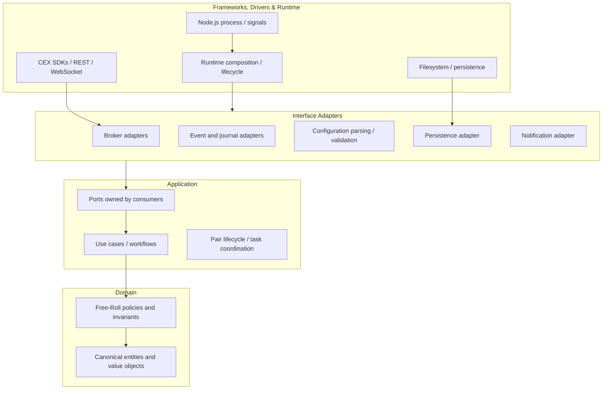
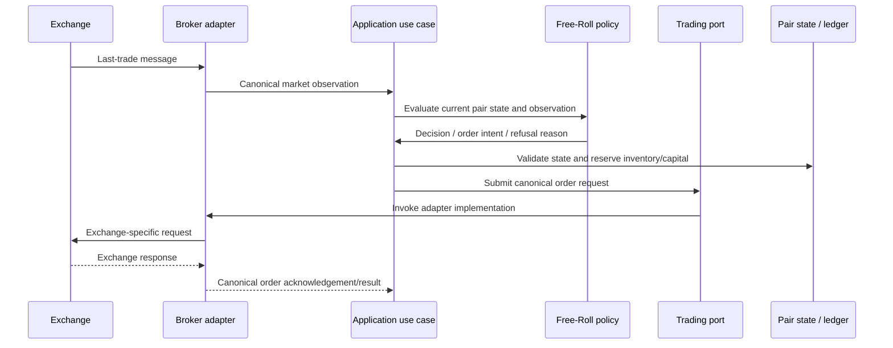
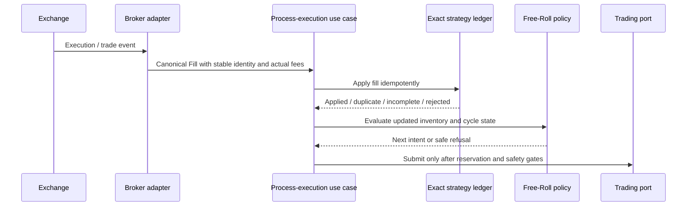

# Coinzilla Architecture Blueprint

**Status:** Target architecture — accepted direction, incremental implementation  
**Scope:** Coinzilla workspace, with detailed application guidance for Free-Roll  
**Decision record:** [ADR-0001](./decisions/ADR-0001-clean-hexagonal-architecture.md)  
**Last reviewed:** 2026-11-01

> This document describes the architecture Coinzilla should evolve toward. It is not a certification of the current implementation. A target folder, port, state machine, or safety mechanism described here must not be assumed to exist until source code and tests prove it.

---

## 1. Executive decision

Use **Clean Architecture + Hexagonal Architecture (Ports and Adapters) + lightweight Domain-Driven Design**.

The goal is not to impose a large framework or a rigid folder template. The goal is to make business decisions independent of exchange SDKs and runtime details, make side effects explicit, and make financial and lifecycle invariants testable without a live exchange.

The key dependency rule is:

**Source-code dependencies point toward stable business rules and contracts. Runtime control may flow outward to adapters, but inner policy code must not import outer infrastructure.**

For Free-Roll this means:

- Free-Roll policy and accounting do not know Binance, Bybit, WebSocket payloads, SDK classes, or exchange-specific status strings.
- Shared canonical financial and trading concepts are owned by Coinzilla's shared entity/contracts packages where they are genuinely reusable.
- Free-Roll-specific decisions remain owned by the Free-Roll application.
- Broker adapters translate between exchange-specific facts and canonical Coinzilla contracts.
- A runtime composition root chooses concrete adapters and injects them into the application.
- Unknown, stale, unsupported, or unreconciled facts fail closed before an unsafe trading action.

## 2. Goals and non-goals

### Goals

1. Keep strategy/domain rules exchange-agnostic.
2. Preserve exact financial values from exchange boundary to ledger and order decision.
3. Separate decision-making from network, filesystem, clock, messaging, and process effects.
4. Make fills, commissions, reservations, reconciliation, and lifecycle transitions explicit.
5. Support multiple broker implementations without rewriting strategy policy.
6. Keep each package/application independently testable with deterministic tests.
7. Evolve the current monorepo in small, reviewable steps that follow the existing domain ownership workflow.
8. Make architecture decisions and unresolved questions discoverable and durable in the repository.

### Non-goals

- Microservices or splitting the current monorepo into deployable services.
- CQRS, event sourcing, repositories, factories, or dependency-injection frameworks everywhere.
- Rewriting stable packages just to match a diagram.
- Creating one class per noun or one file per function.
- Treating a folder layout as proof of dependency inversion.
- Guaranteeing fills, market outcomes, or trading profit.
- Changing approved Free-Roll strategy behavior as part of an architecture refactor.

## 3. Current system context

Coinzilla is a pnpm workspace with applications under `apps/*` and shared packages under `packages/*`. The Free-Roll application currently depends on shared packages including:

- `@coinzilla/entities`
- `@coinzilla/brokers`
- `@coinzilla/event-bus`
- `@coinzilla/journal`
- `@coinzilla/utils`

The entities package already exports canonical concepts including `Money`, `Quantity`, `Asset`, `Market`, `CanonicalOrder`, `Commission`, `Fill`, `Balance`, `TradingRules`, `BrokerCapabilities`, and `BrokerResult`. Reuse and evolve these contracts where they fit; do not create duplicate types in the application.

The Free-Roll application already has useful foundations: a per-pair task queue, event handling and order-execution collaborators, fill-reconciliation helpers, recovery/snapshot logic, inventory allocation helpers, and deterministic tests. Preserve these foundations and improve their boundaries incrementally.

The runtime entry point currently prepares notifications, journal, broker, and bot, and the broker preparation module currently selects a Binance WebSocket broker. That is a legitimate outer-layer responsibility. The target is to keep that concrete selection out of strategy policy and use-case modules.

The dated [Free-Roll current-state audit](../../apps/bot-free-roll/CURRENT_STATE.md) documents important gaps found at its audited ref. In particular, it is a source audit rather than runtime certification. Re-inspect the current branch before relying on any individual finding.

## 4. Architecture at a glance

### 4.1 Logical layers



The arrows illustrate compile-time dependency direction, not the chronological order of a runtime call. The application invokes a port; the injected adapter performs the external operation and returns a canonical result.

### 4.2 Dependency rule

| Area | May depend on | Must not depend on |
|---|---|---|
| Domain policies | Canonical entities, pure domain helpers | Application workflows, broker adapters, SDKs, filesystem, network, event bus |
| Shared entities/contracts | Stable domain primitives and small supporting utilities | Free-Roll application, Binance SDK, runtime composition |
| Application use cases | Domain policies/entities, consumer-owned port contracts | Concrete Binance/Bybit adapters, SDK payloads, process globals |
| Interface adapters | Their port contracts, canonical entities, external SDKs | Strategy policy decisions duplicated in adapter code |
| Runtime composition | Application construction, concrete adapters, config and process lifecycle | Trading rules embedded as runtime glue |
| Tests | Public contracts and test doubles/fakes | Live production services for default unit tests |

**Important distinction:** a runtime call may travel from a use case to a broker adapter through an injected port. The source dependency still points inward because the use case defines or consumes a stable contract and does not import the adapter implementation.

### 4.3 Dependency checks

Enforce boundaries incrementally, not by claiming they are enforced in documentation. Start with explicit review rules and focused import checks for the highest-risk boundary:

- Free-Roll domain and application policy modules must not import exchange SDK packages or exchange-specific adapter modules.
- Exchange-specific payload field names and enums must be normalized before entering application/domain code.
- Runtime composition is the only Free-Roll area expected to select concrete adapters.
- Add automated dependency-boundary checks when the import graph and package ownership are stable enough to enforce without false positives.
- Do not mark a rule as CI-enforced until a check actually verifies it.

## 5. Ownership: shared contracts versus application policy

A common failure mode is putting every business concept into a shared package or putting every type inside one application. Use this division:

### Shared packages own reusable contracts

`packages/entities` owns canonical, exchange-neutral concepts that are meaningful across applications and adapters: exact `Money` and `Quantity`, assets and markets, canonical orders, fills, commissions, balances, trading rules, broker capabilities, and result/error contracts.

A shared entity should describe a stable fact or invariant. It should not know how Free-Roll chooses its next order.

Other packages own their technical capabilities:

- `packages/brokers`: exchange connectivity and exchange-specific adapter implementations.
- `packages/event-bus`: event delivery mechanics and its public contract.
- `packages/journal`: event/file journal mechanics.
- `packages/utils`: genuinely generic utilities only; not a home for domain policy.

### The application owns its strategy

Free-Roll owns its strategy-specific rules and workflows:

- Buy and sell policy.
- Recovery profitability decision.
- Free versus active versus reserved versus external inventory allocation.
- Pair readiness and transition policy.
- Strategy-specific accounting/ledger rules.
- Strategy workflow orchestration.

Do not move Free-Roll-specific rules into `packages/entities` merely because they use Money, Fill, or Order. Shared primitives are inputs to the strategy; the strategy remains the owner of its policy.

### Ports are consumer-owned contracts

A use case should state the external capability it needs, not the adapter class it wants. Define a small port at the consuming application boundary unless multiple consumers genuinely need the same stable contract. If several packages/apps share a contract, consider a dedicated shared contract package or an existing canonical broker capability contract.

Do not introduce a new workspace package solely to satisfy a textbook diagram. First inspect the current broker API and consumers, then make a focused contract decision under the owning domain workflow.

## 6. Target Free-Roll application structure

The following is a **logical organization**, not a mandatory one-file-per-function template. Keep existing cohesive modules where they already work; split only when ownership, testability, or change isolation improves.

```text
apps/bot-free-roll/src/
  domain/
    free-roll/
      buy-policy.js
      sell-profitability.js
      inventory-ledger.js
      pair-state.js
      errors/
    # Free-Roll-only pure rules and invariants

  application/
    ports/
      market-data.js
      trading.js
      account.js
      execution-history.js
      persistence.js
      clock.js
      event-publisher.js
      logger.js
    use-cases/
      start-strategy.js
      stop-strategy.js
      process-market-tick.js
      process-execution.js
      reconcile-pair.js
      recover-strategy.js
    services/
      # Cohesive workflows shared by more than one use case, if justified

  infrastructure/
    adapters/
      broker/
        # App-specific translation only if it is not already owned by packages/brokers
      persistence/
      events/
      notifications/

  runtime/
    compose-application.js
    lifecycle.js
    index.js

  bot/
    # Existing orchestration modules retained/migrated as justified
```

Guidance:

- Do not move shared entities into this tree; import them from `@coinzilla/entities`.
- Do not duplicate the broker adapter implementation under the application. The `packages/brokers` domain owns CEX integration.
- The `infrastructure/adapters/broker` location is only for a thin application-specific adapter when a genuine translation is required; it is not a second home for Binance SDK code.
- The target structure may be reached gradually. A focused module can remain in the existing `bot/` folder until there is a clear reason to move it.
- Avoid an empty `domain/`, `application/`, or `infrastructure/` folder created just for appearance.

## 7. Ports and adapter contracts

Prefer capability-oriented ports over one enormous `Broker` interface. A capability is a coherent set of operations needed by a workflow. The precise method names and payload schemas must be designed against current consumers and the canonical entity contracts; the following is a responsibility map, not a frozen API.

| Capability port | Responsibility | Example operations |
|---|---|---|
| Market data | Deliver validated canonical market observations | Subscribe to last trades; read a current last trade |
| Trading | Mutate exchange orders | Create order; request cancel; query order by canonical identity |
| Account | Read account facts | Read balances and account snapshot |
| Execution history | Retrieve authoritative executions | Read fills/trades with completeness and pagination metadata |
| Market metadata | Supply trading constraints | Read exact tick/step, min/max quantity, notional and supported order constraints |
| Persistence | Save/load versioned strategy state | Load snapshot; atomically persist ledger/state |
| Clock | Supply deterministic time | Current instant; monotonic time if required |
| Event publisher | Publish application facts/diagnostics | Publish named canonical event |
| Logger | Emit structured diagnostics | Debug/info/warn/error with safe context |

Rules:

1. Separate read-only capabilities from mutation capabilities when doing so improves least privilege or testability.
2. Check required capability availability before a pair enters a state where it could trade.
3. Unsupported information must be represented explicitly. Never invent a default price, fee, fill, trading rule, or successful status.
4. Preserve exchange order IDs, client IDs, trade IDs, source timestamps, and pagination/completeness evidence needed for reconciliation.
5. Normalize exchange-specific statuses and payload fields inside the broker adapter.
6. A cancel request is not proof that the order is canceled; reconcile final status and executions.
7. An ambiguous create/cancel timeout is an unknown outcome. Query by stable client identity and history before retrying or releasing reservations.
8. Adapter implementations must satisfy the same contract tests using deterministic fixtures.

### Example structural dependency

```js
// Application-facing use case: illustrative shape, not an approved public API.
export function createProcessExecution({ ledger, trading, publish }) {
  return async function processExecution({ fill }) {
    const result = ledger.applyFill(fill)
    if (!result.ok) return result

    // Further domain decision and workflow orchestration belongs here.
    publish({ name: "execution-accounted", data: result.data })
    return result
  }
}

// Runtime composition injects a concrete adapter. The use case never imports it.
const processExecution = createProcessExecution({
  ledger,
  trading: brokerTradingAdapter,
  publish: eventPublisher,
})
```

This example is explanatory. Do not copy it as a production API without checking existing conventions and the roadmap acceptance criteria.

## 8. Financial correctness is an architectural boundary

For trading software, decimal exactness is not a utility detail. It is a domain invariant that must survive every boundary.

- Financial amounts, prices, quantities, commissions, notionals, balances, and exchange increments must use exact decimal strings or another proven exact representation.
- Do not use JavaScript `Number` arithmetic for financial decisions.
- Do not parse an exchange decimal into Number and then stringify it; precision may already be lost.
- Keep raw source strings and canonical exact values where provenance matters.
- Make scale/exponent limits, sign rules, and validation explicit.
- Make rounding direction explicit for each operation and recompute all order constraints after rounding.
- Treat missing, malformed, stale, or inconsistent financial facts as unknown; never silently coerce them to zero.
- Use Number only for non-financial quantities where safe (for example, bounded counters or elapsed-time measurements), not as a shortcut for order or ledger arithmetic.

The exact arithmetic implementation belongs in shared primitives where reusable and tested; Free-Roll owns the meaning of its calculations (cost basis, realized proceeds, profitability threshold, inventory allocation).

## 9. Free-Roll workflows

### 9.1 Market observation to order intent



Important distinction: an order acknowledgement is not an execution and does not update realized accounting. The order must be tracked and reconciled independently.

### 9.2 Execution to ledger



The adapter preserves actual fill facts; the application owns idempotent ingestion and workflow sequencing; the domain owns the accounting interpretation and trading decision.

### 9.3 Recovery after uncertainty

Recovery is a gated workflow, not a reconnect callback that immediately resumes trading.

1. Detect disconnect, stream gap, ambiguous order outcome, restart, or inconsistent local/broker facts.
2. Block order mutations for the affected pair.
3. Obtain a complete canonical snapshot: balances, open orders, tracked order history, fills, and current trading rules as required by the recovery contract.
4. Validate source completeness, identities, timestamps, pagination, and exact economic facts.
5. Replay missing executions idempotently and compare local state with broker facts.
6. Verify inventory ownership, reservations, order lifecycle, fee completeness, and ledger invariants.
7. Resume only after explicit successful reconciliation and the required operator-controlled action.
8. If any required fact remains unknown or inconsistent, remain paused with actionable diagnostics.

A successful WebSocket subscription alone is not evidence of a reconciled or trade-ready pair.

### 9.4 Pair lifecycle

The Free-Roll strategy specification/roadmap defines the intended pair readiness states and safety transitions. Keep pair readiness distinct from the process lifecycle. The process can be running while one pair is paused or reconciling.

The architecture must support these principles:

- No order mutations during reconciliation or unsafe pause.
- No automatic resume after unresolved discrepancy.
- Stop does not implicitly cancel exchange orders.
- Restart always re-enters initialization and reconciliation.
- Pair-specific work is serialized or otherwise coordinated so concurrent events cannot double-reserve inventory.
- Cross-pair shared-asset reservations require explicit coordination; a per-pair queue alone cannot prove global asset availability.

Do not create a second competing state machine. Reuse and evolve the strategy's documented state model.

## 10. Runtime composition and lifecycle

The composition root is the outermost application boundary. It may:

- Read environment and configuration sources.
- Validate and normalize configuration.
- Select the concrete broker adapter.
- Create the event bus, journal, notification adapter, logger, clock, and persistence adapter.
- Inject capabilities into application workflows.
- Own process signals, startup rollback, shutdown ordering, and resource cleanup.

It must not contain strategy calculations or trading policy.

The target composition flow is:

```text
runtime/index
  ├── load + validate configuration
  ├── create shared runtime services
  ├── create/connect selected broker adapter
  ├── adapt concrete broker capabilities to application ports
  ├── construct domain/application collaborators
  ├── start application lifecycle
  └── stop workflows and release resources in reverse dependency order
```

Keep startup and shutdown idempotent where practical. Make partial-startup cleanup explicit. Timeouts must not be mistaken for cancellation of the underlying operation; document and test cleanup behavior for timed-out work.

## 11. Events, journal, and persistence

These are different responsibilities and should not be conflated:

- **Events** communicate facts or notifications between in-process components. Define stable names, canonical payloads, source identity, and delivery/error semantics.
- **Journal** records events/diagnostics for inspection. A journal is not automatically a durable transactional ledger.
- **Persistence** stores the authoritative strategy state needed to resume after process restart. It needs schema versioning, atomic/durable writes, and explicit corruption/migration behavior.
- **Exchange history** remains an external source of execution/order facts used for reconciliation; it is not replaced by local persistence.

The strategy ledger must be reconstructable and auditable from persisted state plus authoritative broker history according to a documented retention/cursor contract. Do not claim restart recovery is complete until persistence, replay boundaries, duplicate handling, and reconciliation are implemented and tested.

## 12. Error and result semantics

Errors should carry enough context to identify the operation, pair/order/fill identity, and failure class without leaking credentials or private payloads.

Use explicit result/error contracts for expected boundary outcomes where they improve clarity. Reserve thrown exceptions for exceptional failures or invalid construction where consistent with package conventions. Do not silently catch failures or return a success-shaped value after an operation failed.

Distinguish at least:

- Rejected/invalid input.
- Unsupported capability or unsupported exchange fact.
- Temporarily unavailable external service.
- Rate limit / retryable failure.
- Ambiguous outcome (operation may have succeeded remotely).
- Incomplete snapshot/history.
- Reconciliation mismatch.
- Domain invariant violation / unsafe state.
- Duplicate event already applied.

Retries must be bounded and idempotent. A retry of an ambiguous order mutation must first reconcile by stable client identity; blind resubmission is unsafe.

## 13. Testing strategy

Use a test pyramid with deterministic boundaries:

| Level | What it proves | Typical tools |
|---|---|---|
| Domain unit tests | Exact arithmetic, policy decisions, ledger invariants, state transitions | Native Node.js test runner; pure inputs/outputs |
| Application/use-case tests | Orchestration, port invocation order, refusal paths, idempotency | Fakes for ports; controlled promises |
| Adapter contract tests | Each broker maps exchange facts to the same canonical contract | Shared fixtures and contract suite |
| Adapter integration tests | Real SDK/network behavior, pagination, reconnect, TESTNET operations | Explicit opt-in integration tests |
| Simulation/replay tests | Event ordering, partial fills, duplicate/late events, cancel/fill races, restarts | Deterministic fake exchange and replay fixtures |
| End-to-end acceptance | Controlled full lifecycle in a safe environment | TESTNET only for order placement |

Test the observable contracts, not every private function. Avoid mocking the behavior under test. Control clocks and concurrency with injected dependencies/deferred promises rather than arbitrary sleeps. Every resource created by a test must be cleaned up.

Default unit tests must remain deterministic and independent of credentials, network, and live exchange services. Tests that place orders use TESTNET only.

## 14. Security and operational observability

- Keep credentials at the outer configuration/adapter boundary.
- Never log API keys, secrets, authorization headers, or full sensitive account payloads.
- Redact or summarize exchange responses while preserving safe identifiers and diagnostic codes.
- Emit structured diagnostics for pair readiness, reconciliation state, ledger completeness, reservations, order/fill identity, and pause reason.
- Distinguish actual financial facts from estimates/reserves in logs and statistics.
- Make the live-trading enablement boundary explicit and fail-safe.
- Provide an operator-visible explanation for every unsafe pause and a deliberate recovery action.
- Bound buffers, queues, retries, and retained event/history data.

## 15. Incremental migration plan

Do not perform a big-bang rewrite. Preserve working modules and migrate one responsibility at a time. The Free-Roll roadmap's FR identifiers and acceptance criteria remain the implementation backlog; this section describes the architectural sequence, not a replacement roadmap.

| Phase | Focus | Expected result | Guardrail |
|---|---|---|---|
| 0 | Protect strategy and document boundaries | Architecture rules agreed; no behavior changes | Existing README/roadmap remain authoritative |
| 1 | Canonical financial and execution contracts | Reusable exact Money/Quantity/Fill/Commission/Balance/TradingRules contracts are complete and validated | Audit current entities first; no duplicate models |
| 2 | Broker capability contracts | Small, explicit, canonical capabilities with shared contract tests | Broker package owner designs broker-owned implementation; app does not prescribe internals |
| 3 | Exact fill ledger and profitability policy | Actual fill/fee facts drive idempotent accounting and centralized SELL approval | Preserve all strategy decisions and fail-closed behavior |
| 4 | Extract use-case workflows | Market tick, execution, reconciliation, recovery, start/stop workflows are independently testable | Extract only where cohesive; retain current collaborators |
| 5 | Persistence and deterministic restart | Versioned durable state plus complete broker reconciliation | No resume based only on stream connection |
| 6 | Composition-root simplification | Runtime selects adapters and injects ports; app policy has no concrete exchange imports | No exchange-specific leakage inward |
| 7 | Dependency enforcement and release review | Automated boundary checks, adapter contract coverage, simulation evidence | Mark complete only after CI and acceptance evidence |

### PR sizing and ownership

Follow [AI_AGENT_WORKFLOW.md](../../AI_AGENT_WORKFLOW.md):

- One focused task per short-lived branch and PR.
- Start from the latest `develop`; target `develop`.
- Respect package ownership. A Free-Roll consumer request for a broker/entity contract is tracked with the owning package and implemented by that owner.
- Update the owning roadmap and docs as work progresses.
- Do not mark roadmap work complete until merged into `develop` and verified.
- The user approves only the final milestone/release PR to `main`.

## 16. Architecture review checklist

Before merging a material change, ask:

1. Does business policy depend only on stable canonical contracts?
2. Has any exchange SDK type, raw payload, status string, filter name, or precision assumption leaked inward?
3. Are financial values exact end-to-end, including adapter normalization and serialization?
4. Are external effects explicit and injected?
5. Are actual fills and commissions authoritative for accounting?
6. Are order acknowledgements, order status, and executions modeled as separate facts?
7. Are reservations and inventory ownership explicit and concurrency-safe?
8. Does an unknown or incomplete fact block unsafe action?
9. Can the domain/use case be tested without a network or live exchange?
10. Are retry, timeout, cancellation, and ambiguous outcomes handled deliberately?
11. Are diagnostics actionable and free of secrets?
12. Does the change preserve strategy policy and existing package ownership?
13. Are relevant roadmap/docs/tests updated and the complete diff reviewed?

## 17. Open decisions

The architecture does not silently settle product or accounting policy questions that the strategy specification leaves open. In particular, Free-Roll still tracks unresolved decisions in its own README/roadmap. Keep those decisions there and ask only the question that blocks the next implementation task.

Architecture questions that require evidence before a later decision:

- Whether broker capability contracts should remain app-consumer-owned or become a dedicated shared contract package. Decide after auditing all consumers and current broker exports.
- The exact persistence technology and durability guarantees. Decide after defining the state snapshot and recovery cursor contract.
- Whether a generic event envelope is needed beyond current event-bus contracts. Decide only if real consumers need it.
- The minimum dependency-boundary automation that can be added without false positives.
- Whether application-specific adapter wrappers are needed, or whether the broker package can expose the canonical capabilities directly.

No framework, package split, or new dependency is approved by this blueprint alone.
