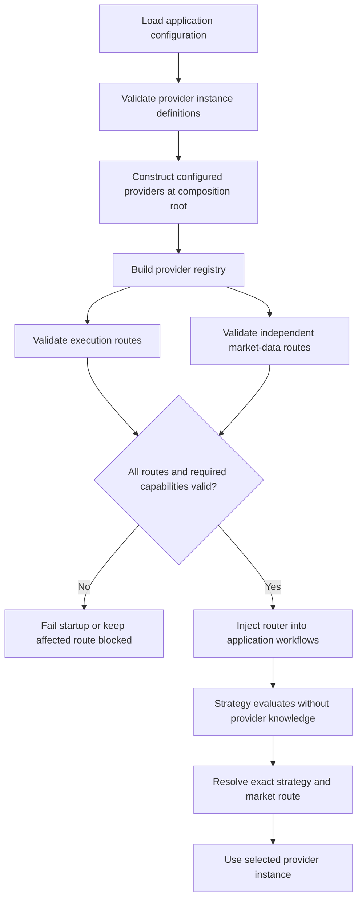
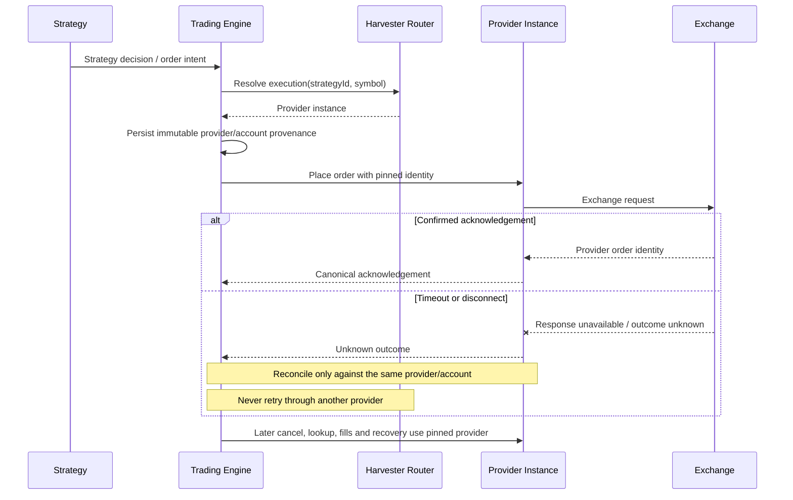

# ADR-0003: Explicit multi-provider execution and market-data routing

- **Status:** Accepted
- **Type:** Architecture decision
- **Owner:** Harvester / Brokers
- **Date:** 2026-11-17
- **Related:** [ADR-0001: Clean and Hexagonal Architecture](./ADR-0001-clean-hexagonal-architecture.md), [ADR-0002: Explicit Binance trading environment](./ADR-0002-explicit-binance-trading-environment.md), [issue #1339](https://github.com/45s/coinzilla/issues/1339)

## Context

Harvester currently composes one Binance broker instance. Its runtime configuration hard-codes the broker identity, bootstrap defaults to the Binance adapter, and one broker instance supplies both execution and market data. That is a valid current deployment shape, but it cannot express a process that runs different strategy/market pairs through different exchange accounts.

The accepted use case is explicit operator routing. For example, a future Recovery Seller (RS) strategy on STRKUSDT may use a Bitunix account, while Conservative / `CG_coinGrabber` on LINKUSDT uses Binance. The market-data source may be different from the execution venue.

The current implementation does not yet satisfy this target. RS is not executable, and Bitunix Spot remains read-only and not Harvester-ready while the capability and exchange-contract blockers in [issue #1185](https://github.com/45s/coinzilla/issues/1185) remain open. This ADR records the target architecture; it does not enable either capability.

## Decision

### 1. Provider instances are constructed at the composition boundary

A provider instance represents one configured connection to one provider type, account and supported environment. A process may own multiple named instances, including multiple instances of the same exchange.

The Harvester composition root is responsible for constructing the configured instances, owning their lifecycle, and assembling an application-owned provider registry/router. Concrete provider classes and credentials must not leak into strategy/domain code.

Provider instance IDs are stable, non-secret configuration identities. They are distinct from provider type (for example, `binance`) and account identity.

### 2. Execution routing is explicit Harvester application policy

The execution route key is:

`(strategyId, marketSymbol) -> providerInstanceId`

Every enabled executable strategy/market pair must resolve to exactly one configured provider instance. Missing routes, duplicate route keys, unknown instances, unsupported capabilities, and invalid provider/market combinations fail closed before the affected strategy can submit an order.

The initial route table has no wildcard, implicit default, fee-based auto-selection, or fallback. The strategy/domain layer produces strategy decisions without selecting an exchange. An injected Harvester application routing capability resolves the configured instance using strategy identity and market identity.

Changing a route affects new execution intents only. It does not move existing orders, positions, reservations, fills, or recovery obligations.

### 3. Market-data routing is independent

Market-data routing is configured separately from execution routing:

`marketSymbol -> marketDataProviderInstanceId`

The initial contract uses one explicitly selected market-data provider per symbol. Do not infer the source from the execution route. Do not silently blend sources, fall back to another exchange, or switch sources after a failure. Any future strategy-specific market-data routing requires an explicit extension to the contract.

The source provider and symbol must remain observable in market-data diagnostics and freshness decisions. A selected source must meet the capabilities and quality requirements of its consumers.

### 4. Provider/account provenance is immutable for each order

An order must retain, at minimum, its strategy ID, market symbol, provider instance ID, provider type, and stable non-secret account identity. It also retains the client order ID and provider-native broker order ID where available.

The exact placement in canonical entities, durable facts, events, and Journal records must follow a source-reviewed migration plan. The provider/account identity must be durably associated with the order before an exchange write can be treated as safely attributable.

Every subsequent cancellation, lookup, fill attribution, user-data event, reconciliation and recovery operation uses the order's original provider/account identity. It must not consult a mutable current route table to find the provider for an existing order. Native exchange IDs must be namespaced by provider/account; equal raw IDs from different exchanges are not the same order.

### 5. No implicit cross-provider failover

A timeout or disconnect during a state-changing request is an unknown outcome. Never retry that intent on another provider. Another exchange may accept a duplicate order and create a second position.

A provider failure may block or defer the affected provider/route scope, but must not silently transfer ownership of orders or positions. Recovery always reconciles against the original provider/account.

### 6. Accounts are isolated by default

Balances, open orders, reservations, user-data readiness, and reconciliation are scoped to provider instance/account identity. Balances from different exchanges or accounts are not fungible and must not be combined into spendable funds by default.

A future cross-account portfolio aggregation or transfer policy requires a separate explicit decision, accounting model, and safety tests. Strategy-owned positions remain distinct from exchange custody; the shared allocator must never double-spend physical funds.

### 7. Capabilities are explicit and provider-instance-specific

Provider registration does not imply support for every broker operation. The application must validate the capabilities required by each enabled strategy/market route. Relevant capabilities include market data, book ticker, candles, market metadata/filters, account snapshots, open orders, order history/lookups, canonical fills, order placement/cancellation, private user-data events, and recovery/reconciliation.

A capability is available only when its implementation and exchange contract are verified for that provider instance and environment. A method inherited from a compatibility base class is not proof of support. Unsupported, unknown, or incomplete capabilities fail closed before execution.

### 8. Fees inform explicit routing; they do not choose providers automatically

The first implementation uses explicit operator-configured routes. Commission schedules, fee assets/discounts, liquidity, slippage, precision, minimums, market availability, permissions, rate limits, and data-source quality may inform an operator's choice, but automatic provider optimization is out of scope. Lower advertised fees alone do not prove a venue is the safer or cheaper execution choice.

### 9. Preserve the existing Binance environment contract

[ADR-0002](./ADR-0002-explicit-binance-trading-environment.md) remains authoritative for every Binance instance: `TRADING_MODE=testnet|live` is explicit, missing/invalid values fail closed, and `NODE_ENV` never selects Binance endpoints. Other providers must define and validate their own actual environment modes; do not copy Binance's environment assumptions onto them.

The existing one-provider Binance deployment remains supported during migration. Multi-provider support must not weaken Binance TESTNET/LIVE selection, process locks, user-data recovery, durable-fact barriers, exact decimal accounting, or order safety.

## Target configuration examples

These examples explain the contract; they are not the current accepted runtime schema.

### Named provider instances

```js
const brokers = {
  binanceTestnet: {
    provider: "binance",
    tradingMode: "testnet",
    credentials: {
      apiKey: process.env.BINANCE_TESTNET_API_KEY,
      apiSecret: process.env.BINANCE_TESTNET_API_SECRET,
    },
  },
  bitunixSpotPrimary: {
    provider: "bitunix-spot",
    tradingMode: "live", // only documented Spot endpoint; this does not enable order mutations
    credentials: {
      apiKey: process.env.BITUNIX_API_KEY,
      apiSecret: process.env.BITUNIX_API_SECRET,
    },
  },
}
```

Credentials are resolved from deployment secrets/environment and must never be committed, logged, placed in events, or included in configuration fingerprints. The Bitunix example is illustrative only: current Bitunix Spot support is read-only and must not be configured for execution.

### Execution routes

```js
const executionRouting = {
  routes: [
    {
      strategyId: "RS_recoverySeller",
      symbol: "STRKUSDT",
      providerInstanceId: "bitunixSpotPrimary",
    },
    {
      strategyId: "CG_coinGrabber",
      symbol: "LINKUSDT",
      providerInstanceId: "binanceTestnet",
    },
  ],
}
```

This is an exact route table. Duplicate `(strategyId, symbol)` keys and missing routes for enabled executable pairs are configuration errors.

### Independent market-data routes

```js
const marketDataRouting = {
  routes: [
    { symbol: "STRKUSDT", providerInstanceId: "binanceTestnet" },
    { symbol: "LINKUSDT", providerInstanceId: "binanceTestnet" },
  ],
}
```

The RS execution route may eventually target Bitunix while STRKUSDT market data comes from Binance. This is valid only when Binance supports that market and the selected feed satisfies the consumer's freshness/quality contract. It does not imply venue prices or liquidity are interchangeable.

### Composition and resolution

```js
const providers = new Map([
  ["binanceTestnet", createBinanceBrokerAdapter({ config: binanceConfig, logger })],
  ["bitunixSpotPrimary", createBitunixBrokerAdapter({ config: bitunixConfig, logger })],
])

const brokerRouter = createBrokerRouter({
  providers,
  executionRoutes: executionRouting.routes,
  marketDataRoutes: marketDataRouting.routes,
})

const executionBroker = brokerRouter.resolveExecution({
  strategyId: "CG_coinGrabber",
  symbol: "LINKUSDT",
})

const marketDataBroker = brokerRouter.resolveMarketData({
  symbol: "LINKUSDT",
})
```

The function names are illustrative. Prefer small cohesive composition and routing modules; do not introduce a generic dependency-injection framework or put strategy/market routing inside `@coinzilla/brokers`.

### Provider composition and route validation

The following flow shows startup validation. The router is assembled only after provider instances are constructed; an invalid route or missing required capability prevents the affected strategy/market from becoming executable.



### Order submission and provider pinning

The provider identity is attached to the order before state-changing I/O. All later lifecycle operations use that stored identity, not the current route table.



The diagrams are explanatory; the invariants in the Decision section are authoritative.

## Ownership

| Concern | Owner |
|---|---|
| Strategy rules and strategy IDs | Harvester Domain |
| Provider-instance configuration and route validation | Harvester configuration/application boundary |
| Provider construction, registry assembly and lifecycle | Harvester composition root |
| Execution and market-data route resolution | Harvester application routing capability |
| Harvester-facing broker contract | Harvester Application port |
| Exchange-specific clients, signing, transport, DTOs and verified capabilities | Brokers Infrastructure |
| Exchange-neutral broker capability semantics | Brokers package |
| Order provenance, account isolation, fill attribution and recovery | Harvester application/domain contracts, supported by broker facts |

The Brokers package must not own Harvester strategy/market routing or import Harvester. Harvester must not import exchange protocol types into its domain.

## Consequences

- A single-provider configuration remains a valid composition of one provider instance and explicit routes.
- Startup becomes more deliberate: all configured instances, routes, capabilities and required lifecycle resources must be validated before affected strategies become executable.
- Provider-specific lifecycle and recovery state must remain isolated; one provider's outage must not mark unrelated providers reconciled or ready.
- Order and account schemas may need a compatibility-preserving provider/account identity extension. This must be implemented test-first and coordinated with durable facts, event contracts and Journal readers.
- Existing deployments and public broker exports remain compatible until an explicit migration is reviewed and tested.

## Related work and implementation status

The phased implementation, source inventory, acceptance matrix, compatibility requirements and current Bitunix blockers are maintained in [issue #1339](https://github.com/45s/coinzilla/issues/1339). This ADR defines the durable architecture; the issue is the operational task contract and the owner roadmaps track delivery status.
