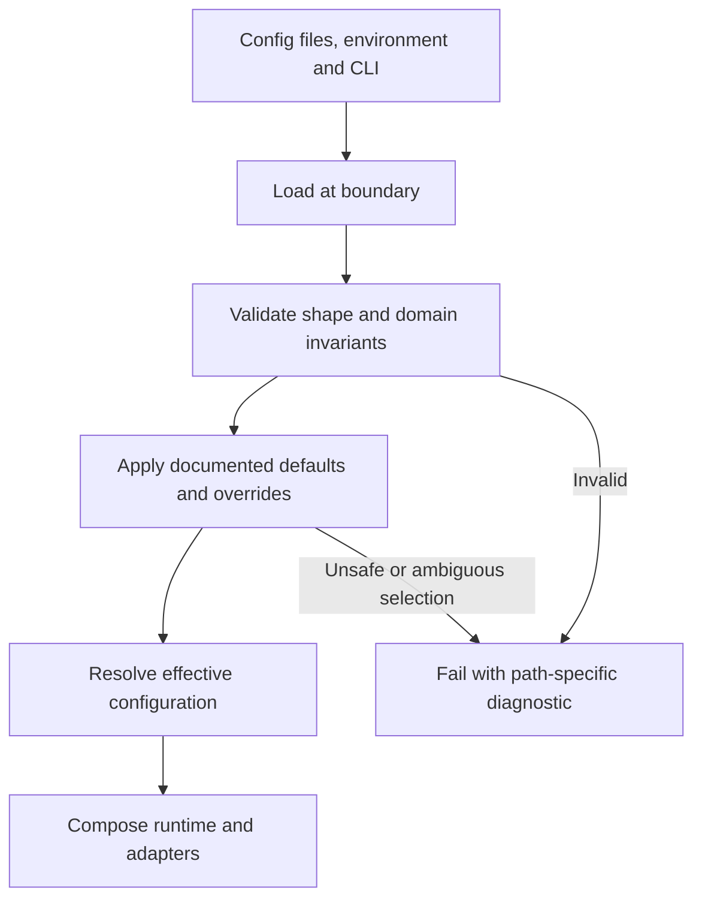

# Configuration standard

## 1. Purpose and scope

Configuration is part of an application's operating contract. It determines which behavior, provider, account, environment, credentials, paths and optional capabilities are selected.

This standard defines the minimum rules shared by all applications and packages. The owning domain remains responsible for its own schema, values, defaults, validation and operational documentation. Do not centralize application-specific settings or introduce a generic configuration framework merely to make different domains look alike.

Use the existing canonical contracts where they are more specific:

- [ADR-0002 — explicit Binance trading environment](../architecture/decisions/ADR-0002-explicit-binance-trading-environment.md) owns Binance endpoint selection.
- [ADR-0003 — multi-provider routing](../architecture/decisions/ADR-0003-multi-provider-routing.md) owns the accepted provider/account/routing architecture.
- [Harvester configuration guidance](../../apps/harvester/README.md#configuration) owns current Harvester setting names and operational examples.
- [Structured Error Handling Standard](structured-error-handling.md) owns validation error classification and safe diagnostics.
- [Shared Utilities Policy](SHARED_UTILITIES_POLICY.md) owns generic validation utility reuse.

## 2. Configuration ownership

Every setting must have one clear owner and one authoritative source.

| Configuration kind | Owner | Examples and boundary |
|---|---|---|
| Repository/tooling | Repository engineering or tool owner | `package.json`, `pnpm-workspace.yaml`, `eslint.config.js`, workflow YAML; use the owning tool's parser/validator |
| Application defaults | Application | Harvester's named `appConfig` in `apps/harvester/config/index.js`, composed from focused named modules |
| Domain/strategy settings | Domain owner | Harvester CG and RS market maps in `cg-coin-grabber.js` and `rs-recovery-seller.js`; keep strategy values with their strategy |
| Integration/provider settings | Integration owner, composed by the application | Harvester `brokers.instances` descriptors and explicit provider environment |
| Deployment/runtime settings | Operator/deployment boundary | `.env.example`, deployment environment variables, secret manager values, process arguments |
| Generated/reference metadata | Owning data contract | Harvester `token-specification.json` is exchange-derived precision metadata, not a second source of strategy investment/quantity settings |

Do not duplicate one setting in multiple files or environment variables without an explicit precedence/compatibility rule. Do not create separate application runtime config objects when the owning application already has one canonical boundary.

## 3. Loading, validation and runtime flow

Keep configuration I/O, validation/normalization and runtime composition separate:

1. **Load at an explicit boundary.** Read files, parse JSON/YAML, import the application config module, and receive process environment/CLI arguments in infrastructure, bootstrap or a CLI entry point.
2. **Validate before side effects.** Validate required fields, types, allowed values, ranges, relationships, duplicate identities and cross-setting invariants before connecting providers, opening operational resources or enabling behavior.
3. **Normalize explicitly.** Resolve documented defaults, environment-specific selection and derived metadata into an effective configuration snapshot. Do not silently coerce malformed values or guess a fallback for safety-sensitive settings.
4. **Compose from the resolved snapshot.** Construct adapters and runtime services with explicit values. Domain policies receive the values they need; they do not discover configuration through filesystem, network or ambient process access.

The diagram describes the general pattern; the owning domain's actual startup contract remains authoritative.

### Validation rules

- Validate at the earliest owner-controlled boundary, before the value can trigger a side effect.
- Keep parsing and filesystem/network access out of pure validation functions.
- Reject unknown fields when the contract is intentionally closed; allow extension fields only when the owning schema documents them.
- Reject invalid types and values rather than relying on JavaScript truthiness, implicit coercion, `||` fallbacks or string parsing scattered among consumers.
- Distinguish missing, empty, null and explicitly false values when they have different meanings.
- Use path-specific diagnostics that identify the invalid setting and expected contract without printing its secret value.
- Reuse the public `ensure` API for generic type/range/collection checks; keep domain invariants in the owning domain. Do not add a second generic validator.
- Validate the complete effective selection, not only individual fields: duplicate provider/account identities, unsupported combinations, unmatched routes and conflicting paths must be rejected.

## 4. Defaults and precedence

- Every default has one owner, one documented value and a test.
- Defaults are appropriate only when omission is safe and the behavior is unambiguous.
- Missing or invalid safety-sensitive selections must fail closed. Do not invent a production/live default, infer exchange mode from `NODE_ENV`, or turn an invalid explicit value into a default.
- If multiple sources may set one value, document the exact precedence and whether an explicit empty value overrides a default. Do not let import order or incidental environment state decide.
- Keep operator-owned strategy values separate from exchange-derived metadata and generated files.
- A CLI utility's safe default does not become a runtime default. For example, Harvester's `config:symbol` TESTNET fallback selects the public metadata endpoint for that generator only; it does not select a runtime trading environment.

For Binance, [ADR-0002](../architecture/decisions/ADR-0002-explicit-binance-trading-environment.md) is definitive: `TRADING_MODE` must be exactly `testnet` or `live`; missing, empty or unsupported values fail closed; `NODE_ENV` must not select or influence the exchange endpoint. This is an explicit operator choice, not a separate trading-enable flag.

## 5. Environment and process access

- Pass an environment object into bootstrap/composition functions and test it with explicit fixtures. The process boundary may default that argument to `process.env`.
- Do not read `process.env`, `process.argv`, current working directory, filesystem state or other ambient process state while importing a static configuration module.
- Domain policies, calculations and pure helpers must not discover runtime settings through ambient process state. An existing shared utility may expose environment access only when that behavior is an explicit part of its public contract.
- Read deployment overrides at one clear boundary, validate them there, and pass the resolved values inward. Do not repeat environment parsing in downstream consumers.
- Keep `NODE_ENV` (application runtime mode), exchange/provider environment, and test/integration opt-in flags separate. Similar names do not make them interchangeable.
- CLI arguments belong to the CLI boundary. A command should parse/validate its own flags and pass ordinary values into the underlying use case.

## 6. Runtime immutability and effective configuration

- Treat validated configuration as a read-only snapshot for the lifetime of the runtime.
- If a consumer needs a different view, derive a new object; do not mutate the shared source configuration or another consumer's view.
- Freeze public constants and configuration collections where doing so protects a shared contract. Do not add deep-freeze machinery without a concrete mutation risk and tests.
- Derived configuration must preserve provenance: identify which source and environment selected it, and keep secrets out of hashes/fingerprints and diagnostic records.
- A runtime configuration change/reload is a separate feature contract. Do not assume that editing a file or changing `process.env` mutates a running process.

Current repository note: Harvester freezes selected runtime option collections and named constants, but the complete nested `appConfig` graph is not uniformly deep-frozen. The read-only rule is therefore a consumer contract, not a claim that every object is runtime-frozen.

## 7. Secrets and sensitive settings

- Never commit real credentials, API keys, tokens, passwords, private keys, signatures or connection secrets.
- Store secret values in deployment environment variables or an approved secret manager. Example environment files must contain empty values or unmistakable placeholders.
- Application configuration may contain the names of credential environment variables when the provider contract requires references; it must not contain the secret values.
- Resolve credentials only at the infrastructure/provider composition boundary. Pass them only to the adapter that needs them; do not expose them through provider identity, domain objects, events, configuration fingerprints, errors or logs.
- Do not log or serialize the complete environment, raw configuration containing secrets, authenticated payloads or unredacted validation input.
- Treat account IDs, chat/user IDs, filesystem paths and other operational identifiers according to their privacy and diagnostic context; they are not automatically secrets, but should not be emitted without a need.

## 8. Compatibility and migration

- Treat configuration keys, serialized values, defaults and precedence as compatibility contracts.
- For a breaking change, identify affected deployments, scripts, examples, tests and consumers before implementation.
- Prefer a deliberate migration path: document old/new forms, an explicit compatibility window or migration tool when justified, and a clear removal point. Do not silently support two competing sources indefinitely.
- Keep legacy compatibility adapters at the owning boundary; normalize into one effective internal shape.
- Add a schema version only when a real persisted/versioned configuration format requires it. Do not add a version field to ordinary in-memory config by habit.
- Significant durable changes with meaningful alternatives or safety consequences require an ADR; routine field additions do not.

## 9. Required test evidence

Tests must prove the actual configuration contract, not just that a loader returns an object.

| Concern | Minimum evidence |
|---|---|
| Defaults | Omitted value selects the documented default; explicit false/empty behavior is distinct where required |
| Validation | Missing, null, wrong type, unsupported enum, malformed string and unknown field as applicable |
| Boundaries | Minimum/maximum, precision, duplicate identity and cross-field invariants |
| Environment | Explicit env fixture, precedence, empty/missing values, invalid override and proof that unrelated variables do not affect selection |
| Secrets | Secret values are not accepted in static config, exposed in metadata/fingerprints, or included in diagnostics |
| Compatibility | Legacy config remains supported during its declared window; unsupported legacy forms fail clearly |
| Side-effect order | Invalid configuration fails before provider/network/database/runtime side effects |
| Immutability | Shared input is not mutated; derived views do not change their source; frozen contracts reject mutation where required |

Use deterministic offline tests by default. Tests that require credentials or external systems must be explicitly gated and must not silently enter required unit-test commands. Broker mutation tests remain TESTNET-only under the repository safety rules.

## 10. Enforcement and exceptions

- Use the owning tool's validator for repository/tooling files and the owning domain's schema/tests for runtime configuration.
- Prefer explicit schema tests and boundary tests over a universal configuration framework.
- No repository-wide AST check currently proves that environment reads occur only at allowed boundaries. A raw text search is not sufficient because process/bootstrap, CLI, integration-test and explicitly documented utility access are legitimate. Any future checker must identify owners and allowlisted boundaries, include valid/invalid fixtures, and be coordinated with the CI owner before becoming required.
- Exceptions must name the setting, owner, reason, scope, and follow-up/removal condition in the task issue/PR. Do not turn an exception into a silent new default.

## 11. Source-verified repository examples

- **Harvester application config:** `apps/harvester/config/index.js` composes one named `appConfig`; focused strategy modules import the operator-owned pair maps. `src/infrastructure/config/load-app-config.js` loads the module and token registry; `src/domain/app-config.js` validates application/domain constraints; `src/bootstrap/config/resolve-harvester-options.js` resolves the explicit trading mode and effective strategy view.
- **Environment overrides:** `resolveTelegramOperatorConfig({ appConfig, env })` validates and merges `TELEGRAM_USER_ID` without mutating the source config. `resolveProviderInstances({ appConfig, env })` validates credential variable names and captures the corresponding values only inside the adapter factory.
- **Exchange safety:** Binance `TRADING_MODE` is governed by ADR-0002. Provider-specific modes must be explicit and validated; ADR-0003 prevents assuming every provider shares Binance's environment vocabulary.
- **Operational paths:** `HARVESTER_DATABASE_DIRECTORY` and `OPERATIONAL_STATE_DIRECTORY` are resolved by infrastructure path adapters from an injected environment object; they are not duplicated into `appConfig`.
- **Generated market metadata:** `token-specification.json` is resolved by exact market symbol before the effective app configuration is validated; strategy pair maps do not duplicate exchange tick/step metadata.
- **CLI configuration:** Harvester's `config:symbol` accepts injected arguments/environment and uses TESTNET only as the safe metadata-endpoint default.

## 12. Change checklist

Before approving a configuration change, confirm:

- [ ] Each setting has one owner and canonical source.
- [ ] Loading/parsing, validation, normalization and composition occur at the correct boundaries.
- [ ] Defaults and source precedence are explicit and tested.
- [ ] Environment access is injected; no import-time or domain-policy ambient reads were introduced.
- [ ] The validated runtime snapshot is treated as read-only; source objects are not mutated.
- [ ] Secrets stay outside committed config and diagnostics.
- [ ] Compatibility and migration impact is documented.
- [ ] Tests cover valid, invalid, missing, boundary, default, environment, secret, side-effect and legacy behavior as applicable.
- [ ] Affected READMEs, examples, ADRs, roadmaps and indexes are updated in the same task PR.
