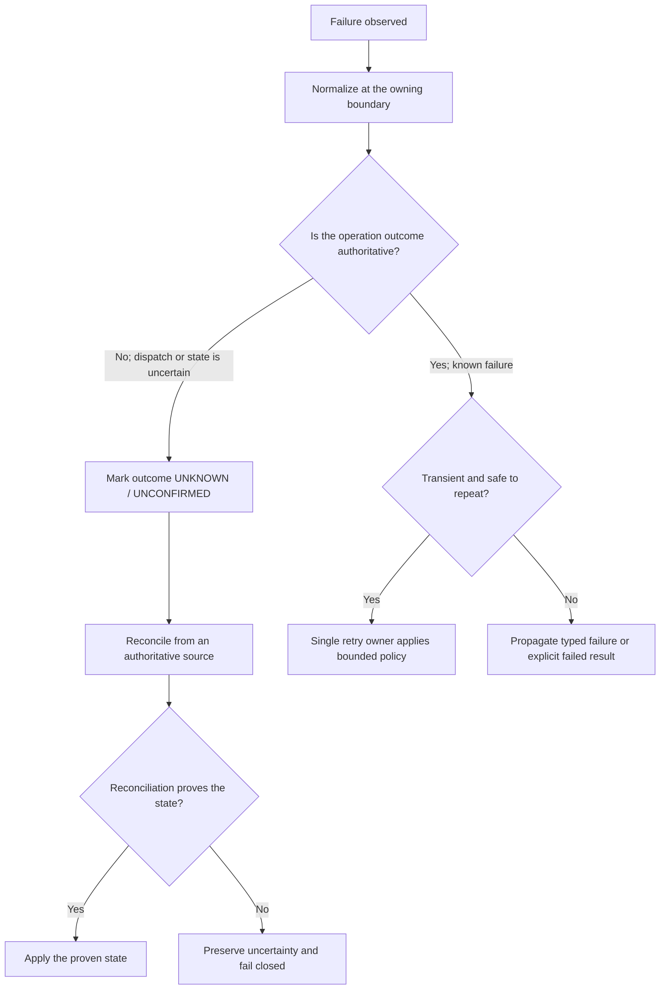

# Structured error handling standard

This document defines the repository-wide contract for application and package errors. It applies to all applications, packages, scripts, tests, and shared infrastructure.

## Goals

Every actionable failure should identify **which component failed, which operation failed, and why**, while preserving the original failure for diagnosis. Error types and codes are part of the internal diagnostic contract; they must not become vague labels that hide the actual cause.

The standard is adopted incrementally. New functionality MUST follow it from its first implementation. When a bug fix or maintenance change touches legacy error handling, improve the touched path where doing so is relevant and safe. Do not launch broad mechanical rewrites solely to rename existing errors.

## 1. Shared base error

The common base class is named `SystemCustomError`. There must be one shared implementation; packages and applications must not create competing copies of the base class.

The Utilities domain owns the single shared implementation in `@coinzilla/utils`, selected after checking dependency direction, package ownership, and the [Shared Utilities Policy](SHARED_UTILITIES_POLICY.md). This is accepted as cross-domain request [#1208](https://github.com/45s/coinzilla/issues/1208) under repository error initiative [#1028](https://github.com/45s/coinzilla/issues/1028). The base must not introduce dependency cycles or make domain packages depend on application code.

The base should extend the native `Error`, set `name` to the concrete subclass name, and support the standard native `cause` option. It may expose the following structured fields where applicable:

- `code`: a stable, machine-readable, domain-scoped identifier.
- `cause`: the original error or lower-level error, preserved without replacing its identity.
- `context`: a small, safe object containing relevant diagnostic facts.
- `retryable`: an explicit boolean only when the operation can meaningfully be classified as retryable or permanent.

The shared base stores `context` as a detached, frozen flat record of JSON-safe scalar values (`string`, finite `number`, `boolean`, or `null`); nested objects and mutable payload graphs are rejected.

Do not add speculative fields or a complex error framework. Keep the base small and independent of logging, transport, persistence, application services, and domain policy.

## 2. Package- and feature-owned subclasses

The component that owns the failed operation owns its specific error classes and codes. Examples include:

- Journal: `JournalReadError`, `JournalWriteError`, `JournalValidationError`.
- Notifications: `NotificationMessageError`, `NotificationDeliveryError`.
- Command Center: `CommandCenterOperationError`, `CommandValidationError`.
- Authentication: `LoginError`, `AuthenticationError`.
- Trading: `TradingEngineError`, `TradingExecutionError`, `AccountAuditError`.
- Configuration: `ConfigLoadingError`, `ConfigValidationError`.
- Brokers: `BrokerConnectionError`, `OrderSubmissionError`, `MarketDataError`.

These are examples, not a mandatory class catalogue. Choose names that identify the owning component and failed operation. Do not create a new class for every function or every expected outcome.

Error codes MUST be stable, unique within the repository, descriptive, and suitable for log filtering and tests (for example, `JOURNAL_EVENT_VALIDATION_FAILED`). Do not derive codes dynamically from messages, stack traces, or class names. Do not reuse one generic code for unrelated failures.

Keep subclasses close to the implementation they describe, normally in a cohesive `errors/` module within the owning package or feature. Export only types that are part of that component's intended public diagnostic contract.

## 3. Failure classification and outcome semantics

Classify a failure by the responsibility that owns it and by what the caller can safely conclude. These descriptions are review categories, not a mandatory class hierarchy, enum, or `SystemCustomError` field. Do not add a generic `category` property or a new taxonomy framework merely to label every exception.

| Category | Meaning | Expected handling |
|---|---|---|
| Validation / input | External or caller-supplied data does not satisfy a declared shape, range, or configuration contract. | Reject at the boundary before side effects. Use native `TypeError` / `RangeError` for generic argument/precondition violations; use an owner-specific error and stable code when callers must distinguish a domain configuration or validation failure. |
| Domain / invariant | A validly shaped input would violate an owning domain's business or state invariant. | Keep the decision with the domain owner. Preserve the invariant and return/throw the domain-owned failure; do not turn it into an empty value or successful no-op. |
| Contract / programmer | An internal caller, adapter, or implementation violated a required interface or invariant. | Treat as a defect, not as a transient operational condition. Preserve the failure for diagnosis; do not retry or hide it as a recoverable external failure. |
| Application / use case | An application operation cannot complete because one or more owned steps failed. | Add operation/lifecycle context at the application boundary when useful, preserve the lower-level cause, and apply the use case's explicit recovery policy. |
| Infrastructure / external | A filesystem, database, network, exchange, or other adapter operation failed. | Normalize provider-specific failures at the adapter boundary into the owning public contract without discarding the native cause or useful provider diagnostics. |
| Reconciliation / unknown state | Available external or persisted facts do not prove whether an operation happened or what state is authoritative. | Preserve an explicit unknown/unconfirmed state and reconcile from an authoritative source. Never infer success, rejection, absence, zero, or ownership from missing/ambiguous evidence. |

A failure can have one owning category and a separate retry/outcome assessment. **Transient/permanent is not a replacement for ownership classification.** Do not classify by parsing human-readable messages, stack traces, provider wording, or error class names when a stable type/code or explicit result field exists.

Use an owner-specific subclass when a caller genuinely needs semantic branching or a stable diagnostic contract. Do not create a subclass for every validation assertion, function, or expected result. A deliberate result envelope (for example, the repository's `toResult` or a domain-owned failure result) is valid when it is the established operation contract: keep `ok: false`, preserve the original error object and its code/cause, and keep failure metadata explicit. Do not both swallow the failure and return a success-shaped result.

## 4. Retry ownership

A retry is a new attempt at an operation, not merely another way to report an error. The layer that owns the retry loop must understand the operation's idempotency, state-changing effects, cancellation/deadline, and total retry budget.

- Exactly one layer owns a given retry loop. Do not stack adapter, application, and caller retries that multiply attempts or obscure the actual attempt count.
- `retryable: true` is a classification hint, not permission to retry automatically. The retry owner must also prove the operation is safe to repeat and apply a bounded attempt/time budget, backoff, cancellation and observability policy.
- Retry only failures classified as transient when the operation is idempotent or has a verified idempotency mechanism. Do not retry validation, domain-invariant, programmer/contract, unsupported-operation, or known permanent failures.
- If the failure is known to have occurred before dispatch (for example, an explicit `NOT_SENT` mutation outcome), follow the operation's existing contract; do not invent a provider rejection.
- If a state-changing request may have been dispatched but its outcome is not authoritative, classify it as unknown and reconcile before any resubmission. A timeout, disconnect, malformed response after dispatch, or missing acknowledgement is not proof that the operation failed.
- Do not retry an unknown mutation merely because its error is marked retryable. If authoritative reconciliation is unavailable or inconclusive, preserve the unknown state and fail closed.

The existing Broker contract distinguishes `NOT_SENT` from `OUTCOME_UNKNOWN`; its provider/application owners remain responsible for the exact protocol evidence and reconciliation. This standard does not replace that contract with a repository-wide mutation enum.

## 5. Safe fallback and fail-closed behavior

A fallback is allowed only when the owning contract explicitly defines it and the fallback preserves the meaning, authority, freshness, and safety of the result.

- A read-only fallback may use a documented last-known snapshot only when the consumer can identify it as stale/degraded and its age/source are sufficient for that use. Never present stale or partial data as current and complete.
- Do not invent defaults such as zero, empty collections, success, no orders, no fills, or no prior state when the source is missing, malformed, contradictory, or unavailable.
- Fail closed when uncertainty affects authorization, account/order ownership, order submission/cancellation, fills, financial quantities, reconciliation, durable-ledger integrity, configuration validity, or lifecycle readiness.
- For an ambiguous state-changing operation, preserve the last authoritative state separately from the unknown attempted outcome; block unsafe dependent mutations until reconciliation resolves the ambiguity.
- A fallback or recovery decision must be explicit, observable, bounded where applicable, and covered by tests. Logging an error and continuing is not a fallback policy.
- If recovery itself fails, retain both the original operational failure and the recovery/cleanup failure (for example, with an appropriate `AggregateError`) rather than replacing the primary cause or silently discarding the secondary failure.

The required safety invariant is: **unknown external or persisted state must not silently be converted into success, failure, or an assumed state.**

### Failure decision path

The following is a review aid, not a replacement for a domain's more specific state machine or broker contract. It emphasizes the point at which a known failure and an unknown outcome require different handling.

## 6. Wrapping and propagation

- Preserve the lower-level error with native `cause` whenever adding component or operation context.
- Wrap an error when crossing a meaningful architectural boundary or when the current layer can add useful context. Do not wrap at every function call.
- Do not replace a specific lower-level error with a generic error that discards its type, code, or cause.
- Do not repeatedly wrap an error with identical context or log the same failure at every layer.
- If an error is intentionally handled, recovered, retried, or suppressed, make that decision explicit and test it.
- Do not use exceptions for ordinary control flow when a result value or explicit state is clearer.
- Normalize non-`Error` thrown values at an appropriate external boundary; do not assume every caught value has `message`, `stack`, or `cause`.

A higher-level error should answer what the owning operation failed to do. Its `cause` should answer what lower-level failure made that operation fail.

## 7. Diagnostic context and security

Include only context that materially helps identify the failure, such as:

- component and operation;
- lifecycle stage or state transition;
- safe entity identifiers (for example, event type, market symbol, order/client identifier, or configuration key);
- stable error code and retry classification;
- the original cause.

Context must be bounded, intentional, and safe to log. Never attach credentials, API secrets, access tokens, private keys, authentication material, or unrestricted account/payload snapshots. Redact or summarize external data. Avoid storing mutable internal objects or entire request/response graphs in error instances.

Error messages should be concise and actionable. Put machine-readable detail in fields, not in a message that callers must parse. Do not expose internal stack traces or sensitive context to end users or notification recipients.

## 8. Logging and reporting

Log at the boundary that owns the operational decision or at the actionable failure point. Use structured fields including the error name, stable code, operation/component, safe context, and original cause when available.

- Preserve the original error object for logger/telemetry integrations where supported.
- The shared Logger intentionally allowlists standard Error diagnostics. Pass custom `code`, `context`, and `retryable` as explicit structured fields when they are needed in logs.
- Avoid duplicate logs when an error is rethrown unchanged. The layer that decides whether to retry, recover, fall back, or stop owns the single actionable operational log; lower layers should not emit a second identical ERROR entry for the same failure.
- The retry owner should record a retry attempt and its bounded decision once, with safe operation identity and attempt/budget context. The terminal failure should be reported once when the owner exhausts the policy or decides not to retry.
- When a permitted fallback is used, report that degraded/stale state explicitly with safe source/age/reason context. Do not log an error and then present the fallback as an ordinary current success.
- Do not log and then silently continue unless that is an explicitly tested recovery policy.
- A logging or notification failure must not mask the original operational failure.
- User-facing messages should be safe and understandable; detailed diagnostics belong in protected logs.

The standard complements the repository-wide reliability and security principles in [Engineering Standards](../../ENGINEERING_STANDARDS.md).

## 9. Incremental adoption rules

1. **New functionality:** introduce or reuse the owning component's specific error types and stable codes as part of the feature, with tests.
2. **Bug fixes:** when changing a path that throws, catches, wraps, or reports errors, improve that path to the standard where relevant. Add regression coverage for the failure and preserved cause/context.
3. **Refactoring:** migrate legacy errors when the code is already being materially changed or when a concrete diagnostic defect warrants a focused task.
4. **Untouched legacy code:** do not require unrelated files to be rewritten. Do not add a mass migration solely to make naming uniform.
5. **Shared error infrastructure:** change the base contract only through a focused cross-domain task with consumer review and compatibility tests.

Every pull request that adds or materially changes error handling must state the affected error types/codes and demonstrate that the original cause and safe context remain available. Update the owning package's documentation when its public error contract changes.

## 10. Required tests

Tests for new or materially changed error behavior should verify, as applicable:

- the concrete subclass and its `name`;
- the stable error `code`;
- original `cause` identity and useful cause chain;
- safe, relevant `context` and absence of secrets;
- the owning failure category and stable type/code where callers branch on it (do not require a universal category field);
- retry classification and the single layer that owns bounded retries, including proof that permanent and unsafe-to-repeat failures are not retried;
- propagation and wrapping at the intended architectural boundary, including result-envelope compatibility;
- known versus unknown mutation outcomes, authoritative reconciliation, and fail-closed behavior when uncertainty remains;
- explicit fallback behavior, including stale/degraded labeling when a last-known read snapshot is permitted;
- single-boundary logging for retry/fallback/terminal decisions, and behavior when logging, reporting, cleanup, or recovery itself fails, including preservation of multiple failures where relevant;
- compatibility of public exports and any serialized diagnostic representation.

Use deterministic tests and meaningful assertion messages. Follow the mandatory RED → GREEN → REFACTOR process in [Engineering Standards](../../ENGINEERING_STANDARDS.md).

## 11. Adoption roadmap

The root [engineering roadmap](../../ROADMAP.md) tracks the staged introduction and gradual migration. Do not interpret this standard as authorization for a one-shot repository-wide rewrite.
