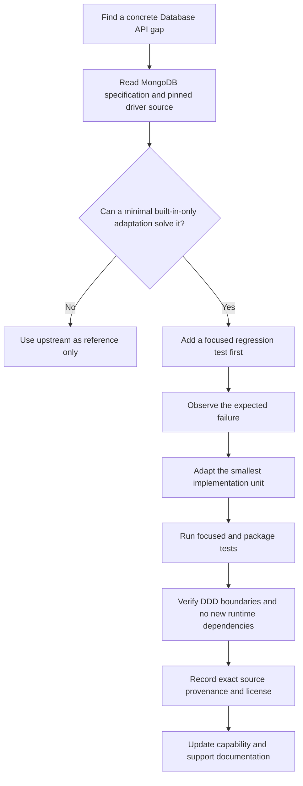

# Official MongoDB Node.js driver: reference and selective-port strategy

**Status:** Approved implementation strategy for issue [#1865](https://github.com/45s/coinzilla/issues/1865) and PR [#1868](https://github.com/45s/coinzilla/pull/1868).  
**Assessment date:** 2026-11-26  
**Reference repository:** [mongodb/node-mongodb-native](https://github.com/mongodb/node-mongodb-native)  
**Reference version inspected:** `mongodb@7.9.1`  
**Reference commit inspected:** [`2ed780df2a57884c3fa597da9ebbb6256ae0a5ea`](https://github.com/mongodb/node-mongodb-native/commit/2ed780df2a57884c3fa597da9ebbb6256ae0a5ea)  
**License:** Apache License 2.0

## Decision

Use the official MongoDB Node.js driver as a **source-level engineering reference** and selectively port/adapt small, proven implementation units when that is safer than independently reproducing subtle protocol behavior.

Do **not** copy the complete driver, vendor its whole source tree, or recreate its public API. The Coinzilla provider has a deliberately smaller contract and must remain dependency-free:

- Preserve `@coinzilla/db`'s provider-neutral Database API and DDD boundaries.
- Keep MongoDB implementation details under `src/infrastructure/mongodb/`.
- Use Node.js built-ins only at runtime; do not add the `mongodb`, `bson`, `@mongodb-js/saslprep`, `mongodb-connection-string-url`, ORM, or other runtime package.
- Port only code that is necessary for the existing Database API, is technically compatible with this package, and has a clear regression-test justification.
- Prefer MongoDB's published specifications for protocol semantics. Treat the official driver as a mature implementation example, not as a replacement for the specifications or our own contract.

This decision supersedes the earlier blanket prohibition on *any* copied third-party implementation. Selective, reviewed, license-compliant adaptation is allowed under the controls in this document. Wholesale copying remains prohibited.

## Why not copy the whole package?

The inspected official driver is a complete general-purpose driver, not a minimal CRUD adapter. Its current `package.json` declares runtime dependencies:

- `@mongodb-js/saslprep`
- `bson`
- `mongodb-connection-string-url`

It also has optional peer integrations for compression, encryption, Kerberos, AWS/GCP authentication and SOCKS. Copying the package would bring a much larger API and operational surface, and its BSON, SASL preparation and URI behavior depend on separate packages. That would violate the no-third-party-runtime-dependency requirement and expand scope beyond the package's JSON record contract.

The official driver also contains substantial functionality that this provider intentionally does not promise: public MongoClient/Db/Collection/Cursor APIs, connection pooling, server discovery and monitoring, broad authentication integrations, compression, change streams, GridFS, client-side encryption, retryable writes and compatibility paths for features outside our declared support matrix.

## Reference-source map

The following official-driver areas are the first places to inspect. Paths are pinned to the reference repository above; use the pinned commit when reviewing or porting so upstream `main` changes do not silently alter the source baseline.

| Concern in our provider | Existing Coinzilla code | Official driver reference | Review focus |
|---|---|---|---|
| BSON codec | `src/infrastructure/mongodb/bson.js` | [`src/bson.ts`](https://github.com/mongodb/node-mongodb-native/blob/2ed780df2a57884c3fa597da9ebbb6256ae0a5ea/src/bson.ts), and the separately maintained [`mongodb/js-bson`](https://github.com/mongodb/js-bson) project | The driver wrapper delegates to the BSON package; inspect the actual codec separately. Compare length validation, nested values, numeric boundaries, malformed input and resource limits. Do not import the BSON package. |
| Wire framing and request/response handling | `wire-protocol.js`, `transport.js` | [`src/cmap/connection.ts`](https://github.com/mongodb/node-mongodb-native/blob/2ed780df2a57884c3fa597da9ebbb6256ae0a5ea/src/cmap/connection.ts), [`src/cmap/commands.ts`](https://github.com/mongodb/node-mongodb-native/blob/2ed780df2a57884c3fa597da9ebbb6256ae0a5ea/src/cmap/commands.ts), [`src/cmap/connect.ts`](https://github.com/mongodb/node-mongodb-native/blob/2ed780df2a57884c3fa597da9ebbb6256ae0a5ea/src/cmap/connect.ts) | Message boundaries, correlation, socket lifecycle, cancellation, timeouts, write dispatch and cleanup. Keep our smaller one-socket model. |
| Handshake and topology facts | `handshake.js` | [`src/cmap/handshake/`](https://github.com/mongodb/node-mongodb-native/tree/2ed780df2a57884c3fa597da9ebbb6256ae0a5ea/src/cmap/handshake), [`src/sdam/`](https://github.com/mongodb/node-mongodb-native/tree/2ed780df2a57884c3fa597da9ebbb6256ae0a5ea/src/sdam) | Required hello fields, wire-version negotiation, primary/secondary behavior and topology distinctions. Do not import the full SDAM monitor/selection subsystem. |
| SCRAM authentication | `scram.js` | [`src/cmap/auth/`](https://github.com/mongodb/node-mongodb-native/tree/2ed780df2a57884c3fa597da9ebbb6256ae0a5ea/src/cmap/auth) | Nonce validation, mechanism negotiation, proof construction, server signature verification and failure handling. The official driver's SASLprep dependency is not available to us; preserve our explicit ASCII restriction unless a separately justified, dependency-free implementation is added and tested. |
| CRUD and cursor commands | `commands.js` | [`src/operations/`](https://github.com/mongodb/node-mongodb-native/tree/2ed780df2a57884c3fa597da9ebbb6256ae0a5ea/src/operations) | Command fields, write concern, cursor IDs, getMore/killCursors, result interpretation and server error cases. Keep only operations required by our provider port. |
| Sessions and transactions | `provider.js` | [`src/sessions.ts`](https://github.com/mongodb/node-mongodb-native/blob/2ed780df2a57884c3fa597da9ebbb6256ae0a5ea/src/sessions.ts), [MongoDB transaction specification](https://github.com/mongodb/specifications/tree/master/source/transactions) | Session identity, transaction numbering, command sequencing, retryable commit semantics and unknown outcomes. Preserve our no-callback-replay rule and explicit outcome-unknown errors. |
| URI parsing | provider configuration in `provider.js` | [`src/connection_string.ts`](https://github.com/mongodb/node-mongodb-native/blob/2ed780df2a57884c3fa597da9ebbb6256ae0a5ea/src/connection_string.ts) | URI grammar, percent decoding, option precedence, authSource and rejection of unsupported options. Do not import `mongodb-connection-string-url`. |
| Error semantics | `database-errors.js`, MongoDB provider error mapping | [`src/error.ts`](https://github.com/mongodb/node-mongodb-native/blob/2ed780df2a57884c3fa597da9ebbb6256ae0a5ea/src/error.ts), [`src/cmap/errors.ts`](https://github.com/mongodb/node-mongodb-native/blob/2ed780df2a57884c3fa597da9ebbb6256ae0a5ea/src/cmap/errors.ts) | Distinguish server rejection, definitely-unsent operations, interrupted writes and uncertain commit results. Map to our provider-neutral error taxonomy. |

## Source-review finding — BSON Timestamp signedness

The pinned driver delegates BSON serialization/deserialization to the separate `mongodb/js-bson` project, so `src/bson.ts` alone is not the codec implementation. Inspection of `js-bson` at commit [`c9922e971af774d260bb529cf2c405def8036633`](https://github.com/mongodb/js-bson/commit/c9922e971af774d260bb529cf2c405def8036633) confirmed that BSON Timestamp is unsigned: its deserializer reads two unsigned 32-bit fields and constructs an unsigned Timestamp value ([deserializer.ts](https://github.com/mongodb/js-bson/blob/c9922e971af774d260bb529cf2c405def8036633/src/parser/deserializer.ts), [timestamp.ts](https://github.com/mongodb/js-bson/blob/c9922e971af774d260bb529cf2c405def8036633/src/timestamp.ts)).

The Coinzilla decoder previously routed BSON type `0x11` through `Buffer.readBigInt64LE`, interpreting values with the high bit set as negative. A test-first regression was committed in `73494aa26b6059428ecf61a9584f273ecc88cc7a` for a timestamp above `2^63 - 1`. The correction uses Node's `readBigUInt64LE` and retains precision by returning a Number only within the safe-integer range, otherwise BigInt. This is a specification-informed local fix; no upstream source was copied, so the attribution ledger remains empty.

A second review found that Node's `Buffer.from(value, "base64")` silently ignores invalid trailing characters. That behavior could allow a malformed SCRAM server-final signature such as a valid proof followed by punctuation to decode to the expected bytes. A test-first regression was committed in `32dad94bfaab85e559cb6a34cb97b2802b8a3afe`; the local fix now validates the Base64 alphabet, padding shape and canonical round-trip before the existing constant-time comparison. This is protocol-input hardening, not copied upstream code.

### Sharded transaction recoveryToken

The MongoDB [Transactions Specification at commit `2f6258c99955394d05babb85e3d3599c2addb02c`](https://github.com/mongodb/specifications/blob/2f6258c99955394d05babb85e3d3599c2addb02c/source/transactions/transactions.md#recoverytoken-field) requires drivers to track the latest `recoveryToken` returned by successful commands in a sharded transaction and append it to subsequent `commitTransaction` and `abortTransaction` commands. The pinned official Node.js driver stores this token on the transaction and forwards it from both commands in `src/sessions.ts`.

A test-first regression in `275afc016924f005a2b71eaba748672465e75bb5` covers token replacement across multiple sharded commands, abort propagation, missing-token rejection and bounded commit write concern. The provider now validates and stores each successful sharded response's latest token, sends it only with commit/abort, and fails closed if a successful sharded response omits a valid document token. No upstream source was copied; this is a local implementation of the normative specification.

### Transaction commit dispatch certainty

The provider previously retried every thrown commit error as ambiguous, even when the transport could prove that the commit frame was never accepted for sending (for example, a synchronous socket-write rejection or a local write-buffer limit). That could report `DatabaseTransactionOutcomeUnknownError` when the commit was definitely not sent. A regression was committed first in `94f24123ddfac6156f12c61e07b624d6f8bafc83`. Commit requests now carry an explicit `commit` operation classification through the transport: timeouts/interruption after dispatch remain ambiguous, while pre-dispatch failures are marked `outcomeUnknown: false` and surface as provider failures without retrying. If an earlier attempt was ambiguous, a later definitely-unsent retry still cannot resolve that earlier attempt, so the final result remains unknown.

### OP_MSG sequence map key safety

A review of `decodeOpMsg` found that response document-sequence identifiers are server-controlled cstrings. Storing them in a normal `{}` object makes the valid identifier `__proto__` invoke the legacy prototype setter instead of creating an own key, silently changing the map's prototype and dropping the sequence entry. A test-first regression was committed in `30cb243927dfd8b172b2a6edeebe431c94201ff9`. The decoder now uses a null-prototype map so all sequence identifiers remain ordinary own keys. This is a local parser-hardening fix; no upstream code was copied.

## Porting workflow — required for every candidate

1. **Name the concrete gap.** Identify the current Coinzilla function, its public contract, observed defect or missing edge case, and a regression test that demonstrates the requirement. Do not port code merely because the official driver has it.
2. **Read the authoritative specification.** Locate the applicable MongoDB specification and server compatibility requirements. The driver is an implementation reference; it is not the normative source for wire behavior.
3. **Inspect the pinned upstream implementation and tests.** Read the smallest relevant source unit plus its tests and call graph. Identify imports, package dependencies, Node APIs, hidden shared abstractions and behavior that our narrower contract does not need.
4. **Choose the smallest safe adaptation.** Prefer a focused algorithm or invariant over copying a class/module. Reimplement using Node.js built-ins and our local abstractions when the upstream code is coupled to unavailable packages or the full driver architecture.
5. **Apply RED → GREEN → REFACTOR.** Add the regression test first and demonstrate it fails for the expected reason. Port/adapt only enough code to pass it; retain tests for malformed, boundary, interruption and cleanup behavior.
6. **Review scope and boundaries.** No MongoDB-native types, commands, sessions, sockets or errors may cross into domain/application/public contracts. Do not broaden the supported feature matrix as an accidental side effect.
7. **Record provenance.** For every code fragment substantially copied or adapted, add a source attribution entry with the upstream repository, pinned commit, exact file path, Apache-2.0 license, local destination and a short description of modifications. Retain upstream copyright/license notices required by the license and mark modified files appropriately.
8. **Verify dependencies and behavior.** Confirm package manifests have no new runtime dependency. Run focused tests, the complete DB package tests and coverage, lint and relevant checks. Use real MongoDB integration for server semantics where possible; fake transports do not prove server interoperability.

A candidate that cannot meet these conditions must be used as a reading/reference source only.

## Porting priority

Prioritize review in this order, based on risk and the current implementation:

1. BSON parsing/serialization correctness and adversarial length/depth handling.
2. OP_MSG framing, response correlation, socket write state and interrupted-operation classification.
3. SCRAM nonce/proof/signature verification and authentication-source semantics.
4. Handshake negotiation and topology-dependent command behavior.
5. Cursor lifecycle and CRUD command/result semantics.
6. Session/transaction sequencing, commit retry boundaries and unknown outcomes.
7. URI parsing and option precedence.

This is a review order, not a commitment to import upstream modules. Existing code may already be simpler and correct; retain it when tests and specification evidence support it.

### Selective-port decision flow

## Explicit non-goals

- Do not vendor the entire official driver or its `src/`, `test/`, build system, public types or package structure.
- Do not add the official driver's runtime dependencies or copy dependency code without a separate dependency/license review.
- Do not recreate MongoClient, Db, Collection, Cursor, connection-pool or SDAM public abstractions.
- Do not add pooling, monitoring, multi-seed/SRV discovery, automatic failover, compression, retryable writes, change streams, GridFS, encryption or extra authentication mechanisms unless the Database API contract later demonstrates a concrete need and the issue scope is explicitly revised.
- Do not copy upstream tests wholesale; translate the relevant behavior into our deterministic Node test style and provider-conformance contract.
- Do not claim full MongoDB driver compatibility. The support matrix in [mongodb.md](./mongodb.md) remains authoritative.

## License and attribution controls

The official Node.js driver repository declares Apache-2.0. Apache 2.0 permits use, modification and redistribution subject to its conditions; it is not permission to omit notices.

Before distributing adapted source:

- Include a copy of the applicable Apache License 2.0 text in the package/repository's third-party license notices.
- Preserve applicable copyright, patent, trademark and attribution notices from source files.
- Mark files that have been modified.
- Carry forward any applicable upstream `NOTICE` attributions.
- Record each substantially adapted file in the ledger below; keep entries accurate as code changes.
- Review separately licensed or separately packaged dependencies (notably BSON and SASL preparation); the driver's top-level license does not automatically replace dependency license review.
- Do not imply MongoDB endorses Coinzilla or use MongoDB trademarks as product branding.

### Adapted-source attribution ledger

No official-driver source code has been copied into Coinzilla as part of the strategy decision itself. Add one row for each later copied/adapted implementation unit.

| Local file | Upstream repository and pinned commit | Upstream file | License | Modification summary |
|---|---|---|---|---|
| _No adapted source recorded yet._ | — | — | — | — |

## Reference links

- [Official MongoDB Node.js driver](https://github.com/mongodb/node-mongodb-native)
- [Pinned driver source snapshot](https://github.com/mongodb/node-mongodb-native/tree/2ed780df2a57884c3fa597da9ebbb6256ae0a5ea)
- [Driver package manifest and dependencies](https://github.com/mongodb/node-mongodb-native/blob/2ed780df2a57884c3fa597da9ebbb6256ae0a5ea/package.json)
- [MongoDB specifications](https://github.com/mongodb/specifications)
- [OP_MSG specification](https://github.com/mongodb/specifications/blob/master/source/message/OP_MSG.md)
- [Apache License 2.0](https://www.apache.org/licenses/LICENSE-2.0)
