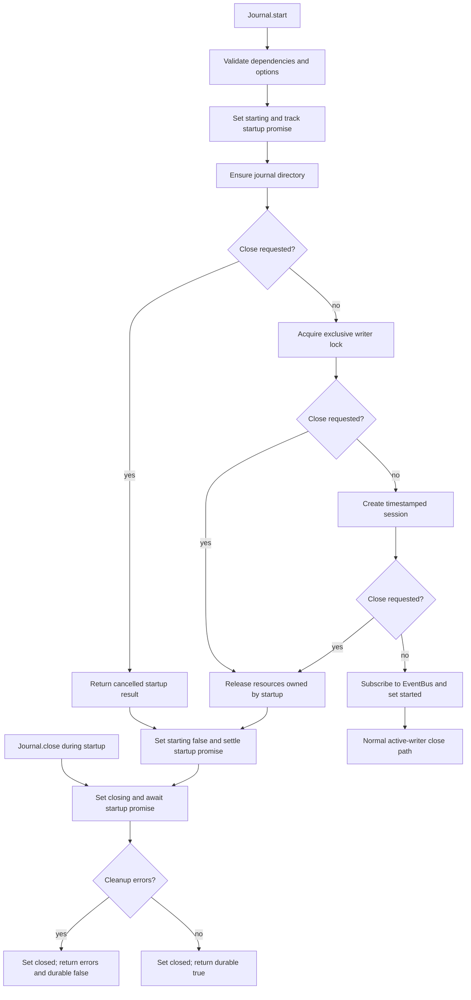
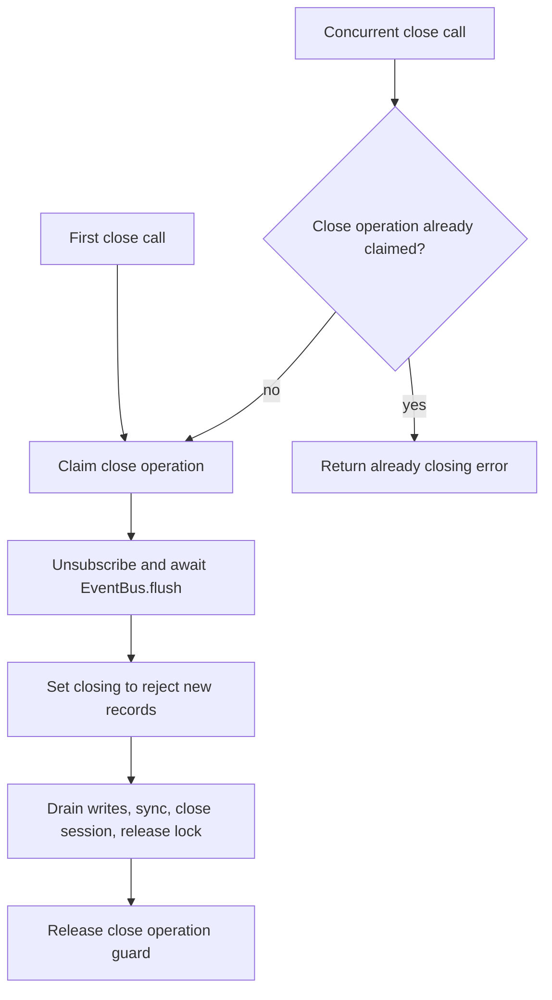
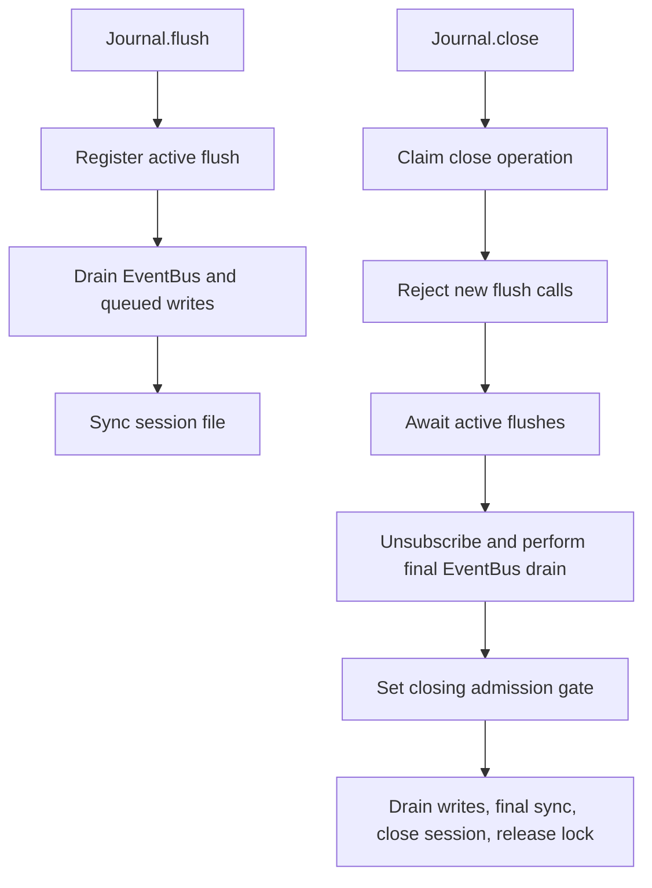

# @coinzilla/journal

Durable JSONL event recording with bounded restart reading and deterministic replay.

## Public API and event vocabulary

Journal stores the events it receives; it does not decide what those events mean to the business. Keep these concepts distinct:

- **Domain event:** a business fact named and owned by the domain that produces it (for example, an order being filled). Journal does not infer domain meaning from an event name or payload.
- **EventBus message / source event:** the event delivered to Journal by the injected EventBus subscription. Journal consumes the event object as supplied; it does not reclassify it as a domain or integration event.
- **Persisted Journal record:** the JSON-representable source-event fields retained at the JSONL top level, plus Journal-owned schema and identity metadata under the reserved `__coinzillaJournal` key. This is subject to the [lossless JSONL source-event contract](#lossless-jsonl-source-event-contract-issue-889).
- **Recovered record:** the read/replay representation derived from a persisted line. It separates Journal identity and schema from the event payload and adds the source file and 1-based line position.

A source event is an object with a non-empty own string `id`. That stable ID becomes the Journal record identity; Journal does not generate a replacement ID or deduplicate records by business meaning. The reserved `__coinzillaJournal` metadata key cannot be supplied by the source event. Before copying or serializing an event, Journal recursively validates the complete value graph against the [lossless JSONL source-event contract](#lossless-jsonl-source-event-contract-issue-889); custom prototypes, accessors, non-enumerable properties, and custom `toJSON` hooks are rejected at any depth.

For source events that satisfy the lossless JSONL value contract below, a current schema-v1 JSONL line retains the source event fields at the top level and adds `__coinzillaJournal: { schemaVersion: 1, id: event.id }`. Reading returns `{ id, schemaVersion, payload, position }`: `payload` contains the persisted event fields without the reserved metadata, and `position` contains `{ fileName, lineNumber }` with a 1-based line number.

Legacy JSONL lines written before the metadata field existed remain readable as schema-v1 records: their top-level object is the payload, and its non-empty `id` supplies record identity. Unknown schema versions and malformed identities fail closed.

### Lossless JSONL source-event contract (issue #889)

Journal validates the complete source-event graph before copying or appending it. The accepted value subset is deliberately narrower than EventBus's in-memory payload contract:

- **Accepted:** `null`, strings, booleans, finite numbers other than negative zero, dense arrays, and plain or null-prototype objects with enumerable own string-keyed data properties.
- **Rejected:** `undefined` at any depth, sparse array holes, BigInt, NaN, positive/negative infinity, negative zero, cycles, custom prototypes, symbol keys, functions, accessors, non-enumerable properties, custom array properties, and custom `toJSON` hooks.

Every rejected value produces a path-specific `TypeError` before any JSONL bytes are appended. Property descriptors are inspected without invoking getters. Shared references are accepted as repeated subtrees; JSONL does not preserve object-identity/alias relationships, and recovered repeated values are independent objects. Null-prototype objects are persisted as ordinary JSON objects; prototype identity is also outside the contract.

EventBus's in-memory contract remains intentionally broader. EventBus `publish()` and `flush()` are not Journal persistence acknowledgements. If an EventBus-delivered event cannot be serialized, the subscriber records the failure in the Journal writer state; `Journal.flush()` returns failure, and `Journal.close()` returns `durable: false`. The active writer rejects subsequent records after this failure. Close still performs cleanup and attempts to sync previously accepted bytes, but never reports durable success after an event was omitted. Direct `record()` calls return the serialization error and poison the writer in the same way.

The current Harvester DTO audit found a narrow consumer migration requirement: `mapOrderUpdatedData` forwards any numeric broker `transactionTime`, while several timestamp checks admit negative zero. Harvester must reject non-finite and negative-zero timestamp values before publishing Journal-bound DTOs. This remains a separate Harvester-owned follow-up; the Journal package does not modify another domain.

Replay passes each recovered record to the consumer as `{ record }`, in session/line order, only after the complete snapshot has been validated. The consumer owns interpretation, application restoration, and idempotent handling. Replay is at-least-once; it is not a command dispatcher or an exactly-once side-effect mechanism.

Construct `Journal` with an EventBus, a directory path, an optional logger,
and an optional `sessionIdentity: { startedAt, runtimeSessionId }`. When
provided, the identity determines the session filename using the UTC start
timestamp and sanitized runtime ID; exclusive creation rejects collisions
without overwriting history. Callers that omit it retain the timestamp-only
filename with numeric collision suffixes. Harvester supplies its process
identity so Journal, DEBUG, TRACE and terminal session files can be correlated.
Journal uses only the EventBus operations `subscribeAll({ handler })` and `flush()`; the returned subscription must expose `unsubscribe()`. EventBus owns message delivery. Journal owns its persisted representation and storage lifecycle.

| Method | Observable contract |
| --- | --- |
| `start()` | Creates the directory if needed, acquires exclusive writer ownership, creates a session, and subscribes to EventBus messages. A second active writer for the same directory is rejected. |
| `record({ event })` | Recursively validates the complete source-event graph, then serializes before queueing the write. Unsupported/lossy values return a `TypeError`, poison the active writer, and are retained for lifecycle durability results. A successful result means the write completed and reports `durable: false`; it does not confirm file-content sync. |
| `flush()` | Flushes EventBus delivery, waits for queued writes, and syncs the active session file. Success reports `durable: true` only when every delivered source event was accepted and every queued write synced. A subscribed serialization failure is included in the result and prevents durable success. |
| `close()` | Cancels and waits for an in-progress startup to finish rolling back its owned resources, or unsubscribes an active writer, drains queued writes, syncs and closes the session, and releases the lock owned by this instance. A failed close remains a failed durability outcome on repeated calls; the issue #889 subscription-serialization caveat also applies. |
| `read(options)` | Reads and validates a complete bounded snapshot while this Journal instance is stopped. It does not acquire a cross-process reader lock. |
| `replay(options)` | Validates the complete snapshot, then awaits the handler sequentially for each recovered record. A handler failure stops replay and reports completed progress. |

Methods return the package's result objects; callers should check `ok` and inspect `errors` on failure. Detailed durability, recovery limits, lock handling, and replay guarantees are described below.

## Startup and close lifecycle

When `close()` races with `start()`, the Journal service requests cancellation and waits for the startup promise. Startup checks that request after each asynchronous acquisition step, then closes/releases only resources owned by the attempt. A session file already created is retained empty; the session handle and directory lock are released before close resolves.



Startup cancellation preserves the distinction between the startup result (cancelled) and the close result (whether cleanup completed safely). The filesystem adapter continues to own file handles and the lock; the Journal service owns cancellation and lifecycle sequencing.

### Serializing active close calls

Only one active close operation may own shutdown. A concurrent `close()` call returns the existing `Journal is already closing` failure without starting another EventBus flush or touching storage. This operation guard is separate from the `closing` admission flag: the flag is set only after the owning close has awaited `EventBus.flush()`, allowing messages already queued for Journal to be recorded before new records are rejected.



### Coordinating flush with close

A close operation first waits for every flush that was already in progress before it unsubscribes and performs its final EventBus drain. New `flush()` calls are rejected as soon as close claims shutdown. This prevents overlapping file-content syncs or closing a session handle while an earlier flush still uses it, while preserving the rule that record admission is stopped only after the final EventBus drain.



## Internal persistence boundary

`Journal` remains the public facade: it coordinates EventBus subscription, lifecycle policy, write ordering, flush, and replay. The package-private `FileSystemJournalStore` owns Node filesystem operations and the resources they create, including the exclusive directory lock and active session handle. It clears each owned handle or lock path only after the corresponding close/unlink operation succeeds; failed cleanup retains the resource reference so a subsequent adapter cleanup attempt can retry it. If multiple session handles are being closed, one failed close does not prevent the adapter from closing the other handles successfully. The store exposes directory-entry metadata, file sizes, and original bytes only; the reader remains responsible for session-name validation, ordering, UTF-8 checks, record parsing, duplicate-ID detection, and recovery limits.

This is one internal filesystem implementation, not a public storage plugin API or a promise of multiple backends. The internal store injection token exists only for deterministic Journal service tests and is not exported from the package entry point. A deprecated `@internal` `Journal.fileHandle` accessor remains as a compatibility bridge for existing failure-injection tests; it forwards overrides to the adapter, which retains ownership of both the replacement and original handles. EventBus remains independently injected and is not wrapped by Journal.

## Writing and durability

```js
const journal = new Journal({ eventBus, directory: "./data/journal" })

const started = await journal.start()
if (!started.ok) throw started.errors[0]

eventBus.publish({ name: "order.filled", source: "broker", data: { orderId: "42" } })

// A successful record() means the JSONL write completed, not that the OS
// has confirmed the file contents on durable storage. The session directory
// is single-writer; directory-entry fsync is not part of this acknowledgement.
const flushed = await journal.flush()
if (!flushed.ok) throw flushed.errors[0]
// flushed.durable === true only after the queued writes and file-content sync succeed.

const closed = await journal.close()
if (!closed.ok) throw closed.errors[0]
```

A transient file-content sync failure after queued writes have completed does not poison the active Journal writer: a later `flush()` on the same instance can retry the sync and make those earlier writes durable. If a caller republishes the same logical audit after an unconfirmed flush, Journal stores that publication as a new record; a later successful sync can make both records durable. Journal does not deduplicate records by business meaning. This is at-least-once publication, so consumers must use stable record IDs and idempotent processing rather than deleting, overwriting, or deduplicating historical evidence. A `writeFile()` failure is different: it poisons the active Journal instance, and later writes/flushes continue failing until operator-level recovery or process restart.

For source events that satisfy the temporary JSONL-safe constraint above, new records retain the source event fields at the JSONL top level and add a reserved `__coinzillaJournal` metadata field containing schema version 1 and the stable record ID. This additive shape preserves compatibility with existing consumers that read JSON-representable event fields directly. Existing raw event JSONL records without metadata are supported as legacy schema-v1 records.

If `close()` is called while `start()` is still acquiring the writer lock or creating the session, close marks startup for cancellation and does not resolve until that startup attempt has completed cleanup of every resource it acquired. The startup promise reports cancellation; the close promise reports whether the resulting stopped state was reached safely. If resource cleanup itself fails, close returns those cleanup errors and does not claim durable closure. The timestamped session file created before cancellation is retained as an empty JSONL file; its handle is closed and its lock is released rather than deleting or rewriting session history.

## Directory ownership

Every active writer owns its directory through an exclusive `.coinzilla-journal.lock` file. This prevents cooperating Journal instances in separate processes from creating concurrent session writers. The lock is a process-lifecycle guard, not a durability acknowledgement; directory-entry fsync remains outside the Journal durability contract.

## Reading after restart

Create a stopped Journal instance and read before starting its writer:

```js
const journal = new Journal({ eventBus, directory: "./data/journal" })
const result = await journal.read({
  maxRecords: 100_000,
  maxSessions: 10_000,
  maxBytes: 64 * 1024 * 1024,
  maxRecordBytes: 1024 * 1024,
})

if (!result.ok) {
  // Fail closed: malformed, incomplete, duplicate, unsupported, or oversized
  // history is not returned as a successful partial snapshot.
  throw result.errors[0]
}

for (const record of result.records) {
  // record = { id, schemaVersion, payload, position }
  await restoreIdempotently({ record })
}
```

Sessions are ordered by timestamp, then by suffix kind: the unsuffixed file comes first, numeric collision suffixes follow in exact numeric order (including values larger than JavaScript's safe-integer range), and non-numeric runtime-session-ID suffixes follow in deterministic lexical order. Zero-padded numeric aliases with equal numeric values use a lexical tie-break. Records retain their line order within each session. Each record includes its source filename and 1-based line number.

The reader rejects invalid UTF-8 and duplicate IDs across all sessions. It accepts legacy raw event records with a non-empty `id` and the current additive metadata format. Unknown schema versions are rejected. A non-empty session must end in a newline; an incomplete final line is reported and preserved unchanged. Journal does not auto-truncate or discard it.

Recovery is bounded by configurable `maxSessions`, `maxRecords`, `maxBytes`, and `maxRecordBytes`. Defaults are 10,000 sessions, 100,000 records, 64 MiB total, and 1 MiB per record. Exceeding a limit fails the entire read; increase limits deliberately when the retained history requires it.

## Sequential replay

```js
const result = await journal.replay({
  handler: async ({ record }) => restoreIdempotently({ record }),
})

if (!result.ok) {
  // result.replayed counts handlers that completed before the failure.
  // A handler can have applied effects before a later handler fails.
  throw result.errors[0]
}
```

The complete journal is validated before the first handler runs. Handlers then execute sequentially in deterministic order. If a handler fails, replay stops and reports `replayed` and `failedRecordId`. Replay is not exactly-once: a process can crash after a handler applies a record but before the caller durably checkpoints that application. Consumers must make replay idempotent using the stable record ID and must reconcile external systems independently.

A Journal writer acquires `.coinzilla-journal.lock` with exclusive file creation before creating a session file. The lock records the owning process ID and acquisition time for diagnostics, and requests owner-only file permissions where the filesystem supports them. A competing writer receives `JOURNAL_DIRECTORY_LOCKED`; it must not remove or overwrite the existing lock. The lock is released only after the active session has been synchronized and its file handle closed. Startup rollback also releases a lock acquired by that attempt.

A process crash can leave a stale lock. Journal never removes an existing lock automatically because it cannot safely distinguish a crashed owner from a live writer. Before manually removing `.coinzilla-journal.lock`, an operator must independently confirm that no process is still writing to the directory. The recorded PID and timestamp are diagnostic hints, not proof that the lock is stale.

Read/replay is available while the Journal instance is stopped (before `start()` or after `close()`); it is rejected while that instance is writing. Read/replay does not acquire a separate lock, so callers must ensure no other process is writing while they read. A concurrent read can observe an incomplete tail and will fail closed rather than return a partial history. The directory must already exist for read/replay: a missing directory returns `JOURNAL_DIRECTORY_NOT_FOUND` instead of being treated as an empty history.

## Harvester startup account preflight records

Harvester emits two durable lifecycle records on every connected startup, whether trading is enabled or not: `account.snapshot_captured` with `data.phase = "PREFLIGHT"` contains all balances with exact decimal free, locked, and total quantities plus exchange source time; `account.open_orders_captured` with the same phase contains account-wide open orders and their broker/client identifiers, symbol, side, type, price, original/executed quantities, and status. Open-order readiness is `READY` only for an empty result; otherwise it is `BLOCKED` with explicit reasons. Each event is followed by a successful `Journal.flush()` before Harvester proceeds to market subscriptions or engine activation. Existing orders remain externally owned; these records are observations, not adoption instructions.

## Backup and restore

A Journal backup is a byte-preserving copy of the complete set of session `.jsonl` files. Take backups only after the writer has stopped and `close()` has returned `ok: true` and `durable: true`. Do not copy an active session or treat the directory lock as backup data.

### Create a consistent backup

1. Stop the application component that owns the Journal writer and await a successful durable `journal.close()`.
2. Confirm that no other process is writing to the directory. Journal's exclusive lock prevents cooperating writers, but it is not a backup snapshot mechanism.
3. Copy every session `.jsonl` file, preserving filenames and bytes, to a backup location outside the live Journal directory. Do not include `.coinzilla-journal.lock`; it represents live process ownership, not journal history.
4. Record the backup timestamp and a cryptographic checksum for the archive (and, where required by local policy, each copied file). Keep the backup immutable and access-controlled.

For example, with the writer already stopped:

```sh
mkdir -p /secure/backups/coinzilla-journal
find ./data/journal -maxdepth 1 -type f -name '*.jsonl' -printf '%f\0' \
  | sort -z \
  | tar -czf /secure/backups/coinzilla-journal/sessions.tar.gz -C ./data/journal --null -T -
sha256sum /secure/backups/coinzilla-journal/sessions.tar.gz
```

The archive contains the original session files without parsing, truncating, reformatting, or deduplicating records. Store the checksum alongside the archive.

### Restore and validate

1. Stop all writers and choose an empty restore directory. Never extract over an active Journal directory.
2. Verify the archive checksum, then extract the session files while preserving their original names and bytes. Do not restore a stale `.coinzilla-journal.lock`; the next writer must acquire a fresh lock.
3. Before starting a writer, construct a stopped Journal pointed at the restore directory and call `read()`. Require `ok: true`; inspect the returned record count and positions. A failed read is a fail-closed validation result, not permission to repair or discard the offending bytes.
4. If replay is required, use an application-owned handler that is idempotent by stable record ID. Journal replay is sequential and at-least-once; it does not make external effects exactly-once.
5. Reconcile restored evidence with authoritative external/broker state before any application recovery decision. Journal history is evidence, not trading state or an instruction to resubmit orders.

A restore does not merge histories or resolve duplicate IDs. Keep the original backup unchanged, preserve incomplete or malformed source files for diagnosis, and follow the application's independently reviewed recovery procedure.

## Development and coverage

Run the deterministic Journal tests and the package-scoped coverage gate from the repository root:

```sh
pnpm --filter @coinzilla/journal test
pnpm --filter @coinzilla/journal test:coverage
```

The coverage command measures only Journal-owned implementation files under `src/` (including `src/helpers/`) and excludes test files and imported workspace dependencies. CI enforces a minimum of 85% line coverage and 80% branch coverage for the Journal package.
